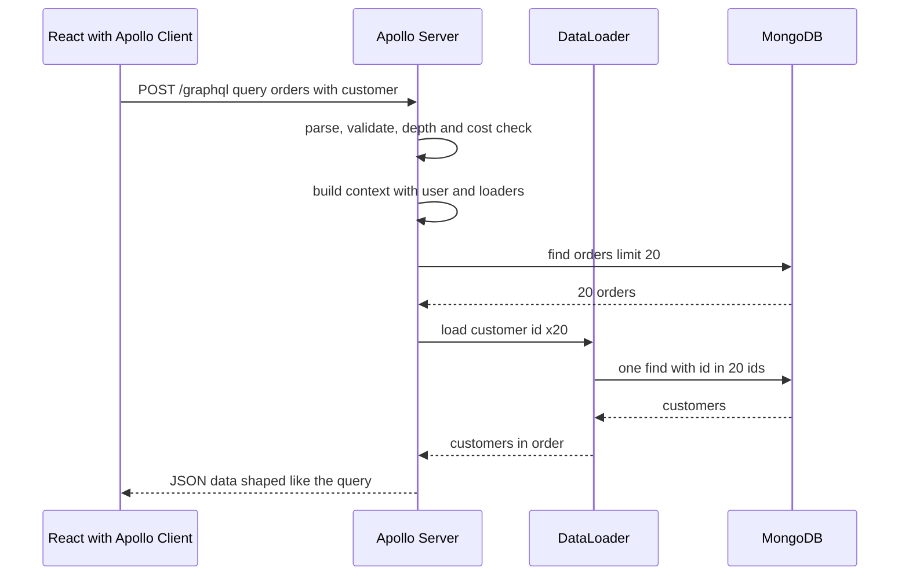

GraphQL lets a React screen ask for exactly the fields it needs across several resources in one round trip, which is why product teams love it. It also lets any client send a query that fans out into 10,000 database calls, bypasses HTTP caching by default, and moves authorization from routes into hundreds of field resolvers. Running it well on Node means designing the schema around client use cases, batching data access, and putting hard limits on what a single query may cost.

## How it works

The client sends one query document. Apollo Server parses and validates it against the schema, builds a per-request context, then walks the selection set, calling a resolver for every field. Resolvers that load related data go through DataLoader, which batches calls made in the same tick.



## Schema design

Design the schema from what screens need, not as a mirror of your Mongoose models. Use nullable fields by default for anything that can fail independently, non-null (`!`) for fields that are always present, and input types plus result unions for mutations.

```graphql
type Query {
  me: User
  order(id: ID!): Order
  orders(first: Int = 20, after: String, status: OrderStatus): OrderConnection!
}

type Order {
  id: ID!
  status: OrderStatus!
  totalCents: Int!
  customer: User!
  items: [OrderItem!]!
  createdAt: DateTime!
}

type Mutation {
  placeOrder(input: PlaceOrderInput!): PlaceOrderResult!
}

union PlaceOrderResult = Order | OutOfStockError | InvalidCouponError
```

Modeling expected failures as union members makes them part of the typed contract; reserve the top-level `errors` array for unexpected failures. Never remove fields; mark them `@deprecated(reason: "...")` and watch field usage metrics until traffic reaches zero. Generate TypeScript types for resolvers and client operations with GraphQL Code Generator.

## Resolvers and the N+1 problem

A naive `Order.customer` resolver runs `User.findById` once per order. A list of 20 orders becomes 21 queries; nest `items { product }` and it becomes hundreds. DataLoader collects every `load(id)` call made during one event loop tick and issues a single batched query.

```ts
import DataLoader from 'dataloader';

export const createLoaders = () => ({
  userById: new DataLoader<string, UserDoc | null>(async (ids) => {
    const users = await UserModel.find({ _id: { $in: ids } }).lean();
    const map = new Map(users.map((u) => [u._id.toString(), u]));
    return ids.map((id) => map.get(id) ?? null); // same order and length as ids
  }),
});

export const resolvers = {
  Order: {
    customer: (order, _args, ctx) => ctx.loaders.userById.load(order.userId.toString()),
  },
};
```

Create loaders per request, never globally. A global loader caches across users, leaks data between tenants and grows without bound.

## Auth in context

Authenticate once when building the context, then authorize in resolvers or, better, in the service layer they call.

```ts
import { ApolloServer } from '@apollo/server';
import { expressMiddleware } from '@as-integrations/express5';

const server = new ApolloServer({ typeDefs, resolvers, validationRules, plugins });
await server.start();

app.use('/graphql', express.json(), expressMiddleware(server, {
  context: async ({ req }) => ({
    user: await verifyAccessToken(req.headers.authorization),
    loaders: createLoaders(),
  }),
}));
```

Field-level checks such as "only admins see `User.email`" can be centralized with a schema directive or `graphql-shield`, but object-level checks ("can this user see this order") belong next to the data access, so the REST and GraphQL paths share them.

## Pagination with Relay connections

The Relay connection spec is the de facto standard: `first` and `after` arguments, `edges` with an opaque `cursor`, and `pageInfo { hasNextPage endCursor }`. Underneath, it is the same keyset pagination you would write for REST, sorted by `(createdAt, _id)` with a compound index. Apollo Client's `relayStylePagination()` field policy merges pages into the cache automatically for infinite scroll. Cap `first` at around 100 in the resolver.

## Depth and complexity limits

Without limits, a client can request `orders { customer { orders { customer { ... } } } }` ten levels deep. Defend in layers:

- **Depth limit**: reject queries deeper than 7 to 10 levels with `graphql-depth-limit`.
- **Cost analysis**: assign each field a cost and multiply list fields by `first`, using `graphql-query-complexity`. Reject anything over a budget, for example 1,000 points.
- **Pagination caps** on every list field, so cost is bounded.
- **Timeouts and rate limits** by cost per client, not by request count, since one request can be cheap or enormous.
- **Disable introspection** in production for private APIs, and turn off field suggestions in error messages.

## Persisted queries

With persisted queries, the client sends a SHA-256 hash instead of the full query text. Automatic persisted queries (APQ) register unknown hashes on first use, which shrinks request size but still accepts any query. A safelist, built at compile time from the client's operations, is stronger: the server executes only queries it already knows, which removes arbitrary-query attacks for first-party apps entirely. Apollo calls this a persisted query list.

## Caching

On the client, Apollo Client keeps a normalized cache keyed by `__typename` and `id`, so updating an `Order` from a mutation response updates every component showing that order without refetching. Define `keyFields` for types without an `id`, and use `cache.modify` or `refetchQueries` when a mutation adds items to a list.

On the server, POST requests are not cached by CDNs. Persisted queries sent as `GET /graphql?extensions={"persistedQuery":...}&variables=...` produce stable URLs that a CDN can cache. Apollo Server's `@cacheControl(maxAge: 60)` hints compute a `Cache-Control` header from the lowest `maxAge` across the fields in the response, and any field marked `scope: PRIVATE` stops shared caching. Public catalog queries can then be served from the edge in milliseconds.

## When REST is better

GraphQL is not a free upgrade. REST is usually the better choice for public APIs consumed by third parties, simple CRUD with one client, file uploads and downloads, webhooks, and anything that benefits heavily from plain HTTP caching. GraphQL pays off with several clients (web, iOS, Android) needing different shapes of the same data, deeply related data, and teams that iterate on UI faster than the backend can add endpoints. Federation (Apollo Federation or similar) helps at large scale but adds a router and schema governance you should not adopt early.

## Trade-offs and pitfalls

- **N+1 queries** are the default behavior; every relationship field needs a loader.
- **Errors return HTTP 200** with an `errors` array, so monitoring must inspect bodies, not status codes.
- **Authorization is spread across fields**; a forgotten check on one resolver leaks data.
- **Observability** needs per-operation and per-field tracing, since one endpoint serves everything.
- **Schema churn** is harder to undo than code; review schema changes like public API changes.

## Interview angle

- Explain the N+1 problem in resolvers and how DataLoader batches and caches per request.
- Describe how you stop expensive queries: depth limits, cost analysis, pagination caps and safelisted operations.
- Explain why GraphQL breaks HTTP caching and how GET persisted queries and cache hints restore it.

## Key takeaways

- Design the schema for client use cases and model expected errors as union types.
- Create DataLoaders per request for every relationship field.
- Authenticate in context; keep object-level authorization in shared services.
- Enforce depth, cost and pagination limits, and use a persisted query safelist for first-party clients.
- Use Apollo Client's normalized cache, and GET persisted queries with cache hints for CDN caching.
