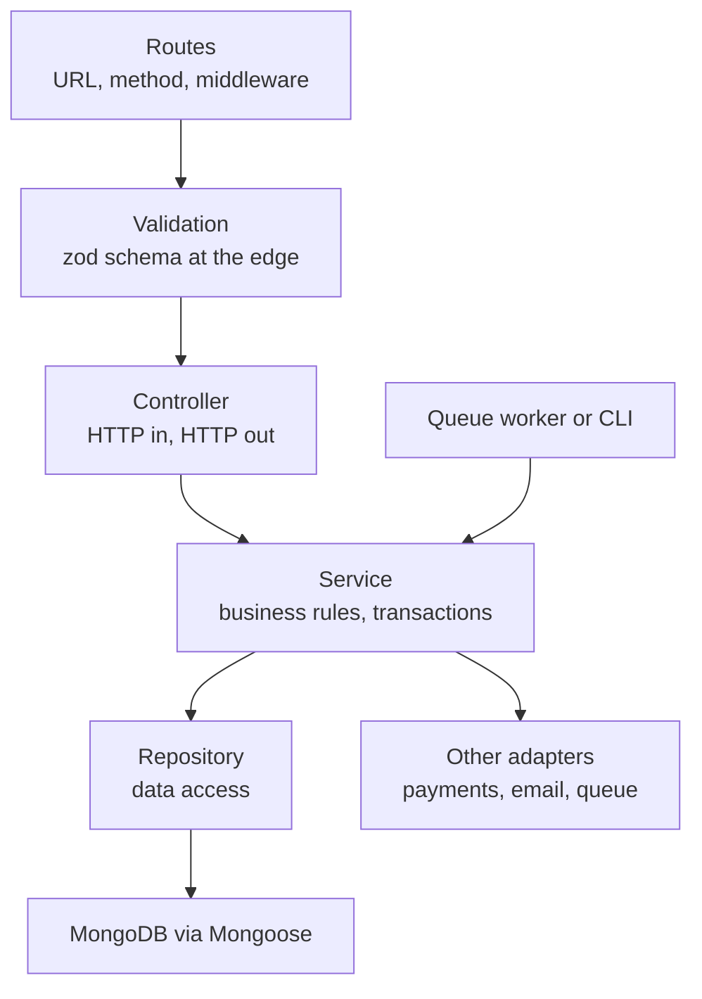

The typical Express tutorial puts the Mongoose query, the validation and the business rules inside the route callback. That works until the same "place order" logic is needed from a queue worker, a CLI and an admin endpoint, or until you try to unit test a rule without booting HTTP and a database. A layered structure gives each concern one home, keeps HTTP details out of business logic, and makes the code testable and replaceable piece by piece.

## How it works

Each layer only talks to the one below it and knows nothing about the ones above.



| Layer | Knows about | Must not know about |
| --- | --- | --- |
| Route | Express, middleware | Business rules |
| Controller | `req`, `res`, DTOs | Mongoose, SQL |
| Service | Domain rules, repositories via interfaces | `req`, `res`, status codes |
| Repository | Mongoose models, queries | HTTP, business rules |

The test of a good boundary: could a BullMQ worker call this service function directly? If the service needs `req`, the answer is no.

## Folder structure

Group by feature (vertical slices) rather than by technical type. A change to orders then touches one folder.

```text
src/
  app.ts                 # express app, global middleware
  server.ts              # listen, graceful shutdown
  container.ts           # wiring / composition root
  config/env.ts          # validated env vars
  http/errors.ts         # AppError, error handler
  modules/
    orders/
      order.routes.ts
      order.controller.ts
      order.service.ts
      order.repository.ts
      order.model.ts     # mongoose schema
      order.schemas.ts   # zod request schemas and DTO types
      order.service.test.ts
    users/
      ...
```

## Validation at the edge

Validate and coerce untrusted input once, before it reaches the controller. zod gives you runtime validation and the TypeScript type from one definition.

```ts
// order.schemas.ts
import { z } from 'zod';

export const createOrderBody = z.object({
  items: z.array(z.object({
    productId: z.string().regex(/^[a-f0-9]{24}$/),
    qty: z.number().int().min(1).max(100),
  })).min(1).max(50),
  couponCode: z.string().trim().max(32).optional(),
}).strict(); // reject unknown keys

export type CreateOrderInput = z.infer<typeof createOrderBody>;

// http/validate.ts
export const validate = (schema: z.ZodTypeAny) => (req, _res, next) => {
  const r = schema.safeParse(req.body);
  if (!r.success) return next(new AppError(400, 'VALIDATION', 'Invalid body', r.error.flatten()));
  req.body = r.data;
  next();
};
```

Joi works the same way; zod is more common in TypeScript codebases because of `z.infer`. Validation here is about shape. Business validation (is the coupon expired, is there stock) belongs in the service.

## DTOs

A DTO (data transfer object) is the shape that crosses a boundary. Input DTOs come from the schema above. Output DTOs stop you from leaking internal fields like `passwordHash`, `__v` or internal flags, and decouple your API from your schema.

```ts
export const toOrderDto = (o: OrderDoc) => ({
  id: o._id.toString(),
  status: o.status,
  totalCents: o.totalCents,
  items: o.items.map((i) => ({ productId: i.productId.toString(), qty: i.qty })),
  createdAt: o.createdAt.toISOString(),
});
```

## The layers in code

```ts
// order.repository.ts
export class OrderRepository {
  constructor(private model = OrderModel) {}
  create(data: NewOrder, session?: ClientSession) {
    return this.model.create([data], { session }).then(([d]) => d);
  }
  findByUser(userId: string, limit = 20) {
    return this.model.find({ userId }).sort({ createdAt: -1 }).limit(limit).lean();
  }
}

// order.service.ts
export class OrderService {
  constructor(
    private orders: OrderRepository,
    private products: ProductRepository,
    private queue: { add(name: string, data: unknown): Promise<unknown> },
  ) {}

  async placeOrder(userId: string, input: CreateOrderInput) {
    const prices = await this.products.priceMap(input.items.map((i) => i.productId));
    if (prices.size !== input.items.length) throw new AppError(422, 'UNKNOWN_PRODUCT', 'Product not found');
    const totalCents = input.items.reduce((s, i) => s + prices.get(i.productId)! * i.qty, 0);
    const order = await this.orders.create({ userId, items: input.items, totalCents, status: 'pending' });
    await this.queue.add('order-confirmation', { orderId: order.id });
    return order;
  }
}

// order.controller.ts
export const makeOrderController = (svc: OrderService) => ({
  create: async (req: Request, res: Response) => {
    const order = await svc.placeOrder(req.user.id, req.body);
    res.status(201).json(toOrderDto(order));
  },
});
```

Using `AppError` with a status in the service is a pragmatic compromise; purists throw domain errors (`ProductNotFoundError`) and map them in the error handler.

## Dependency injection

DI here just means passing dependencies in rather than importing singletons. A composition root wires everything once:

```ts
// container.ts
const orderRepo = new OrderRepository();
const productRepo = new ProductRepository();
const orderService = new OrderService(orderRepo, productRepo, emailQueue);
export const orderController = makeOrderController(orderService);
```

Manual wiring is enough for most apps. Containers like `awilix`, `tsyringe` or InversifyJS help when the graph gets large or you want request-scoped dependencies. NestJS bakes this whole structure in, if you prefer a framework.

## Testing each layer

- **Services**: unit tests with fake repositories. Fast, no DB, cover business rules.
- **Repositories**: integration tests against a real MongoDB (`mongodb-memory-server` or Testcontainers), since query correctness is the point.
- **Routes and controllers**: HTTP tests with `supertest` against the app, verifying status codes, validation errors and DTO shape.

```ts
test('rejects unknown product', async () => {
  const svc = new OrderService(fakeOrders, { priceMap: async () => new Map() } as any, fakeQueue);
  await expect(svc.placeOrder('u1', { items: [{ productId: 'a'.repeat(24), qty: 1 }] }))
    .rejects.toMatchObject({ code: 'UNKNOWN_PRODUCT' });
});
```

## Trade-offs and pitfalls

- **Over-layering**: a pass-through service that only calls `repo.findById` adds files without value. Start with layers where logic exists.
- **Leaking Mongoose documents** out of repositories couples services to Mongoose. Return `.lean()` objects or plain types.
- **Anemic services** that just shuffle data while rules live in controllers defeat the point.
- **Transactions** span repositories; let the service own the session and pass it down.
- **Generic repository base classes** often fight Mongoose features. Write the queries you need.

## Interview angle

- Explain why business logic must not depend on HTTP: reuse from workers, testability, swapping transports.
- When asked about input validation, distinguish shape validation at the edge from business validation in the service.
- Connect layering to scaling teams: feature folders let teams own modules, a step toward extracting services later.

## Key takeaways

- Routes and controllers handle HTTP; services hold rules; repositories hold queries.
- Validate shape at the edge with zod or Joi and return explicit output DTOs.
- Inject dependencies through constructors and wire them in one composition root.
- Unit test services with fakes, integration test repositories and HTTP separately.
