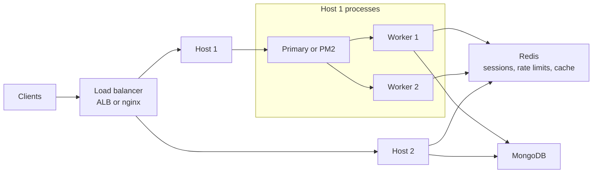
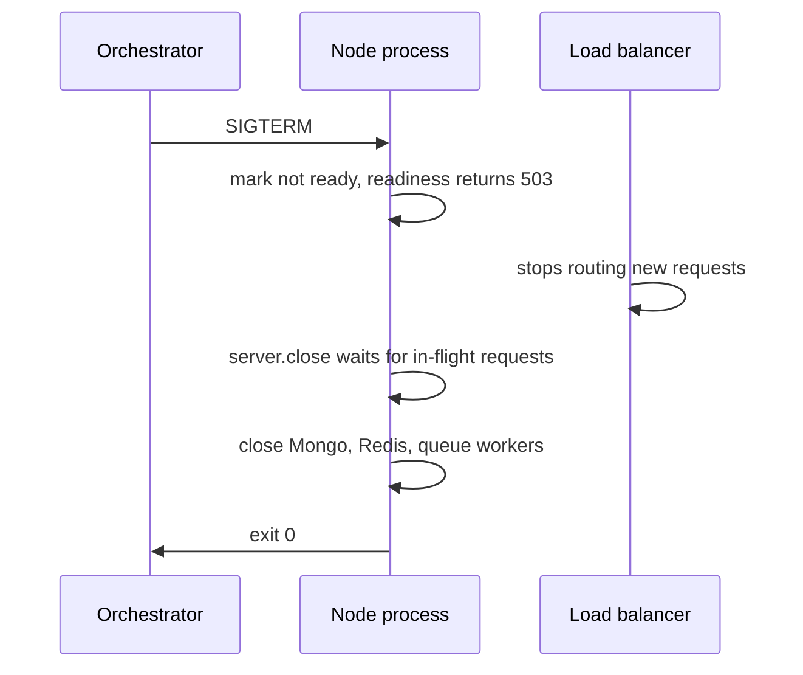

One Node.js process runs your JavaScript on one core. On an 8-core VM, a single `node server.js` leaves seven cores idle, and one deploy or crash takes the whole API offline. Scaling Node is a layered problem: use all cores on a machine, keep CPU-heavy work off the request thread, run many machines behind a load balancer, and make sure processes can come and go without dropping requests.

## How it works



Two levels of scaling coexist. Inside a host, several Node processes share a port. Across hosts, a load balancer spreads traffic. Both only work if processes are stateless: anything that must survive between requests lives in Redis or MongoDB, not in process memory.

## Using every core: cluster and PM2

The built-in `cluster` module forks worker processes that share a listening socket. On Linux the primary accepts connections and hands them out round-robin by default.

```ts
import cluster from 'node:cluster';
import { availableParallelism } from 'node:os';

if (cluster.isPrimary) {
  const n = availableParallelism();
  for (let i = 0; i < n; i++) cluster.fork();
  cluster.on('exit', (worker, code) => {
    console.error(`worker ${worker.process.pid} exited ${code}, restarting`);
    cluster.fork();
  });
} else {
  await import('./server.js');
}
```

In practice most teams let PM2 do this, since it adds restarts, zero-downtime reloads and log handling:

```js
// ecosystem.config.cjs
module.exports = {
  apps: [{
    name: 'api',
    script: 'dist/server.js',
    instances: 'max',          // one per core
    exec_mode: 'cluster',
    max_memory_restart: '512M',
    kill_timeout: 10000,       // ms to wait after SIGINT before SIGKILL
    wait_ready: true,          // wait for process.send('ready')
    listen_timeout: 8000,
  }],
};
```

`pm2 reload api` restarts workers one at a time, so capacity never drops to zero.

**In Kubernetes, skip both.** Run one Node process per container and let the orchestrator scale replicas. Clustering inside a pod hides crashes from health checks and makes CPU limits confusing.

## CPU work: worker threads

Cluster gives you more event loops, but a 2-second PDF render still blocks whichever worker runs it. `worker_threads` run JavaScript on separate threads with their own V8 isolate, inside the same process. Use a pool rather than spawning per request, since starting a worker costs tens of milliseconds and memory.

```ts
// main
import Piscina from 'piscina';
const pool = new Piscina({ filename: new URL('./resize.worker.js', import.meta.url).href });

app.post('/thumbnail', async (req, res) => {
  const out = await pool.run({ key: req.body.key, width: 320 });
  res.json(out);
});
```

For work that can take longer than a request should wait, prefer a job queue (see the BullMQ guide later in this series).

## Horizontal scaling and statelessness

Behind a load balancer, request N+1 from a user may hit a different process. Things that break:

| In-memory state | Move it to |
| --- | --- |
| `express-session` MemoryStore | `connect-redis` or JWTs |
| Rate limit counters | Redis store |
| Local cache Map | Redis, or accept per-node caches with short TTL |
| Uploaded files on local disk | S3 |
| Socket.IO rooms | `@socket.io/redis-adapter` |
| `setInterval` cron jobs | One scheduler, e.g. repeatable BullMQ jobs |

**Sticky sessions** (the LB pins a client to one backend via a cookie) are a workaround, not a design. They cause uneven load, and when that instance dies the user loses state anyway. The legitimate use is Socket.IO with HTTP long-polling fallback, where the handshake requests must reach the same process.

## Graceful shutdown

Deploys, autoscaling and Kubernetes evictions send `SIGTERM`, then `SIGKILL` after a grace period (30 s default in Kubernetes). Without a handler, in-flight requests die mid-response.



```ts
import { createServer } from 'node:http';
import mongoose from 'mongoose';

const server = createServer(app).listen(3000);
server.keepAliveTimeout = 65_000; // longer than ALB idle timeout of 60 s
let shuttingDown = false;

app.get('/readyz', (_req, res) => res.sendStatus(shuttingDown ? 503 : 200));

async function shutdown(signal: string) {
  if (shuttingDown) return;
  shuttingDown = true;
  console.log(`${signal} received, draining`);
  setTimeout(() => process.exit(1), 25_000).unref(); // hard deadline
  await new Promise((r) => setTimeout(r, 5_000));    // let LB notice readiness
  server.close(async () => {
    await mongoose.connection.close();
    await redis.quit();
    process.exit(0);
  });
  server.closeIdleConnections(); // Node 18.2+
}
process.on('SIGTERM', () => shutdown('SIGTERM'));
process.on('SIGINT', () => shutdown('SIGINT'));
```

`server.close()` stops accepting new connections but waits for existing ones, including idle keep-alive sockets, which is why `closeIdleConnections()` (or `closeAllConnections()` at the deadline) matters. In Docker, run Node as PID 1 with `CMD ["node", "dist/server.js"]` rather than `npm start`, because npm may not forward signals.

## Trade-offs and pitfalls

- **Cluster workers share nothing.** An in-memory cache is duplicated per worker and diverges.
- **More processes means more DB connections.** 8 workers x 10 hosts x a Mongoose `maxPoolSize` of 100 is 8,000 potential connections. Size pools deliberately.
- **Worker threads do not help I/O-bound code**; the event loop already handles that.
- **Keep-alive mismatch**: if Node's `keepAliveTimeout` (5 s default) is shorter than the LB idle timeout, you get sporadic 502s.
- **Crash loops**: auto-restart hides bugs; alert on restart counts.

## Interview angle

- "How do you scale a Node API to 10x traffic?" Walk the layers: stateless processes, one per core or per container, LB, externalized state in Redis, then DB scaling.
- Be ready to argue against sticky sessions and explain where they are acceptable.
- Mention graceful shutdown and readiness probes when discussing zero-downtime deploys.
- Distinguish cluster (more event loops for I/O) from worker threads (parallel CPU) from queues (deferred work).

## Key takeaways

- Use cluster or PM2 on VMs, one process per container on Kubernetes.
- Offload CPU work to a worker pool or a queue, never the request thread.
- Statelessness is the prerequisite for horizontal scaling; push state to Redis, Mongo and S3.
- Handle SIGTERM: fail readiness, drain with `server.close`, close clients, exit before the deadline.
