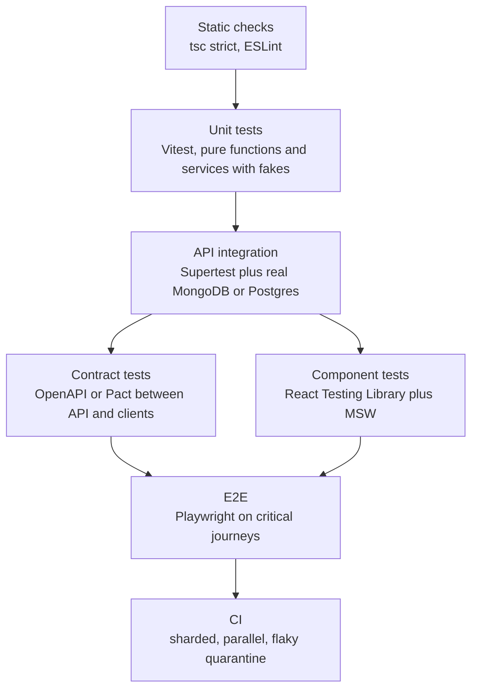

Most MERN codebases end up with one of two broken test suites. Either there are hundreds of unit tests that mock Mongoose so heavily they pass while production queries fail, or there is a slow pile of browser tests that flake every third run until people stop reading the results. A good strategy puts each kind of test where it gives the most confidence per second of CI time, runs against real infrastructure where correctness depends on it, and treats flakiness as a bug.

## How it works

The classic testing pyramid says many unit tests, fewer integration tests, very few end-to-end tests. Kent C. Dodds' testing trophy shifts the weight toward integration tests, because in a typical CRUD API most bugs live at boundaries: a wrong query filter, a missing index, a middleware order mistake, a field the DTO forgot. For a MERN app a sensible split by count is roughly 50% integration, 35% unit, 10% component, and 5% E2E, with static analysis (TypeScript strict mode, ESLint) as the free base layer.



| Layer | Runtime per test | What it catches | What it misses |
| --- | --- | --- | --- |
| Unit | 1 to 5 ms | Business rule mistakes, edge cases | Query and wiring bugs |
| Integration | 20 to 200 ms | Queries, validation, auth, status codes | Browser behavior |
| Component | 10 to 100 ms | Rendering, interaction, form logic | Real API contract drift |
| E2E | 2 to 30 s | Whole journeys, deploy config | Fine-grained edge cases |

## Unit tests with Vitest

Vitest is the 2026 default for new TypeScript projects: native ESM, Vite's config, Jest-compatible `expect`, and a fast watch mode. Jest 30 is fine in existing codebases. Unit test pure functions and services with injected fakes, not mocked Mongoose models.

```ts
import { describe, it, expect } from 'vitest';
import { priceCart } from './pricing';

describe('priceCart', () => {
  it('applies percentage coupon after line totals', () => {
    const total = priceCart([{ priceCents: 1000, qty: 3 }], { type: 'percent', value: 10 });
    expect(total).toBe(2700);
  });
  it('never goes below zero', () => {
    expect(priceCart([{ priceCents: 500, qty: 1 }], { type: 'fixed', value: 900 })).toBe(0);
  });
});
```

If a unit test needs five mocks to run, the code under test is doing too much or the test belongs one layer up.

## Integration tests against a real database

Mocking the database hides the bugs you most need to catch. Spin up a real one instead. For MongoDB, `mongodb-memory-server` downloads a real `mongod` binary and starts it in about one second; start it as a replica set if your code uses transactions or change streams. For Postgres, Testcontainers starts a Docker container per test run, and you apply real migrations against it.

```ts
// test/setup.ts
import { MongoMemoryReplSet } from 'mongodb-memory-server';
import mongoose from 'mongoose';

let mongo: MongoMemoryReplSet;
beforeAll(async () => {
  mongo = await MongoMemoryReplSet.create({ replSet: { count: 1 } });
  await mongoose.connect(mongo.getUri(), { dbName: `test_${process.env.VITEST_POOL_ID}` });
});
afterEach(async () => {
  const cols = await mongoose.connection.db!.collections();
  await Promise.all(cols.map((c) => c.deleteMany({})));
});
afterAll(async () => { await mongoose.disconnect(); await mongo.stop(); });
```

```ts
// orders.http.test.ts
import request from 'supertest';
import { buildApp } from '../src/app';
import { userFactory, authHeader } from './factories';

it('creates an order and hides internal fields', async () => {
  const user = await userFactory.create();
  const res = await request(buildApp())
    .post('/api/orders')
    .set(authHeader(user))
    .send({ items: [{ productId: (await productFactory.create()).id, qty: 2 }] })
    .expect(201);
  expect(res.body).toMatchObject({ status: 'pending', totalCents: expect.any(Number) });
  expect(res.body).not.toHaveProperty('__v');
});
```

Export a `buildApp()` function that returns the Express app without calling `listen`, so Supertest can bind an ephemeral port. Give each Vitest worker its own database name so parallel files never collide. For Postgres, wrapping each test in a transaction that rolls back is faster than truncating tables, typically under 5 ms of cleanup versus 30 to 50 ms.

## Contract tests

A server integration test proves the server works, not that clients agree with it. Either validate every Supertest response against your OpenAPI document, or use consumer-driven contracts with Pact, where each client publishes the interactions it relies on and the API's CI verifies them. Pact pays off when separate teams deploy independently; in one monorepo, shared zod schemas often remove the need.

## Component tests with React Testing Library

Test components the way users use them: query by role and label, interact with `user-event`, and assert on visible output. Mock the network, not your own hooks, using Mock Service Worker so the component runs its real fetching code.

```tsx
import { render, screen } from '@testing-library/react';
import userEvent from '@testing-library/user-event';
import { http, HttpResponse } from 'msw';
import { server } from '../test/msw';

it('shows a validation error from the API', async () => {
  server.use(http.post('/api/orders', () =>
    HttpResponse.json({ title: 'Invalid body', errors: { qty: ['Too large'] } }, { status: 400 })));
  render(<CheckoutForm />);
  await userEvent.type(screen.getByLabelText(/quantity/i), '500');
  await userEvent.click(screen.getByRole('button', { name: /place order/i }));
  expect(await screen.findByText(/too large/i)).toBeInTheDocument();
});
```

Run these under Vitest with `jsdom` or `happy-dom`. For components that depend on real layout or browser APIs, Vitest browser mode with Playwright as the provider runs them in a real Chromium.

## E2E with Playwright

Keep E2E for the five to fifteen journeys that make money or lose trust: sign up, log in, checkout, password reset, the core create flow. Playwright's auto-waiting locators, isolated browser contexts and trace viewer make it the standard choice. Log in once in a setup project and reuse `storageState` instead of driving the login form in every test, and seed data through the API rather than clicking through the UI.

```ts
test('checkout happy path', async ({ page, request }) => {
  const product = await (await request.post('/test-api/products', { data: { priceCents: 1999 } })).json();
  await page.goto(`/products/${product.id}`);
  await page.getByRole('button', { name: 'Add to cart' }).click();
  await page.getByRole('link', { name: 'Checkout' }).click();
  await expect(page.getByRole('heading', { name: 'Order confirmed' })).toBeVisible();
});
```

## Test data and factories

Hard-coded fixtures rot. Factories build valid objects with defaults and let each test override only what it cares about; `fishery` or a small builder with `@faker-js/faker` is enough. Seed faker for reproducible failures, and never share mutable records between tests, or they fail randomly once parallelized.

## CI parallelism

Vitest runs files in parallel worker threads by default. Playwright supports `--shard=1/4` to split across CI machines; a 12-minute suite on one runner becomes about 3.5 minutes on four, plus a merge step for the HTML report. Run E2E on pull requests and before deploy, and cache the `mongodb-memory-server` binary and Playwright browsers between runs.

## Trade-offs and pitfalls

- **Flaky tests** usually come from shared state, fixed `sleep` calls, time and timezone dependence, or unawaited promises. Use fake timers, fixed clocks and web-first assertions. Track flake rate, quarantine a flaky test within a day, and fix or delete it within a week.
- **Retries hide bugs**. Playwright `retries: 2` in CI is reasonable, but report tests that passed only on retry.
- **Coverage targets** become a game. 80% line coverage with no assertions is worthless; aim for coverage of risky code, and look at mutation testing (Stryker) for critical modules.
- **Over-mocking** makes tests pass against your assumptions instead of reality.

## Interview angle

- Explain why you would trade some unit tests for integration tests against a real database in a CRUD-heavy API.
- Describe how you keep a suite fast as it grows: per-worker databases, transaction rollback, sharding, and running E2E only on critical paths.
- Show you treat flakiness as an operational metric with an owner, not background noise.

## Key takeaways

- Weight the suite toward integration tests with Supertest and a real MongoDB or Postgres.
- Unit test pure logic with Vitest; component test with React Testing Library and MSW.
- Reserve Playwright for a small set of critical journeys, seeded through the API.
- Use factories, per-worker isolation and CI sharding to keep tests fast and independent.
- Quarantine and fix flaky tests quickly, or the whole suite loses its value.
