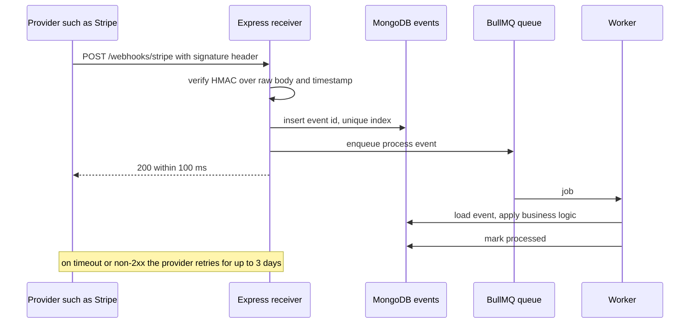

A webhook is an HTTP POST one system sends to another when something happens: Stripe tells you a payment succeeded, GitHub tells you a branch was pushed, your SaaS tells a customer's server that an invoice was paid. It looks like an ordinary endpoint, but it is a distributed systems problem in disguise. Deliveries arrive late, twice, out of order, or from an attacker pretending to be Stripe. On the sending side, customer endpoints time out, return 500 for days, or point at your own internal network.

## How it works

Both sides follow the same principle: separate the network handshake from the work. The receiver verifies, records and acknowledges in milliseconds, then processes asynchronously. The sender writes an event to durable storage first, then a worker delivers it with retries.



## Receiving: verify the signature on the raw body

Providers sign the exact bytes they sent with a shared secret using HMAC-SHA256. If `express.json()` parses the body first, re-serializing it changes whitespace and key order and the signature never matches. Mount a raw body parser on the webhook route before the global JSON parser.

```ts
import express from 'express';
import Stripe from 'stripe';

const stripe = new Stripe(process.env.STRIPE_SECRET_KEY!);
const app = express();

app.post('/webhooks/stripe', express.raw({ type: 'application/json', limit: '1mb' }), async (req, res) => {
  let event: Stripe.Event;
  try {
    event = stripe.webhooks.constructEvent(
      req.body,                          // Buffer, untouched
      req.get('stripe-signature')!,
      process.env.STRIPE_WEBHOOK_SECRET!,
      300,                               // tolerance in seconds
    );
  } catch {
    return res.status(400).send('bad signature');
  }
  await recordAndEnqueue('stripe', event.id, event.type, event);
  res.sendStatus(200);
});

app.use(express.json()); // everything else
```

For providers without an SDK, verify yourself. Compute the HMAC over the signed payload (often `timestamp + "." + body`), and compare with `crypto.timingSafeEqual`, never `===`, which leaks timing information.

```ts
import { createHmac, timingSafeEqual } from 'node:crypto';

export function verify(raw: Buffer, ts: string, sig: string, secret: string) {
  if (Math.abs(Date.now() / 1000 - Number(ts)) > 300) return false; // replay window
  const expected = createHmac('sha256', secret).update(`${ts}.`).update(raw).digest();
  const given = Buffer.from(sig, 'hex');
  return given.length === expected.length && timingSafeEqual(given, expected);
}
```

The timestamp tolerance, typically 5 minutes, stops an attacker from replaying a captured valid request later. Because the timestamp is inside the signed payload, it cannot be changed without invalidating the signature. Support two active secrets during rotation.

## Respond fast, then queue

Stripe expects a 2xx within about 10 seconds, GitHub within 10, and many providers less. If you call three APIs and send an email inside the handler, a slow dependency causes a timeout, the provider retries, and now you process the event twice while still slow. Do the minimum synchronously: verify, persist, enqueue, return 200. Return 2xx even for event types you ignore, or the provider will keep retrying them. Return 4xx only for bad signatures, and 5xx only if you could not persist the event, so the provider retries.

## Idempotency by event ID

Every serious provider delivers at least once, so duplicates are normal. Deduplicate on the provider's event ID with a unique index.

```ts
// WebhookEvent schema: { provider, eventId, type, payload, status, receivedAt }
// index: { provider: 1, eventId: 1 }, { unique: true }
async function recordAndEnqueue(provider: string, eventId: string, type: string, payload: unknown) {
  try {
    await WebhookEvent.create({ provider, eventId, type, payload, status: 'pending' });
  } catch (e: any) {
    if (e.code === 11000) return; // duplicate delivery, already recorded
    throw e;
  }
  await webhookQueue.add('process', { provider, eventId }, { jobId: `${provider}:${eventId}` });
}
```

Make the worker idempotent too, since a job can crash after the side effect but before marking the event processed. Use conditional updates such as `updateOne({ _id, status: 'pending' }, { status: 'paid' })` so a second run is a no-op. Add a TTL index to drop stored events after 30 to 90 days.

## Ordering

Webhooks are not ordered. `invoice.paid` can arrive before `invoice.created`, and a retried `subscription.updated` from an hour ago can arrive after a newer one. Two defenses: compare a version or timestamp on the resource and ignore events older than what you have stored, or treat the webhook as a notification only and fetch the current state from the provider's API (`stripe.subscriptions.retrieve(id)`). The fetch approach costs an API call but is always correct.

## Sending webhooks

When your platform sends webhooks, you take on the provider's job. The Standard Webhooks specification, used by several large providers, is a good default format: `webhook-id`, `webhook-timestamp` and `webhook-signature` headers, with an HMAC over `id.timestamp.body`.

1. **Outbox first**: in the same transaction as the business change, write an event row. A worker reads it and creates one delivery per subscribed endpoint. This avoids sending a webhook for a change that rolled back.
2. **Sign** every request with a per-endpoint secret shown once to the customer.
3. **Short timeouts**: 5 to 10 seconds, no following redirects.
4. **Retry with exponential backoff and jitter** on network errors, 5xx and 429, for example at 1 minute, 5 minutes, 30 minutes, 2 hours, 6 hours, then every 12 hours up to 3 days. Do not retry most 4xx.
5. **Delivery log**: store status code, latency, response snippet and attempt count per delivery, and show it in a dashboard with a manual redeliver button.
6. **Disable bad endpoints**: after, say, 3 days of continuous failures, mark the endpoint disabled and email the owner, so one dead endpoint does not consume your worker capacity forever.

```ts
new Worker('webhook-delivery', async (job) => {
  const d = await Delivery.findById(job.data.deliveryId).populate('endpoint');
  const body = JSON.stringify(d.payload);
  const ts = Math.floor(Date.now() / 1000).toString();
  const sig = createHmac('sha256', d.endpoint.secret).update(`${d.id}.${ts}.${body}`).digest('base64');
  await assertPublicUrl(d.endpoint.url);
  const res = await fetch(d.endpoint.url, {
    method: 'POST', body, redirect: 'manual', signal: AbortSignal.timeout(8000),
    headers: { 'content-type': 'application/json', 'webhook-id': d.id, 'webhook-timestamp': ts, 'webhook-signature': `v1,${sig}` },
  });
  await d.recordAttempt(res.status);
  if (res.status >= 500 || res.status === 429) throw new Error(`retryable ${res.status}`);
}, { connection, concurrency: 50 });
```

Configure the queue with `attempts: 10` and a custom backoff strategy, and keep per-endpoint concurrency low so one slow customer cannot starve the others.

## SSRF protection

Customers choose the URL, so an attacker can register `http://169.254.169.254/latest/meta-data/` or `http://localhost:6379` and use your worker to reach internal services. Validate at registration and again at send time: require HTTPS, resolve DNS and reject private, loopback, link-local and cloud metadata ranges (10/8, 172.16/12, 192.168/16, 127/8, 169.254/16, fc00::/7, ::1), and connect to the IP you checked to defeat DNS rebinding. The safest option is to send from an egress proxy such as Smokescreen in an isolated network with no route to internal systems.

## Trade-offs and pitfalls

- **Parsing JSON before verification** breaks every signature check. Raw body on that route only.
- **Doing work in the handler** causes timeouts, retries and duplicate processing.
- **Trusting event order** corrupts state; use versions or refetch.
- **Unbounded retries** to dead endpoints waste capacity and fill logs.
- **Webhooks are a hint, not a ledger**: run a periodic reconciliation job against the provider's API to catch missed events.

## Interview angle

- Explain why signatures must be computed over raw bytes and why timestamps prevent replay.
- Walk through at-least-once delivery and how a unique index on event ID makes processing idempotent.
- For the sending side, describe the outbox, backoff schedule, endpoint disabling and SSRF defenses.

## Key takeaways

- Verify HMAC on the raw body with constant-time comparison and a 5-minute timestamp window.
- Persist, enqueue and return 2xx in milliseconds; process in a worker.
- Deduplicate by event ID and design for out-of-order delivery.
- When sending, sign, retry with backoff, log every attempt, and disable endpoints that keep failing.
- Treat customer-supplied URLs as hostile and block internal network access.
