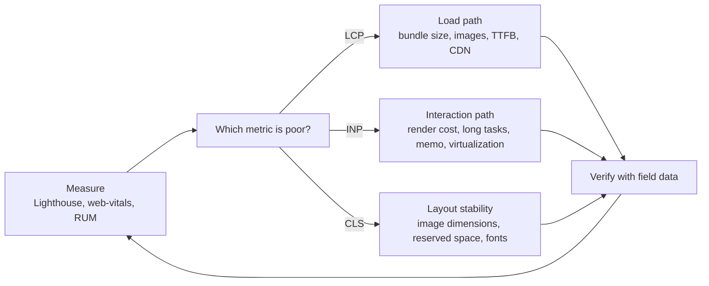

A MERN app that felt instant on a developer laptop often feels sluggish on a real user's mid-range Android phone over 4G. The causes are predictable: too much JavaScript to download and parse, too much rendering work per interaction, unoptimized images, and assets that are re-downloaded on every visit. This guide covers the fixes in roughly the order they pay off, and how to measure them with Core Web Vitals.

## How it works

Performance work is a loop: measure in the field, find the dominant cost, fix it, verify. The dominant cost usually falls into one of three buckets, each mapping to a vital.



| Metric | Measures | Good threshold (75th percentile) |
|---|---|---|
| LCP, Largest Contentful Paint | When the main content renders | 2.5 s or less |
| INP, Interaction to Next Paint | Latency from input to next frame | 200 ms or less |
| CLS, Cumulative Layout Shift | Unexpected movement of content | 0.1 or less |

INP replaced FID as a Core Web Vital in 2024. Collect field data, not only Lighthouse lab scores:

```js
import { onLCP, onINP, onCLS } from 'web-vitals';

function send(metric) {
  navigator.sendBeacon('/api/vitals', JSON.stringify({
    name: metric.name, value: metric.value, id: metric.id, page: location.pathname,
  }));
}
onLCP(send); onINP(send); onCLS(send);
```

On the Express side, store these in a MongoDB time series collection and chart the p75 per route.

## Code splitting with React.lazy

Every route should not ship in one bundle. Split at route boundaries first, then for heavy widgets (rich text editors, charts, maps) that most users never open.

```jsx
import { lazy, Suspense } from 'react';

const AdminDashboard = lazy(() => import('./pages/AdminDashboard'));
const ChartPanel = lazy(() => import('./components/ChartPanel'));

<Route path="/admin" element={
  <Suspense fallback={<PageSkeleton />}><AdminDashboard /></Suspense>
} />
```

Prefetch likely next routes on hover or idle so the split does not add latency: call the same `import('./pages/AdminDashboard')` in an `onMouseEnter` handler; the bundler dedupes the request.

## Bundle analysis

You cannot fix what you cannot see. With Vite, add `rollup-plugin-visualizer`; with webpack, `webpack-bundle-analyzer`.

```js
// vite.config.js
import { visualizer } from 'rollup-plugin-visualizer';

export default {
  plugins: [react(), visualizer({ filename: 'stats.html', gzipSize: true })],
  build: {
    rollupOptions: {
      output: { manualChunks: { react: ['react', 'react-dom'], charts: ['recharts'] } },
    },
  },
};
```

Typical wins: replacing `moment` with `date-fns` or `Intl`, importing `lodash-es` functions individually, removing a full icon library import, and making sure server-only packages never reach the client. Set a budget, for example 170 KB of compressed JS on the critical path, and fail CI when it is exceeded.

## Memoization, and when it does not help

`React.memo`, `useMemo` and `useCallback` all trade memory and comparison cost for skipped work. They help only when the skipped work is meaningful and the inputs are actually stable.

```jsx
const ProductRow = memo(function ProductRow({ product, onSelect }) {
  return <li onClick={() => onSelect(product._id)}>{product.name}</li>;
});

function ProductList({ products, filter }) {
  const visible = useMemo(
    () => products.filter((p) => p.name.toLowerCase().includes(filter)),
    [products, filter],
  );
  const onSelect = useCallback((id) => navigate(`/p/${id}`), [navigate]);
  return <ul>{visible.map((p) => <ProductRow key={p._id} product={p} onSelect={onSelect} />)}</ul>;
}
```

Memoization does not help when:

- A prop is a new object, array or inline function every render, which defeats `memo` entirely. `useCallback` is only useful when the receiving component is memoized or the function is an effect dependency.
- The component is cheap. Comparing props can cost as much as rendering.
- The slowness is in a single expensive render, not repeated renders. Then you need less work per render, virtualization or a transition.
- State lives too high. Moving state down to where it is used is usually a better fix than wrapping siblings in `memo`.

The React Compiler, when enabled, inserts memoization automatically, which reduces the need for manual `useMemo` and `useCallback`. Use the React DevTools Profiler with "Highlight updates" to confirm a fix.

## List virtualization

Rendering 10,000 order rows creates 10,000 DOM subtrees, which hurts memory, layout and INP. Virtualization renders only the visible rows plus a small overscan.

```jsx
import { useVirtualizer } from '@tanstack/react-virtual';

function OrderTable({ orders }) {
  const parentRef = useRef(null);
  const v = useVirtualizer({
    count: orders.length,
    getScrollElement: () => parentRef.current,
    estimateSize: () => 48,
    overscan: 8,
  });
  return (
    <div ref={parentRef} style={{ height: 600, overflow: 'auto' }}>
      <div style={{ height: v.getTotalSize(), position: 'relative' }}>
        {v.getVirtualItems().map((row) => (
          <div key={orders[row.index]._id}
               style={{ position: 'absolute', top: 0, height: row.size, width: '100%',
                        transform: `translateY(${row.start}px)` }}>
            <OrderRow order={orders[row.index]} />
          </div>
        ))}
      </div>
    </div>
  );
}
```

Pair it with cursor-based pagination on the API (`find({ _id: { $lt: lastId } }).sort({ _id: -1 }).limit(50)`) so you are not loading all rows either.

## Images

Images are often the LCP element and the largest bytes on the page.

```html


```

Serve AVIF or WebP, size images to the layout, always set `width` and `height` (prevents CLS), lazy-load below-the-fold images, and never lazy-load the LCP image. In Next.js, `next/image` handles most of this.

## Caching static assets with hashed filenames

Vite and webpack emit names like `assets/index-3f9a1c2b.js`, where the hash changes when content changes. That lets you cache assets forever and still deploy instantly.

```nginx
location /assets/ {
  add_header Cache-Control "public, max-age=31536000, immutable";
}
location = /index.html {
  add_header Cache-Control "no-cache";
}
```

`index.html` must be revalidated on each load because it references the current hashes. Keep the previous deploy's assets available for a while so users with an old `index.html` do not get 404s on lazy chunks.

## Trade-offs and pitfalls

- **Optimizing by lab score alone.** Lighthouse runs on one simulated device; real users differ. Use field data for decisions.
- **Over-splitting.** Dozens of tiny chunks add request overhead and waterfalls. Split by route and by heavy feature.
- **Memo everywhere.** Adds complexity and often no benefit if props are unstable.
- **Caching index.html long-term.** Users get stuck on old code until the cache expires.
- **Third-party scripts.** Analytics and chat widgets frequently dominate main-thread time. Load them deferred or after interaction.

## Interview angle

- Describe a measurement-first approach: field Core Web Vitals, then target the poor metric.
- Explain content hashing plus `immutable` caching, and why `index.html` is treated differently.
- For "a table with 50,000 rows is slow", combine server pagination, virtualization and memoized rows.
- Know concrete thresholds for LCP, INP and CLS.

## Key takeaways

- Measure field vitals first; LCP, INP and CLS point to different fixes.
- Split code by route and heavy feature, and keep a bundle budget in CI.
- Memoization helps only with stable inputs and expensive work; moving state down often helps more.
- Virtualize long lists and paginate on the server.
- Hashed assets get one-year immutable caching; HTML is always revalidated.
