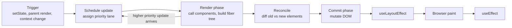

Most React performance bugs, stale UI glitches and "why did my effect run twice?" questions come from a fuzzy mental model of what rendering actually is. In React, "render" does not mean "update the DOM". It means "call your component function to compute what the UI should look like". Whether the DOM changes at all is a separate step. Once you separate those two phases, re-renders, keys, memoization and concurrent features all start to make sense.

## How it works

React work happens in two phases:

- **Render phase**: React calls component functions, which return a new element tree. It diffs that tree against the previous one (reconciliation) and records a list of changes. This phase is pure and, in concurrent mode, interruptible. React may run it, throw the result away and run it again.
- **Commit phase**: React applies the recorded changes to the DOM in one synchronous pass, then runs layout effects (`useLayoutEffect`), lets the browser paint, and afterwards runs passive effects (`useEffect`).



### Fiber

Since React 16, each component instance is backed by a **fiber**: a plain object holding the component type, props, state (the hooks linked list), a pointer to the DOM node, and links to child, sibling and parent. React keeps two trees, `current` (what is on screen) and `workInProgress` (what is being built). Because work is broken into per-fiber units, React can pause after any fiber, yield to the browser, and resume. This is what makes concurrent rendering possible. At commit, React swaps the pointers so the work-in-progress tree becomes current.

### Reconciliation and keys

A full tree diff is O(n^3), so React uses two heuristics to make it O(n):

1. Elements of different types produce different trees. If `<div>` becomes `<section>`, or `<UserCard>` becomes `<AdminCard>`, React unmounts the old subtree (losing its state) and mounts a fresh one.
2. Among siblings, the `key` prop identifies which child is which across renders.

```jsx
// Bad: index keys. Deleting the first todo shifts every index,
// so React reuses the wrong component state and input values.
{todos.map((t, i) => <TodoRow key={i} todo={t} />)}

// Good: stable identity from the data, e.g. the MongoDB _id
{todos.map((t) => <TodoRow key={t._id} todo={t} />)}
```

Keys are also a tool. Changing a key forces a remount, which is the cleanest way to reset a form when the selected record changes: `<EditUser key={user._id} user={user} />`.

## What triggers a re-render

A component re-renders when:

- Its own state changes via a `useState` setter or `useReducer` dispatch (React bails out if the new value is `Object.is` equal to the old one).
- Its parent re-renders. This is the big one. By default every child re-renders, **whether or not its props changed**. `React.memo` opts out of this.
- A context it consumes via `useContext` gets a new value.
- An external store it subscribes to with `useSyncExternalStore` changes (this is how Redux and Zustand hooks work).

Props changing is not itself a trigger. Props only change because a parent rendered.

```jsx
function Parent() {
  const [count, setCount] = useState(0);
  // A new object every render, so a memoized child still re-renders
  const style = { color: 'red' };
  return (
    <>
      <button onClick={() => setCount(c => c + 1)}>{count}</button>
      <ExpensiveChild style={style} />
    </>
  );
}
```

## Batching

React 18 introduced **automatic batching**: multiple state updates in the same tick are combined into a single render, no matter where they happen (event handlers, promises, `setTimeout`, native listeners). Before 18 only React event handlers were batched.

```jsx
async function save() {
  const res = await api.post('/orders', form);
  setSaving(false);   // these three updates
  setOrder(res.data); // produce one render
  setError(null);     // in React 18+
}
```

If you truly need a synchronous DOM update between two setters (for example to measure a node), wrap the first in `flushSync` from `react-dom`. Use it rarely, since it defeats batching.

## Concurrent rendering

With `createRoot`, React can assign updates different priorities ("lanes"). Urgent updates like typing are processed first. Updates marked as transitions can be interrupted and restarted.

```jsx
const [query, setQuery] = useState('');
const [isPending, startTransition] = useTransition();

function onChange(e) {
  setQuery(e.target.value);              // urgent: keep the input responsive
  startTransition(() => setFilter(e.target.value)); // can be interrupted
}
```

`useDeferredValue(value)` is the consumer-side equivalent: it gives you a lagging copy of a value so that an expensive subtree renders with the old value while urgent work finishes. Interruption is only possible because the render phase is pure, which is why side effects in the component body are bugs.

## StrictMode double-invoke

In development, `<StrictMode>` deliberately:

- Calls component bodies, `useState`/`useMemo` initializers and reducers **twice** and discards one result, to surface impure render logic.
- Mounts every component, unmounts it, and mounts it again, so each effect runs setup, cleanup, setup. This simulates React reusing state when a component is hidden and shown again.

If your effect fires two API requests in development, that is StrictMode exposing a missing cleanup. Production builds do not double-invoke.

```jsx
useEffect(() => {
  const controller = new AbortController();
  fetch(`/api/users/${id}`, { signal: controller.signal })
    .then(r => r.json())
    .then(setUser)
    .catch(err => { if (err.name !== 'AbortError') setError(err); });
  return () => controller.abort(); // cleanup makes the double run harmless
}, [id]);
```

## Trade-offs and pitfalls

- **Treating render as expensive DOM work.** Re-rendering is usually cheap; the DOM is only touched where the diff found changes. Profile with React DevTools before adding `memo` everywhere.
- **Side effects in render.** Mutating refs, logging analytics or calling APIs in the component body breaks under concurrent rendering and StrictMode.
- **Defining components inside components.** `function Row() {}` declared inside a parent is a new type every render, so React unmounts and remounts it each time, losing state and focus.
- **Index keys on reorderable or filterable lists.** Causes wrong state attached to wrong rows, and lost input values.
- **Context at the root holding fast-changing values.** Every consumer re-renders on every change.
- **Derived state in `useState` plus `useEffect` to sync it.** This causes an extra render and a frame of stale UI. Compute it during render instead.

## Interview angle

- Explain the difference between render and commit, and why render must be pure. This is the foundation for answering any question about concurrent features.
- Expect "why are keys needed, and why not use the index?" Answer with the reconciliation heuristics and a concrete state-mixup example.
- For "a page feels janky when typing in a search box over 10,000 rows", talk about transitions or deferred values, then memoization and virtualization.
- Know that React 18 batches all updates automatically and what `flushSync` is for.

## Key takeaways

- Rendering computes a new tree; committing changes the DOM. Only commit is visible.
- Children re-render when parents render, regardless of props, unless memoized.
- Keys give siblings identity; changing a key remounts and resets state.
- Fiber makes rendering interruptible, enabling transitions and priority lanes.
- StrictMode double-invokes in development to expose impure renders and missing effect cleanups.
