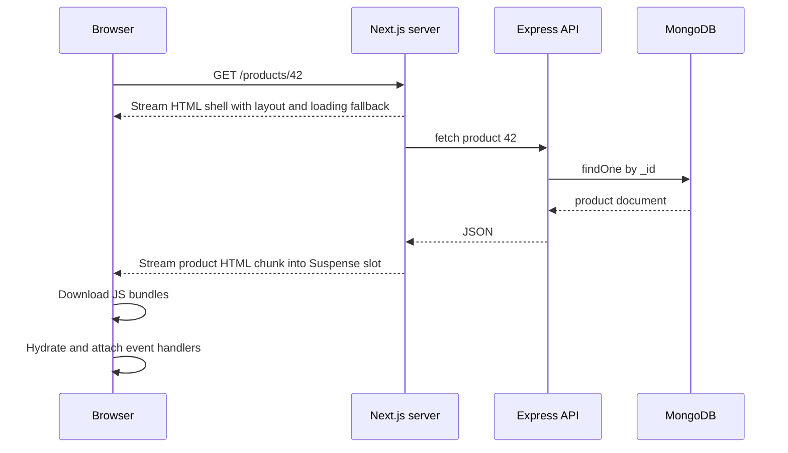

The classic MERN template ships a Create React App or Vite bundle that renders everything in the browser. That works well for a logged-in dashboard, but a product page that search engines must index, or a landing page that must show content in under two seconds on a mid-range phone, needs something else. The question "where and when is the HTML produced?" has five common answers, and choosing well is one of the highest-leverage architecture decisions on the frontend.

## How it works

| Strategy | HTML produced | Data freshness | Typical TTFB | Good for |
|---|---|---|---|---|
| CSR | In the browser after JS loads | Live | Fast (static shell) | Dashboards, admin, apps behind login |
| SSR | On the server, per request | Live | Slower, bound by data fetching | Personalized or fast-changing public pages |
| SSG | At build time | As of last build | Fastest (CDN) | Docs, marketing, blogs |
| ISR | At build, then regenerated in the background | Bounded staleness | Fast (CDN) | Catalogs, listings with many pages |
| RSC | On the server per request or cached, as a component payload | Configurable | Fast with streaming | Mixed pages in Next.js App Router |

The sequence below shows SSR with streaming and hydration, which is where most of the subtlety lives.



### Client-side rendering (CSR)

The server returns a near-empty `index.html` and a bundle. The browser downloads, parses and executes JavaScript, then fetches data, then renders. LCP waits for that whole chain. Crawlers that execute JS (Googlebot does, in a deferred second wave) can index it, but social previews and many other bots will not.

### Server-side rendering (SSR)

The server runs React to produce HTML for each request. Users see content before JS loads, but the page is not interactive until **hydration**: React re-runs components in the browser, matches them against the existing DOM and attaches handlers. If the server and client render different output (dates, `Math.random()`, `window` checks), you get hydration mismatch warnings and possibly a client re-render.

### Static generation (SSG) and ISR

SSG renders pages at build time and serves them from a CDN, giving excellent TTFB. It breaks down when you have 500,000 product pages or data that changes hourly. ISR fixes that: pages are generated on first request or at build, cached, and regenerated in the background after a revalidation window, or on demand.

```js
// app/products/[id]/page.jsx (Next.js App Router)
export const revalidate = 300; // regenerate at most every 5 minutes

export default async function ProductPage({ params }) {
  const { id } = await params; // params is a Promise in Next.js 15+
  const res = await fetch(`${process.env.API_URL}/products/${id}`, {
    next: { revalidate: 300, tags: [`product-${id}`] },
  });
  if (!res.ok) notFound();
  const product = await res.json();
  return <ProductView product={product} />;
}
```

When an admin updates a product in Express, invalidate exactly that page instead of waiting:

```js
// app/api/revalidate/route.js, called by the Express API after a write
import { revalidateTag } from 'next/cache';

export async function POST(req) {
  const { tag, secret } = await req.json();
  if (secret !== process.env.REVALIDATE_SECRET) return new Response('no', { status: 401 });
  revalidateTag(tag);
  return Response.json({ revalidated: true });
}
```

### React Server Components (RSC)

In the Next.js App Router, components are server components by default. They run only on the server, can `await` data directly, and **ship zero JavaScript** for themselves. Only files marked `'use client'` are bundled and hydrated. The server sends a serialized component payload that the client merges into the tree, which allows navigation without full page reloads.

```jsx
// Server component: no JS shipped, can talk to the DB layer directly
import { Suspense } from 'react';
import AddToCart from './AddToCart'; // 'use client' component

export default async function Page({ params }) {
  const { id } = await params;
  const product = await getProduct(id);
  return (
    <main>
      <h1>{product.name}</h1>
      <AddToCart productId={product._id.toString()} />
      <Suspense fallback={<ReviewsSkeleton />}>
        <Reviews productId={id} />
      </Suspense>
    </main>
  );
}
```

Props passed from server to client components must be serializable, which is why the ObjectId is converted to a string.

### Streaming

With `renderToPipeableStream` (or Next.js automatically), the server flushes the shell immediately and streams each `Suspense` boundary as its data resolves. A slow reviews query no longer delays TTFB for the whole page. Hydration is also selective: React hydrates boundaries as their code arrives and prioritizes the one the user interacts with.

## Choosing for a MERN app

- **Authenticated SPA (CRM, admin, internal tools):** Vite + React CSR, Express API, served from a CDN. SEO is irrelevant and the simplest topology wins.
- **Public content plus app (e-commerce, marketplace):** Next.js with ISR or cached RSC for catalog and product pages, client components for cart and checkout, Express or Next route handlers for the API.
- **Highly personalized, real-time public pages:** SSR or dynamic RSC with streaming, aggressive caching of shared fragments.
- **Marketing site and docs:** SSG.

You can mix strategies per route in Next.js, which is usually the right answer.

## Trade-offs and pitfalls

- **SSR moves cost to your servers.** Each request now costs CPU for rendering plus data fetching. A Node SSR process can be CPU-bound under load; cache aggressively and keep render paths lean.
- **Fast TTFB but slow interactivity.** SSR HTML that looks clickable but is not yet hydrated frustrates users. Ship less client JS, which is what RSC is for.
- **Hydration mismatches** from time zones, locale formatting or reading `localStorage` during render. Move browser-only logic into `useEffect` or a client-only component.
- **Waterfalls on the server.** Sequential `await`s in nested server components add latency. Start fetches in parallel with `Promise.all` or preload them.
- **Over-caching personalized data.** Never let a page that reads cookies or user data be statically cached or shared across users through ISR.
- **Secrets in client components.** Anything imported into a `'use client'` file ends up in the bundle.

## Interview angle

- Be ready to map a page type to a strategy and justify it with TTFB, LCP, SEO and server cost.
- Explain hydration and why "SSR makes the page interactive faster" is wrong; it makes content visible faster.
- For a catalog with millions of products, propose ISR or on-demand revalidation triggered by write events, plus a CDN.
- Describe how streaming with Suspense prevents one slow dependency from blocking the entire response.

## Key takeaways

- CSR is simplest and fine behind login; SSR, SSG and ISR exist mainly for first-load speed and SEO.
- Hydration is the cost of SSR: the browser must still download and execute component code.
- ISR gives static speed with bounded staleness; on-demand revalidation closes the gap after writes.
- Server Components reduce shipped JavaScript by keeping non-interactive code on the server.
- Pick per route, not per app.
