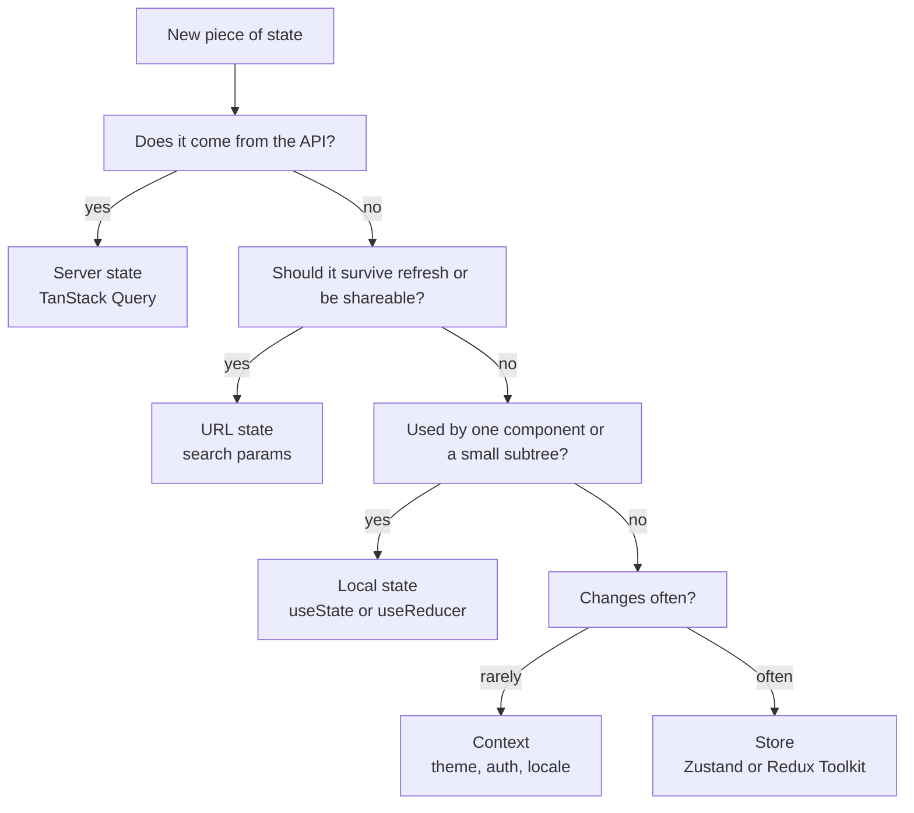

Most React codebases that feel tangled have one root cause: every kind of state is stored the same way. Data fetched from the Express API, a modal's open flag, the current search filters and the logged-in user all end up in one global store, synchronized by hand with `useEffect`. The fix is to classify state first and then pick the tool that fits each kind. There are really four categories: local UI state, shared client state, server state and URL state.

## How it works



Server state is different in kind from client state. It is owned by MongoDB, not the browser, so the browser only holds a possibly stale **cache** of it. Treating it as a cache, with expiry, refetching and invalidation, removes most hand-written loading and syncing code.

## Local state and lifting state

Start with `useState` in the component that uses the value. When two siblings need it, lift it to their closest common parent and pass it down. Use `useReducer` when updates are related (a form with validation, a multi-step wizard) so transitions live in one pure function.

```jsx
function reducer(state, action) {
  switch (action.type) {
    case 'field': return { ...state, values: { ...state.values, [action.name]: action.value } };
    case 'submit': return { ...state, submitting: true, error: null };
    case 'error': return { ...state, submitting: false, error: action.error };
    default: return state;
  }
}
```

Lifting state too high is the most common performance smell: a keystroke in a search box should not re-render the whole page. Colocate state as low as possible.

## Context and its re-render cost

Context solves prop drilling, not state management. When a provider's `value` changes identity, **every** consumer of that context re-renders, and `React.memo` on intermediate components does not stop it. Two rules keep it cheap:

```jsx
const AuthStateContext = createContext(null);
const AuthActionsContext = createContext(null);

export function AuthProvider({ children }) {
  const [user, setUser] = useState(null);
  // Stable actions object, so components that only call login never re-render on user changes
  const actions = useMemo(() => ({
    login: async (creds) => setUser(await api.login(creds)),
    logout: () => setUser(null),
  }), []);
  return (
    <AuthActionsContext.Provider value={actions}>
      <AuthStateContext.Provider value={user}>{children}</AuthStateContext.Provider>
    </AuthActionsContext.Provider>
  );
}
```

1. Memoize the `value` so it only changes when the data changes.
2. Split contexts by update frequency, and split state from actions.

Context is ideal for rarely changing values: theme, locale, the authenticated user, feature flags. It is a poor fit for a shopping cart updated on every click across many consumers.

## Client stores: Redux Toolkit and Zustand

Both stores let components subscribe to a **slice** of state through a selector, and re-render only when that slice changes. That is the key advantage over Context.

```js
// Zustand: minimal API, no provider needed
import { create } from 'zustand';

export const useCart = create((set) => ({
  items: [],
  add: (product) => set((s) => ({ items: [...s.items, { ...product, qty: 1 }] })),
  remove: (id) => set((s) => ({ items: s.items.filter((i) => i._id !== id) })),
}));

// Only re-renders when the count changes
const count = useCart((s) => s.items.length);
```

```js
// Redux Toolkit: createSlice uses Immer, so "mutations" are safe
const cartSlice = createSlice({
  name: 'cart',
  initialState: { items: [] },
  reducers: {
    added(state, action) { state.items.push({ ...action.payload, qty: 1 }); },
    removed(state, action) { state.items = state.items.filter((i) => i._id !== action.payload); },
  },
});
```

| | Zustand | Redux Toolkit |
|---|---|---|
| Boilerplate | Very low | Moderate |
| DevTools and time travel | Via middleware | Built in |
| Conventions for large teams | Few | Strong (slices, actions, middleware) |
| Server data | Pair with TanStack Query | RTK Query included |

Choose Zustand for small to medium apps; choose Redux Toolkit when many teams share one store and you value enforced structure.

## Server state with TanStack Query

TanStack Query caches responses by **query key**, deduplicates concurrent requests, refetches on focus or reconnect, and implements stale-while-revalidate: cached data renders instantly, and if it is older than `staleTime` a background refetch updates it.

```jsx
const queryClient = new QueryClient({
  defaultOptions: { queries: { staleTime: 30_000 } }, // default staleTime is 0
});

function useProducts(filters) {
  return useQuery({
    queryKey: ['products', filters],
    queryFn: () => api.get('/products', { params: filters }).then((r) => r.data),
    placeholderData: keepPreviousData, // avoid flashing empty state between pages
  });
}

function useUpdateProduct() {
  const qc = useQueryClient();
  return useMutation({
    mutationFn: (p) => api.patch(`/products/${p._id}`, p),
    onSuccess: (_, p) => {
      qc.invalidateQueries({ queryKey: ['products'] });   // all lists
      qc.invalidateQueries({ queryKey: ['product', p._id] });
    },
  });
}
```

Two timers matter. `staleTime` decides when data is considered outdated and eligible for refetch. `gcTime` (formerly `cacheTime`, 5 minutes by default) decides how long unused data stays in memory. Invalidation by key prefix is how you keep lists and detail views consistent after a mutation. For instant UI, use optimistic updates with `onMutate` and roll back in `onError`.

## URL state

Filters, sort order, pagination and selected tabs belong in the URL. Users can bookmark, share and use the back button, and the server or SSR layer can read them.

```jsx
const [params, setParams] = useSearchParams(); // react-router
const page = Number(params.get('page') ?? 1);
const sort = params.get('sort') ?? '-createdAt';
const { data } = useProducts({ page, sort });
```

Here URL state feeds the query key directly, so there is one source of truth and no syncing effect.

## Trade-offs and pitfalls

- **Copying server data into Redux or useState.** You now own cache invalidation by hand, and it will go stale. Let the query cache own it.
- **One giant context.** Every consumer re-renders on every change. Split or move to a selector-based store.
- **Unstable selectors.** `useStore((s) => s.items.filter(...))` returns a new array each time and re-renders on every store change. Select primitives or use a shallow comparator.
- **Query key drift.** If keys are built inconsistently (`['product', id]` vs `['products', id]`), invalidation misses entries. Centralize key factories.
- **Leaking user data between sessions.** Call `queryClient.clear()` on logout.

## Interview angle

- Classify state out loud: server, URL, global client, local. Interviewers look for that separation.
- Explain why Context is not a store, and how selector subscriptions avoid unnecessary re-renders.
- Describe stale-while-revalidate and invalidation after mutations, and when you would use optimistic updates.
- For "users share filtered search links", answer with URL state.

## Key takeaways

- Most "global state" is really server state; a query cache replaces most of it.
- Keep state as local as possible and lift only when needed.
- Context is for low-frequency values; use Zustand or Redux Toolkit selectors for frequently changing shared state.
- Put shareable view state in the URL.
- Consistent query keys make invalidation reliable.
