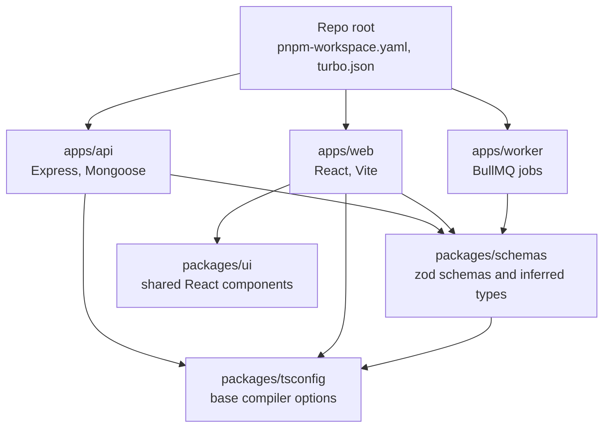

In a two-repo MERN setup, the API returns `totalCents` and the React app reads `total`, and nobody notices until a customer sees `NaN`. The frontend keeps a hand-written copy of every response type, validation rules are duplicated in two languages of intent, and a field rename takes three pull requests. Putting the API, the web app and their shared code in one TypeScript monorepo turns that drift into a compile error, as long as the workspace, build and type-checking setup stays fast.

## How it works

Apps depend on internal packages through the workspace protocol. Turborepo reads that dependency graph and runs tasks in order, caching results by input hash.



```text
.
  pnpm-workspace.yaml
  turbo.json
  package.json
  apps/
    api/        # Express API
    web/        # React SPA (Vite)
    worker/     # background jobs
  packages/
    schemas/    # zod schemas, DTO types, error codes
    ui/         # design system components
    tsconfig/   # shared tsconfig presets
    eslint-config/
```

## pnpm workspaces

pnpm is the usual choice: a content-addressed store means one copy of each package version on disk, installs are fast, and its strict `node_modules` layout stops apps from importing dependencies they never declared.

```yaml
# pnpm-workspace.yaml
packages:
  - "apps/*"
  - "packages/*"
catalog:
  zod: ^4.1.0
  typescript: ^5.9.0
```

```json
// apps/api/package.json
{
  "name": "@acme/api",
  "dependencies": {
    "@acme/schemas": "workspace:*",
    "zod": "catalog:"
  }
}
```

`workspace:*` links the local package. The `catalog:` protocol pins one version of shared dependencies across every app, which prevents the classic bug of two zod copies where `instanceof ZodError` fails.

## Shared zod schemas

The highest-value shared package is not types alone but schemas. One zod definition validates requests on the server, validates forms on the client, and produces the TypeScript type for both.

```ts
// packages/schemas/src/order.ts
import { z } from 'zod';

export const CreateOrder = z.object({
  items: z.array(z.object({
    productId: z.string().length(24),
    qty: z.number().int().min(1).max(100),
  })).min(1).max(50),
  couponCode: z.string().trim().max(32).optional(),
});
export type CreateOrder = z.infer<typeof CreateOrder>;

export const OrderDto = z.object({
  id: z.string(),
  status: z.enum(['pending', 'paid', 'shipped', 'cancelled']),
  totalCents: z.number().int(),
  createdAt: z.iso.datetime(),
});
export type OrderDto = z.infer<typeof OrderDto>;
```

```tsx
// apps/web/src/CheckoutForm.tsx
import { useForm } from 'react-hook-form';
import { zodResolver } from '@hookform/resolvers/zod';
import { CreateOrder } from '@acme/schemas';

const form = useForm<CreateOrder>({ resolver: zodResolver(CreateOrder) });
```

The API uses the same `CreateOrder` in its validation middleware. Keep this package free of server-only code: no Mongoose, no `process.env`, nothing that drags Node built-ins into the browser bundle. Mongoose models stay in `apps/api`; the shared package describes the wire format, not the storage format.

## Building internal packages

There are two common strategies. **Just-in-time packages** export TypeScript source directly (`"exports": { ".": "./src/index.ts" }`) and let the consumer compile them: Vite handles this natively, and the API runs through `tsx` in dev and a bundler like `tsup` or `esbuild` for production. No build step, instant changes. **Compiled packages** run `tsc` or `tsup` to emit `dist/` with `.d.ts` files, which is slower to iterate on but required if the package is published or consumed by plain Node without a bundler. Most internal app monorepos use just-in-time packages for schemas and UI and compile only what ships to npm.

## tsconfig and project references

Share compiler options from a preset, and use strict settings everywhere.

```json
// packages/tsconfig/base.json
{
  "compilerOptions": {
    "target": "ES2023",
    "module": "NodeNext",
    "moduleResolution": "NodeNext",
    "strict": true,
    "noUncheckedIndexedAccess": true,
    "isolatedModules": true,
    "verbatimModuleSyntax": true,
    "skipLibCheck": true,
    "composite": true,
    "declaration": true
  }
}
```

The web app overrides with `"module": "ESNext"`, `"moduleResolution": "Bundler"` and `"jsx": "react-jsx"`. Project references (`"references": [{ "path": "../../packages/schemas" }]`) let `tsc --build` type-check each package once and reuse `.tsbuildinfo` results, so a 200k-line repo re-checks only what changed. Without references, every app re-type-checks every shared file. Run type-checking as its own task (`tsc --noEmit` or `tsc -b`), separate from the dev server and bundling, which only strip types.

## Turborepo tasks and caching

```json
// turbo.json
{
  "$schema": "https://turborepo.com/schema.json",
  "tasks": {
    "build": { "dependsOn": ["^build"], "outputs": ["dist/**"] },
    "type-check": { "dependsOn": ["^type-check"] },
    "lint": {},
    "test": { "dependsOn": ["^build"], "outputs": ["coverage/**"] },
    "dev": { "cache": false, "persistent": true }
  }
}
```

`^build` means build dependencies first. Turborepo hashes each task's inputs (source files, lockfile entries, env vars you declare) and replays cached output when nothing changed. With remote caching enabled, a CI run that touches only `apps/web` skips the API's build and tests entirely, often cutting pipelines from 10 minutes to 2. `pnpm turbo run test --filter=...[origin/main]` runs tasks only for packages affected since `main`. Nx is the main alternative, with more code generation and a richer project graph; Turborepo is simpler to adopt.

## tRPC versus OpenAPI codegen

Sharing schemas gives you types for payloads, but not for the link between a route and its payload. Two ways close that gap.

| Aspect | tRPC | OpenAPI plus codegen |
| --- | --- | --- |
| Type flow | Inferred directly from server router | Generated from spec |
| Build step | None | Regenerate client on change |
| Non-TS clients | Poor | Any language |
| Public API | Not suited | Standard |
| HTTP semantics | RPC style, batching | Full REST, caching, ETags |

tRPC fits when the only consumers are your own TypeScript apps in the same repo: rename a field on the server and the React call site fails to compile. Pair it with TanStack Query for caching. For public APIs, mobile apps in Swift or Kotlin, or partners, generate an OpenAPI 3.1 document from zod schemas and produce a typed client with `openapi-typescript` and `openapi-fetch`, or with Orval or Hey API. Some teams run both: tRPC internally, OpenAPI at the public edge.

## Trade-offs and pitfalls

- **Leaky shared packages**: one server import in `@acme/schemas` can pull Node built-ins into the browser bundle or break the build.
- **Coupled deploys**: shared types do not make deploys atomic. A new required field breaks old mobile clients still in the wild; keep wire changes backward compatible.
- **Slow type-checking** without project references or with `skipLibCheck: false` grows with the repo.
- **Phantom dependencies** are blocked by pnpm, which surprises teams migrating from npm.
- **Cache misses** come from undeclared env vars or timestamps in build output; declare `env` in `turbo.json`.

## Interview angle

- Explain how sharing zod schemas makes one definition serve runtime validation and static types on both sides.
- Compare tRPC and OpenAPI by consumer type and public versus internal use.
- Describe how task graphs and content-hash caching keep monorepo CI time proportional to the change, not the repo.

## Key takeaways

- Use pnpm workspaces with `workspace:*` and catalogs for one version of shared dependencies.
- Share zod schemas, not just types, and keep the shared package free of server code.
- Use a strict shared tsconfig and project references for incremental type-checking.
- Let Turborepo order and cache tasks, with remote caching and affected-only runs in CI.
- Choose tRPC for internal TypeScript clients and OpenAPI codegen for everyone else.
