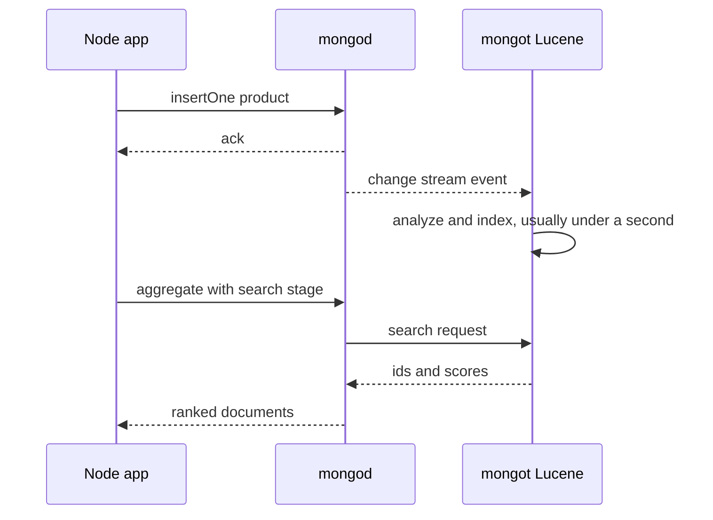

A product search box that only does `{ name: /phone/i }` scans the whole collection, cannot rank results, misses "iphnoe", and does not know that "running" and "run" are related. MongoDB has two very different answers. The legacy **`$text` index** lives inside `mongod` and covers basic keyword search. **Atlas Search** runs Apache Lucene next to your cluster and gives you relevance scoring, fuzzy matching, autocomplete, facets and highlighting, and **Atlas Vector Search** adds semantic search over embeddings. Picking the right one, and understanding that search indexes lag behind writes, is what this guide covers.

## How it works

Atlas Search indexes are not stored in WiredTiger. A separate process, `mongot`, runs on each Atlas node, tails the collection through change streams, and maintains Lucene indexes. A `$search` or `$vectorSearch` stage is routed by `mongod` to `mongot`, which returns matching `_id`s and scores; `mongod` then fetches the documents and continues the rest of the pipeline.



Because indexing is asynchronous, search results are **eventually consistent**. A product inserted a moment ago may not appear in `$search` yet, even though `find()` returns it.

## Legacy $text indexes

```javascript
db.products.createIndex(
  { name: 'text', description: 'text' },
  { weights: { name: 10, description: 2 }, default_language: 'english' }
);
db.products.find(
  { $text: { $search: 'wireless headphones -wired' } },
  { score: { $meta: 'textScore' } }
).sort({ score: { $meta: 'textScore' } });
```

It handles stemming, stop words, phrases in quotes and negation with `-`. The limits: one text index per collection, no fuzzy matching, no prefix or autocomplete, crude scoring, no facets, and `$text` must be in the first `$match` of a pipeline. It is consistent with writes and works on any deployment, which makes it fine for internal admin search or small catalogs.

## Atlas Search

### Index mappings and analyzers

```javascript
// mongosh, Atlas or a local Atlas deployment
db.products.createSearchIndex('products_search', {
  mappings: {
    dynamic: false,
    fields: {
      name: [
        { type: 'string', analyzer: 'lucene.english' },
        { type: 'autocomplete', tokenization: 'edgeGram', minGrams: 2, maxGrams: 15 },
      ],
      description: { type: 'string', analyzer: 'lucene.english' },
      brand: { type: 'token' },        // exact values for faceting and filtering
      category: { type: 'token' },
      price: { type: 'number' },
      inStock: { type: 'boolean' },
    },
  },
});
```

**Dynamic mappings** index every field automatically, which is convenient for prototypes but bloats the index and makes every new field searchable. **Static mappings** with `dynamic: false` index only what you list. The **analyzer** controls tokenization: `lucene.standard` splits on word boundaries and lowercases, `lucene.english` adds stemming so "running" matches "run", and `lucene.keyword` treats the whole value as one token. Language analyzers exist for about 40 languages, and you can define custom analyzers with char filters and synonyms.

### Queries: compound, fuzzy, autocomplete, highlighting

```javascript
await db.collection('products').aggregate([
  {
    $search: {
      index: 'products_search',
      compound: {
        must: [{ text: { query: 'wireles headphnes', path: ['name', 'description'], fuzzy: { maxEdits: 1 } } }],
        should: [{ text: { query: 'sony', path: 'brand', score: { boost: { value: 3 } } } }],
        filter: [{ range: { path: 'price', lte: 200 } }, { equals: { path: 'inStock', value: true } }],
      },
      highlight: { path: 'description' },
    },
  },
  { $limit: 20 },
  { $project: { name: 1, price: 1, score: { $meta: 'searchScore' }, highlights: { $meta: 'searchHighlights' } } },
]).toArray();
```

- `compound` combines clauses: `must` required and scored, `should` optional and boosting, `filter` required but not scored, `mustNot` exclusions.
- `fuzzy.maxEdits` allows 1 or 2 character edits, so typos still match.
- `highlight` returns the matching snippets with hit markers for the UI.
- `$search` must be the first stage. Put filters inside `compound.filter` rather than a later `$match`, otherwise Lucene returns many candidates that `mongod` then discards.

Search-as-you-type uses the `autocomplete` operator against the edgeGram field:

```javascript
{ $search: { index: 'products_search', autocomplete: { query: 'head', path: 'name', fuzzy: { maxEdits: 1 } } } }
```

### Facets

Facet counts for a filter sidebar come from `$searchMeta`, computed inside Lucene in one pass:

```javascript
db.products.aggregate([{
  $searchMeta: {
    index: 'products_search',
    facet: {
      operator: { text: { query: 'headphones', path: 'name' } },
      facets: {
        brands: { type: 'string', path: 'brand', numBuckets: 10 },
        priceBands: { type: 'number', path: 'price', boundaries: [0, 50, 100, 200, 500] },
      },
    },
  },
}]);
```

Use `$search` with the `facet` collector and `$$SEARCH_META` when you need results and counts in a single query.

## Atlas Vector Search

Vector search finds documents by meaning. You store an embedding per document, for example 1,536 floats from an embedding model, and query with the embedding of the user's text.

```javascript
db.products.createSearchIndex({
  name: 'products_vector',
  type: 'vectorSearch',
  definition: {
    fields: [
      { type: 'vector', path: 'embedding', numDimensions: 1536, similarity: 'cosine' },
      { type: 'filter', path: 'category' },
    ],
  },
});

db.products.aggregate([
  {
    $vectorSearch: {
      index: 'products_vector',
      path: 'embedding',
      queryVector: queryEmbedding,
      numCandidates: 200,
      limit: 10,
      filter: { category: 'audio' },
    },
  },
  { $project: { name: 1, score: { $meta: 'vectorSearchScore' } } },
]);
```

It uses an approximate HNSW graph. `numCandidates` trades recall for latency; 10 to 20 times `limit` is a common starting point. Quantization (scalar or binary) cuts memory for large indexes at a small recall cost.

**Hybrid search** combines keyword precision with semantic recall. MongoDB 8.1+ provides a `$rankFusion` stage that merges `$search` and `$vectorSearch` pipelines with reciprocal rank fusion. On older versions, run both pipelines with `$unionWith` and compute the fused score yourself, or do the merge in the application.

## Where it runs

Atlas Search and Vector Search have historically been Atlas-only, plus local development through `atlas deployments setup --type local`. MongoDB 8.2 introduced search and vector search for self-managed Community and Enterprise deployments by running `mongot` yourself, initially as a public preview, so verify its support status before betting production on it. The long-standing self-hosted alternative is to stream changes into Elasticsearch or OpenSearch with a change-stream consumer or a Kafka connector and query that cluster for search.

## Trade-offs and pitfalls

- **Eventual consistency**: read-your-own-write flows, like "create a product then show it in search results", need a fallback such as merging the new item client-side or querying by `_id`.
- **Resource cost**: `mongot` competes for memory and CPU on the same nodes unless you use dedicated search nodes; large vector indexes need RAM sized for the HNSW graph.
- **Dynamic mappings** grow indexes silently and slow reindexing.
- **Mapping changes trigger a full rebuild**, which can take hours on large collections; the old index serves queries until the new one is ready.
- **Pagination** with `$skip` over deep result sets is slow; use `searchAfter` tokens.
- **`$text` and Atlas Search do not mix**: pick one per use case.

## Interview angle

- Contrast `$text` (consistent, simple, limited) with Lucene-based Atlas Search (relevance, fuzzy, autocomplete, facets, eventually consistent).
- Sketch the architecture: `mongot` tails change streams, `$search` returns ids and scores, `mongod` fetches documents.
- For a RAG or "similar products" feature, propose `$vectorSearch` with metadata filters and hybrid fusion with keyword search.
- Mention the self-hosted path: `mongot` on 8.2, or change streams into Elasticsearch.

## Key takeaways

- `$text` is fine for basic keyword search; Atlas Search is the choice for user-facing search.
- Use static mappings, the right analyzer per field, and `compound.filter` for non-scoring filters.
- Autocomplete needs an edgeGram `autocomplete` field; facets come from `$searchMeta`.
- `$vectorSearch` enables semantic and hybrid search with tunable `numCandidates`.
- Search indexes lag writes, so design for eventual consistency.
