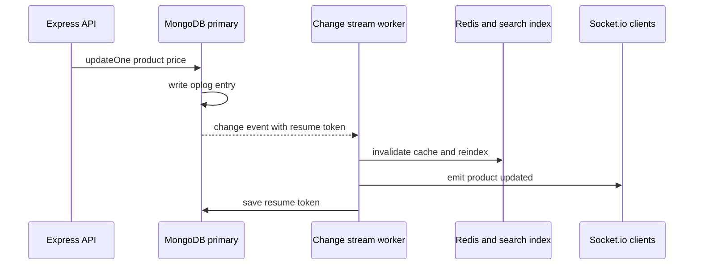

Sooner or later a MERN app needs to react to data changes: push a new chat message to connected browsers, invalidate a Redis key when a product changes, keep an Elasticsearch or Atlas Search index in sync, or notify another service that an order was paid. Polling the database every few seconds is wasteful and laggy. Writing to the database and then publishing an event from the app is fragile, because the second step can fail after the first succeeds. **Change streams** let you subscribe to the database's own record of what changed.

## How it works

Change streams are built on the replica set **oplog**. A client opens a stream with `watch()` on a collection, a database or the whole deployment. The server tails the oplog, filters and transforms entries through an aggregation pipeline you supply, and pushes change events to the client. Each event carries a **resume token** so a consumer can continue exactly where it stopped.



Change streams only return majority-committed changes by default, so you never react to a write that is later rolled back. They require a replica set or sharded cluster.

## Watching a collection in Node

```javascript
const pipeline = [
  { $match: { operationType: { $in: ['insert', 'update', 'replace', 'delete'] } } },
  { $project: { operationType: 1, documentKey: 1, fullDocument: 1, 'updateDescription.updatedFields': 1 } },
];

const stream = Product.watch(pipeline, { fullDocument: 'updateLookup' });

stream.on('change', async (ev) => {
  const id = ev.documentKey._id.toString();
  if (ev.operationType === 'delete') {
    await redis.del(`product:${id}`);
    await search.delete(id);
  } else {
    await redis.del(`product:${id}`);
    await search.index(id, ev.fullDocument);
  }
});

stream.on('error', (err) => {
  console.error('change stream error', err);
  // close and reopen from the last saved resume token
});
```

By default, an `update` event contains only the changed fields (`updateDescription`). `fullDocument: 'updateLookup'` asks the server to fetch the current version of the document, which may already include later changes. MongoDB 6.0 added pre- and post-images (`fullDocumentBeforeChange` and `fullDocument: 'whenAvailable'` or `'required'`) when the collection has `changeStreamPreAndPostImages` enabled.

## Resume tokens: never lose an event

Every event's `_id` is its resume token. Store it after successfully processing the event. On restart, pass it back as `resumeAfter` (or `startAfter`, which also works after an invalidate event).

```javascript
async function run() {
  const saved = await Checkpoint.findById('product-sync').lean();

  // Native driver stream from the Mongoose model, which supports for await
  const stream = Product.collection.watch(pipeline, {
    fullDocument: 'updateLookup',
    ...(saved ? { resumeAfter: saved.token } : {}),
  });

  for await (const ev of stream) {
    await handle(ev);  // must be idempotent
    await Checkpoint.updateOne(
      { _id: 'product-sync' },
      { $set: { token: ev._id, at: new Date() } },
      { upsert: true }
    );
  }
}
```

This gives **at-least-once** delivery: if the worker crashes after `handle` but before saving the token, the event is processed again. Make handlers idempotent: upserts keyed by document id, cache deletes, and version checks are all naturally safe to repeat.

A resume token only works while the matching oplog entry still exists. If the worker is down longer than the oplog window, resuming fails and you must do a full resync. Size the oplog accordingly and alert when a consumer falls behind.

## Outbox-style sync

For integrating with other services, a common pattern is a transactional **outbox**:

1. In one transaction (or one document write), update business data and insert an event document into an `outbox` collection.
2. A worker watches the `outbox` collection and publishes each event to Kafka, SQS, a webhook or a search index.
3. The worker marks the event as sent or relies on resume tokens and idempotent consumers.

```javascript
await mongoose.connection.transaction(async (session) => {
  await Order.updateOne({ _id: orderId }, { $set: { status: 'paid' } }, { session });
  await Outbox.create(
    [{ type: 'order.paid', aggregateId: orderId, payload: { orderId, total }, createdAt: new Date() }],
    { session }
  );
});
```

Why not watch `orders` directly? You can, and for simple cache invalidation it is fine. An explicit outbox gives you a stable event contract that is decoupled from the internal shape of the `orders` collection, which matters once other teams consume the events. A TTL index on `outbox.createdAt` keeps the collection small.

For managed pipelines, the MongoDB Kafka connector and Atlas Triggers are built on change streams, so you get the same semantics without running the worker yourself.

## Real-time UI updates

For a chat or dashboard, one worker per app instance can watch a collection and broadcast to Socket.io rooms:

```javascript
Message.watch([{ $match: { operationType: 'insert' } }]).on('change', (ev) => {
  const msg = ev.fullDocument;
  io.to(`room:${msg.roomId}`).emit('message', msg);
});
```

If you run many API instances, every instance opening its own stream multiplies load on the server. Prefer one or a few dedicated consumers that publish into Redis pub/sub or the Socket.io Redis adapter.

## Limitations

- **Requires a replica set or sharded cluster**, so local development needs a single-node replica set.
- **Each open stream costs resources** on the server and holds a connection. Hundreds of streams with complex filters add load.
- **Ordering** is guaranteed per stream. On sharded clusters, mongos merges events from all shards in cluster time order, which adds a little latency.
- **Oplog window** bounds how long a consumer can be offline.
- **Event size** is limited by the 16MB BSON limit; large documents with pre- and post-images can hit it (newer versions offer `$changeStreamSplitLargeEvent`).
- **Not a message queue**: no consumer groups, no per-message acknowledgement, no dead-letter queue. Put Kafka or SQS behind the stream if you need those.

## Trade-offs and pitfalls

- **Non-idempotent handlers** cause duplicate side effects after restarts.
- **Not persisting the resume token** means losing events during deploys.
- **`updateLookup`** costs an extra read per event and can return a newer document than the event.
- **Watching from every web server** instead of a dedicated worker wastes connections and duplicates work.

## Interview angle

- For "keep search in sync with the database", propose a change stream worker with resume tokens and idempotent upserts, rather than dual writes from the API.
- Explain at-least-once delivery and why idempotency is required.
- Mention the outbox pattern for cross-service events and the oplog window as the main operational limit.
- For real-time features, describe one consumer fanning out through Redis pub/sub to Socket.io instances.

## Key takeaways

- Change streams expose majority-committed changes from the oplog as an event feed.
- Persist resume tokens after processing to survive restarts with at-least-once delivery.
- Use them for cache invalidation, search sync, real-time UI and outbox publishing.
- They are not a full message queue; bridge to Kafka or SQS when you need queue semantics.
