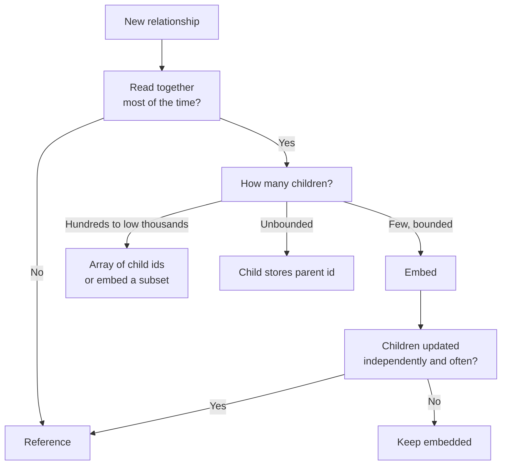

Most MongoDB performance problems trace back to the data model, not to missing hardware. In a relational database you normalize first and ask questions later. In MongoDB the rule is reversed: **model for the queries your application actually runs**. A document is the unit of atomicity, the unit of retrieval and the unit of caching in memory, so deciding what lives together in one document is the most important design decision you make.

## How it works

Every relationship forces one decision: embed the related data inside the parent document, or store it in its own collection and keep a reference (an `ObjectId`). The answer depends on how many related items there are, how often they are read together, and whether they change independently.



### Relationship cardinality

| Shape | Example | Typical model |
|---|---|---|
| One-to-few | User and their 2 shipping addresses | Embed an array in the parent |
| One-to-many | Product and its 500 parts | Parent holds an array of child ids, or children reference the parent |
| One-to-squillions | Server and its log lines | Each child stores the parent id; never an array on the parent |

The deciding factor for "squillions" is growth. An array that grows without bound eventually makes every update rewrite a huge document, bloats the index on that array, and finally runs into the **16MB BSON document limit**.

## Embedding and referencing in Mongoose

One-to-few, read together, owned by the parent: embed.

```javascript
const addressSchema = new mongoose.Schema(
  { label: String, line1: String, city: String, zip: String },
  { _id: false }
);

const userSchema = new mongoose.Schema({
  email: { type: String, required: true, unique: true },
  name: String,
  addresses: {
    type: [addressSchema],
    validate: [(v) => v.length <= 10, 'Too many addresses'],
  },
});
```

One-to-squillions: the child points to the parent, and an index on that field makes lookups cheap.

```javascript
const orderSchema = new mongoose.Schema({
  userId: { type: mongoose.Schema.Types.ObjectId, ref: 'User', index: true },
  total: Number,
  createdAt: { type: Date, default: Date.now },
});

// Latest 20 orders for a user, served by an index on { userId: 1, createdAt: -1 }
const orders = await Order.find({ userId })
  .sort({ createdAt: -1 })
  .limit(20)
  .lean();
```

`populate()` is convenient but it is a second query (or more) issued by the driver, not a server-side join. Use it on small result sets and avoid nesting it several levels deep.

## Schema patterns worth knowing

### Subset pattern

A product page shows the 10 most recent reviews, but a product may have 50,000. Embed the latest 10 in the product and keep the full history in a `reviews` collection.

```javascript
await Review.create({ productId, rating, text });
await Product.updateOne(
  { _id: productId },
  { $push: { recentReviews: { $each: [{ rating, text }], $sort: { _id: -1 }, $slice: 10 } } }
);
```

`$push` with `$slice` keeps the embedded array bounded automatically.

### Extended reference pattern

Copy the few fields you need for display alongside the reference, so the common read avoids a join. An order keeps `customer: { _id, name, email }` rather than only `customerId`. The trade-off is duplication: decide whether the copy should reflect the value at order time (usually correct for orders) or be kept in sync.

### Computed pattern

Instead of counting reviews on every page view, maintain the result on write.

```javascript
await Product.updateOne(
  { _id: productId },
  { $inc: { reviewCount: 1, ratingSum: rating } }
);
// average = ratingSum / reviewCount, computed cheaply on read
```

When reads vastly outnumber writes, precomputing is almost always worth it.

### Bucket pattern

For time series or IoT data, one document per reading creates billions of tiny documents and large indexes. Group readings into buckets per sensor per hour.

```javascript
// mongosh
db.readings.updateOne(
  { sensorId: 's-42', hour: ISODate('2026-10-31T14:00:00Z'), count: { $lt: 200 } },
  {
    $push: { samples: { t: new Date(), v: 21.7 } },
    $inc: { count: 1, sum: 21.7 },
  },
  { upsert: true }
);
```

The `count < 200` guard caps bucket size. For pure time series workloads on MongoDB 5.0 and later, native **time series collections** apply this bucketing internally and are usually the better choice.

## Schema validation still matters

"Schemaless" does not mean "no schema". Mongoose validates in the application, but other services and scripts bypass it. Add server-side validation for critical fields:

```javascript
db.runCommand({
  collMod: 'users',
  validator: {
    $jsonSchema: {
      bsonType: 'object',
      required: ['email'],
      properties: { email: { bsonType: 'string' } },
    },
  },
  validationLevel: 'moderate',
});
```

## Trade-offs and pitfalls

- **Unbounded arrays** are the classic failure. Comments, followers, events and log entries embedded in a parent grow until writes slow down and documents approach 16MB. Long before the hard limit, large documents waste cache because the whole document is loaded to read one field.
- **Over-normalizing** turns MongoDB into a slow relational database: many collections, many `populate()` calls, no foreign keys and no cheap joins.
- **Duplicated data drifts.** Extended references and computed fields need a clear owner and an update path, often a background job or a change stream consumer.
- **Large embedded arrays with multikey indexes** produce one index entry per element, so index size grows with array length.
- **Atomicity follows the document.** Data that must change together atomically is a strong argument for embedding, because single-document writes are always atomic without a transaction.

## Interview angle

- Expect a prompt like "design the schema for a blog, chat or e-commerce app". Start by listing the top read and write queries, then justify each embed or reference decision against them.
- Name the cardinality explicitly (one-to-few, one-to-many, one-to-squillions) and say what happens when the array grows.
- Mention the 16MB limit and the subset or bucket pattern as the fix, rather than just saying "use references".
- Point out that embedding gives atomic updates without transactions, which links neatly to consistency questions later.

## Key takeaways

- Design around access patterns: data read together should usually be stored together.
- Embed bounded, owned, co-read data; reference unbounded or independently changing data.
- Never let an array grow without a cap; use subset, bucket or child-references instead.
- Extended reference and computed patterns trade write-time work and duplication for fast reads.
- Add `$jsonSchema` validation on the server for fields that must always be correct.
