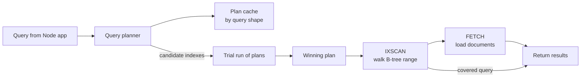

A query that takes 3 ms on your laptop with 1,000 documents can take 3 seconds in production with 10 million. The difference is almost always an index: without one, MongoDB performs a **collection scan** (`COLLSCAN`) and examines every document. Indexes are the single highest-leverage performance tool in MongoDB, and `explain()` is how you prove an index is actually being used.

## How it works

MongoDB indexes are B-tree structures that store field values in sorted order with a pointer to the document. The query planner looks at candidate indexes, races them briefly, caches the winning plan for that query shape, and executes it.



The ideal plan walks a narrow range of the index (`IXSCAN`), fetches only matching documents (`FETCH`), and needs no in-memory `SORT` stage. If all requested fields are in the index, the `FETCH` stage disappears entirely: a **covered query**.

## Index types you will actually use

```javascript
// mongosh
db.users.createIndex({ email: 1 }, { unique: true });             // single field
db.orders.createIndex({ userId: 1, status: 1, createdAt: -1 });  // compound
db.posts.createIndex({ tags: 1 });                                // multikey (array field)
db.articles.createIndex({ title: 'text', body: 'text' });        // text
db.sessions.createIndex({ createdAt: 1 }, { expireAfterSeconds: 3600 }); // TTL
db.orders.createIndex(
  { createdAt: -1 },
  { partialFilterExpression: { status: 'pending' } }              // partial
);
```

- **Multikey** indexes are created automatically when the indexed field holds an array, with one entry per element. A compound index can include at most one array field.
- **Text** indexes support `$text` search with stemming. A collection can have only one text index. For relevance ranking, fuzzy matching and autocomplete, Atlas Search (Lucene based) is far stronger.
- **TTL** indexes delete documents in a background task that runs roughly every 60 seconds, so expiry is not instant.
- **Partial** indexes only include documents matching a filter, which keeps them small. A query must include the filter condition for the planner to use the index.

In Mongoose, declare indexes on the schema and build them deliberately in production rather than relying on `autoIndex`:

```javascript
orderSchema.index({ userId: 1, status: 1, createdAt: -1 });
// In production: mongoose.set('autoIndex', false) and run Model.syncIndexes() in a migration step
```

## The ESR rule for compound indexes

Field order in a compound index matters. The rule of thumb is **Equality, Sort, Range**:

1. **Equality** fields first (`status: 'shipped'`, `userId: x`).
2. **Sort** fields next (`createdAt: -1`).
3. **Range** fields last (`total: { $gt: 100 }`, `$in` over many values often behaves like a range for sorting).

Query: shipped orders for a user over 100 dollars, newest first.

```javascript
db.orders.find({ userId: uid, status: 'shipped', total: { $gt: 100 } })
  .sort({ createdAt: -1 });

// Good: E, E, S, R
db.orders.createIndex({ userId: 1, status: 1, createdAt: -1, total: 1 });
```

If you put `total` before `createdAt`, the index range on `total` breaks the sort order, and MongoDB must sort in memory. In-memory sorts are limited (100MB by default) and burn CPU.

The **prefix rule** also applies: an index on `{ a: 1, b: 1, c: 1 }` serves queries on `a`, `a,b` and `a,b,c`, but not on `b` alone. That means one well designed compound index can replace several single-field indexes.

## Covered queries

If the filter and projection use only indexed fields and you exclude `_id`, MongoDB answers entirely from the index:

```javascript
db.users.find({ email: 'a@x.com' }, { email: 1, _id: 0 });
```

`totalDocsExamined: 0` in the explain output confirms a covered query.

## Reading explain("executionStats")

```javascript
db.orders.find({ userId: uid, status: 'shipped' })
  .sort({ createdAt: -1 })
  .limit(20)
  .explain('executionStats');
```

From Node, use `await Order.find(filter).sort(s).limit(20).explain('executionStats')`.

Focus on a handful of fields:

| Field | What good looks like |
|---|---|
| `winningPlan.stage` tree | `LIMIT` over `FETCH` over `IXSCAN`; no `COLLSCAN`, no `SORT` |
| `nReturned` | The number of documents you wanted |
| `totalKeysExamined` | Close to `nReturned` |
| `totalDocsExamined` | Close to `nReturned`, or 0 for covered queries |
| `executionTimeMillis` | Low single digits for OLTP reads |

The key health metric is the ratio of examined to returned. Returning 20 documents after examining 200,000 keys means the index is the wrong shape, usually a range or sort field placed too early.

Useful helpers:

```javascript
db.orders.getIndexes();
db.orders.aggregate([{ $indexStats: {} }]);   // usage counts per index since restart
db.orders.find(filter).hint({ userId: 1, status: 1, createdAt: -1 }); // force an index for testing
```

## Trade-offs and pitfalls

- **Every index costs writes.** Each insert updates every index on the collection, and indexes compete with data for the WiredTiger cache. Drop indexes that `$indexStats` shows are never used.
- **Low-selectivity indexes** (a boolean `isActive` alone) rarely help. Combine them into a compound index or use a partial index.
- **Regex** queries only use an index efficiently when anchored with `^` and case-sensitive.
- **Building indexes on large collections** consumes I/O. Modern versions build without blocking reads and writes for most of the build, but schedule big builds off-peak and roll them across replica set members if needed.
- **Plan cache surprises**: a cached plan that was good for one parameter value may be bad for another. `explain` with `allPlansExecution` helps diagnose this.
- **`autoIndex` in production** can trigger unexpected index builds on app startup.

## Interview angle

- When asked "the orders page is slow", walk through: find the query, run `explain`, compare keys examined to documents returned, design a compound index using ESR.
- Mention write amplification: more indexes make reads faster and writes slower, so justify each one.
- Bring up TTL indexes for sessions or ephemeral data, and partial indexes to keep hot indexes small.
- Covered queries and avoiding in-memory sorts show depth beyond "add an index".

## Key takeaways

- No index means `COLLSCAN`; always verify plans with `explain('executionStats')`.
- Order compound index fields by Equality, Sort, Range.
- Aim for keys examined and docs examined close to documents returned.
- Use TTL, partial and multikey indexes deliberately; each has specific constraints.
- Indexes cost write throughput and RAM, so remove unused ones.
