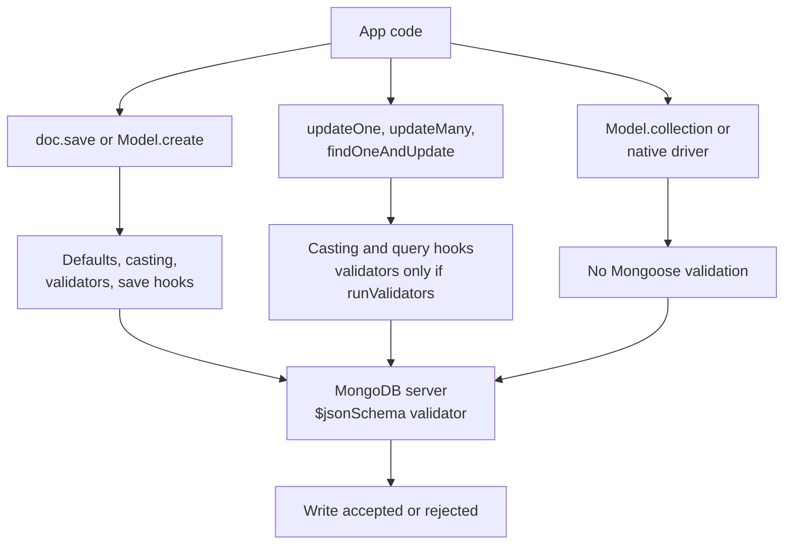

MongoDB is often called schemaless, but every production application has a schema. The only question is where it is enforced. Mongoose enforces it in Node, on the paths that go through Mongoose documents. MongoDB's `$jsonSchema` validator enforces it on the server, for every writer. Knowing exactly which Mongoose operations skip validation, what `lean()` and `populate()` really cost, and how to evolve a schema with millions of existing documents separates a working MERN app from one that slowly fills with bad data.

## How it works

Mongoose has two execution paths. **Document operations** (`new Model()`, `doc.save()`, `Model.create()`) build a hydrated document, run defaults, casting, validators and document middleware, then write. **Query operations** (`updateOne`, `findOneAndUpdate`, `updateMany`) build a filter and update object, cast them, run query middleware, and send them straight to MongoDB. Full validation does not run on the query path unless you ask for it.



## Schemas and validators

```javascript
const orderSchema = new mongoose.Schema(
  {
    userId: { type: mongoose.Types.ObjectId, ref: 'User', required: true, index: true },
    status: { type: String, enum: ['pending', 'paid', 'shipped', 'cancelled'], default: 'pending' },
    total: { type: Number, min: 0, required: true },
    email: { type: String, lowercase: true, trim: true, match: /^[^@\s]+@[^@\s]+$/ },
    items: {
      type: [{ sku: String, qty: { type: Number, min: 1 }, price: Number }],
      validate: { validator: (v) => v.length > 0 && v.length <= 200, message: '1 to 200 items' },
    },
  },
  { timestamps: true, strict: 'throw', optimisticConcurrency: true }
);
```

`strict: 'throw'` rejects unknown fields instead of silently dropping them, which surfaces client bugs early. `unique: true` is **not** a validator: it only creates a unique index, and violations surface as a MongoDB `E11000` duplicate key error that you must map to a 409 yourself.

## Which operations skip validation

| Operation | Validators | `save` middleware |
|---|---|---|
| `doc.save()`, `Model.create()` | Yes | Yes |
| `Model.insertMany()` | Yes | No, `insertMany` hooks only |
| `updateOne`, `updateMany`, `findOneAndUpdate` | Only with `runValidators: true` | No, query hooks only |
| `bulkWrite()` | `insertOne` yes; updates only with `runValidators` | No middleware at all |
| `Model.collection.*` (native driver) | No | No |

```javascript
await Order.updateOne(
  { _id: id },
  { $set: { status: 'refunded' } },
  { runValidators: true }   // without this, 'refunded' is written despite the enum
);
```

Even with `runValidators`, update validators only check paths present in the update, and inside a custom validator `this` is the Query, not the document. A cross-field rule like "`discount` must be less than `total`" will not see `total` unless both are in the `$set`. You can enable it globally with `mongoose.set('runValidators', true)`.

## Middleware pitfalls

- `pre('save')` does not fire for `updateOne` or `findOneAndUpdate`. Password hashing in a save hook is bypassed by `User.updateOne({ $set: { password } })`. Register `pre('findOneAndUpdate')` too or route all password changes through `save()`.
- `deleteOne` hooks are query middleware by default. Use `schema.pre('deleteOne', { document: true, query: false }, fn)` for `doc.deleteOne()`. `remove()` was removed in Mongoose 7.
- Arrow functions lose `this`. Use `function () {}` in hooks and validators.
- Hooks that do I/O, like cascading deletes or audit writes, run outside any transaction unless you pass the session through.

## lean() and populate()

A hydrated Mongoose document carries change tracking, getters, virtuals and prototype methods. For read-only API responses, `lean()` returns plain objects and typically cuts memory several times over and speeds large reads noticeably.

```javascript
const orders = await Order.find({ userId }).sort({ createdAt: -1 }).limit(50).lean();
```

Lean results have no virtuals, getters, defaults for missing fields, or `save()`. Use plugins like `mongoose-lean-virtuals` if you need some of that.

`populate()` is not a join. Mongoose runs the first query, collects referenced ids, then issues one extra `find({ _id: { $in: ids } })` per populated path. Populating `userId` and `items.productId` on 50 orders is three round trips; nested populates multiply this. Each `$in` list can contain thousands of ids for large pages. Alternatives: denormalize the few fields you display (customer name on the order), use an aggregation `$lookup` for one round trip, or populate with `select` to fetch only needed fields.

## Discriminators

Discriminators store several related shapes in one collection with a type key (`__t` by default), sharing base fields and indexes.

```javascript
const Event = mongoose.model('Event', new mongoose.Schema({ at: Date, userId: ObjectId }, { discriminatorKey: 'kind' }));
const Click = Event.discriminator('Click', new mongoose.Schema({ url: String }));
const Purchase = Event.discriminator('Purchase', new mongoose.Schema({ amount: Number }));

await Click.find({ userId });  // Mongoose adds { kind: 'Click' } automatically
```

Good for a polymorphic feed or activity log. Bad when shapes diverge heavily or one subtype dominates volume and needs its own indexes.

## Versioning and optimistic concurrency

By default `__v` is only incremented when an array is modified in a way that can shift positions, to protect positional array updates. With `optimisticConcurrency: true`, every `save()` adds `__v` to the update filter and increments it. If another request saved in between, the filter matches nothing and Mongoose throws `VersionError`, which you can retry after re-reading.

```javascript
const order = await Order.findById(id);
order.status = 'shipped';
await order.save(); // filter: { _id: id, __v: 3 }, update: { $inc: { __v: 1 } }
```

Query updates such as `updateOne` do not check or bump `__v`. For hot counters, skip read-modify-write and use atomic operators like `$inc` with a conditional filter instead.

## Server-side $jsonSchema validation

Mongoose rules disappear the moment a script, a Python service or `mongosh` writes to the collection. A server validator enforces a baseline for everyone.

```javascript
db.runCommand({
  collMod: 'orders',
  validator: {
    $jsonSchema: {
      bsonType: 'object',
      required: ['userId', 'status', 'total'],
      properties: {
        userId: { bsonType: 'objectId' },
        status: { enum: ['pending', 'paid', 'shipped', 'cancelled'] },
        total: { bsonType: ['double', 'int', 'decimal'], minimum: 0 },
      },
    },
  },
  validationLevel: 'moderate',
  validationAction: 'error',
});
```

- `validationLevel: 'strict'` (default) checks all inserts and updates. `'moderate'` checks inserts and updates to documents that already pass, so legacy invalid documents can still be updated. `'off'` disables it.
- `validationAction: 'error'` rejects the write; `'warn'` allows it and logs the violation, useful for rolling out a new rule and measuring how many writers break it.
- Since 5.0, rejected writes return a detailed `errInfo` explaining which rule failed.

Keep the server validator to structural invariants (types, required fields, enums) and leave business rules in the application.

## Schema evolution and migrations

You cannot `ALTER TABLE` ten million documents atomically, so evolve schemas in steps:

1. **Expand**: make the new field optional in Mongoose and the validator; write both old and new shapes.
2. **Migrate**: backfill in batches, for example 1,000 documents per `bulkWrite` with a pause, keyed on `_id` ranges so the job is resumable. Tools like `migrate-mongo` track which scripts have run.
3. **Contract**: once every document has the new shape, make it required, tighten `$jsonSchema` and remove old-field reads.

Adding a `schemaVersion` field lets code handle both shapes and migrate lazily on read: when a version-1 document is loaded, upgrade it and save it back.

## Trade-offs and pitfalls

- Validation that only lives in `save()` is bypassed by every update query; set `runValidators` globally.
- `populate` hides N+1 style round trips and large `$in` lists.
- `autoIndex` building indexes at startup in production causes surprise load; disable it and build indexes in a migration.
- Tightening a validator with `strict` level on existing bad data blocks updates to those documents.
- Discriminators share one collection's indexes and write throughput.

## Interview angle

- Explain the document versus query execution paths and why `updateOne` skips `pre('save')`.
- Show a lost update and fix it with `optimisticConcurrency` or an atomic `$inc`.
- Argue for defense in depth: Mongoose for rich rules, `$jsonSchema` for invariants every client must respect.
- Describe expand, migrate, contract for schema changes on a live collection.

## Key takeaways

- Updates skip validators unless `runValidators: true`; `bulkWrite` skips all middleware and the native driver skips Mongoose entirely.
- Use `lean()` for read-only responses and treat `populate()` as extra queries.
- `optimisticConcurrency` turns `__v` into a real concurrency check for `save()`.
- Add `$jsonSchema` validators, starting with `warn`, to protect data from non-Mongoose writers.
- Migrate with expand, backfill in batches, contract, and track a `schemaVersion`.
