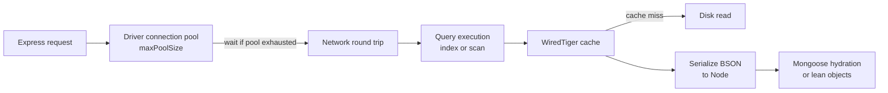

Once indexes are in place, the next round of MongoDB performance problems usually comes from somewhere less obvious: the working set no longer fits in memory, connection pools are mis-sized, the app fetches whole documents to read two fields, writes go one round trip at a time, or pagination uses `skip` on page 5,000. This guide covers the tuning levers a MERN developer actually controls.

## How it works

A request's latency is the sum of time waiting for a connection, network round trips, server-side query execution, and reading data from cache or disk.



Each box is a tuning point. A slow request is often not a slow query at all, but a request waiting for a free connection or spending time hydrating thousands of Mongoose documents.

## WiredTiger cache and the working set

WiredTiger keeps recently used data and indexes in its internal cache, by default sized at roughly 50 percent of (RAM minus 1GB), with a minimum of 256MB. The rest of RAM is used by the operating system file cache, which holds compressed data files.

The **working set** is the data and indexes your application touches regularly. When it fits in cache, reads are memory-speed. When it does not, every miss is a disk read and latency climbs sharply.

```javascript
// mongosh
const s = db.serverStatus().wiredTiger.cache;
({
  maxGB: s['maximum bytes configured'] / 1e9,
  usedGB: s['bytes currently in the cache'] / 1e9,
  dirtyGB: s['tracked dirty bytes in the cache'] / 1e9,
  readIntoCache: s['pages read into cache'],
});

db.orders.stats().totalIndexSize;  // indexes should comfortably fit in RAM
```

Signals of a working-set problem: steadily increasing "pages read into cache", high disk read IOPS, and a cache that is constantly full while latency rises. Fixes: archive cold data, drop unused indexes, shrink documents, or add RAM. Do not raise the WiredTiger cache size above the default on a shared host without care, since the OS file cache and connections also need memory.

## Connection pooling in Node

The Node driver maintains a pool per server. Mongoose uses the driver's pool. The default `maxPoolSize` is 100.

```javascript
await mongoose.connect(process.env.MONGODB_URI, {
  maxPoolSize: 20,         // per Node process, per server
  minPoolSize: 2,
  maxIdleTimeMS: 60000,
  waitQueueTimeoutMS: 5000, // fail fast instead of queueing forever
});
```

Rules of thumb:

- **Create one connection at startup** and reuse it. Never connect per request. In serverless functions, cache the connection in module scope outside the handler.
- **Total connections = processes x maxPoolSize.** 40 containers with the default pool can open 4,000 connections, and each server connection uses roughly 1MB of memory. Check the Atlas tier's connection limit.
- Node is single-threaded per process, so a pool much larger than your concurrent in-flight queries does not help. If requests wait for connections, find slow queries first, then raise the pool.

## The slow query profiler

```javascript
// mongosh: log operations slower than 50 ms
db.setProfilingLevel(1, { slowms: 50 });

db.system.profile
  .find({ millis: { $gt: 50 } }, { ns: 1, op: 1, millis: 1, planSummary: 1, keysExamined: 1, docsExamined: 1, nreturned: 1 })
  .sort({ ts: -1 })
  .limit(10);

db.setProfilingLevel(0); // turn off when done
```

Look for `planSummary: COLLSCAN` and large `docsExamined` relative to `nreturned`. Even with the profiler off, operations slower than `slowms` (100 ms by default) go to the server log. On Atlas, the Query Profiler and Performance Advisor surface the same data and suggest indexes.

In Mongoose, enable debug logging locally to see every query:

```javascript
mongoose.set('debug', process.env.NODE_ENV !== 'production');
```

## Projection and lean()

Return only the fields you need, and skip Mongoose document hydration for read-only paths:

```javascript
const items = await Product.find({ category: 'shoes' })
  .select('name price thumbnail')
  .lean()
  .limit(24);
```

`lean()` returns plain objects, which is markedly faster and lighter for list endpoints since it skips change tracking, getters and virtuals. Projection reduces network transfer and BSON parsing, and can make a query covered.

## Avoid unbounded arrays

A document whose array grows forever (followers, comments, events) gets slower to update, consumes more cache per read, bloats multikey indexes, and eventually hits the 16MB limit. Cap arrays with `$push` plus `$slice`, or move the items into their own collection referencing the parent.

## Batch writes with bulkWrite

Inserting 10,000 documents one at a time costs 10,000 round trips. Batch them:

```javascript
const ops = rows.map((r) => ({
  updateOne: {
    filter: { sku: r.sku },
    update: { $set: { price: r.price, updatedAt: new Date() } },
    upsert: true,
  },
}));

const res = await Product.bulkWrite(ops, { ordered: false });
console.log(res.upsertedCount, res.modifiedCount);
```

`ordered: false` lets the server continue after an individual error and apply operations in parallel where possible. The driver splits very large batches automatically, but for huge imports process input in chunks of a few thousand to keep memory bounded.

## Pagination: skip vs range-based

`skip(n)` makes the server walk and discard n entries, so page 10,000 is far slower than page 1. Results also shift when new documents arrive between page loads.

```javascript
// Offset: fine for small, admin-style tables
await Post.find().sort({ createdAt: -1 }).skip(page * 20).limit(20);

// Range or cursor-based: constant cost per page
const filter = cursor
  ? {
      $or: [
        { createdAt: { $lt: cursor.createdAt } },
        { createdAt: cursor.createdAt, _id: { $lt: cursor.id } },
      ],
    }
  : {};

const page = await Post.find(filter)
  .sort({ createdAt: -1, _id: -1 })
  .limit(20)
  .lean();

const last = page[page.length - 1];
const nextCursor = last ? { createdAt: last.createdAt, id: last._id } : null;
```

Index `{ createdAt: -1, _id: -1 }` to support it. The `_id` tie-breaker keeps ordering stable when timestamps collide. Encode the cursor as an opaque base64 string in your API.

## Trade-offs and pitfalls

- **Huge pools** hide slow queries and exhaust server connections.
- **`lean()` everywhere** loses virtuals, getters and defaults; use it for reads, not for documents you will `save()`.
- **Profiler level 2** logs every operation and adds overhead; use it only briefly.
- **Exact total counts** with `countDocuments` on large filtered sets are expensive; consider `estimatedDocumentCount` or approximate "more results" indicators.
- **Cursor pagination** cannot jump to an arbitrary page number; that is usually an acceptable product trade-off.

## Interview angle

- Discuss memory first: working set versus RAM determines whether MongoDB runs at memory speed.
- Explain connection math when scaling app servers horizontally or using serverless.
- Propose cursor-based pagination for feeds and explain why `skip` degrades.
- Mention `bulkWrite` and projection as cheap wins before adding infrastructure.

## Key takeaways

- Keep the working set, especially indexes, in RAM.
- Size `maxPoolSize` per process and multiply by instance count.
- Use the profiler to find `COLLSCAN` and high examined-to-returned ratios.
- Project fields, use `lean()` for reads, and batch writes with `bulkWrite`.
- Paginate feeds with range-based cursors, not large skips.
