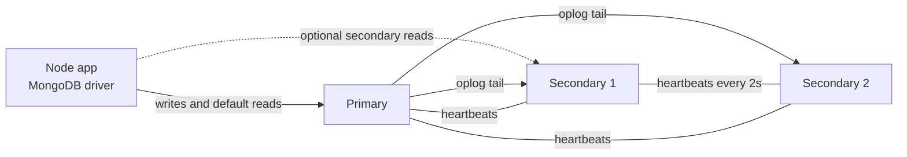
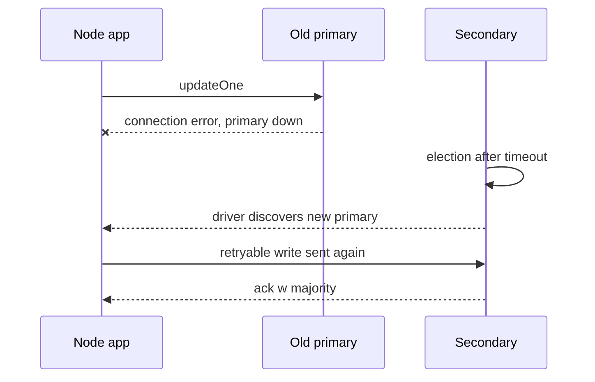

A single `mongod` is a single point of failure: when the machine or its disk dies, your app is down and recent writes may be gone. A **replica set** keeps several copies of the data on separate servers, elects one of them to accept writes, and promotes another automatically when it fails. Every production MongoDB deployment, including every Atlas cluster, is at least a three-member replica set.

## How it works

One member is the **primary** and accepts all writes. **Secondaries** continuously copy the primary's **oplog** (operations log), a capped collection in the `local` database that records every change in an idempotent form, and apply those operations to their own data.



Members exchange heartbeats every 2 seconds. If the secondaries cannot reach the primary for the election timeout (10 seconds by default, `electionTimeoutMillis`), an eligible secondary calls an **election**. A candidate needs votes from a **majority** of voting members, which is why replica sets use an odd number of voters. The most up-to-date eligible member with the highest priority usually wins. In practice, failover typically completes within roughly 10 to 15 seconds.

### Arbiters

An **arbiter** votes in elections but holds no data. It lets a two-data-node setup reach a majority cheaply, but it weakens durability: with one data node down, `w: 'majority'` writes cannot be acknowledged by data-bearing members, and majority reads can stall. MongoDB recommends three data-bearing members (P-S-S) over primary-secondary-arbiter (P-S-A) whenever possible.

## Write concern

Write concern controls when the server acknowledges a write.

| Setting | Meaning | Risk |
|---|---|---|
| `w: 0` | Fire and forget | Errors and losses are invisible |
| `w: 1` | Primary applied it | Lost if primary fails before replicating (rollback) |
| `w: 'majority'` | Majority of voting members have it | Survives failover; default since MongoDB 5.0 for most topologies |
| `j: true` | Written to the on-disk journal | Survives a process crash on the acknowledging members |
| `wtimeout` | Give up waiting after N ms | Write may still eventually apply |

```javascript
await Order.create([{ userId, total }], { writeConcern: { w: 'majority', j: true } });

// Or set it once on the connection
await mongoose.connect(uri, { writeConcern: { w: 'majority', wtimeoutMS: 5000 } });
```

Writes acknowledged only with `w: 1` that had not reached a majority when the primary crashed are **rolled back** when that node rejoins, and written to rollback files. For anything that matters (orders, payments, user accounts), use `w: 'majority'`.

## Read concern

Read concern controls what data a read may see.

- `local` (default for most reads): the newest data on the node, which might later be rolled back.
- `majority`: only data acknowledged by a majority, so it will never be rolled back.
- `linearizable`: reflects all majority-acknowledged writes completed before the read started; primary only and slower.
- `snapshot`: a consistent point-in-time view, used by transactions.

## Read preference

Read preference controls **which member** serves the read.

| Mode | Use |
|---|---|
| `primary` (default) | Read-your-writes, strongest consistency |
| `primaryPreferred` | Keep reading from a secondary during a failover |
| `secondary` | Offload analytics or reports |
| `secondaryPreferred` | Spread non-critical reads |
| `nearest` | Lowest latency in multi-region deployments |

```javascript
// Per query in Mongoose
const report = await Order.find({ createdAt: { $gte: since } })
  .read('secondaryPreferred')
  .lean();

// Or via connection string
// mongodb+srv://.../shop?readPreference=secondaryPreferred&maxStalenessSeconds=90
```

Secondaries lag behind the primary, sometimes by milliseconds, sometimes by seconds under heavy write load. If a user updates their profile and the next page reads from a secondary, they may see stale data. Use a causally consistent session or keep user-facing reads on the primary.

## Failover from the Node app's point of view



The driver monitors the topology and discovers the new primary automatically. During the election window:

- Writes fail with errors such as `NotWritablePrimary` or network errors. With `retryWrites=true`, the driver retries an eligible write **once** after selecting the new primary.
- Operations wait for a suitable server for up to `serverSelectionTimeoutMS` (30 seconds by default) before failing.
- Reads with `primaryPreferred` or `secondaryPreferred` can continue against secondaries.

Practical settings:

```javascript
await mongoose.connect(process.env.MONGODB_URI, {
  maxPoolSize: 50,
  serverSelectionTimeoutMS: 15000,
  retryWrites: true,
  retryReads: true,
});
```

Your code still needs to handle the rare case where the retry also fails: return a 503, retry at the job level, or use idempotency keys so clients can retry safely. Test this deliberately: Atlas has a "Test Failover" button, and locally you can run `rs.stepDown()` in mongosh.

```javascript
// mongosh
rs.status().members.map((m) => ({ name: m.name, state: m.stateStr, lag: m.optimeDate }));
rs.printSecondaryReplicationInfo();
rs.conf();
```

## Trade-offs and pitfalls

- **Replicas are not backups.** A `deleteMany({})` replicates to every member in milliseconds. Use point-in-time backups.
- **Oplog window**: if a secondary falls behind longer than the oplog covers, it needs a full resync. Size the oplog for hours or days of writes.
- **Reading from secondaries to scale** gives stale reads and does not help write throughput.
- **Even number of voters** or a P-S-A topology causes availability and durability surprises.
- **Multi-region**: place members so that losing one region still leaves a voting majority.

## Interview angle

- Explain elections and majority, and why three members is the minimum sensible production setup.
- Tie write concern to durability: `w: 'majority'` is what makes an acknowledged write survive failover.
- Distinguish read preference (which node) from read concern (which data is visible).
- Describe what the app sees during a 10 to 15 second failover and how retryable writes and idempotency cover it.

## Key takeaways

- A replica set gives high availability and data redundancy, not horizontal write scaling.
- Use `w: 'majority'` for important writes; `w: 1` can be rolled back.
- Secondary reads are eventually consistent; keep read-your-writes paths on the primary.
- Drivers handle failover automatically, but the app must tolerate a short write outage.
- Prefer three data-bearing members over an arbiter.
