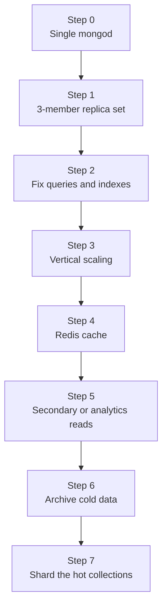

"How would you scale the database?" is one of the most common system design follow-ups, and the weakest answer is "shard it". Sharding is the last and most expensive step. A MERN app typically climbs a ladder of cheaper moves first, each triggered by a specific, measurable signal. Knowing the order, and the signal for each rung, is what makes an answer sound like production experience.

## How it works



The order is not strict. Steps 2 and 3 often alternate, and caching may come before read scaling. The principle is: take the cheapest step that addresses the measured bottleneck.

## Step 0: a single node

A single `mongod` on a VM or in Docker is fine for development and early prototypes. It has no failover, no transactions (they need a replica set), and no change streams. Leaving it in production is a reliability problem before it is a performance one.

**Signal to move on**: you have real users or any data you cannot afford to lose.

## Step 1: a managed replica set

Move to a three-member replica set, typically on MongoDB Atlas, where an M10 or larger dedicated tier gives you automated backups, monitoring, the Performance Advisor and one-click failover tests.

```javascript
await mongoose.connect(process.env.MONGODB_URI, {
  maxPoolSize: 20,
  writeConcern: { w: 'majority' },
  retryWrites: true,
});
```

This is about availability and durability, not throughput.

## Step 2: fix queries before buying hardware

Most "the database is slow" incidents are a missing or wrong index, an unbounded array, or a pipeline doing too much. Turn on the profiler or use the Atlas Query Profiler, find the slow query shapes, and fix them.

```javascript
// mongosh
db.setProfilingLevel(1, { slowms: 100 });
db.system.profile.find().sort({ millis: -1 }).limit(5);
```

**Signal**: `COLLSCAN` in slow query logs, high "scanned objects to returned" ratio, or CPU spikes that correlate with specific endpoints.

## Step 3: vertical scaling

Scaling up (more RAM, CPU, faster disks or more IOPS) is the most underrated step. It requires no code changes and on Atlas is a rolling, near-zero-downtime operation. The most important resource is **RAM relative to the working set**: the indexes and documents your app touches frequently should fit in the WiredTiger cache.

**Signals**: cache dirty or used percentage persistently high, rising disk read IOPS as data grows, page faults, CPU near saturation after query fixes. Atlas tier autoscaling can handle gradual growth.

## Step 4: cache hot reads in Redis

When the same expensive reads are served repeatedly (product pages, feeds, configuration, session data), a cache in front of MongoDB removes load entirely rather than just spreading it.

```javascript
async function getProduct(id) {
  const key = `product:${id}`;
  const hit = await redis.get(key);
  if (hit) return JSON.parse(hit);

  const doc = await Product.findById(id).lean();
  if (doc) await redis.set(key, JSON.stringify(doc), { EX: 300 });
  return doc;
}

async function updateProduct(id, patch) {
  await Product.updateOne({ _id: id }, { $set: patch });
  await redis.del(`product:${id}`); // invalidate after write
}
```

**Signals**: a small set of documents or query results accounts for a large share of reads; read latency matters more than absolute freshness. Watch for cache stampedes on hot keys and decide a TTL per data type.

## Step 5: scale reads with secondaries or analytics nodes

Route reporting, exports and dashboards to secondaries (or Atlas analytics nodes, which are tagged secondaries that do not serve normal app traffic). This isolates heavy analytical reads from latency-sensitive OLTP traffic.

```javascript
const rows = await Order.aggregate(pipeline).read('secondary', [{ nodeType: 'ANALYTICS' }]);
```

**Signals**: reporting jobs cause latency spikes on the primary. Not a signal: "writes are slow". Secondaries apply every write too, so they do not add write capacity, and their data can be slightly stale.

## Step 6: archive cold data

Many collections are mostly history: old orders, logs, events, notifications. Keeping years of cold data in hot collections bloats indexes and pushes the working set out of RAM.

- TTL indexes for data that can simply expire (`expireAfterSeconds`).
- A nightly job that moves old documents to an archive collection or cluster with `$merge`, then deletes them in batches.
- Atlas Online Archive, which moves aged data to cheaper object storage while keeping it queryable through a federated endpoint.

**Signals**: indexes no longer fit in RAM, most queries touch only recent data, storage costs climb.

## Step 7: shard

Shard when a single replica set genuinely cannot keep up, usually for one of three reasons:

| Signal | Why sharding helps |
|---|---|
| Write throughput saturates the largest practical primary | Writes spread across multiple primaries |
| Data size exceeds what one replica set can hold or back up in reasonable time | Storage spread across shards |
| Working set exceeds the RAM of the largest practical instance | Each shard holds part of the working set |

Shard only the collections that need it. Small, rarely written collections can stay unsharded on a primary shard. The shard key decision dominates the outcome, so prototype it against real query patterns first.

## Trade-offs and pitfalls

- **Skipping step 2** and buying hardware to compensate for missing indexes is the most expensive mistake.
- **Caching without invalidation** serves stale data; decide the owner of each cache key.
- **Using secondaries as a write-scaling strategy** does not work.
- **Sharding with a poor key** can make performance worse than a single replica set.
- **Ignoring connection counts**: scaling app servers horizontally multiplies connection pools; 50 pods with `maxPoolSize: 100` can open 5,000 connections.

## Interview angle

- Present the ladder in order and attach a metric to each step: slow query ratio, cache hit rate, CPU, IOPS, replication lag, working set versus RAM.
- Emphasise that replicas scale reads and availability, while sharding is the only way to scale writes horizontally.
- Use Redis for hot reads and archiving for cold data before proposing sharding.
- If you do shard, immediately discuss the shard key for the specific entity.

## Key takeaways

- Start with a replica set for availability, then fix queries and indexes.
- Scale vertically before horizontally; RAM for the working set matters most.
- Cache hot reads, offload analytics to secondaries, and archive cold data.
- Shard last, when write throughput, data size or working set outgrow one replica set.
- Every step should be justified by a measured signal, not by anticipated scale.
