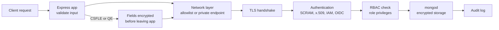

Most MongoDB breaches are not clever exploits. They are databases bound to `0.0.0.0` with no authentication, application users with `root`, connection strings committed to Git, and Express handlers that pass `req.body` straight into `find()`. Securing MongoDB is a layered job: prove who is connecting, limit what they can do, encrypt the wire and the disk, keep the network private, record what happened, and stop the application from turning user input into query operators.

## How it works

Every request crosses several independent controls. Failing any one of them should not expose data on its own, which is the point of defense in depth.



## Authentication

Since MongoDB 4.0 the default mechanism is **SCRAM-SHA-256**: a salted challenge-response where the password never crosses the wire. Self-managed servers must start with `security.authorization: enabled`; without it, anyone who can reach port 27017 is effectively admin.

Other mechanisms:

- **x.509 certificates**: clients and replica set members authenticate with certificates instead of passwords. Common for internal cluster auth (`security.clusterAuthMode: x509`) and service-to-service connections.
- **AWS IAM** (`MONGODB-AWS`) on Atlas: a Lambda or EKS pod authenticates with its IAM role, so there is no database password to store or rotate.
- **OIDC** (`MONGODB-OIDC`, MongoDB 7.0+ Enterprise and Atlas): workforce identity federation lets humans log in through Okta or Entra ID; workload identity federation does the same for services on Azure or GCP.
- **LDAP and Kerberos** are Enterprise Advanced options for organizations with existing directories.

```javascript
// Node driver with IAM auth: no secret in the URI
const client = new MongoClient(
  'mongodb+srv://cluster0.abc12.mongodb.net/?authMechanism=MONGODB-AWS&authSource=$external'
);
```

## RBAC with least privilege

Built-in roles like `readWrite` and `dbAdmin` are broad. Give each application its own user and a custom role scoped to exactly the collections and actions it needs.

```javascript
// mongosh
use shop;
db.createRole({
  role: 'ordersApi',
  privileges: [
    { resource: { db: 'shop', collection: 'orders' }, actions: ['find', 'insert', 'update'] },
    { resource: { db: 'shop', collection: 'products' }, actions: ['find'] },
  ],
  roles: [],
});
db.createUser({ user: 'orders-api', pwd: passwordPrompt(), roles: ['ordersApi'] });
```

The orders API cannot delete orders, cannot write products, and cannot drop collections. A reporting job gets a separate read-only user pointed at a secondary. Humans use named accounts with short-lived access, not the application credential. Never use `root` or `atlasAdmin` from application code.

## TLS and network access

Require TLS for every connection with `net.tls.mode: requireTLS` (Atlas enforces TLS 1.2+ by default). Use a CA-signed certificate and keep hostname validation on; `tlsAllowInvalidCertificates=true` in a production URI silently disables protection against man-in-the-middle attacks.

Network exposure is the first line:

- Self-managed: bind to private interfaces only (`net.bindIp: 10.0.1.12`) and restrict 27017 with security groups so only app subnets can connect.
- Atlas: the **IP access list** starts empty. Never add `0.0.0.0/0` to make a deploy work. Prefer **VPC/VNet peering** or **private endpoints** (AWS PrivateLink, Azure Private Link, GCP Private Service Connect), which keep traffic off the public internet entirely.

## Encryption at rest and in use

**At rest**: Atlas encrypts all cluster storage and backups by default, and you can add customer key management with AWS KMS, Azure Key Vault or GCP KMS so revoking the key makes the data unreadable. Self-managed, the WiredTiger encrypted storage engine is an Enterprise feature (with KMIP key management); Community users rely on filesystem or volume encryption such as LUKS or EBS encryption.

At-rest encryption does not protect against a compromised DBA account or a leaked connection string, because the server decrypts data for any authorized query. For that you need **in-use encryption**, where the driver encrypts fields before they leave the application and the server only ever sees ciphertext:

- **Client-Side Field Level Encryption** (CSFLE, 4.2+): deterministic encryption allows equality queries; random encryption allows none.
- **Queryable Encryption** (GA in 7.0 for equality, range queries GA in 8.0): randomized encryption that still supports equality and range queries on encrypted fields, using encrypted metadata collections on the server.

```javascript
const encryptedFieldsMap = {
  'clinic.patients': {
    fields: [
      { path: 'ssn', bsonType: 'string', queries: { queryType: 'equality' } },
      { path: 'dob', bsonType: 'date', queries: { queryType: 'range', min: new Date('1900-01-01'), max: new Date('2100-01-01') } },
    ],
  },
};
const client = new MongoClient(uri, {
  autoEncryption: { keyVaultNamespace: 'encryption.__keyVault', kmsProviders, encryptedFieldsMap },
});
```

Keys live in a KMS; the data encryption keys are stored wrapped in a key vault collection. Costs: larger documents, extra metadata writes (Queryable Encryption can roughly double or triple storage for indexed fields), and no sorting or aggregation on encrypted values.

## Auditing

Auditing records authentication attempts, user and role changes, DDL such as `dropCollection`, and optionally CRUD on chosen namespaces. It requires Enterprise Advanced or an Atlas M10+ cluster.

```yaml
auditLog:
  destination: file
  format: JSON
  path: /var/log/mongodb/audit.json
  filter: '{ atype: { $in: ["authenticate", "dropCollection", "createUser", "grantRolesToUser"] } }'
```

Ship the log to a SIEM and alert on failed authentication bursts and privilege grants. Auditing every read on a busy collection can cost noticeable throughput, so filter.

## NoSQL injection in Express

MongoDB has no SQL string to inject into, but JSON bodies can carry **query operators**. Consider:

```javascript
app.post('/login', async (req, res) => {
  const user = await User.findOne({ email: req.body.email, password: req.body.password });
});
```

Sending `{"email": "admin@shop.com", "password": {"$gt": ""}}` matches any non-empty password. Query strings work too: `?role[$ne]=user` is parsed by `qs` into `{ role: { $ne: 'user' } }`.

Defenses, in order of strength:

1. **Validate types at the edge** with Zod, Joi or express-validator. If `password` must be a string, an object is rejected before reaching the database.
2. **Enable Mongoose `sanitizeFilter`**, which wraps nested objects containing `$` keys in `$eq` so they are compared literally.
3. **Strip `$` and `.` keys** with middleware such as `express-mongo-sanitize` (note it mutates `req.query`, which Express 5 made read-only, so validate instead on Express 5).
4. **Disable server-side JavaScript** (`security.javascriptEnabled: false`) so `$where` and `$function` cannot run attacker-controlled code.

```javascript
const Login = z.object({ email: z.string().email(), password: z.string().min(8).max(128) });
mongoose.set('sanitizeFilter', true);

app.post('/login', async (req, res) => {
  const { email, password } = Login.parse(req.body);
  const user = await User.findOne({ email }).select('+passwordHash');
  if (!user || !(await bcrypt.compare(password, user.passwordHash))) return res.sendStatus(401);
});
```

Also never compare passwords in the query: fetch by email and verify a bcrypt or Argon2 hash in the application.

## Secrets handling

Connection strings are credentials. Keep them out of Git, Docker images and client bundles. Load them at runtime from AWS Secrets Manager, Vault or Kubernetes Secrets, rotate them on a schedule, and prefer IAM or OIDC so there is no long-lived password at all. Scrub URIs from logs, since many error messages echo the full connection string.

## Trade-offs and pitfalls

- **Auth disabled on "internal" servers** is the classic breach; ransom bots scan for open 27017 continuously.
- **Shared application users** make audits useless and blast radius huge.
- **CSFLE and Queryable Encryption** remove server-side search, sorting and most aggregation on protected fields; encrypt only genuinely sensitive fields.
- **Losing the KMS key** means losing the data permanently.
- **Sanitizer middleware alone** is brittle; schema validation of inputs is the real fix.
- **`0.0.0.0/0` on Atlas** "temporarily" tends to stay forever.

## Interview angle

- Describe layers: network isolation, TLS, authentication, least-privilege RBAC, encryption at rest, field-level encryption for PII, auditing.
- Show the `{"$gt": ""}` login bypass and fix it with type validation plus `sanitizeFilter`.
- Distinguish at-rest encryption (protects disks and backups) from Queryable Encryption (protects against the server operator).
- Mention IAM or OIDC auth to eliminate static credentials.

## Key takeaways

- Always enable authorization, use SCRAM-SHA-256 or keyless IAM/OIDC auth, and require TLS.
- One user and one custom role per application, scoped to the collections it touches.
- Keep clusters on private networks; avoid public IP allowlists.
- Use Queryable Encryption or CSFLE for fields the database operator must not read.
- Validate request types before they become query filters, and keep secrets out of code.
