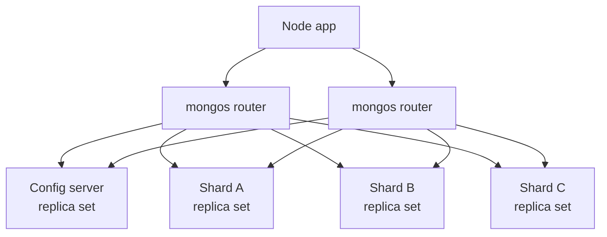

A replica set scales reads a little and availability a lot, but every write still lands on one primary, and the whole dataset must fit on one machine's disks and, ideally, its working set in one machine's RAM. When write throughput or data size outgrows the largest sensible server, you **shard**: split a collection horizontally across several replica sets. Sharding is powerful and permanent in its consequences, and nearly everything depends on one choice, the **shard key**.

## How it works

A sharded cluster has three components:

- **Shards**: each is a full replica set holding a subset of the data.
- **Config servers**: a replica set storing metadata, including which ranges of the shard key live on which shard.
- **mongos**: stateless query routers. Your Node app connects to mongos exactly as it would to a normal `mongod`.



Data is divided into contiguous ranges of shard key values called **chunks** (also called ranges in newer versions). The **balancer**, a background process run by the config server primary, migrates chunks between shards to keep the data evenly distributed. In MongoDB 6.0 and later, the balancer balances by data size per shard rather than by chunk count, and the default range size is 128MB.

When a query arrives, mongos checks the routing table:

- If the filter includes the shard key, mongos sends it to the one shard (or few shards) that own those values: a **targeted query**.
- If not, mongos must send it to **every** shard and merge the results: a **scatter-gather** query.

## Sharding a collection

```javascript
// mongosh connected to mongos
sh.enableSharding('shop'); // implicit in recent versions, harmless to run
db.orders.createIndex({ customerId: 1, createdAt: 1 });
sh.shardCollection('shop.orders', { customerId: 1, createdAt: 1 });

// Hashed alternative
sh.shardCollection('shop.events', { deviceId: 'hashed' });

sh.status();
db.orders.getShardDistribution();
```

## Ranged, hashed and zoned sharding

| Strategy | How data is placed | Good for | Watch out for |
|---|---|---|---|
| Ranged | Contiguous key ranges per chunk | Range queries on the key, locality | Monotonic keys create a hot shard |
| Hashed | Hash of the key decides placement | Even write distribution | Range queries on the key become scatter-gather |
| Zoned | Key ranges pinned to tagged shards | Data residency, tiered hardware | Zones must be maintained as data grows |

Zoned sharding example, keeping EU customers on EU shards:

```javascript
sh.addShardToZone('shard-eu-1', 'EU');
sh.updateZoneKeyRange(
  'shop.customers',
  { region: 'EU', customerId: MinKey },
  { region: 'EU', customerId: MaxKey },
  'EU'
);
```

This requires the shard key to start with `region`.

## Choosing a shard key

Evaluate candidates against three properties, then against your top queries.

1. **Cardinality**: how many distinct values exist. A key with only 5 values (`country` for a regional app) can never be split into more than 5 chunks, which caps the cluster at 5 useful shards.
2. **Frequency**: how evenly values occur. If 40 percent of documents share one value, that chunk cannot be split and becomes a **jumbo chunk** that the balancer cannot move.
3. **Monotonicity**: whether values always increase. `createdAt` or a default `ObjectId` as a ranged key sends every insert to the chunk holding the maximum value, so one shard takes all writes while others sit idle.

Then the query test: the most frequent and latency-sensitive queries should include the shard key so they are targeted.

### Worked example: orders in a multi-tenant SaaS

| Candidate | Verdict |
|---|---|
| `_id` (ObjectId), ranged | Monotonic, all inserts hit one shard |
| `_id`, hashed | Even writes, but "orders for customer X" scatters to all shards |
| `status` | Very low cardinality, heavily skewed |
| `customerId` | Good targeting, but one huge tenant creates jumbo chunks |
| `{ customerId: 1, createdAt: 1 }` | Targeted by customer, splittable within a big customer, writes spread across customers |

The compound key wins: queries by customer are targeted, high cardinality comes from the second field, and inserts spread across many customers. If customer IDs were themselves sequential, hashing the first field (`{ customerId: 'hashed', createdAt: 1 }`, supported since 4.4) would remove that hotspot.

## Jumbo chunks

A chunk becomes jumbo when it exceeds the range size and cannot be split, because every document in it shares the same shard key value. The balancer will not migrate it, so that shard grows indefinitely. The fix is a key with more cardinality, which brings us to changing keys:

```javascript
// MongoDB 5.0+: online resharding
db.adminCommand({ reshardCollection: 'shop.orders', key: { customerId: 1, orderId: 1 } });

// 4.4+: append a suffix to an existing key to increase cardinality
db.adminCommand({ refineCollectionShardKey: 'shop.orders', key: { customerId: 1, orderId: 1 } });
```

Resharding rewrites the entire collection and needs spare disk and I/O capacity. It is possible but expensive, so choose carefully up front.

## Scatter-gather queries

A query without the shard key fans out to all N shards. Latency becomes the slowest shard's latency, and each shard spends resources even if it has no matching data. A few admin queries scattering is fine. A hot API endpoint scattering across 20 shards is a design problem. Common fixes: include the shard key in the query, maintain a small lookup collection that maps a secondary attribute to the shard key, or denormalize the field into the key.

Also remember: unique indexes on a sharded collection must include the shard key as a prefix, because each shard can only enforce uniqueness locally.

## Trade-offs and pitfalls

- **Sharding too early** adds operational cost (more servers, mongos, config servers, complex backups) when vertical scaling and indexes would suffice.
- **Sharding too late** means migrating terabytes under load. Start planning when a single replica set approaches the limits of the largest affordable instance.
- **Monotonic ranged keys** produce a single hot shard.
- **Low-cardinality keys** produce jumbo chunks.
- **Transactions and `$lookup`** across shards work but are slower than single-shard operations.
- **Balancer migrations** consume I/O; schedule a balancing window if migrations hurt peak traffic.

## Interview angle

- When the interviewer says "now we have 10x the writes", explain why replicas do not help and sharding does.
- Walk through shard key selection with cardinality, frequency, monotonicity and query targeting, using the actual entity in the problem.
- Mention hashed keys for write distribution and their cost on range queries.
- Bring up zoned sharding for data residency requirements such as GDPR.

## Key takeaways

- Sharding scales writes and storage horizontally; replica sets do not.
- mongos routes by shard key; queries without it scatter to every shard.
- A good shard key has high cardinality, even frequency, non-monotonic inserts, and appears in hot queries.
- Compound keys like `{ tenantId, createdAt }` often balance targeting and distribution.
- Resharding exists but is costly, so treat the shard key as a long-term decision.
