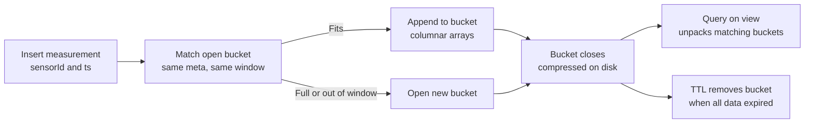

Metrics, IoT readings, clickstreams and audit events share a shape: append-heavy writes, rarely updated, queried by time range, and worthless after a retention window. Storing one document per reading in a normal collection works until you have 2 billion of them and an index that no longer fits in RAM. MongoDB offers three tools for this kind of data: **time series collections** for compact storage and fast range queries, **TTL indexes** for automatic expiry, and **capped collections** for fixed-size ring buffers.

## How it works

A time series collection looks like a normal collection to your application, but MongoDB stores it as a view over an internal `system.buckets.<name>` collection. Measurements that share the same `metaField` value and fall into the same time window are grouped into one bucket document, stored in columnar form and compressed.



A bucket holds up to 1,000 measurements or roughly 125 KB, and each bucket stores `control.min` and `control.max` for every field. Queries on a time range skip buckets whose min and max do not overlap, which is why range scans are cheap. A common result is 5x to 10x less storage than one document per reading, plus far fewer index entries.

## Creating a time series collection

```javascript
// mongosh
db.createCollection('readings', {
  timeseries: {
    timeField: 'ts',          // required, must be a BSON date
    metaField: 'meta',        // optional: identifies the series
    granularity: 'minutes',   // seconds | minutes | hours
  },
  expireAfterSeconds: 60 * 60 * 24 * 90,  // drop data older than 90 days
});

db.readings.insertMany([
  { ts: new Date(), meta: { sensorId: 's-17', site: 'berlin' }, temp: 21.4, humidity: 0.41 },
  { ts: new Date(), meta: { sensorId: 's-18', site: 'berlin' }, temp: 19.8, humidity: 0.45 },
]);
```

Put fields that identify the series and rarely change, such as device id, region or customer, in `metaField`. Never put a high-cardinality, per-reading value like a request id there, or every measurement gets its own bucket and the compression benefit vanishes.

### Granularity and bucket span

`granularity` should match the interval between consecutive readings of the same series:

| Granularity | Bucket span |
|---|---|
| `seconds` | 1 hour |
| `minutes` | 24 hours |
| `hours` | 30 days |

Since MongoDB 6.3 you can instead set `bucketMaxSpanSeconds` and `bucketRoundingSeconds` (they must be equal) for custom spans. Granularity can be raised later with `collMod`, from `seconds` to `minutes`, but never lowered.

## Indexes and queries

Since 6.3, a time series collection created with a `metaField` gets an automatic compound index on `{ meta: 1, ts: 1 }`. You can add secondary indexes on meta subfields and on measurement fields:

```javascript
db.readings.createIndex({ 'meta.site': 1, ts: -1 });
db.readings.createIndex({ temp: 1 });   // measurement index, useful for rare threshold queries

db.readings.aggregate([
  { $match: { 'meta.sensorId': 's-17', ts: { $gte: ISODate('2026-11-01'), $lt: ISODate('2026-11-02') } } },
  { $group: { _id: { $dateTrunc: { date: '$ts', unit: 'hour' } }, avgTemp: { $avg: '$temp' }, maxTemp: { $max: '$temp' } } },
  { $sort: { _id: 1 } },
]);
```

Always filter on the meta field and a time range so the planner can prune buckets. MongoDB 8.0's block processing executes many `$match`, `$group` and window stages directly on compressed buckets, giving large speedups for this kind of rollup.

### Limitations

- You cannot convert an existing collection to time series or back; migrate with `$out` or a copy script.
- Updates and deletes are supported with growing flexibility across 5.x to 8.x, but they rewrite whole buckets and are slow. Treat the data as append-only.
- No writes inside multi-document transactions, no change streams, and no unique indexes on measurements.
- Very late or out-of-order inserts open extra buckets and hurt compression.
- Sharding is supported, typically on `metaField` subfields plus time.

## TTL indexes

A TTL index deletes documents once a date field is older than `expireAfterSeconds`. A background thread on the primary, the TTL monitor, wakes every 60 seconds and issues deletes, which replicate to secondaries like normal writes.

```javascript
// Delete sessions 30 minutes after creation
db.sessions.createIndex({ createdAt: 1 }, { expireAfterSeconds: 1800 });

// expireAt pattern: each document chooses its own expiry
db.otps.createIndex({ expireAt: 1 }, { expireAfterSeconds: 0 });
db.otps.insertOne({ phone: '+491701234', code: '482913', expireAt: new Date(Date.now() + 5 * 60 * 1000) });

// Partial TTL: only purge soft-deleted documents
db.carts.createIndex(
  { updatedAt: 1 },
  { expireAfterSeconds: 7 * 86400, partialFilterExpression: { status: 'abandoned' } }
);

// Change retention without rebuilding
db.runCommand({ collMod: 'sessions', index: { keyPattern: { createdAt: 1 }, expireAfterSeconds: 3600 } });
```

Rules to remember:

- The field must hold a BSON `Date` or an array of dates (the earliest is used). Strings or epoch numbers never expire.
- TTL indexes are single-field only, and cannot be on `_id`.
- Expiry is not exact: documents can survive 60 seconds or much longer if the monitor falls behind under heavy delete load. Always filter `expireAt: { $gt: new Date() }` in reads where exactness matters, like OTP validation.
- Mass expiry is a delete storm. Expiring 50 million documents at midnight competes with production writes; spread expiry times out with jitter.

In Mongoose, `{ createdAt: { type: Date, expires: '30m' } }` or `schema.index({ expireAt: 1 }, { expireAfterSeconds: 0 })` creates the same index.

## Capped collections

A capped collection has a fixed maximum size and preserves insertion order. When full, the oldest documents are overwritten, like a ring buffer.

```javascript
db.createCollection('recentLogs', { capped: true, size: 100 * 1024 * 1024, max: 500000 });
db.recentLogs.find().sort({ $natural: -1 }).limit(100);
```

They also support tailable cursors. The constraints are severe: you cannot delete individual documents, updates cannot grow a document, and they cannot be sharded. MongoDB itself now recommends TTL indexes or time series collections for most use cases; reserve capped collections for small, local ring buffers.

## When to use something else

- **Heavy analytical scans** across billions of points with complex SQL: ClickHouse, TimescaleDB or a column store will be faster and cheaper.
- **High-cardinality metrics monitoring** with Grafana dashboards: Prometheus with Thanos or Mimir, or InfluxDB.
- **Long-term cold retention**: archive old buckets to S3 as Parquet, or use Atlas Online Archive, instead of keeping years of data on cluster disks.
- **Exact-time expiry**, such as a reservation hold released at precisely 10:00: use a scheduler or a delayed job queue, not TTL.

MongoDB time series is a good fit when the readings live next to operational data your app already serves and queries stay within days or weeks.

## Trade-offs and pitfalls

- A wrong `metaField` choice, either too granular or constantly changing, destroys bucketing efficiency.
- Granularity too coarse for sparse series wastes space; too fine for dense series creates many small buckets.
- Time series TTL drops whole buckets, so data expires in chunks of up to one bucket span.
- TTL deletes are real deletes: they generate oplog entries and can lag replication during big purges.
- Capped collections block normal maintenance like removing a bad document.

## Interview angle

- For an IoT or metrics design, propose a time series collection with device id as `metaField`, granularity matched to the reporting interval, and collection-level `expireAfterSeconds` for retention.
- Explain bucketing and min/max pruning to justify storage and query gains.
- Use TTL for sessions and OTPs, and call out the 60-second monitor and lack of exactness.
- Know when to say "this belongs in ClickHouse or Prometheus".

## Key takeaways

- Time series collections compress measurements into buckets keyed by `metaField` and time.
- Pick `metaField` for series identity and granularity for the reporting interval.
- TTL indexes need Date fields and expire approximately every 60 seconds; use `expireAfterSeconds: 0` for per-document expiry.
- Capped collections are niche ring buffers; prefer TTL or time series.
- Large-scale analytics and long retention often belong in a dedicated store or archive.
