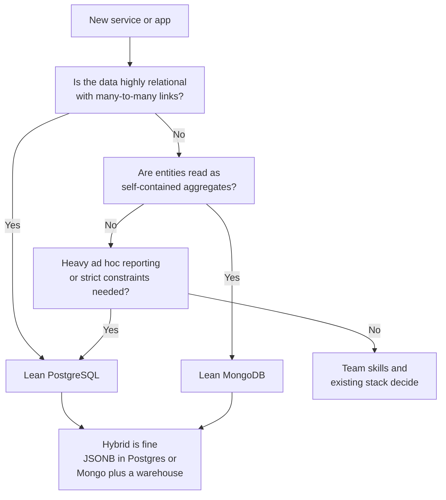

The "M" in MERN makes MongoDB the default, but the default is not always the right call. PostgreSQL has become the go-to relational database for Node backends, and it handles JSON well. MongoDB, meanwhile, has added transactions, schema validation and joins. The two now overlap heavily, so the decision rests on the shape of your data, your query patterns and your scaling path, not on old stereotypes like "Mongo is not ACID" or "Postgres cannot do JSON".

## How it works

The core difference is the unit of storage and the way relationships are expressed. MongoDB stores rich documents and expects you to co-locate related data. PostgreSQL stores normalized rows and relies on joins and constraints at query time.



## The same order in both

MongoDB, with the order as one aggregate:

```javascript
const order = await Order.create({
  userId,
  status: 'paid',
  items: [
    { sku: 'TSHIRT-M', qty: 2, price: 19.99 },
    { sku: 'CAP-01', qty: 1, price: 14.5 },
  ],
  shipping: { city: 'Kochi', zip: '682001' },
  total: 54.48,
});

// One read, no joins
const full = await Order.findById(order._id).lean();
```

PostgreSQL, normalized with constraints:

```sql
CREATE TABLE orders (
  id         bigserial PRIMARY KEY,
  user_id    bigint NOT NULL REFERENCES users(id),
  status     text NOT NULL CHECK (status IN ('pending','paid','shipped')),
  shipping   jsonb NOT NULL,
  total      numeric(12,2) NOT NULL,
  created_at timestamptz NOT NULL DEFAULT now()
);

CREATE TABLE order_items (
  order_id bigint NOT NULL REFERENCES orders(id) ON DELETE CASCADE,
  sku      text   NOT NULL REFERENCES products(sku),
  qty      int    NOT NULL CHECK (qty > 0),
  price    numeric(10,2) NOT NULL,
  PRIMARY KEY (order_id, sku)
);

SELECT o.*, json_agg(oi.*) AS items
FROM orders o JOIN order_items oi ON oi.order_id = o.id
WHERE o.id = $1
GROUP BY o.id;
```

The MongoDB version is simpler for reading one order. The PostgreSQL version guarantees that every item references a real product and quantities are positive, and it answers "total revenue per product across all orders" with one straightforward query.

## Comparison

| Dimension | MongoDB | PostgreSQL |
|---|---|---|
| Schema | Flexible documents; optional `$jsonSchema` validation; Mongoose enforces in app | Strict typed schema; migrations required; constraints, foreign keys, checks |
| Joins | `$lookup` works but is not the primary model; design to avoid frequent joins | First-class, efficient joins with a mature cost-based planner |
| Transactions | Single-document atomic always; multi-document ACID since 4.0 with some overhead | Full ACID by default for every statement; mature isolation levels |
| Scaling | Native sharding, replica sets with automatic failover built in | Scale up and read replicas; horizontal sharding via extensions like Citus or app-level partitioning |
| JSON support | Native BSON documents, rich operators on nested data | `jsonb` with GIN indexes and JSON path queries; strong but secondary to relational model |
| Ecosystem | Mongoose, Atlas (search, vector search, triggers, online archive) | Prisma, Drizzle, Knex, TypeORM; extensions such as PostGIS, pgvector, TimescaleDB |
| Reporting and BI | Aggregation pipeline; BI usually through exports or connectors | SQL works directly with nearly every BI tool |
| Managed options | Atlas on all major clouds | RDS, Aurora, Cloud SQL, Azure, Neon, Supabase |

## When MongoDB fits better

- Data is naturally hierarchical and read as whole aggregates: product catalogs with varied attributes, CMS content, user profiles with settings, event payloads.
- Schemas vary per record or evolve fast, and you want to ship without a migration for every new field.
- You expect high write volume or large data that will eventually need horizontal sharding.
- You want built-in change streams, Atlas Search and vector search in one managed platform.

## When PostgreSQL fits better

- The domain is relational and integrity-critical: accounting, billing, inventory across warehouses, bookings, permissions graphs.
- Many-to-many relationships and ad hoc queries across entities are common.
- Reporting, analytics and BI tools need direct SQL access.
- You want strong constraints enforced by the database regardless of which service writes.

## Hybrid approaches

Real systems often combine both, or use one in the style of the other.

- **PostgreSQL with JSONB**: relational core tables plus a `jsonb` column for flexible attributes. A product table with typed `price` and `stock` and a `attributes jsonb` column covers most "we need flexibility" cases.

```sql
CREATE INDEX idx_products_attrs ON products USING gin (attributes jsonb_path_ops);
SELECT id, name FROM products WHERE attributes @> '{"color": "red", "size": "M"}';
```

- **Polyglot persistence by service**: billing and orders in PostgreSQL, catalog, content and activity feeds in MongoDB. Each service owns its database; events (outbox plus change streams or logical replication) keep read models in sync.
- **MongoDB plus a warehouse**: keep MongoDB for OLTP and stream changes to BigQuery, Snowflake or Postgres for reporting.

Avoid splitting a single tightly coupled domain across both databases, which forces distributed transactions and double the operational work.

## Trade-offs and pitfalls

- **Choosing MongoDB to avoid schema design** leads to inconsistent documents and painful queries later. You still need a schema; it just lives in Mongoose, validators and conventions.
- **Choosing PostgreSQL and then storing everything in one JSONB column** loses the benefits of the relational model and its planner statistics.
- **Ignoring team experience**: operating either database well matters more than marginal feature differences.
- **Assuming sharding is needed**: most apps never outgrow a well-tuned single primary of either database.

## Interview angle

- Avoid tribal answers. State the data shape and access patterns first, then choose and justify.
- Acknowledge that both support ACID transactions and JSON; the difference is the primary model and its defaults.
- Mention a hybrid: Postgres for money and integrity, MongoDB for flexible, aggregate-shaped or high-volume data.
- If scaling comes up, contrast MongoDB's native sharding with Postgres read replicas and Citus-style sharding.

## Key takeaways

- MongoDB suits aggregate-shaped, evolving and high-volume data; PostgreSQL suits relational, integrity-heavy and reporting-heavy data.
- Both are ACID-capable and JSON-capable; pick based on the dominant query patterns.
- MongoDB scales horizontally natively; PostgreSQL usually scales up and out with replicas first.
- Hybrid setups are common: JSONB inside Postgres or polyglot persistence per service.
