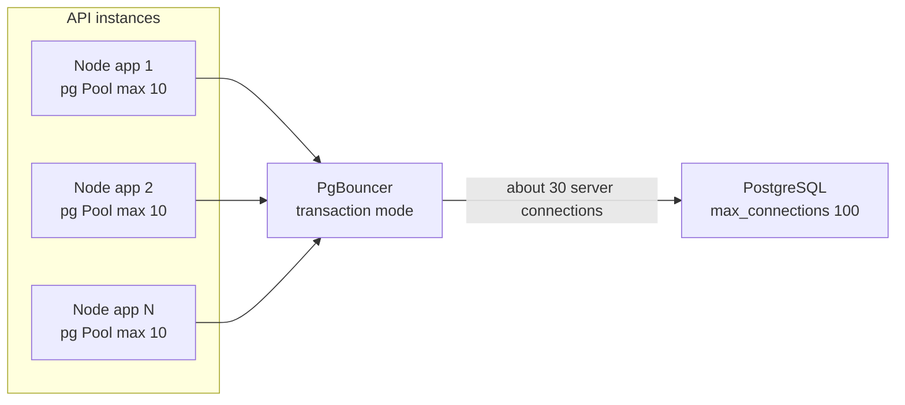

The first scaling wall many Node.js teams hit with PostgreSQL is not CPU or disk. It is `FATAL: sorry, too many clients already`. You scaled the API from 4 to 20 containers, each with a pool of 20, and suddenly you need 400 connections on a database configured for 100. Understanding why connections are costly, and where to put pooling, fixes this class of outage permanently.

## How it works

As covered in guide 1, each PostgreSQL connection is a forked OS process. Establishing one involves a TCP handshake, usually TLS, authentication (SCRAM-SHA-256 involves several round trips) and process startup: often several milliseconds or more. Each backend then holds its own memory: catalog caches, prepared plans, and `work_mem` allocations during sorts and hashes. Hundreds of mostly idle backends also add contention on internal shared structures and snapshot computation.

The fix is to reuse a small number of server connections across many client requests. You can pool in the application, in a proxy, or both.



## The node-postgres Pool

The `pg` package's `Pool` keeps open connections and hands them out per query.

```js
import pg from 'pg';

export const pool = new pg.Pool({
  connectionString: process.env.DATABASE_URL,
  max: 10,                        // per process; default is 10
  idleTimeoutMillis: 30_000,      // close idle clients after 30s
  connectionTimeoutMillis: 5_000, // fail fast instead of queueing forever
  maxLifetimeSeconds: 1800,       // recycle connections periodically
  statement_timeout: 15_000,      // server-side cap per statement
  application_name: 'orders-api',
});

pool.on('error', (err) => {
  // errors on idle clients, for example after a DB restart
  console.error('idle pg client error', err);
});
```

Use `pool.query()` for single statements. For transactions, check out one client and always release it:

```js
const client = await pool.connect();
try {
  await client.query('BEGIN');
  // ...
  await client.query('COMMIT');
} catch (e) {
  await client.query('ROLLBACK');
  throw e;
} finally {
  client.release();
}
```

A leaked client (no `release()` on an error path) eventually exhausts the pool and every request hangs until `connectionTimeoutMillis`. Watch `pool.totalCount`, `pool.idleCount` and `pool.waitingCount` in your metrics.

### Sizing the pool

Bigger is not faster. A database server can only run roughly as many queries in parallel as it has CPU cores (plus some headroom for I/O waits). Beyond that, extra connections just queue inside PostgreSQL instead of inside your app, with more context switching. A common starting point for the total active connections is a small multiple of the core count, for example 2 to 4 times cores, then measure.

## max_connections math

Do the arithmetic before you deploy:

```text
instances x pool max  +  workers x pool max  +  migrations/admin  +  replication  <  max_connections
     20   x    10     +     4    x    5      +        5          +       3       =  228
```

`max_connections` defaults to 100. Managed services often derive it from instance memory. Raising it to thousands without a pooler costs memory and throughput. `superuser_reserved_connections` keeps a few slots for admins so you can still log in during an incident. Autoscaling makes this worse: a burst from 20 to 60 pods triples your demand. That is the point where a proxy pooler pays off.

## PgBouncer

PgBouncer is a lightweight single-process proxy that speaks the Postgres protocol. Clients open thousands of cheap connections to it; it multiplexes them onto a small server pool.

```ini
; pgbouncer.ini
[databases]
app = host=10.0.0.5 port=5432 dbname=app

[pgbouncer]
listen_port = 6432
auth_type = scram-sha-256
pool_mode = transaction
max_client_conn = 5000
default_pool_size = 30
reserve_pool_size = 5
server_idle_timeout = 600
```

### Pooling modes

| Mode | Server connection assigned for | Multiplexing | Session features |
|------|-------------------------------|--------------|------------------|
| Session | The whole client connection | None, just reuse after disconnect | All work |
| Transaction | One transaction | High | Session state breaks |
| Statement | One statement | Highest | Multi-statement transactions forbidden |

**Transaction mode** is what most apps want, and it has caveats because consecutive transactions from one client can land on different server connections:

- `SET` (without `LOCAL`), session-level advisory locks, `LISTEN/NOTIFY`, temporary tables and `WITH HOLD` cursors do not behave as expected. Use `SET LOCAL` inside a transaction and `pg_advisory_xact_lock`.
- **Prepared statements**: named protocol-level prepared statements live on a server connection. Historically this broke drivers and ORMs that prepare statements automatically. PgBouncer 1.21 and later can track them with `max_prepared_statements`; on older versions, disable statement preparation in your client. In node-postgres, passing a `name` in the query config creates a named prepared statement, so avoid it behind older PgBouncer versions.
- Run migrations and `LISTEN` consumers against the database directly or through a session-mode pool.

Managed alternatives include RDS Proxy, Supabase's Supavisor, Neon's built-in pooler and Azure's built-in PgBouncer.

## Serverless and Lambda pitfalls

Each Lambda execution environment is a separate process, so 500 concurrent invocations means 500 pools. Guidelines:

- Create the pool **outside** the handler so warm invocations reuse it, and set `max: 1` or `2` per function instance.
- Put a pooler (RDS Proxy, PgBouncer) between functions and the database, or use an HTTP or WebSocket-based driver such as Neon's serverless driver.
- Cap function concurrency so it cannot exceed what the database can accept.
- Frozen environments keep connections open but idle; set server-side `idle_session_timeout` or pooler timeouts so they get reclaimed.

```js
// Lambda handler module scope
const pool = new pg.Pool({ connectionString: process.env.DATABASE_URL, max: 1, idleTimeoutMillis: 10_000 });

export const handler = async (event) => {
  const { rows } = await pool.query('SELECT * FROM orders WHERE id = $1', [event.id]);
  return rows[0];
};
```

## Trade-offs and pitfalls

- **Double pooling** (app pool plus PgBouncer) is normal and fine; keep app pools small.
- **PgBouncer is single-threaded**; at very high throughput run several instances behind a load balancer or use a multi-threaded alternative such as PgCat.
- **Long transactions defeat pooling**: a server connection is pinned for the full transaction.
- **Pool exhaustion masquerades as slow queries**: if p99 latency rises while DB CPU is low, check `waitingCount`.
- **Missing timeouts**: without `statement_timeout` and `connectionTimeoutMillis`, one stuck query can cascade into a full outage.

## Interview angle

- Explain why you cannot just raise `max_connections` to 5000.
- Draw the app pool plus PgBouncer topology and state which pooling mode you would use and why.
- Mention prepared statement and session-state caveats of transaction pooling.
- For serverless designs, propose RDS Proxy or an HTTP driver and concurrency limits.

## Key takeaways

- Postgres connections are processes; keep the server-side count small and busy.
- Size total pools against `max_connections` and roughly the core count, not request volume.
- Use PgBouncer in transaction mode for many app instances, and avoid session state.
- Serverless functions need `max: 1`, a proxy, and a concurrency cap.
