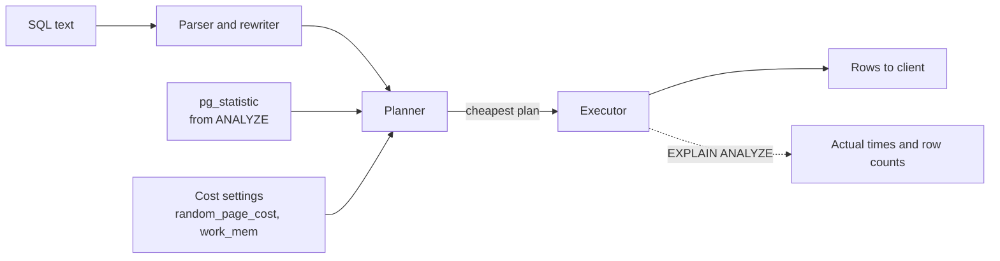

When an endpoint gets slow, guessing at indexes wastes time. PostgreSQL will tell you exactly how it executed a query and where the time went, if you know how to read the plan. This guide covers the plan nodes you see 95% of the time, the one number that explains most bad plans (estimated versus actual rows), and how to find which queries to look at in the first place.

## How it works

PostgreSQL turns SQL into a parse tree, rewrites it, then the **planner** enumerates candidate plans and picks the one with the lowest estimated cost. Costs come from table statistics gathered by `ANALYZE` (row counts, most common values, histograms, null fractions) combined with cost constants such as `random_page_cost`. The executor then runs the plan as a tree of nodes, each pulling rows from its children.



`EXPLAIN` shows the chosen plan with estimates only. `EXPLAIN ANALYZE` actually runs the query and adds real timings and row counts. Add `BUFFERS` to see how many pages came from cache versus disk.

```sql
EXPLAIN (ANALYZE, BUFFERS)
SELECT o.id, o.total, c.name
FROM orders o
JOIN customers c ON c.id = o.customer_id
WHERE o.created_at > now() - interval '1 day';
```

Remember that `EXPLAIN ANALYZE` executes the statement. For an UPDATE or DELETE, wrap it in `BEGIN; ... ROLLBACK;`.

## Reading a plan

```text
Hash Join  (cost=38.5..2412.7 rows=1200 width=44) (actual time=0.9..18.4 rows=1187 loops=1)
  Hash Cond: (o.customer_id = c.id)
  Buffers: shared hit=930 read=12
  ->  Index Scan using idx_orders_created on orders o  (cost=0.43..2340.1 rows=1200 width=20) (actual time=0.03..15.2 rows=1187 loops=1)
        Index Cond: (created_at > (now() - '1 day'::interval))
  ->  Hash  (cost=25.0..25.0 rows=1000 width=28) (actual time=0.8..0.8 rows=1000 loops=1)
        ->  Seq Scan on customers c  (cost=0.0..25.0 rows=1000 width=28) (actual time=0.01..0.3 rows=1000 loops=1)
Planning Time: 0.4 ms
Execution Time: 18.9 ms
```

Read it inside-out: the deepest indented nodes run first. For each node:

- `cost=startup..total` is in arbitrary planner units, useful only for comparison.
- `rows=` in the first parentheses is the **estimate**; in the second it is the **actual** count per loop.
- `loops=` tells you how many times the node ran. Multiply actual time and rows by loops for the true total.
- `shared hit` pages came from shared buffers; `read` pages came from the OS or disk.

## Scan types

| Node | What it does | When the planner picks it |
|------|--------------|---------------------------|
| Seq Scan | Reads every page of the table | Small tables, or a large fraction of rows match |
| Index Scan | Walks the index, fetches each matching heap tuple | Few rows match, or ordering is needed |
| Index Only Scan | Answers from the index, skips heap for all-visible pages | All needed columns are in the index |
| Bitmap Heap Scan | Builds a bitmap of matching pages from one or more indexes, then reads those pages in physical order | Moderate selectivity, or combining indexes with AND or OR |

A Seq Scan is not automatically bad. Reading 40% of a table via random index lookups is slower than reading it sequentially. Worry about a Seq Scan that filters millions of rows down to a handful: look for `Rows Removed by Filter` with a large number.

## Join strategies

- **Nested Loop**: for each outer row, look up matching inner rows (ideally via an index). Excellent when the outer side is small. Disastrous when the planner thinks the outer side has 10 rows and it actually has 500,000.
- **Hash Join**: build an in-memory hash table on the smaller input, probe it with the larger. Good for large unsorted equality joins. If the hash exceeds `work_mem` it spills into batches on disk (look for `Batches: 8` and similar).
- **Merge Join**: both inputs sorted on the join key, then merged. Good when both sides already come sorted from indexes.

## Row estimate errors

The single most useful habit: compare estimated rows to actual rows at each node. When they differ by 10x or more, the planner chose its strategy based on wrong information, and everything above that node is suspect.

Common causes and fixes:

```sql
-- 1. Stale statistics after a bulk load
ANALYZE orders;

-- 2. Skewed column needs a finer histogram (default target is 100)
ALTER TABLE orders ALTER COLUMN status SET STATISTICS 1000;
ANALYZE orders;

-- 3. Correlated columns: planner assumes independence
CREATE STATISTICS orders_city_zip (dependencies) ON city, zip FROM orders;
ANALYZE orders;
```

Other causes: functions in predicates (the planner falls back to default selectivity guesses), generic plans for prepared statements with skewed parameters, and CTEs or JSONB expressions the planner cannot see into.

## Finding the queries worth fixing: pg_stat_statements

Do not optimise the query you happen to remember. Optimise the queries consuming the most total time. The `pg_stat_statements` extension aggregates statistics per normalised query.

```sql
-- postgresql.conf: shared_preload_libraries = 'pg_stat_statements' (restart required)
CREATE EXTENSION IF NOT EXISTS pg_stat_statements;

SELECT left(query, 80) AS query,
       calls,
       round(total_exec_time::numeric) AS total_ms,
       round(mean_exec_time::numeric, 2) AS mean_ms,
       rows
FROM pg_stat_statements
ORDER BY total_exec_time DESC
LIMIT 10;
```

A 2 ms query called 5 million times a day often matters more than a 3-second report run once. Managed services (RDS Performance Insights, Cloud SQL Query Insights) layer a UI on similar data.

To capture plans of slow queries automatically, enable `auto_explain` with `auto_explain.log_min_duration = '500ms'`, or at least set `log_min_duration_statement`.

From Node.js you can grab a plan during debugging:

```js
const { rows } = await pool.query(
  'EXPLAIN (ANALYZE, BUFFERS, FORMAT JSON) SELECT * FROM orders WHERE customer_id = $1',
  [customerId]
);
console.log(JSON.stringify(rows[0]['QUERY PLAN'], null, 2));
```

Paste text plans into a visualiser such as explain.dalibo.com for large trees.

## Trade-offs and pitfalls

- **Testing on tiny data**: plans on a 1,000-row dev table look nothing like production. Test against realistic volumes.
- **Cold versus warm cache**: the first run reads from disk; the second hits cache. Compare `BUFFERS` output, not only time.
- **Forcing plans**: `SET enable_seqscan = off` is a diagnostic tool, not a fix. PostgreSQL has no built-in hints; fix statistics, indexes or the query instead.
- **`random_page_cost`** defaults to 4, tuned for spinning disks. On SSDs, values around 1.1 to 2 often produce better index choices.
- **`work_mem`** is per sort or hash node, per backend. Raising it globally can exhaust memory under concurrency; raise it per session for heavy reports.

## Interview angle

- When asked "this query is slow, what do you do?", answer: find it in pg_stat_statements, run EXPLAIN ANALYZE, compare estimates to actuals, then fix stats, index or query.
- Explain why the planner might rightly choose a seq scan over an index.
- Describe when nested loop versus hash join wins.

## Key takeaways

- Use `EXPLAIN (ANALYZE, BUFFERS)` and read plans from the innermost node outward.
- Large gaps between estimated and actual rows are the root cause of most bad plans.
- Fix estimates with ANALYZE, higher statistics targets, or extended statistics.
- Prioritise by total time in `pg_stat_statements`, not by the slowest single run.
