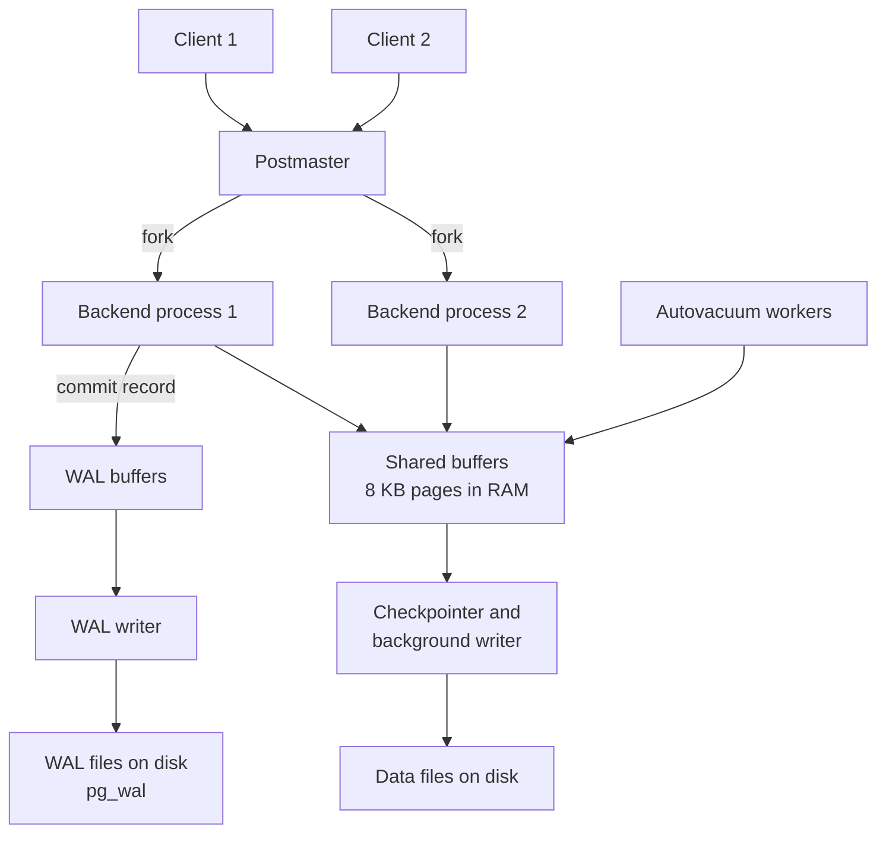

Most PostgreSQL production incidents trace back to a handful of internal mechanisms: every connection is a whole OS process, every UPDATE writes a new row version, and dead row versions have to be cleaned up by VACUUM before they pile up. If you understand those three facts, symptoms like "the table is 40 GB but holds 2 GB of data", "the database refused writes to prevent wraparound" or "we ran out of memory at 800 connections" stop being mysterious. This guide is the foundation for the rest of the series.

## How it works

A PostgreSQL server starts one parent process, the **postmaster**. Every client connection gets its own forked **backend process**. Background processes handle the work that is not tied to a single query: the WAL writer, the checkpointer, the background writer, autovacuum workers and, on primaries with replicas, WAL sender processes.



### Shared buffers and the OS cache

Tables and indexes are stored as 8 KB pages. When a backend needs a page it looks in **shared buffers**, a memory region shared by all backends. On a miss it reads from the OS, which often has the page in its own file cache. That is why the usual advice is to set `shared_buffers` to around 25% of RAM rather than 80%: PostgreSQL deliberately relies on the OS page cache as a second layer. `effective_cache_size` tells the planner how much total cache (shared buffers plus OS) to assume.

### The write-ahead log

Modified pages are not written to data files at commit time. Instead, a compact description of the change is appended to the **WAL** and flushed with `fsync`. Once the WAL record is durable, the commit returns. Dirty data pages are written later by the checkpointer. After a crash, PostgreSQL replays WAL from the last checkpoint to reconstruct any page changes that never reached the data files. The same WAL stream is what powers streaming replication and point-in-time recovery.

Checkpoints are tuned with `checkpoint_timeout` and `max_wal_size`. Checkpoints that happen too often cause I/O spikes and extra "full page image" WAL volume; too rarely and crash recovery takes longer.

### MVCC: every update is an insert

PostgreSQL implements multi-version concurrency control by keeping multiple physical versions (tuples) of a row. Each tuple header stores `xmin` (the transaction ID that created it) and `xmax` (the transaction that deleted or replaced it).

```sql
CREATE TABLE accounts (id int PRIMARY KEY, balance int);
INSERT INTO accounts VALUES (1, 100);

SELECT xmin, xmax, ctid, * FROM accounts;
--  xmin | xmax | ctid  | id | balance
--   741 |    0 | (0,1) |  1 |     100

UPDATE accounts SET balance = 90 WHERE id = 1;

SELECT xmin, xmax, ctid, * FROM accounts;
--   742 |    0 | (0,2) |  1 |      90
```

The `ctid` (physical location) changed: the UPDATE wrote a brand new tuple and marked the old one with `xmax = 742`. A transaction that started before 742 committed can still see the old version through its snapshot. That is how readers never block writers. The cost is that the old tuple is now **dead** once no snapshot needs it, and it still occupies space.

When the new version fits on the same page and no indexed column changed, PostgreSQL does a **HOT update** (heap-only tuple) and skips writing new index entries. Leaving free space on pages with `fillfactor` (for example 90 on heavily updated tables) increases HOT updates.

## VACUUM, autovacuum and bloat

**VACUUM** scans tables, finds dead tuples no running transaction can see, and marks their space reusable. It does not normally shrink the file; it makes space available for future inserts. It also updates the visibility map, which index-only scans depend on.

**Autovacuum** runs VACUUM and ANALYZE automatically. By default a table is vacuumed when dead tuples exceed `autovacuum_vacuum_threshold` (50) plus `autovacuum_vacuum_scale_factor` (0.2) times the row count. On a 100-million-row table that means 20 million dead rows before cleanup starts, which is far too late for hot tables. Tune per table:

```sql
ALTER TABLE events SET (
  autovacuum_vacuum_scale_factor = 0.01,
  autovacuum_analyze_scale_factor = 0.02
);

-- Who needs vacuum right now?
SELECT relname, n_live_tup, n_dead_tup, last_autovacuum
FROM pg_stat_user_tables
ORDER BY n_dead_tup DESC
LIMIT 10;
```

**Bloat** is what you get when dead tuples accumulate faster than vacuum reclaims them, or when something prevents reclaiming at all. The classic blocker is a long-running transaction (or an `idle in transaction` session, or an abandoned replication slot): VACUUM cannot remove any tuple that might still be visible to the oldest open snapshot. Finding them:

```sql
SELECT pid, state, now() - xact_start AS age, left(query, 60)
FROM pg_stat_activity
WHERE xact_start IS NOT NULL
ORDER BY xact_start
LIMIT 5;
```

Set `idle_in_transaction_session_timeout` so forgotten transactions get killed. To actually shrink a bloated table, `VACUUM FULL` rewrites it but takes an ACCESS EXCLUSIVE lock; the `pg_repack` extension does the same online.

## Transaction ID wraparound

Transaction IDs are 32-bit, so there are about 4 billion of them and comparisons are done modulo 2^32: roughly 2 billion IDs are "in the past" and 2 billion "in the future". If an old tuple's `xmin` were left untouched for 2 billion transactions, it would suddenly appear to be in the future and the row would vanish.

VACUUM prevents this by **freezing** old tuples, marking them as visible to everyone regardless of xid. Autovacuum launches an aggressive anti-wraparound vacuum when a table's oldest unfrozen xid exceeds `autovacuum_freeze_max_age` (200 million by default), and it runs even if autovacuum is disabled. If freezing still cannot keep up, PostgreSQL eventually stops assigning new transaction IDs and refuses writes until a manual VACUUM completes. Monitor it:

```sql
SELECT datname, age(datfrozenxid) AS xid_age
FROM pg_database ORDER BY xid_age DESC;
```

Alert well before ages approach 1 billion. High-write systems with long transactions or stuck replication slots are the ones that hit this.

## Trade-offs and pitfalls

- **Process per connection** costs several MB of memory per backend plus fork overhead, so thousands of direct connections hurt. This is why pooling exists (guide 5).
- **Update-heavy tables** generate dead tuples and WAL; wide rows updated frequently multiply the cost. Splitting hot counters into a narrow table can help.
- **Disabling autovacuum** to "save I/O" is almost always a mistake that turns into bloat and wraparound emergencies.
- **Long transactions** are the root cause of a surprising share of bloat. Keep transactions short and never hold one open across an HTTP call.
- **`VACUUM FULL` in production** locks the table for the full rewrite.

## Interview angle

- Explain how MVCC lets reads and writes proceed without blocking, and name the cost (dead tuples, vacuum).
- Contrast with an in-place update engine using undo logs, such as InnoDB, which keeps the table compact but shifts the cost to undo storage.
- Describe the WAL as the single source for durability, crash recovery and replication.
- If asked why a write-heavy table grows forever, walk through autovacuum thresholds and long-running transactions.

## Key takeaways

- Every connection is an OS process, so connection count is a real resource limit.
- Commits are durable once the WAL is flushed; data pages are written later at checkpoints.
- UPDATE creates a new tuple version; VACUUM reclaims old ones once no snapshot needs them.
- Tune autovacuum per table for large hot tables and kill idle-in-transaction sessions.
- Monitor `age(datfrozenxid)` so transaction ID wraparound never becomes an outage.
