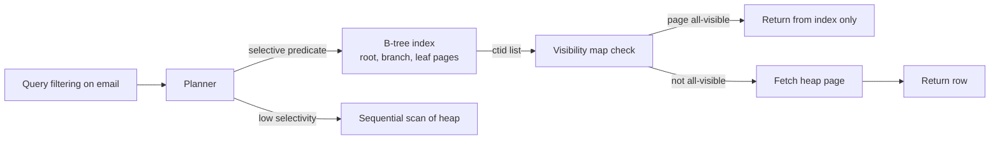

An index is the cheapest performance win in PostgreSQL and also one of the easiest ways to slow down writes and waste disk. You reach for this topic when a query that was 5 ms in development is 4 seconds on a 50-million-row production table, or when someone added twelve indexes to a table and now inserts crawl. PostgreSQL ships several index access methods, each suited to a different shape of data and query. Choosing well is mostly about matching the operator in your WHERE clause to the index that supports it.

## How it works

An index is a separate on-disk structure that maps key values to tuple locations (`ctid`) in the table (the heap). The planner decides whether reading the index and then fetching heap pages is cheaper than scanning the whole table. Because of MVCC, the index entry alone does not say whether a row is visible to your transaction, so PostgreSQL normally has to visit the heap too, unless the visibility map says the page is all-visible.



## Index types and when to use them

| Type | Supports | Typical use |
|------|----------|-------------|
| B-tree | `=`, `<`, `>`, `BETWEEN`, `IN`, `ORDER BY`, prefix `LIKE 'abc%'` with suitable collation or `text_pattern_ops` | Default for almost everything |
| Hash | `=` only | Rarely better than B-tree; crash-safe since v10 |
| GIN | "contains" operators: `@>`, `?`, `&&`, `@@` | JSONB, arrays, full-text search |
| GiST | Overlap, distance, ranges, geometry | PostGIS, range types, exclusion constraints, nearest-neighbour |
| BRIN | Ranges over physically ordered data | Huge append-only time-series tables |

### B-tree

B-tree is the default and the right answer most of the time. It keeps keys sorted, so it serves equality, ranges and ordering, and can satisfy `ORDER BY ... LIMIT` without a sort.

### GIN for JSONB, arrays and full text

GIN (generalized inverted index) stores each element or key once with a list of rows that contain it. It is ideal when a column holds many values per row.

```sql
CREATE INDEX idx_products_attrs ON products USING gin (attributes jsonb_path_ops);
SELECT * FROM products WHERE attributes @> '{"color": "red"}';

CREATE INDEX idx_posts_tags ON posts USING gin (tags);           -- text[]
SELECT * FROM posts WHERE tags && ARRAY['postgres', 'node'];

CREATE INDEX idx_docs_fts ON docs USING gin (to_tsvector('english', body));
SELECT * FROM docs WHERE to_tsvector('english', body) @@ to_tsquery('vacuum & bloat');
```

GIN reads are fast but writes are relatively expensive; the `fastupdate` pending list batches inserts at the cost of occasional slower reads.

### GiST and BRIN

GiST is a framework for "balanced tree of bounding boxes" style indexes: geometric data, `tstzrange` overlap (`&&`), and `EXCLUDE` constraints that prevent overlapping bookings. With `pg_trgm`, GiST or GIN trigram indexes also speed up `ILIKE '%term%'`.

BRIN stores only a min/max summary per block range (128 pages by default). It is tiny (kilobytes for a table of hundreds of GB) and works when the column correlates with physical order, such as `created_at` on an append-only log table:

```sql
CREATE INDEX idx_events_created_brin ON events USING brin (created_at);
```

If rows are updated or inserted out of order, BRIN ranges overlap and it becomes useless.

## Multicolumn ordering

A B-tree on `(a, b, c)` is sorted by `a`, then `b`, then `c`. It efficiently serves predicates on a leftmost prefix: `a`, `a AND b`, `a AND b AND c`. A query filtering only on `b` usually cannot use it well. A good rule: equality columns first, then the range or sort column.

```sql
-- Query: orders for one customer, newest first
SELECT id, total, created_at FROM orders
WHERE customer_id = $1 AND status = 'paid'
ORDER BY created_at DESC LIMIT 20;

CREATE INDEX idx_orders_cust_status_created
  ON orders (customer_id, status, created_at DESC);
```

This index finds the exact slice and returns rows already in order, so no sort node is needed.

## Partial and expression indexes

A **partial index** covers only rows matching a predicate. It is smaller and cheaper to maintain:

```sql
-- Only 1% of jobs are pending; that's all the worker queries
CREATE INDEX idx_jobs_pending ON jobs (run_at) WHERE status = 'pending';

-- Unique email among non-deleted users only
CREATE UNIQUE INDEX uq_users_email_active ON users (email) WHERE deleted_at IS NULL;
```

The query's WHERE clause must imply the index predicate for the planner to use it.

An **expression index** indexes a computed value. The query must use the same expression:

```sql
CREATE INDEX idx_users_lower_email ON users (lower(email));
SELECT * FROM users WHERE lower(email) = lower($1);
```

## Index-only scans and covering indexes

If every column a query needs is in the index and the heap pages are marked all-visible, PostgreSQL can skip the heap entirely. `INCLUDE` adds non-key payload columns to a B-tree:

```sql
CREATE INDEX idx_orders_cust_inc ON orders (customer_id) INCLUDE (total, created_at);
```

In `EXPLAIN ANALYZE`, look for `Index Only Scan` and a low `Heap Fetches` count. High heap fetches mean the visibility map is stale, which means vacuum is behind.

## Building indexes without downtime

Plain `CREATE INDEX` blocks writes (INSERT, UPDATE, DELETE) on the table for the whole build. On a large production table use:

```sql
CREATE INDEX CONCURRENTLY idx_orders_created ON orders (created_at);
```

It takes longer, scans the table twice, cannot run inside a transaction block, and if it fails it leaves an `INVALID` index behind that you must drop and retry:

```sql
SELECT indexrelid::regclass FROM pg_index WHERE NOT indisvalid;
DROP INDEX CONCURRENTLY idx_orders_created;
```

Many migration tools wrap each migration in a transaction, so you need to disable that for these migrations (see guide 10).

## Trade-offs and pitfalls

- **Write amplification**: every index must be updated on INSERT and on non-HOT UPDATEs. Ten indexes can make writes several times slower.
- **Unused indexes** still cost writes and memory. Find them with `pg_stat_user_indexes` where `idx_scan = 0` over a long window, and check replicas before dropping.
- **Function mismatch**: `WHERE created_at::date = '2026-10-01'` will not use an index on `created_at`. Rewrite as a range.
- **Low selectivity**: an index on a boolean column rarely helps; a partial index usually does.
- **Leading wildcard** `LIKE '%foo'` cannot use a B-tree; use `pg_trgm`.
- **Duplicate indexes**: `(a)` is redundant if `(a, b)` exists, in most cases.

## Interview angle

- Be ready to choose an index for a specific query and justify the column order.
- Explain why indexes speed reads but slow writes, and how you'd find unused ones.
- Mention BRIN for time-series and GIN for JSONB or search to show breadth.
- Know that `CREATE INDEX CONCURRENTLY` is how you add indexes to a live table.

## Key takeaways

- B-tree is the default; GIN for multi-valued data, GiST for ranges and geometry, BRIN for ordered append-only data.
- Put equality columns first and the range or sort column last in composite indexes.
- Partial and expression indexes keep indexes small and targeted.
- Covering indexes enable index-only scans only when vacuum keeps the visibility map fresh.
- Always build indexes on live tables with `CONCURRENTLY` and check for invalid leftovers.
