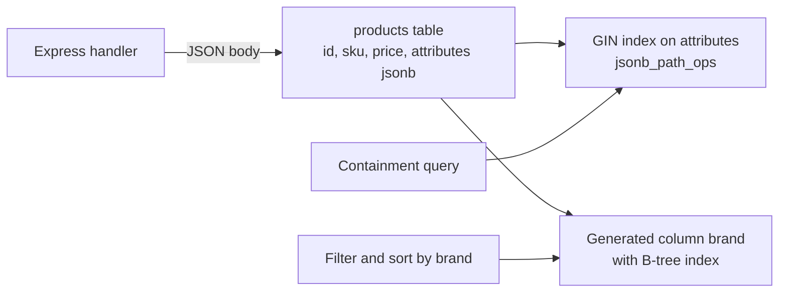

MERN developers often assume flexible documents mean MongoDB. But PostgreSQL's `jsonb` type stores, indexes and queries JSON documents efficiently, inside the same transactions as your relational data. For many applications that removes the need for a second database. This guide covers how JSONB works, how to query and index it, and the cases where a dedicated document database is still the better tool.

## How it works

PostgreSQL has two JSON types. `json` stores the original text verbatim and reparses it on every access. `jsonb` parses once on write into a decomposed binary format: keys are deduplicated (last one wins) and sorted, whitespace is dropped, and key order is not preserved. Reads and operators are much faster, and only `jsonb` supports GIN indexing. Use `jsonb` unless you need to preserve exact input text.

Large JSONB values (roughly over 2 KB) are compressed and moved out of line into TOAST storage. Updating any key rewrites the whole value, which matters for big documents.



A common hybrid model keeps stable, frequently filtered fields as real columns and puts the variable part in JSONB:

```sql
CREATE TABLE products (
  id          bigint GENERATED ALWAYS AS IDENTITY PRIMARY KEY,
  sku         text UNIQUE NOT NULL,
  price_cents integer NOT NULL CHECK (price_cents >= 0),
  attributes  jsonb NOT NULL DEFAULT '{}'
);

INSERT INTO products (sku, price_cents, attributes) VALUES
 ('TSHIRT-1', 1999, '{"brand":"Acme","color":"red","sizes":["S","M","L"],"specs":{"cotton":100}}');
```

## JSONB operators

| Operator | Meaning | Example |
|----------|---------|---------|
| `->` | Get field as jsonb | `attributes -> 'specs'` |
| `->>` | Get field as text | `attributes ->> 'color'` |
| `#>>` | Get nested path as text | `attributes #>> '{specs,cotton}'` |
| `@>` | Left contains right | `attributes @> '{"color":"red"}'` |
| `?` | Key exists | `attributes ? 'sizes'` |
| `?&` | All listed keys exist | `attributes ?& array['color','sizes']` |
| `@?`, `@@` | SQL/JSON path match | `attributes @? '$.sizes[*] ? (@ == "M")'` |
| `-` | Remove a key | `attributes - 'sale'` |

There is also `?|` (any of the listed keys exists) and the concatenation operator, which merges two objects, as in `attributes || '{"sale": true}'`.

```sql
-- Red products available in M
SELECT id, sku FROM products
WHERE attributes @> '{"color":"red","sizes":["M"]}';

-- Update one nested key without rewriting from the app
UPDATE products
SET attributes = jsonb_set(attributes, '{specs,cotton}', '95')
WHERE sku = 'TSHIRT-1';

-- Unnest an array for reporting
SELECT sku, jsonb_array_elements_text(attributes -> 'sizes') AS size FROM products;
```

From Node.js, `pg` serialises objects to JSON automatically and parses `jsonb` columns back into objects:

```js
await pool.query(
  'INSERT INTO products (sku, price_cents, attributes) VALUES ($1, $2, $3)',
  [sku, priceCents, { brand: 'Acme', color: 'blue', sizes: ['M'] }]
);

const { rows } = await pool.query(
  'SELECT id, sku, attributes FROM products WHERE attributes @> $1',
  [{ color: 'blue' }]
);
rows[0].attributes.sizes; // ['M']
```

Note that arrays passed as parameters are converted to Postgres arrays, not JSON, so call `JSON.stringify()` when the value is a top-level array destined for a jsonb column.

## Indexing JSONB

A GIN index makes containment and existence queries fast across all keys:

```sql
-- Default opclass: supports @>, ?, ?|, ?&, @?, @@
CREATE INDEX idx_products_attrs ON products USING gin (attributes);

-- jsonb_path_ops: supports @>, @?, @@ only, but smaller and usually faster
CREATE INDEX idx_products_attrs_path ON products USING gin (attributes jsonb_path_ops);
```

`jsonb_path_ops` hashes full paths to values, so it cannot answer "does key X exist". Pick it when your queries are containment lookups.

GIN does not help with range comparisons or sorting on a JSON field. For that, index the extracted value with an expression index, or better, a generated column.

## Generated columns

A stored generated column is computed from other columns on every write and behaves like a normal column for indexing, constraints and statistics:

```sql
ALTER TABLE products
  ADD COLUMN brand text GENERATED ALWAYS AS (attributes ->> 'brand') STORED;
CREATE INDEX idx_products_brand ON products (brand);

ALTER TABLE products
  ADD COLUMN weight_g numeric GENERATED ALWAYS AS ((attributes ->> 'weight_g')::numeric) STORED;
-- Range queries and ORDER BY now use a B-tree
SELECT sku FROM products WHERE weight_g BETWEEN 100 AND 500 ORDER BY weight_g;
```

Generated columns also give the planner real statistics, which it lacks for JSONB internals and which otherwise causes poor row estimates (guide 3). Note that adding a stored generated column rewrites the table, so do it carefully on large tables.

You can also enforce structure with CHECK constraints, for example `CHECK (jsonb_typeof(attributes -> 'sizes') = 'array')`.

## JSONB versus a separate MongoDB

| Need | Postgres with JSONB | MongoDB |
|------|---------------------|---------|
| Transactions spanning documents and relational data | Native, one database | Multi-document transactions exist, but not with your SQL data |
| Joins, foreign keys, constraints | Full SQL | Limited (`$lookup`), no foreign keys |
| Flexible per-row attributes | Good | Good |
| Frequent partial updates to large documents | Rewrites the whole value, more WAL | Updates in place more efficiently in many cases |
| Built-in horizontal sharding | Needs Citus or app-level | Native |
| Ops overhead | One system | Two systems to run, back up and keep consistent |

**JSONB wins** when the core domain is relational and some fields are variable (product attributes, user settings, webhook payloads, feature flags), when you need ACID across both, and when you want one operational footprint.

**MongoDB can win** when the whole domain is document-shaped with deep nesting and little cross-document relation, when documents are large and updated piecemeal at high rates, or when you need built-in sharding across many nodes and your team already runs it well.

## Trade-offs and pitfalls

- **Everything in one JSONB column** loses type safety, constraints and planner statistics. Promote hot fields to columns.
- **Large documents updated often** cause write amplification and TOAST churn. Split them or normalise the hot part.
- **Type confusion**: `->>` returns text, so compare with casts (`(attributes ->> 'qty')::int > 5`).
- **GIN write cost** on high-insert tables; consider indexing only the paths you query via expression indexes.
- **Key order** is not preserved; do not rely on it.

## Interview angle

- When a design needs flexible attributes, propose a hybrid table rather than adding a second database by default.
- Explain `@>` with GIN `jsonb_path_ops` versus B-tree on a generated column for ranges.
- Give a concrete reason you would still pick MongoDB.

## Key takeaways

- Use `jsonb`, not `json`, for queryable documents.
- GIN indexes power containment queries; `jsonb_path_ops` is smaller when you only need `@>`.
- Generated columns turn hot JSON fields into indexable, well-estimated columns.
- Keep relational core data in columns and variable data in JSONB.
- A separate document database is justified by document-shaped workloads or sharding needs, not just by "flexible schema".
