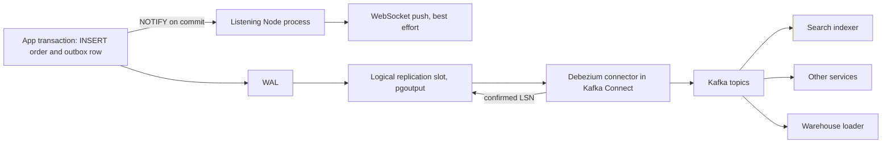

Sooner or later something outside the database needs to know that a row changed: a WebSocket server pushing order status to a browser, a cache that must be invalidated, a search index, a data warehouse, another microservice. Polling `WHERE updated_at > $last` every second works until it does not: it misses deletes, hammers the database, and races with in-flight transactions. PostgreSQL offers two built-in push mechanisms with very different guarantees. `LISTEN/NOTIFY` is a lightweight, fire-and-forget signal. Logical decoding streams every committed change from the write-ahead log and is the foundation for durable change data capture (CDC).

## How it works

`NOTIFY channel, 'payload'` queues a message inside the current transaction. On `COMMIT`, PostgreSQL delivers it to every session that has run `LISTEN channel`. If the transaction rolls back, nothing is sent. Sessions that are not listening at that moment never see the message.

Logical decoding works on the WAL instead. Every change is already written to the WAL for crash recovery; with `wal_level = logical` the WAL carries enough information to reconstruct row-level changes. A **replication slot** remembers how far a consumer has read, and an **output plugin** (`pgoutput` is built in) turns WAL records into a stream of inserts, updates and deletes in commit order.



## LISTEN/NOTIFY in practice

Key properties:

- **Payload limit**: under 8000 bytes by default. Send an ID and a type, not the row.
- **Transactional**: delivered only on commit, in commit order. Identical channel and payload pairs within one transaction are collapsed into one notification.
- **Not durable**: no persistence, no replay, no acknowledgement. A listener that is restarting misses everything sent in the meantime.
- **Queue**: undelivered notifications sit in an 8 GB queue. A listener stuck in a long transaction prevents cleanup; when the queue fills, transactions that call `NOTIFY` fail at commit.
- **Commit serialization**: transactions that issued `NOTIFY` take a global lock while committing, so thousands of notifying writes per second become a bottleneck.

A trigger keeps notifications in sync with every write path, including manual SQL and other services:

```sql
CREATE OR REPLACE FUNCTION notify_order_change() RETURNS trigger AS $$
BEGIN
  PERFORM pg_notify('order_events', json_build_object(
    'op', TG_OP,
    'id', COALESCE(NEW.id, OLD.id),
    'status', CASE WHEN TG_OP = 'DELETE' THEN NULL ELSE NEW.status END
  )::text);
  RETURN NULL;
END;
$$ LANGUAGE plpgsql;

CREATE TRIGGER orders_notify
AFTER INSERT OR UPDATE OF status OR DELETE ON orders
FOR EACH ROW EXECUTE FUNCTION notify_order_change();
```

The listener needs its own **dedicated, non-pooled connection**. `LISTEN` is session state; behind PgBouncer in transaction mode your listen registration lands on a server connection that is then reused by someone else. Connect directly to the primary (replicas cannot `LISTEN` to primary notifications):

```js
import pg from 'pg';

async function startListener(onEvent) {
  const client = new pg.Client({ connectionString: process.env.DATABASE_DIRECT_URL });
  client.on('notification', (msg) => {
    try { onEvent(msg.channel, JSON.parse(msg.payload)); } catch (e) { console.error(e); }
  });
  client.on('error', (err) => {
    console.error('listener error, reconnecting', err.message);
    client.end().catch(() => {});
    setTimeout(() => startListener(onEvent), 1000);
  });
  await client.connect();
  await client.query('LISTEN order_events');
  // After reconnect, resync anything changed while disconnected
  await onEvent('resync', null);
}
```

Because messages can be lost during reconnects, treat a notification as a hint: "order 812 changed, go read it". On reconnect, re-query state since the last known `updated_at`. Good fits: cache invalidation across a handful of Node instances, waking up a job worker instead of polling every 500 ms, live dashboards. Bad fits: anything that must never miss an event.

## Logical replication and decoding

Enable it on the primary (requires a restart):

```sql
ALTER SYSTEM SET wal_level = 'logical';
ALTER SYSTEM SET max_replication_slots = 10;
ALTER SYSTEM SET max_wal_senders = 10;
ALTER SYSTEM SET max_slot_wal_keep_size = '50GB';
```

A **publication** chooses which tables are streamed, and a slot tracks progress:

```sql
CREATE PUBLICATION app_cdc FOR TABLE orders, order_items, outbox;
SELECT pg_create_logical_replication_slot('debezium_app', 'pgoutput');
ALTER TABLE orders REPLICA IDENTITY FULL;  -- only if consumers need old values
```

By default `UPDATE` and `DELETE` events carry only the primary key of the old row. `REPLICA IDENTITY FULL` includes the full old row at the cost of larger WAL. The same machinery powers native logical replication (`CREATE SUBSCRIPTION` on another Postgres), which is how many teams do near-zero-downtime major version upgrades.

### The slot retention danger

A slot guarantees the consumer never misses a change by preventing PostgreSQL from removing WAL the consumer has not confirmed. If the consumer stops (Kafka Connect down, connector paused, a forgotten test slot), WAL accumulates until the disk fills and the primary stops accepting writes. This is the single most common way CDC takes down production. Defend against it:

```sql
SELECT slot_name, active, wal_status,
       pg_size_pretty(pg_wal_lsn_diff(pg_current_wal_lsn(), confirmed_flush_lsn)) AS lag
FROM pg_replication_slots WHERE slot_type = 'logical';
```

Alert when lag exceeds a few GB or `active` is false for more than minutes. Set `max_slot_wal_keep_size` so a runaway slot is invalidated (`wal_status = 'lost'`) instead of filling the disk; the consumer then needs a fresh snapshot, which is far better than an outage. Drop unused slots with `pg_drop_replication_slot`. PostgreSQL 16 added logical decoding on standbys, and PostgreSQL 17 can synchronize failover-enabled slots to a physical standby so CDC survives a primary failover.

## Debezium and Kafka

Debezium is the standard open-source CDC connector. Its PostgreSQL connector runs in Kafka Connect, takes an initial consistent snapshot of the selected tables, then streams from the slot via `pgoutput`, writing one Kafka topic per table (`app.public.orders`) with before and after images, the operation type and the source LSN. It commits the processed LSN back to the slot only after Kafka has accepted the events, so delivery is **at least once**: consumers must be idempotent, typically by upserting on the primary key or tracking processed event IDs.

Operational notes: on a database where the captured tables are quiet but others are busy, the slot cannot advance and WAL grows; configure Debezium heartbeats (`heartbeat.interval.ms` plus a `heartbeat.action.query` writing to a small table) to keep it moving. Schema changes flow through, but renames and type changes still break downstream consumers, so version event schemas with a registry.

## Outbox via CDC

Streaming raw table changes couples consumers to your internal schema. The **transactional outbox** fixes that: in the same transaction as the business write, insert a purpose-built event row.

```sql
BEGIN;
INSERT INTO orders (id, customer_id, total) VALUES ($1, $2, $3);
INSERT INTO outbox (id, aggregate_type, aggregate_id, type, payload)
VALUES (gen_random_uuid(), 'order', $1, 'OrderPlaced', $4::jsonb);
COMMIT;
```

Debezium captures only the `outbox` table, and its Outbox Event Router transform routes each row to a topic by `aggregate_type` with `aggregate_id` as the Kafka key, preserving per-order ordering. There is no dual write and no polling relay. Delete or partition old outbox rows on a schedule. An alternative is `pg_logical_emit_message(true, 'outbox', payload)`, which writes an event straight into the WAL without a table.

## Choosing between them

| Need | Use |
|------|-----|
| Wake workers or invalidate caches, loss tolerable | LISTEN/NOTIFY |
| Push UI updates to a few app servers | LISTEN/NOTIFY plus resync on reconnect |
| Replicate to another Postgres or upgrade versions | Native logical replication |
| Reliable events to many services, replay, ordering per key | Outbox plus Debezium and Kafka |
| Feed a warehouse or search index | Debezium CDC on the tables directly |
| Simple reliable events without Kafka | Outbox table polled with `FOR UPDATE SKIP LOCKED` |

## Trade-offs and pitfalls

- NOTIFY is a signal, not a queue; design for missed messages.
- Pooled connections silently break `LISTEN`.
- Abandoned replication slots fill disks; monitor lag and cap with `max_slot_wal_keep_size`.
- CDC is at least once; consumers must be idempotent.
- Large transactions are emitted only after commit, so a 5-million-row backfill arrives as a burst.

## Interview angle

- Explain why NOTIFY is not durable and how you would compensate.
- Describe how a replication slot works and how it can take down a primary.
- Design an outbox with Debezium and explain how it avoids the dual-write problem.
- Compare polling, NOTIFY and CDC on latency, reliability and operational cost.

## Key takeaways

- LISTEN/NOTIFY: transactional, under 8000 bytes, not durable, needs a direct connection.
- Logical decoding reads committed changes from the WAL through a slot and `pgoutput`.
- Slots retain WAL until confirmed; monitor them like disk space, because they are disk space.
- Debezium plus Kafka gives durable, replayable, at-least-once CDC.
- Use an outbox table to publish stable domain events instead of raw table changes.
