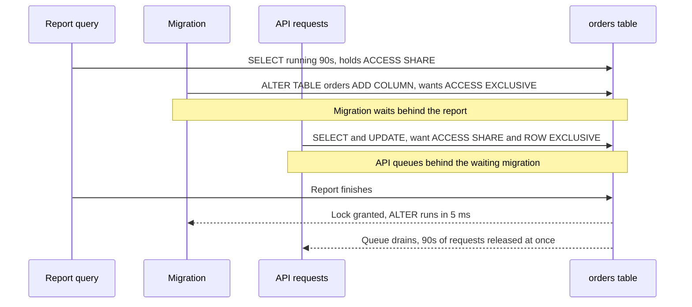

Most PostgreSQL outages that look like "the database is down" are really "one session holds a lock and 400 others are queued behind it". MVCC means plain reads and writes rarely block each other, so teams forget locks exist until a two-second `ALTER TABLE` takes the whole API offline for a minute. Understanding the lock modes, how the wait queue works and how to find the blocking process turns these incidents from mysteries into five-minute fixes.

## How it works

PostgreSQL has two main lock layers. **Table-level locks** (heavyweight locks on relations) are held in a shared lock table in memory and are visible in `pg_locks`. **Row-level locks** are not stored in memory at all: the locking transaction's ID is written into the tuple header (`xmax` plus infomask bits). That is why you can lock millions of rows without exhausting memory, and also why `pg_locks` does not list locked rows. When a session waits on a row, it shows up as waiting on the other transaction's `transactionid` lock (and briefly a `tuple` lock).

Every lock is held until the transaction ends. There is no "unlock row" statement; `COMMIT` or `ROLLBACK` releases everything (advisory session locks are the exception).

Lock requests on a table are granted in **FIFO order**. If a request conflicts with a lock that is held or with a request already waiting in the queue, it waits. That queueing rule is what causes pile-ups.



## Row lock modes

| Mode | Taken by | Conflicts with |
|------|----------|----------------|
| `FOR KEY SHARE` | Foreign key checks on the parent row | `FOR UPDATE` |
| `FOR SHARE` | Explicit `SELECT ... FOR SHARE` | `FOR NO KEY UPDATE`, `FOR UPDATE` |
| `FOR NO KEY UPDATE` | `UPDATE` that does not touch unique-indexed columns | `FOR SHARE`, `FOR NO KEY UPDATE`, `FOR UPDATE` |
| `FOR UPDATE` | `DELETE`, `UPDATE` of a key column, explicit `FOR UPDATE` | Everything |

The split between `KEY SHARE` and `NO KEY UPDATE` exists so that inserting an `order_items` row (which key-share-locks its parent `orders` row) does not block a concurrent `UPDATE orders SET status = 'paid'`. If your application uses `SELECT ... FOR UPDATE` before a non-key update, consider `FOR NO KEY UPDATE` instead: it gives the same protection against concurrent writers without blocking foreign key inserts into child tables.

## Table lock modes and DDL

There are eight table lock modes. The ones that matter day to day:

| Mode | Acquired by | Blocks |
|------|-------------|--------|
| `ACCESS SHARE` | `SELECT` | Only `ACCESS EXCLUSIVE` |
| `ROW SHARE` | `SELECT ... FOR UPDATE/SHARE` | `EXCLUSIVE`, `ACCESS EXCLUSIVE` |
| `ROW EXCLUSIVE` | `INSERT`, `UPDATE`, `DELETE`, `MERGE` | `SHARE` and stronger |
| `SHARE UPDATE EXCLUSIVE` | `VACUUM`, `ANALYZE`, `CREATE INDEX CONCURRENTLY`, `ALTER TABLE ... VALIDATE CONSTRAINT` | Itself and stronger, not reads or writes |
| `SHARE` | `CREATE INDEX` (non-concurrent) | All writes |
| `SHARE ROW EXCLUSIVE` | `CREATE TRIGGER`, `ADD FOREIGN KEY` (on both tables) | All writes |
| `ACCESS EXCLUSIVE` | `DROP`, `TRUNCATE`, `VACUUM FULL`, `CLUSTER`, `REFRESH MATERIALIZED VIEW`, `LOCK TABLE`, most `ALTER TABLE` forms | Everything, including `SELECT` |

`ACCESS EXCLUSIVE` comes from `ADD COLUMN`, `DROP COLUMN`, `ALTER COLUMN TYPE`, `SET NOT NULL`, `RENAME`, and adding a `CHECK` constraint. A foreign key added without `NOT VALID` takes the weaker `SHARE ROW EXCLUSIVE`, but still blocks all writes to both tables while it scans every row. Many of these are metadata-only and finish in milliseconds (adding a nullable column, or since PG 11 a column with a constant default). The danger is not the duration of the DDL itself but the time it spends **waiting** for the lock while everything else queues behind it.

## lock_timeout: fail fast instead of piling up

Always set `lock_timeout` for migrations so a blocked DDL gives up quickly and can be retried:

```sql
SET lock_timeout = '3s';
SET statement_timeout = '30s';
ALTER TABLE orders ADD COLUMN refunded_at timestamptz;
```

If it cannot get the lock within 3 seconds it aborts with SQLSTATE `55P03`, the queue behind it drains, and your migration tool retries a few times with backoff. For application traffic, set guardrails at the role level so a single bad request cannot hold locks for minutes:

```sql
ALTER ROLE api SET statement_timeout = '15s';
ALTER ROLE api SET idle_in_transaction_session_timeout = '60s';
ALTER ROLE api SET lock_timeout = '5s';
```

PostgreSQL 17 also adds `transaction_timeout`, which caps the total lifetime of a transaction regardless of what it is doing.

## NOWAIT and SKIP LOCKED

Two modifiers change what a row lock request does when the row is already locked:

- `NOWAIT` raises `55P03` immediately. Use it when waiting is pointless, such as "is someone else already editing this invoice?" in an admin UI.
- `SKIP LOCKED` silently omits locked rows from the result. It is the basis of job queues where N workers each claim different rows.

```js
// Worker loop claiming one job at a time with node-postgres
const client = await pool.connect();
try {
  await client.query('BEGIN');
  const { rows } = await client.query(`
    SELECT id, payload FROM jobs
    WHERE status = 'pending' AND run_at <= now()
    ORDER BY run_at
    LIMIT 1
    FOR NO KEY UPDATE SKIP LOCKED`);
  if (rows.length) {
    await handle(rows[0].payload);
    await client.query("UPDATE jobs SET status = 'done' WHERE id = $1", [rows[0].id]);
  }
  await client.query('COMMIT');
} catch (err) {
  await client.query('ROLLBACK');
  throw err;
} finally {
  client.release();
}
```

Holding the transaction open during `handle()` means a crashed worker automatically releases the job. The cost is one open transaction per in-flight job, which holds back vacuum; for jobs that run longer than a few seconds, mark the row `running` with a lease timestamp and commit immediately instead.

## Deadlocks

When a session has waited `deadlock_timeout` (default `1s`), PostgreSQL runs the deadlock detector, looking for a cycle in the wait-for graph. If it finds one, it aborts one participant with SQLSTATE `40P01` and logs both queries. The check is deliberately delayed because it is expensive and most waits resolve on their own.

Common real-world causes:

- Two transactions update the same set of rows in different orders, for example a bulk `UPDATE ... WHERE id IN (...)` with unsorted IDs.
- Transfers between accounts: A locks account 1 then 2, B locks 2 then 1.
- Foreign key checks: inserting child rows takes `KEY SHARE` on the parent while another transaction updates the parent with `FOR UPDATE`.

The fix is **consistent lock ordering**:

```sql
-- Lock both accounts in id order, regardless of transfer direction
SELECT id, balance FROM accounts
WHERE id IN ($1, $2)
ORDER BY id
FOR NO KEY UPDATE;
```

Keep transactions short and retry on `40P01`. Hundreds of deadlocks a day means an ordering bug.

## Advisory locks

Advisory locks lock an application-chosen 64-bit key (or a pair of 32-bit keys). PostgreSQL enforces nothing about what the key means.

```sql
SELECT pg_advisory_xact_lock(42, tenant_id);       -- waits, released at commit
SELECT pg_try_advisory_xact_lock(hashtext('reindex-search'));  -- returns true/false
SELECT pg_advisory_lock(1001);  SELECT pg_advisory_unlock(1001);  -- session scoped
```

Session-level locks outlive the transaction and stay held until unlocked or the connection closes. Behind PgBouncer in transaction mode this breaks in two ways: the lock is taken on a server connection that is then handed to another client, and your `unlock` may run on a different connection and return `false`. Use `_xact_` variants behind a pooler, or use a dedicated direct connection for leader election style locks. Advisory locks also consume slots in the shared lock table, sized by `max_locks_per_transaction` (default 64) times connections, so do not take one per row in a large batch.

## Diagnosing a live lock incident

Find who is blocked and who is blocking:

```sql
SELECT a.pid,
       pg_blocking_pids(a.pid) AS blocked_by,
       a.state,
       now() - a.xact_start AS xact_age,
       a.wait_event_type, a.wait_event,
       left(a.query, 80) AS query
FROM pg_stat_activity a
WHERE cardinality(pg_blocking_pids(a.pid)) > 0
ORDER BY xact_age DESC;
```

Then look at the blocker itself. It is frequently `idle in transaction`: an application that ran `BEGIN`, did a query, and then waited on an HTTP call or leaked the client. Inspect held table locks with:

```sql
SELECT l.pid, l.relation::regclass, l.mode, l.granted
FROM pg_locks l
WHERE l.relation = 'orders'::regclass
ORDER BY l.granted DESC;
```

To resolve, `SELECT pg_cancel_backend(pid)` cancels the current query; `pg_terminate_backend(pid)` kills the session and rolls back its transaction. Turn on `log_lock_waits = on` so any wait longer than `deadlock_timeout` is logged with the blocking PIDs. It is off by default before PostgreSQL 18.

## Trade-offs and pitfalls

- **Lock queue amplification**: a cheap DDL behind a long query is worse than an expensive one on an idle table. Always use `lock_timeout` and retries.
- **Idle in transaction**: holds every lock it took plus blocks vacuum. Set `idle_in_transaction_session_timeout`.
- **`FOR UPDATE` by habit**: blocks child-table foreign key inserts; `FOR NO KEY UPDATE` is usually what you mean.
- **Long `SKIP LOCKED` transactions**: fine for sub-second jobs, harmful for long ones.
- **`LOCK TABLE` without a mode** takes `ACCESS EXCLUSIVE`.

## Interview angle

- Explain why a 5 ms `ALTER TABLE` can cause a minute-long outage, and how `lock_timeout` plus retry prevents it.
- Walk through a deadlock between two transfers and fix it with ordered locking.
- Describe how you would find the blocking session with `pg_blocking_pids` and what you would do about it.
- Know that row locks live in tuple headers, which is why Postgres can lock millions of rows cheaply.

## Key takeaways

- Row locks live on the tuple; table locks live in `pg_locks`; all are released at transaction end.
- Lock requests queue FIFO, so a waiting `ACCESS EXCLUSIVE` blocks everyone behind it.
- Set `lock_timeout`, `statement_timeout` and `idle_in_transaction_session_timeout` everywhere.
- Prevent deadlocks with a consistent lock order and retry on `40P01`.
- Use transaction-scoped advisory locks behind poolers.
