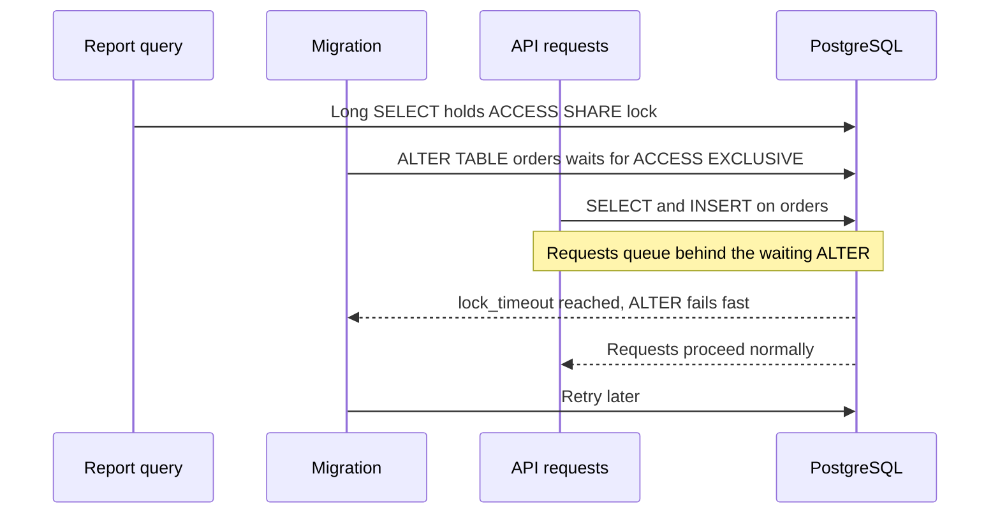
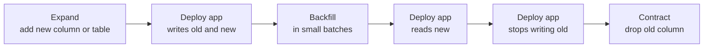

Most PostgreSQL outages caused by application teams are not caused by load. They are caused by a migration: an `ALTER TABLE` that waited for a lock behind a long query and then blocked every request behind it, or a column rename that broke the old version of the app still serving traffic during a rolling deploy. This final guide covers how to talk to Postgres from Node.js and how to change the schema of a live database without downtime.

## Choosing a client

| Tool | Style | Strengths | Watch out for |
|------|-------|-----------|---------------|
| `pg` (node-postgres) | Raw SQL driver | Full control, minimal overhead, everything else builds on it | Manual mapping and types, migrations not included |
| Knex | Query builder plus migrations | Mature, flexible, JS migration files | Weaker TypeScript inference |
| Prisma | Schema-first ORM with generated client | Excellent DX and types, declarative schema, `prisma migrate` | Abstracts SQL; complex queries need `$queryRaw`; generated migrations need review for locking |
| Drizzle | TypeScript-first SQL-like builder | Types inferred from TS schema, thin, SQL-shaped API, `drizzle-kit` migrations | Younger ecosystem |

Rule of thumb: Prisma for fast-moving product teams that value DX; Drizzle or Kysely if you want SQL-shaped code with strong types; raw `pg` for hot paths and for anything Postgres-specific. Whatever you pick, **read the SQL your migrations generate** before it touches production.

```ts
// Drizzle example
import { pgTable, bigserial, text, timestamp } from 'drizzle-orm/pg-core';
import { drizzle } from 'drizzle-orm/node-postgres';
import { eq } from 'drizzle-orm';

export const users = pgTable('users', {
  id: bigserial('id', { mode: 'number' }).primaryKey(),
  email: text('email').notNull().unique(),
  createdAt: timestamp('created_at', { withTimezone: true }).defaultNow().notNull(),
});

const db = drizzle(pool);
const [user] = await db.select().from(users).where(eq(users.email, email));
```

## How it works: locks and migrations

Every DDL statement takes a lock. Many `ALTER TABLE` forms take an **ACCESS EXCLUSIVE** lock, which conflicts with everything, including plain SELECTs. The danger is the **lock queue**: if a long-running query holds a weaker lock, your ALTER waits, and every new query on that table queues behind the ALTER.



The fix is to cap how long DDL can wait:

```sql
SET lock_timeout = '3s';
SET statement_timeout = '15min';
ALTER TABLE orders ADD COLUMN notes text;
```

If the lock cannot be acquired in 3 seconds the statement fails, the queue drains, and your migration runner retries. Failing a migration is far better than a full outage.

## Expand and contract

During a rolling deploy, old and new versions of the app run simultaneously against the same schema. So every schema change must be compatible with both. **Expand and contract** splits a breaking change into backward-compatible steps:



Example: renaming `users.name` to `users.full_name`.

1. Add `full_name` (nullable).
2. Deploy code that writes both columns.
3. Backfill existing rows in batches.
4. Deploy code that reads `full_name`.
5. Deploy code that no longer touches `name`.
6. Drop `name`.

Never rename or drop a column in the same deploy that changes the code using it.

### Backfilling in batches

One giant `UPDATE` holds row locks for its whole duration, bloats the table and creates a huge WAL burst for replicas. Batch it:

```js
let updated;
do {
  const res = await pool.query(`
    UPDATE users SET full_name = name
    WHERE id IN (
      SELECT id FROM users WHERE full_name IS NULL AND name IS NOT NULL
      ORDER BY id LIMIT 5000
      FOR UPDATE SKIP LOCKED
    )`);
  updated = res.rowCount;
  await new Promise(r => setTimeout(r, 100)); // let vacuum and replicas breathe
} while (updated > 0);
```

## Safe recipes for common changes

**Adding a column**: since PostgreSQL 11, `ADD COLUMN ... DEFAULT <constant>` is a metadata-only change and does not rewrite the table. A volatile default such as `clock_timestamp()` still rewrites. Still use `lock_timeout`, since the brief exclusive lock is needed.

**Adding NOT NULL**: `SET NOT NULL` scans the whole table under an exclusive lock. On PostgreSQL 12+, add a validated CHECK constraint first and Postgres will skip the scan:

```sql
ALTER TABLE users ADD CONSTRAINT users_full_name_nn CHECK (full_name IS NOT NULL) NOT VALID;
ALTER TABLE users VALIDATE CONSTRAINT users_full_name_nn;  -- weaker lock, allows writes
ALTER TABLE users ALTER COLUMN full_name SET NOT NULL;      -- uses the constraint, no scan
ALTER TABLE users DROP CONSTRAINT users_full_name_nn;
```

**Adding a foreign key**: same `NOT VALID` then `VALIDATE` pattern. `NOT VALID` enforces the rule for new writes immediately; `VALIDATE CONSTRAINT` checks existing rows with a lock that does not block reads or writes on the table.

```sql
ALTER TABLE orders ADD CONSTRAINT orders_user_fk
  FOREIGN KEY (user_id) REFERENCES users (id) NOT VALID;
ALTER TABLE orders VALIDATE CONSTRAINT orders_user_fk;
```

**Adding an index**: always `CREATE INDEX CONCURRENTLY` (guide 2). It cannot run inside a transaction, so disable the wrapping transaction for that migration. In Knex:

```js
// migrations/20261031_add_orders_created_idx.js
exports.config = { transaction: false };

exports.up = async (knex) => {
  await knex.raw('SET lock_timeout = \'3s\'');
  await knex.raw('CREATE INDEX CONCURRENTLY IF NOT EXISTS idx_orders_created ON orders (created_at)');
};

exports.down = (knex) => knex.raw('DROP INDEX CONCURRENTLY IF EXISTS idx_orders_created');
```

With Prisma, edit the generated SQL file to add `CONCURRENTLY` and keep that statement alone in its migration file, then check your Prisma version's documented behaviour for non-transactional statements. Unique constraints follow the same path: build a unique index concurrently, then `ADD CONSTRAINT ... UNIQUE USING INDEX`.

**Changing a column type**: most type changes rewrite the table. Some are cheap, such as increasing a `varchar(n)` limit or `varchar` to `text`. For others, use expand and contract with a new column.

| Change | Risky version | Safe version |
|--------|---------------|--------------|
| New index | `CREATE INDEX` | `CREATE INDEX CONCURRENTLY` |
| New FK or CHECK | Validated immediately | `NOT VALID`, then `VALIDATE` |
| NOT NULL | `SET NOT NULL` directly | CHECK `NOT VALID`, validate, then set |
| Rename column | `RENAME COLUMN` in one deploy | Expand and contract |
| Big data fix | One giant UPDATE | Batched updates |

## Running migrations in production

- Run migrations as a separate step in CI/CD (a one-off job or init container), not on every app instance startup.
- Connect directly or via a session-mode pooler, not PgBouncer transaction mode.
- Use a linter such as `squawk` in CI to flag unsafe statements.
- Make migrations idempotent where possible (`IF NOT EXISTS`) so retries after a `lock_timeout` failure are safe.

## Trade-offs and pitfalls

- **ORM-generated migrations** are not lock-aware by default; review them.
- **Auto-migrate on startup** with many replicas causes races and surprise DDL.
- **Long transactions** in the app or analytics jobs are what make DDL wait; find them before deploying.
- **Down migrations** are rarely safe after data has changed; prefer roll-forward fixes.

## Interview angle

- Explain expand and contract when asked how to deploy a schema change without downtime.
- Name the lock queue problem and `lock_timeout` as its mitigation.
- Mention `CONCURRENTLY` and `NOT VALID` for indexes and constraints on large tables.
- Justify a choice between an ORM and a query builder in terms of team speed and control.

## Key takeaways

- Pick a client for your team's needs, but always review the SQL your migrations generate.
- Set `lock_timeout` on every migration and retry instead of blocking traffic.
- Make every schema change backward compatible using expand and contract.
- Build indexes concurrently and add constraints as `NOT VALID` then validate.
- Backfill in small batches to protect locks, vacuum and replicas.
