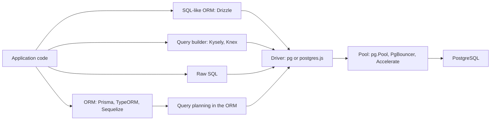

Every Node.js team on PostgreSQL eventually argues about the data layer. One camp wants raw SQL because "the ORM generated a 40-line query with six joins". The other wants an ORM because hand-written SQL strings have no types and break silently when a column is renamed. Both are right about something. The useful question is not "ORM or not" but how much abstraction you want between TypeScript and SQL, and which failure modes you are willing to manage: N+1 queries, hidden transactions, migration drift and connection exhaustion on serverless.

## How it works

The tools sit on a spectrum. At the bottom is a **driver** (`pg`, also called node-postgres, or `postgres.js`) that sends SQL strings with parameters over the wire protocol. **Query builders** (Knex, Kysely) let you compose SQL with method calls, and Kysely adds full TypeScript inference of result shapes. **ORMs** map tables to models with relations: Prisma generates a typed client from a schema file, Drizzle defines the schema in TypeScript and stays close to SQL, while TypeORM and Sequelize follow the classic Active Record or Data Mapper style with decorators or model classes.



Every layer ends up at the same place: a parameterized SQL statement on a pooled connection. What differs is who writes the SQL, how much you can see of it, and what the type system knows about the result.

## The same query in each style

```ts
// pg: full control, types are on you
const { rows } = await pool.query<{ id: number; email: string }>(
  'SELECT id, email FROM users WHERE org_id = $1 AND deleted_at IS NULL ORDER BY id LIMIT 50',
  [orgId]
);

// Kysely: SQL shape, inferred types
const users = await db.selectFrom('users')
  .select(['id', 'email'])
  .where('org_id', '=', orgId).where('deleted_at', 'is', null)
  .orderBy('id').limit(50).execute();

// Drizzle: SQL-like builder on a TS schema
const users2 = await db.select({ id: users.id, email: users.email })
  .from(users)
  .where(and(eq(users.orgId, orgId), isNull(users.deletedAt)))
  .orderBy(users.id).limit(50);

// Prisma: model API
const users3 = await prisma.user.findMany({
  where: { orgId, deletedAt: null },
  select: { id: true, email: true },
  orderBy: { id: 'asc' }, take: 50,
});
```

## The N+1 problem

N+1 happens when you load a list and then issue one query per item for a relation: 1 query for 50 orders, then 50 queries for their customers. At 2 ms each that is 100 ms of round trips for data a single join returns in 3 ms.

```ts
// N+1: one query per order
const orders = await prisma.order.findMany({ take: 50 });
for (const o of orders) {
  o.customer = await prisma.customer.findUnique({ where: { id: o.customerId } });
}
```

Fixes, by tool:

- **Prisma**: use `include` or nested `select`. By default Prisma loads each relation level with one batched `WHERE id IN (...)` query, so 50 orders plus customers is 2 queries, not 51. With `relationLoadStrategy: 'join'` it uses a single query with lateral joins and JSON aggregation. Prisma also batches `findUnique` calls made in the same tick, which is why the GraphQL-resolver case is less painful than the loop above.
- **Drizzle**: the relational API `db.query.orders.findMany({ with: { customer: true } })` compiles to one SQL statement.
- **TypeORM and Sequelize**: lazy relations and calling getters in a loop are the classic trap. Use `relations`, `leftJoinAndSelect` or `include` explicitly.
- **Raw SQL or Kysely**: write the join, or fetch IDs and run one `WHERE id = ANY($1)` query.

Detect it by logging queries in development (`log: ['query']` in Prisma, `logger: true` in Drizzle) or by watching `pg_stat_statements` for a cheap query with an enormous `calls` count.

## Transactions in each tool

```ts
// pg: one checked-out client for the whole transaction
const client = await pool.connect();
try {
  await client.query('BEGIN');
  await client.query('UPDATE accounts SET balance = balance - $1 WHERE id = $2', [amt, from]);
  await client.query('UPDATE accounts SET balance = balance + $1 WHERE id = $2', [amt, to]);
  await client.query('COMMIT');
} catch (e) { await client.query('ROLLBACK'); throw e; } finally { client.release(); }

// Prisma interactive transaction (default timeout 5 s, maxWait 2 s)
await prisma.$transaction(async (tx) => {
  await tx.account.update({ where: { id: from }, data: { balance: { decrement: amt } } });
  await tx.account.update({ where: { id: to }, data: { balance: { increment: amt } } });
}, { isolationLevel: 'Serializable', timeout: 10_000 });

// Drizzle
await db.transaction(async (tx) => { /* tx.update(...) */ });

// Kysely
await db.transaction().execute(async (trx) => { /* trx.updateTable(...) */ });
```

Knex (`knex.transaction(async trx => ...)`), TypeORM (`dataSource.transaction(async manager => ...)`) and Sequelize (`sequelize.transaction(async t => ...)`) follow the same callback pattern. The rule in every tool: queries inside the callback must use the transaction handle (`tx`, `trx`, `manager`), not the global client, or they silently run outside the transaction on another connection. Prisma also offers `$transaction([q1, q2])`, a batch of independent queries in one transaction, which is cheaper because it needs only one round-trip sequence and holds no connection across your JavaScript code.

## Migrations

| Tool | Workflow |
|------|----------|
| Prisma | Edit `schema.prisma`, `prisma migrate dev` generates SQL, commit it, `prisma migrate deploy` in CI |
| Drizzle | Edit TS schema, `drizzle-kit generate` writes SQL, `drizzle-kit migrate` applies; `push` only for prototypes |
| Kysely | Hand-written `up`/`down` TS migrations run by `Migrator` |
| Knex | `knex migrate:make`, `knex migrate:latest` |
| TypeORM | `migration:generate` from entity diff; never `synchronize: true` in production |
| Sequelize | `sequelize-cli` migrations, separate from model definitions |

Generated migrations are a starting point. Review the SQL: diff tools happily emit a column rename as drop-and-add (data loss), add a non-concurrent index, or set `NOT NULL` with a full-table lock. For anything on a large table, edit the generated SQL to use `CREATE INDEX CONCURRENTLY` (which must run outside the migration's transaction) and a `lock_timeout`.

## Connection pooling and serverless

A long-lived Node server keeps a `pg.Pool` of 10 to 20 connections per process. Serverless functions break this: 300 concurrent Lambda or Vercel invocations each open their own pool and exhaust `max_connections` (often 100 to 500 on managed tiers). Options:

- **PgBouncer or a managed pooler** (Supabase Supavisor, Neon's pooler, RDS Proxy) in transaction mode in front of Postgres. Set the app pool to `max: 1` per function instance. Older setups had to disable prepared statements (Prisma's `?pgbouncer=true`); PgBouncer 1.21+ supports protocol-level prepared statements in transaction mode with `max_prepared_statements`.
- **Prisma driver adapters**: Prisma's current client runs its query compiler in TypeScript and talks to the database through an adapter such as `@prisma/adapter-pg` or `@prisma/adapter-neon`, which removed the old Rust binary and its cold-start cost and lets you use HTTP or WebSocket drivers at the edge.
- **Prisma Accelerate**: a hosted connection pool plus optional query cache reached via a `prisma://` URL, useful for edge runtimes that cannot open TCP sockets.
- **HTTP drivers** like `@neondatabase/serverless` with Drizzle or Kysely, one stateless request per query.

Session features (session advisory locks, `SET` without `LOCAL`, `LISTEN`) do not survive transaction-mode pooling regardless of the tool.

## Type safety

Kysely, Drizzle and Prisma all infer result types from the selected columns, so `select: { id: true }` yields `{ id: number }[]`. Prisma and Drizzle own the schema source; Kysely usually generates types from the live database with `kysely-codegen`. With raw `pg`, types are assertions you write by hand; add runtime validation (Zod) at the boundary or use tools like `pgtyped` or `sqlc` that type-check SQL files against the schema. TypeORM and Sequelize types are weaker: partial selects and raw queries often return the full entity type even when fields are missing.

## Performance traps

- **Over-fetching**: `findMany()` without `select` pulls every column, including large JSONB and text.
- **Deep nested includes** produce huge result sets or many queries; paginate the parent first.
- **Offset pagination** (`skip: 100000`) scans and discards rows; use cursor pagination on an indexed key.
- **Long interactive transactions** hold a pooled connection while your code awaits HTTP calls.
- **Per-row upserts in loops** instead of `createMany` or `INSERT ... ON CONFLICT` with multiple rows.
- **Not reading the SQL**: always check `EXPLAIN` for the queries that matter, whatever generated them.

## Recommendation matrix

| Situation | Pick |
|-----------|------|
| New TypeScript app, team comfortable with SQL | Drizzle or Kysely |
| New app, team wants fastest onboarding and a schema-first workflow | Prisma |
| Analytics, complex CTEs, window functions | Kysely or raw `pg` with `sql` templates |
| Edge or serverless at scale | Drizzle or Prisma with an HTTP or pooled driver |
| Existing NestJS codebase | TypeORM (or migrate gradually to Prisma or Drizzle) |
| Legacy JavaScript Express app | Keep Sequelize or Knex; do not rewrite for fashion |

Mixing is normal: an ORM for 90 percent of CRUD and raw SQL (`prisma.$queryRaw`, Drizzle's `sql` template) for the hot or complex 10 percent.

## Trade-offs and pitfalls

- ORMs make simple queries trivial and complex ones awkward; budget for raw SQL escape hatches.
- Abstractions hide round trips; always log queries in development.
- Schema-diff migrations are not lock-aware.
- Pool sizing is per process: 20 pods times a pool of 20 is 400 connections.

## Interview angle

- Explain N+1 with numbers and two different fixes.
- Describe why serverless functions exhaust Postgres connections and how a transaction-mode pooler fixes it.
- Argue for or against an ORM with concrete trade-offs rather than taste.

## Key takeaways

- All tools end at a driver and a pool; choose by how much SQL you want to see.
- Kill N+1 with includes, joins or `= ANY($1)` batching, and detect it with query logs.
- Use the transaction handle inside the callback, every time.
- Review generated migrations for locks and data loss.
- On serverless, put a transaction-mode pooler or HTTP driver between functions and Postgres.
