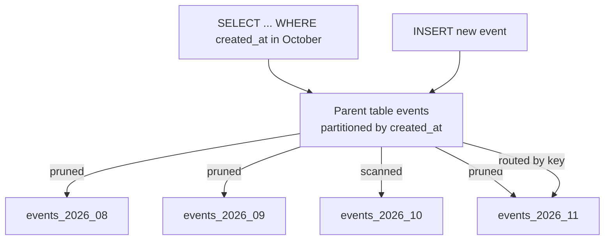
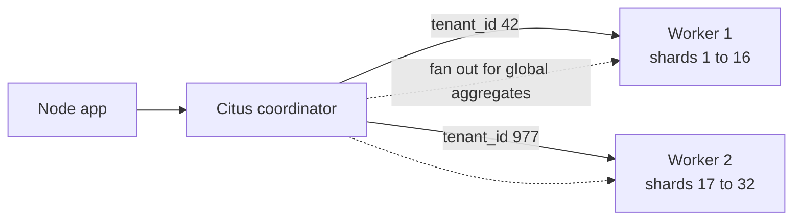

Once a table reaches hundreds of millions or billions of rows, everyday operations get painful: autovacuum on it runs for hours, rebuilding an index needs a maintenance window, and deleting last year's data generates a storm of WAL and dead tuples. Partitioning splits one logical table into many physical tables on the same server. Sharding goes further and spreads those pieces across servers. They solve different problems, and confusing them leads to poor designs.

## How it works

With **declarative partitioning** you create a parent table that holds no data itself, plus child partitions that each own a slice of the key space. The planner routes inserts to the right child and, when a query filters on the partition key, skips partitions that cannot contain matching rows. That skipping is **partition pruning**.



## Range, list and hash partitioning

**Range** is the workhorse for time-series data:

```sql
CREATE TABLE events (
  id          bigint GENERATED ALWAYS AS IDENTITY,
  tenant_id   bigint NOT NULL,
  created_at  timestamptz NOT NULL,
  type        text NOT NULL,
  payload     jsonb,
  PRIMARY KEY (id, created_at)          -- must include the partition key
) PARTITION BY RANGE (created_at);

CREATE TABLE events_2026_10 PARTITION OF events
  FOR VALUES FROM ('2026-10-01') TO ('2026-11-01');
CREATE TABLE events_2026_11 PARTITION OF events
  FOR VALUES FROM ('2026-11-01') TO ('2026-12-01');

CREATE INDEX ON events (tenant_id, created_at);  -- created on every partition
```

**List** partitions on discrete values, such as region or a few very large tenants:

```sql
CREATE TABLE orders (...) PARTITION BY LIST (region);
CREATE TABLE orders_eu PARTITION OF orders FOR VALUES IN ('eu-west', 'eu-central');
CREATE TABLE orders_us PARTITION OF orders FOR VALUES IN ('us-east', 'us-west');
CREATE TABLE orders_other PARTITION OF orders DEFAULT;
```

**Hash** spreads rows evenly when there is no natural range, for example by `user_id`:

```sql
CREATE TABLE sessions (...) PARTITION BY HASH (user_id);
CREATE TABLE sessions_p0 PARTITION OF sessions FOR VALUES WITH (MODULUS 8, REMAINDER 0);
-- ... through REMAINDER 7
```

Partitions can be sub-partitioned (range by month, then hash by tenant), but keep the count manageable. Planning overhead grows with the number of partitions; hundreds is fine, tens of thousands is not.

## Partition pruning in practice

Pruning only works when the query constrains the partition key:

```sql
EXPLAIN SELECT count(*) FROM events
WHERE created_at >= '2026-10-01' AND created_at < '2026-10-08';
-- Aggregate -> Seq Scan on events_2026_10   (other partitions absent)

EXPLAIN SELECT count(*) FROM events WHERE tenant_id = 42;
-- Append over every partition: no pruning
```

Pruning also happens at execution time for parameterized queries and prepared statements, shown as `Subplans Removed` in the plan. Wrapping the key in a function (`date_trunc('day', created_at) = ...`) can defeat it.

## Time-series retention by dropping partitions

Deleting 200 million rows with `DELETE` is slow, bloats the table and floods replicas. Dropping a partition is a metadata operation:

```sql
-- Detach without blocking concurrent queries (PG 14+), then drop or archive
ALTER TABLE events DETACH PARTITION events_2025_10 CONCURRENTLY;
DROP TABLE events_2025_10;
```

Automate creation of future partitions and dropping of old ones with the `pg_partman` extension or a scheduled job:

```js
// Nightly job: ensure next month's partition exists
const now = new Date();
const next = new Date(Date.UTC(now.getUTCFullYear(), now.getUTCMonth() + 1, 1));
const after = new Date(Date.UTC(next.getUTCFullYear(), next.getUTCMonth() + 1, 1));
const name = `events_${next.getUTCFullYear()}_${String(next.getUTCMonth() + 1).padStart(2, '0')}`;
await pool.query(
  `CREATE TABLE IF NOT EXISTS ${name} PARTITION OF events
   FOR VALUES FROM ('${next.toISOString()}') TO ('${after.toISOString()}')`
);
```

If an insert has no matching partition and there is no DEFAULT partition, it fails, so create partitions ahead of time.

## From partitioning to sharding with Citus

Partitioning keeps everything on one primary, so it does not raise the write ceiling. **Citus** is an open source PostgreSQL extension that turns a cluster into a coordinator plus worker nodes. A distributed table is split into shards (32 by default) placed across workers.

```sql
CREATE EXTENSION citus;

SELECT create_distributed_table('events', 'tenant_id');
SELECT create_distributed_table('orders', 'tenant_id', colocate_with => 'events');
SELECT create_reference_table('plans');  -- small table copied to every node
```



A query with `WHERE tenant_id = 42` is routed to the single shard that owns 42 and runs at single-node speed. Queries without the distribution key fan out to all shards and are merged on the coordinator, which is great for parallel analytics and wasteful for high-QPS OLTP.

## Choosing a distribution key

The distribution key (shard key) is the hardest decision to change later. Good keys:

- **Appear in nearly every query**, so most queries hit one shard.
- **Are shared by related tables**, so joins and foreign keys between co-located tables stay local. In SaaS, `tenant_id` on every table is the classic choice.
- **Have high cardinality and even distribution**. Watch for whale tenants; Citus can isolate a large tenant onto its own shard.
- **Are immutable**: changing a row's key means moving it between shards.

Bad keys: `created_at` (all writes hit the newest shard), low-cardinality status columns, or a key half your queries do not include.

## Trade-offs and pitfalls

- **Primary keys and unique constraints** on a partitioned table must include the partition key, so global uniqueness of `id` alone is not enforced.
- **Too many partitions** slow planning and use more locks per query.
- **Queries without the key** scan everything, partitioned or sharded.
- **Cross-shard transactions** work in Citus but cost more coordination; design so they are rare.
- **Hash partitioning on one node** rarely improves performance by itself; its main benefit is smaller units for vacuum and maintenance.

## Interview angle

- Distinguish partitioning (one node, manageability, retention) from sharding (many nodes, write and storage scale).
- For a metrics or logging system, propose monthly or daily range partitions with retention by dropping partitions.
- For multi-tenant SaaS, propose `tenant_id` as the distribution key with co-located tables and reference tables.
- Explain what happens to a query that lacks the shard key.

## Key takeaways

- Declarative partitioning splits one table into child tables by range, list or hash.
- Pruning requires the partition key in the WHERE clause.
- Retention by `DETACH` and `DROP` is far cheaper than bulk DELETE.
- Citus distributes tables across nodes; co-locate related tables on the same key.
- Choose a distribution key that is in every query, high cardinality and immutable.
