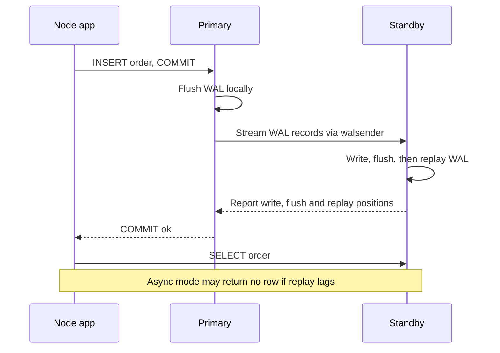

A single PostgreSQL server is a single point of failure and a ceiling on read throughput. Replication addresses both: standbys that can take over when the primary dies, and replicas that absorb read traffic. It also introduces the hardest problem in this series for application developers: a replica is always slightly behind, so a user who just saved something may not see it on the next page load.

## How it works

Recall from guide 1 that every change is first written to the WAL. **Physical streaming replication** simply ships that WAL to standbys, which replay it continuously. The standby is a byte-for-byte copy of the whole cluster (all databases), and with `hot_standby = on` (the default) it accepts read-only queries.



Setting up a standby is essentially `pg_basebackup` plus connection info:

```bash
pg_basebackup -h primary.internal -U replicator -D /var/lib/postgresql/data \
  -X stream -R --slot=replica1 -C
```

`-R` writes `primary_conninfo` and creates `standby.signal`; `--slot` with `-C` creates a **replication slot** so the primary retains WAL until this standby has consumed it.

## Synchronous versus asynchronous

By default replication is **asynchronous**: the primary commits once its own WAL is flushed and streams to standbys afterwards. If the primary dies, the last few hundred milliseconds of commits might never have reached a standby.

**Synchronous** replication makes commits wait for confirmation from standbys:

```sql
ALTER SYSTEM SET synchronous_standby_names = 'ANY 1 (replica1, replica2)';
ALTER SYSTEM SET synchronous_commit = 'on';  -- wait for standby flush
SELECT pg_reload_conf();
```

`synchronous_commit` levels trade latency for guarantees: `remote_write` (standby received it into OS memory), `on` (standby flushed to disk), and `remote_apply` (standby replayed it, so reads there see it). You can also set it per transaction: `SET LOCAL synchronous_commit = off` for unimportant writes such as analytics events.

| Mode | Data loss on primary failure | Write latency | Risk |
|------|------------------------------|---------------|------|
| Async | Possible, small window | Lowest | Lost recent commits |
| Sync, ANY 1 of 2 | None if a sync standby is up | Adds a network round trip | Writes stall if no sync standby is available |
| remote_apply | None, and replica reads are fresh | Highest | Slow replay slows every commit |

Use quorum (`ANY 1 of 2`) rather than a single named synchronous standby, otherwise losing that one standby blocks all writes.

## Replication lag and read-your-writes

Monitor lag on the primary:

```sql
SELECT application_name, state, sync_state,
       write_lag, flush_lag, replay_lag,
       pg_wal_lsn_diff(pg_current_wal_lsn(), replay_lsn) AS bytes_behind
FROM pg_stat_replication;
```

Lag is usually milliseconds but can spike to seconds or minutes during bulk writes, vacuum of huge tables, or long queries on the replica that conflict with replay (controlled by `max_standby_streaming_delay` and `hot_standby_feedback`).

Strategies for read-your-writes in a Node app:

1. **Route by recency**: after a user writes, send that user's reads to the primary for a few seconds (store a timestamp in the session or a cookie).
2. **LSN tracking**: return the commit LSN to the client and only read from a replica that has replayed past it.
3. **Read critical paths from primary**: checkout, account settings, anything shown immediately after a write.

```js
const primary = new pg.Pool({ connectionString: process.env.PRIMARY_URL, max: 10 });
const replica = new pg.Pool({ connectionString: process.env.REPLICA_URL, max: 20 });

async function createOrder(userId, items) {
  const { rows } = await primary.query(
    'INSERT INTO orders (user_id, items) VALUES ($1, $2) RETURNING id, pg_current_wal_lsn() AS lsn',
    [userId, items]
  );
  return rows[0]; // keep lsn in the session
}

async function getOrder(id, minLsn) {
  if (minLsn) {
    const { rows } = await replica.query(
      'SELECT pg_last_wal_replay_lsn() >= $1::pg_lsn AS caught_up', [minLsn]
    );
    if (!rows[0].caught_up) return (await primary.query('SELECT * FROM orders WHERE id = $1', [id])).rows[0];
  }
  return (await replica.query('SELECT * FROM orders WHERE id = $1', [id])).rows[0];
}
```

## Logical replication

Logical replication decodes WAL into row-level changes per table and sends them via publications and subscriptions. Unlike physical replication it can replicate a subset of tables, works across major versions, and the subscriber is a normal writable database.

```sql
-- On the source
CREATE PUBLICATION orders_pub FOR TABLE orders, order_items;
-- On the target
CREATE SUBSCRIPTION orders_sub
  CONNECTION 'host=old-db dbname=app user=replicator'
  PUBLICATION orders_pub;
```

Uses: near-zero-downtime major version upgrades, migrating to a new provider, feeding a reporting database, and change data capture with tools like Debezium. Limitations: DDL is not replicated, sequences are not synced (on most current versions), and tables need a primary key or replica identity for updates and deletes.

## Failover

PostgreSQL itself does not elect a new primary. Something external must detect failure, promote a standby (`pg_promote()`), and redirect clients.

- **Patroni** is the most common self-managed option. Each node runs a Patroni agent; leadership is held as a lock in a distributed store (etcd, Consul or ZooKeeper). If the leader stops renewing its lock, a healthy replica with the least lag is promoted. HAProxy or a DNS or virtual IP layer uses Patroni's REST health checks to route to the current primary.
- **Amazon RDS Multi-AZ** keeps a synchronous standby in another AZ and flips the DNS endpoint on failure, typically within a minute or two.
- **Aurora PostgreSQL** separates compute from a shared, replicated storage layer, so replicas read the same storage and failover usually takes well under a minute. Readers sit behind a reader endpoint.

Your app must survive failover: retry on connection errors, keep DNS TTLs low, and avoid caching resolved IPs forever.

## Trade-offs and pitfalls

- **Abandoned replication slots** make the primary retain WAL forever and fill the disk. Monitor `pg_replication_slots` and set `max_slot_wal_keep_size`.
- **Replicas are not backups**: a `DELETE` without WHERE replicates instantly. Keep WAL-archived backups with point-in-time recovery.
- **Split brain**: two nodes both accepting writes. Consensus-backed tools like Patroni plus fencing exist to prevent this.
- **`hot_standby_feedback = on`** prevents query cancellations on replicas but can cause bloat on the primary.
- **Async failover loses data**: decide your RPO explicitly.

## Interview angle

- Explain sync versus async replication in terms of RPO and write latency.
- Propose a read-your-writes strategy when you add read replicas to a design.
- Describe how automated failover works and what the client needs to do.
- Mention logical replication for upgrades and CDC.

## Key takeaways

- Streaming replication ships WAL to standbys that replay it and serve reads.
- Async is fast but can lose recent commits; quorum sync gives zero loss at a latency cost.
- Replica lag is normal; route read-after-write traffic to the primary or track LSNs.
- Logical replication moves selected tables across versions and systems.
- Use Patroni or a managed service for failover, and make clients retry.
