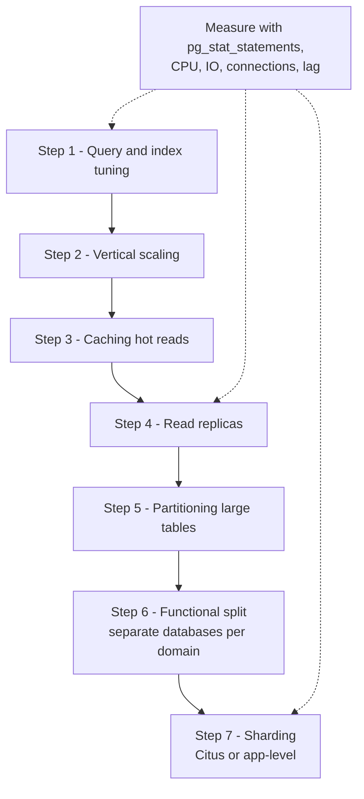

"Postgres doesn't scale" is usually said by teams that jumped to sharding before adding an index. A single well-tuned PostgreSQL primary on modern hardware handles tens of thousands of simple transactions per second and multiple terabytes of data. Each step up the scaling ladder adds operational complexity and constraints on your application, so the goal is to climb only as far as your workload forces you to. This guide lays out the steps in order and the measurable signals for each.

## How it works

Think of scaling as a sequence of increasingly expensive interventions. Exhaust the cheap ones first; each later step assumes the earlier ones are done.



## Step 1: Query and index tuning

**Signals**: a few queries dominate `total_exec_time` in `pg_stat_statements`; sequential scans on large tables; plans with large estimate errors; CPU high but QPS modest.

**Actions**: add the right composite, partial or covering indexes (guide 2); fix N+1 query patterns in the ORM; paginate with keyset pagination instead of large `OFFSET`; drop unused indexes slowing writes; tune autovacuum on hot tables.

```sql
-- Keyset pagination: constant cost regardless of page depth
SELECT id, created_at, title FROM posts
WHERE (created_at, id) < ($1, $2)
ORDER BY created_at DESC, id DESC
LIMIT 20;
```

This step regularly yields 10x to 100x improvements and costs nothing in architecture.

## Step 2: Vertical scaling

**Signals**: queries are already efficient, but CPU sits above roughly 70% at peak, or the working set no longer fits in RAM (shared buffers hit ratio falling, `BUFFERS` showing many reads).

**Actions**: a bigger instance, more RAM, faster storage (provisioned IOPS, local NVMe). Retune `shared_buffers`, `effective_cache_size`, `work_mem` and `max_wal_size` for the new hardware. Cloud instances with dozens of vCPUs and hundreds of GB of RAM are routine. Vertical scaling is boring, and boring is good: zero code changes.

## Step 3: Caching

**Signals**: read-heavy traffic dominated by the same hot keys (product pages, user profiles, config, leaderboards); data can tolerate seconds of staleness.

**Actions**: cache-aside in Redis with TTLs and explicit invalidation on writes; HTTP and CDN caching for public responses; materialized views for expensive aggregates refreshed on a schedule.

```js
async function getProduct(id) {
  const key = `product:${id}`;
  const cached = await redis.get(key);
  if (cached) return JSON.parse(cached);
  const { rows } = await pool.query('SELECT * FROM products WHERE id = $1', [id]);
  if (rows[0]) await redis.set(key, JSON.stringify(rows[0]), { EX: 300 });
  return rows[0];
}
```

Caching adds invalidation bugs and stale-read questions, so cache what is hot and tolerant, not everything.

## Step 4: Read replicas

**Signals**: reads still saturate the primary after caching; reporting or analytics queries compete with OLTP traffic; you need HA standbys anyway.

**Actions**: add streaming replicas and route read-only traffic to them, handling lag and read-your-writes (guide 6). Send heavy analytics to a dedicated replica or export to a warehouse.

Replicas do nothing for write throughput. If the primary is write-bound, keep going.

## Step 5: Partitioning

**Signals**: one or two tables are hundreds of GB or billions of rows; vacuum and index maintenance on them takes hours; most queries touch recent data; you need to delete old data in bulk.

**Actions**: declarative partitioning by time or tenant (guide 8). Queries with the partition key prune to a few partitions, vacuum works per partition, and retention becomes `DROP TABLE` instead of a massive `DELETE`. Partitioning is still a single server, so it helps manageability and query locality more than raw write capacity.

## Step 6: Functional split

**Signals**: unrelated domains (billing, analytics events, the core app) contend on one cluster; teams want independent scaling and deploys.

**Actions**: move a high-volume domain, often events or audit logs, to its own database. Cross-database joins disappear, so this works best along boundaries where you already communicate via APIs or events.

## Step 7: Sharding

**Signals**: write throughput or total data size exceeds what the largest practical single primary can handle after all the above; the data has a natural key (tenant, user, account) that most queries filter on.

**Options**:

| Approach | How | Fits |
|----------|-----|------|
| Citus | Extension that distributes tables by a column across worker nodes and routes or parallelises queries | Multi-tenant SaaS, real-time analytics |
| App-level sharding | App maps a key to one of N databases | Full control, simple per-key access patterns |
| Managed distributed SQL | Postgres-compatible systems with built-in sharding | Teams willing to accept compatibility differences |

```js
// App-level: route by tenant using a lookup table, not a hard-coded modulo
const shardPools = {
  s1: new pg.Pool({ connectionString: process.env.SHARD1_URL }),
  s2: new pg.Pool({ connectionString: process.env.SHARD2_URL }),
};
async function poolForTenant(tenantId) {
  const shard = await directory.getShard(tenantId); // cached tenant -> shard map
  return shardPools[shard];
}
```

A directory lookup lets you move individual tenants between shards later; a plain `hash % N` makes resharding painful.

Sharding costs: cross-shard joins and transactions become expensive or impossible, unique constraints are per shard, schema migrations run N times, and backups and failover multiply. Choose the shard key carefully (guide 8).

## Trade-offs and pitfalls

- **Skipping steps**: sharding to fix a missing index adds permanent complexity for a problem that an index would have solved.
- **Ignoring connections**: many "scaling" incidents are connection exhaustion; add pooling early (guide 5).
- **Archiving**: deleting or moving cold data often delays every later step.
- **Replicas for writes**: they cannot help; identify whether you are read-bound or write-bound first.
- **Premature microservice databases** trade one scaling problem for many consistency problems.

## Interview angle

- When asked how to scale a Postgres-backed design, walk the ladder in order and tie each step to a metric.
- Distinguish read scaling (cache, replicas) from write scaling (partitioning helps maintenance, sharding helps throughput).
- Name a shard key for the system in question and explain what queries become cross-shard.
- Give rough capacity numbers to show you know a single node goes far.

## Key takeaways

- Tune queries and indexes first; it is the highest return step.
- Scale vertically before horizontally; it requires no code changes.
- Caching and replicas scale reads, not writes.
- Partition huge tables for maintenance and retention; shard only when one primary cannot keep up.
- Every step should be justified by a measured signal, not by anticipation.
