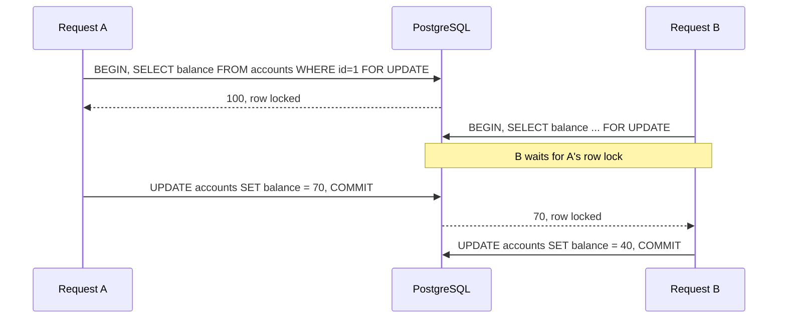

Concurrency bugs are the ones that pass every test and then double-charge a customer in production. Two requests read the same balance, both subtract, both write. PostgreSQL gives you several tools to prevent this: isolation levels, explicit row locks, advisory locks and the option to detect conflicts optimistically. Picking the right one depends on how often conflicts actually happen and what you can afford to retry.

## How it works

Every statement runs inside a transaction (implicitly, if you did not `BEGIN`). Thanks to MVCC, each transaction reads from a **snapshot**: the set of transactions that were committed when the snapshot was taken. Reads never block writes and writes never block reads. Writers do block other writers on the **same row**: the second UPDATE waits until the first transaction commits or rolls back.



## Isolation levels

PostgreSQL accepts the four SQL standard levels but implements three distinct behaviours (READ UNCOMMITTED behaves like READ COMMITTED; dirty reads never happen).

| Level | Snapshot taken | Prevents | Still possible |
|-------|----------------|----------|----------------|
| Read Committed (default) | Per statement | Dirty reads | Non-repeatable reads, phantoms, lost updates in read-modify-write code |
| Repeatable Read | Once, at first statement | Non-repeatable reads, phantoms | Write skew |
| Serializable | Once, plus conflict tracking (SSI) | All anomalies | Nothing, but transactions may abort with a serialization failure |

### Read Committed

Each statement sees data committed before that statement began. The classic bug is the lost update in application code:

```js
// BROKEN under concurrency
const { rows } = await client.query('SELECT stock FROM products WHERE id = $1', [id]);
await client.query('UPDATE products SET stock = $1 WHERE id = $2', [rows[0].stock - 1, id]);
```

Two requests both read 10, both write 9. The fix is often just to let the database do the arithmetic atomically:

```sql
UPDATE products SET stock = stock - 1 WHERE id = $1 AND stock > 0 RETURNING stock;
```

### Repeatable Read

The whole transaction sees one snapshot. If you try to update a row that another transaction modified and committed after your snapshot, PostgreSQL raises `could not serialize access due to concurrent update` (SQLSTATE `40001`) and you must retry. It still allows **write skew**: two doctors each check "at least one other doctor is on call", both see yes, both go off call.

### Serializable

Serializable Snapshot Isolation tracks read/write dependencies and aborts one transaction if the outcome could not have happened in some serial order. It catches write skew. The price is some overhead and more `40001` errors under contention, so every serializable transaction must be wrapped in retry logic:

```js
async function withSerializableRetry(pool, fn, attempts = 5) {
  for (let i = 1; i <= attempts; i++) {
    const client = await pool.connect();
    try {
      await client.query('BEGIN ISOLATION LEVEL SERIALIZABLE');
      const result = await fn(client);
      await client.query('COMMIT');
      return result;
    } catch (err) {
      await client.query('ROLLBACK').catch(() => {});
      if (err.code !== '40001' && err.code !== '40P01') throw err;
      if (i === attempts) throw err;
      await new Promise(r => setTimeout(r, 2 ** i * 10 + Math.random() * 20));
    } finally {
      client.release();
    }
  }
}
```

## Pessimistic locking: SELECT ... FOR UPDATE

`FOR UPDATE` locks the selected rows until the transaction ends, so a read-modify-write sequence becomes safe under Read Committed. Weaker variants exist: `FOR NO KEY UPDATE` (does not block inserts of child rows referencing the key) and `FOR SHARE`. Add `NOWAIT` to fail immediately instead of queuing.

### Job queues with SKIP LOCKED

`SKIP LOCKED` lets many workers pull from one table without stepping on each other: each worker skips rows another worker already locked.

```sql
WITH next_job AS (
  SELECT id FROM jobs
  WHERE status = 'pending' AND run_at <= now()
  ORDER BY run_at
  LIMIT 10
  FOR UPDATE SKIP LOCKED
)
UPDATE jobs j SET status = 'running', locked_at = now()
FROM next_job WHERE j.id = next_job.id
RETURNING j.*;
```

Pair it with a partial index on `(run_at) WHERE status = 'pending'`. Libraries like pg-boss and Graphile Worker build on this pattern. It comfortably handles thousands of jobs per second, but vacuum must keep up with the churn of updated rows.

## Advisory locks

Advisory locks are application-defined locks on an arbitrary 64-bit key, with no table involved. Useful for "only one instance runs this cron job" or "serialise work per tenant":

```sql
-- Transaction-scoped: released automatically at COMMIT or ROLLBACK
SELECT pg_try_advisory_xact_lock(hashtext('nightly-billing'));
```

Prefer the `_xact_` variants. Session-level advisory locks survive until explicitly released or the connection closes, and they break with transaction-mode connection poolers because the next transaction may run on a different server connection.

## Deadlocks

A deadlock happens when transaction A holds row 1 and wants row 2 while B holds row 2 and wants row 1. PostgreSQL checks for cycles after `deadlock_timeout` (1 second by default), aborts one transaction with SQLSTATE `40P01`, and lets the other proceed. Prevention:

- Lock rows in a consistent order, for example `ORDER BY id` in your `FOR UPDATE` query.
- Keep transactions short.
- Retry on `40P01`.

## Optimistic locking with a version column

When conflicts are rare and you do not want to hold locks across user think time (an edit form open for five minutes), use a version column:

```sql
UPDATE documents
SET body = $1, version = version + 1
WHERE id = $2 AND version = $3;
```

```js
const res = await pool.query(sql, [body, id, expectedVersion]);
if (res.rowCount === 0) {
  throw new ConflictError('Document was modified by someone else, reload and retry');
}
```

No lock is held between read and write; the conditional UPDATE detects the conflict. Return HTTP 409 and let the client reconcile.

## Trade-offs and pitfalls

- **Holding a transaction across network calls** (calling Stripe between BEGIN and COMMIT) holds locks and blocks vacuum. Do external calls outside the transaction.
- **Pool misuse**: running `BEGIN` with `pool.query` sends each statement to a possibly different connection. Always use one checked-out client for a transaction.
- **Serializable without retries** turns normal contention into user-facing 500 errors.
- **Lock queues**: a waiting `ALTER TABLE` blocks every later query on the table behind it. See lock_timeout in guide 10.
- **Hot rows** such as a global counter serialise all writers; shard the counter or aggregate asynchronously.

## Interview angle

- Explain how you would prevent double-booking or overselling: atomic UPDATE with a condition, `FOR UPDATE`, or a unique or exclusion constraint.
- Compare optimistic and pessimistic locking and when each fits.
- Describe a Postgres-backed job queue with `SKIP LOCKED` as an alternative to adding Redis or SQS early on.
- Name write skew and say which isolation level prevents it.

## Key takeaways

- Read Committed is the default and is fine if you write atomic, conditional UPDATEs.
- Repeatable Read and Serializable require retry logic for SQLSTATE 40001.
- `FOR UPDATE SKIP LOCKED` is a solid foundation for job queues.
- Use transaction-scoped advisory locks, especially behind a pooler.
- Optimistic locking with a version column suits low-contention, long think-time edits.
