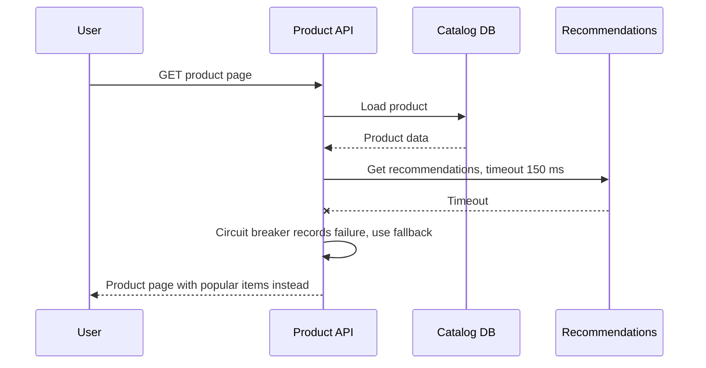

Availability is whether the system answers correctly right now. Reliability is whether it keeps doing so over time, including through failures you know will happen: disks die, instances get rebooted for maintenance, deploys go wrong, a zone loses power, a dependency starts timing out. You cannot prevent these, so a reliable design assumes them and limits what each one can do. The tools are simple to name and easy to get subtly wrong: redundancy, health checks, failover, isolation and graceful degradation, each verified by actually breaking things on purpose.

## Availability math: serial and parallel

When a request needs every component in a chain, availabilities multiply. When any one of several redundant copies can serve it, the unavailabilities multiply.

- **Serial**: A = A1 × A2 × ... × An. A load balancer at 99.99%, an app tier at 99.9% and a database at 99.95% give 0.9999 × 0.999 × 0.9995 ≈ 99.84%, worse than any single part. Every synchronous dependency you add lowers the ceiling.
- **Parallel**: A = 1 − (1 − A1) × (1 − A2) × .... Two independent instances at 99% each give 1 − 0.01 × 0.01 = 99.99%. Three give 99.9999%.

| Setup | Availability |
|---|---|
| One instance at 99.5% | 99.5% (about 3.6 hours down a month) |
| Two instances at 99.5%, independent | 99.9975% |
| Chain of 5 services each at 99.9% | 99.5% |
| Same chain, each service with 2 independent replicas | about 99.9995% |

The catch is "independent". Two instances on the same host, in the same zone, running the same buggy release or depending on the same config service fail together. Real availability is dominated by correlated failures, which is why placement, deploy strategy and shared dependencies matter more than instance count.

## Redundancy and removing single points of failure

A single point of failure (SPOF) is any component whose failure takes the system down. Walk the request path and every background path, and for each element ask what happens if it disappears.

- **Stateless tiers**: at least two instances, spread across availability zones, behind a load balancer. Size so the survivors carry full load (N+1 or N+2).
- **Databases**: a synchronous or semi-synchronous standby in another zone with automated failover; read replicas are not a failover plan unless promotion is automated and tested.
- **Caches and queues**: clustered or managed with replication; design the app to survive a cache flush.
- **Network and edge**: redundant load balancers (managed LBs already are), NAT gateways per zone, DNS with health-checked records.
- **Hidden SPOFs**: a single cron host, a license server, a secrets store, an identity provider, a CI system needed for emergency fixes, the one engineer with production access.

## Active-passive vs active-active

| | Active-passive | Active-active |
|---|---|---|
| How it works | Standby receives replicated data, takes traffic only on failover | All copies serve traffic simultaneously |
| Failover time | Seconds to minutes (detection plus promotion plus DNS/connection switch) | Near zero: unhealthy node is removed from rotation |
| Capacity cost | Standby mostly idle | Each copy must absorb the others' load when they fail |
| Data complexity | Simple: one writer | Hard for writes: conflict resolution, partitioning by owner, or consensus |
| Typical use | Relational database primaries | Stateless services, caches, globally partitioned data |

A common, sound combination: active-active stateless services across zones, active-passive database within a region.

## Failover and health checks

Failover is only as good as detection. Health checks come in two kinds:

- **Liveness**: is the process alive? Failing means restart it.
- **Readiness**: can it serve traffic right now (dependencies reachable, warmed up)? Failing means stop sending it requests.

Keep readiness checks cheap and local. A readiness check that calls the database on every instance will mark every instance unhealthy when the database blips, turning a partial outage into a full one. Tune thresholds: a check every 5 seconds with 3 consecutive failures detects a dead node in about 15 seconds without flapping on a single slow response.

For database failover, the hard parts are avoiding split brain (two nodes both believing they are primary, usually prevented with a consensus-based coordinator or fencing) and getting clients to the new primary (DNS TTL, connection pool refresh, retry on connection errors). Managed databases typically fail over in 30 to 120 seconds; your application should retry through that window rather than crash.

## Multi-AZ vs multi-region

Availability zones are separate data centres within a region with independent power and networking, connected by low-latency links (single-digit milliseconds or less). Regions are hundreds or thousands of kilometres apart.

| | Multi-AZ | Multi-region |
|---|---|---|
| Protects against | Instance, rack, data centre failure | Regional outage, regional control-plane failure, disaster, residency needs |
| Synchronous replication | Practical | Usually too slow (tens to over 100 ms round trip) |
| Typical availability target | 99.9% to 99.99% | 99.99% to 99.999% |
| Cost and complexity | Modest | High: duplicated stacks, data replication, cross-region transfer fees, routing |

Multi-AZ in one region is the right default for most systems. Go multi-region when the business needs regional disaster tolerance or global low latency, and be honest about the data model it requires.

## RTO and RPO

- **RTO (recovery time objective)**: how long until service is restored after a disaster.
- **RPO (recovery point objective)**: how much recent data you can afford to lose.

| Strategy | RTO | RPO | Cost |
|---|---|---|---|
| Backup and restore to another region | Hours | Hours (since last backup) or minutes with log shipping | Low |
| Pilot light: data replicated, minimal compute off | Tens of minutes | Seconds to minutes | Medium |
| Warm standby: scaled-down full stack running | Minutes | Seconds | Medium-high |
| Active-active multi-region | Near zero | Near zero to seconds | High |

An untested backup is not a backup. Restore into a fresh environment on a schedule and time it; that measured number is your real RTO.

## Durability vs availability

Durability means acknowledged data is not lost; availability means you can access it now. They are different promises. A system can be fully durable and unavailable (the database is down but every write is safe on replicated disks), or available and not durable (an in-memory cache that answers instantly and loses everything on restart). Object stores offer extreme durability (designed for 11 nines) with lower availability targets (often 99.9% to 99.99%). Decide per data class: orders need durability above all, so acknowledge only after replication; a view counter can trade durability for speed.

## Graceful degradation

When something fails, serve a reduced experience instead of an error page.

- Product page with recommendations down: show the page without that widget.
- Search cluster down: fall back to cached popular results or category browsing.
- Payment provider slow: accept the order as pending and confirm by email later.
- Under overload: shed low-priority traffic (analytics beacons, prefetches) before checkout.

Degradation must be designed per feature, with timeouts, circuit breakers and fallbacks, and tested; otherwise the "optional" dependency becomes a hard one the first time it is slow.

## Blast radius and cell-based architecture

Redundancy handles machines failing. It does not help when the failure is a bad deploy, a poison message, a runaway tenant or a config change, because those hit every replica at once. Blast radius reduction limits how much of the system one such event can touch.

- **Staged rollouts**: canary to 1% of traffic or one zone, watch SLOs, then widen.
- **Bulkheads**: separate thread pools, connection pools or clusters per dependency or customer tier.
- **Cells**: split the whole stack (services plus data) into independent copies, each serving a subset of customers, with a thin routing layer that maps a customer to a cell. A failure in one cell of 20 affects 5% of customers. Cells also cap the size of each deployment unit, so they scale by adding cells instead of growing one giant cluster. AWS and others use this pattern for core services.
- **Shuffle sharding**: give each customer a random small subset of nodes so a bad customer only affects others who share their exact subset.

## Chaos testing

You only know failover works when you have seen it work. Start small and controlled:

1. Define steady state with SLO metrics.
2. Hypothesise: "killing one app instance does not change error rate".
3. Inject the fault in staging, then in production during working hours with a quick abort: kill instances, add latency to a dependency, fail a database over, block a zone.
4. Fix what breaks and automate the experiment.

Game days that rehearse a regional failover or a restore from backup find the missing permission, the expired certificate and the stale runbook before a real incident does.

## Trade-offs and pitfalls

- **Correlated failures** make naive parallel math wildly optimistic.
- **Deep health checks** cascade a dependency blip into total outage.
- **Unexercised failover** fails when needed; test it regularly.
- **Multi-region without a data strategy** gives you two regions that cannot serve writes consistently.
- **Long serial chains** of synchronous services cap availability below any single component.
- **Chasing extra nines** for internal or non-critical features wastes money better spent on checkout or login.

## Interview angle

- Do the serial and parallel math aloud to justify redundancy.
- Remove SPOFs tier by tier, including DNS, NAT and the database.
- State RTO and RPO and choose a DR strategy that fits them.
- Default to multi-AZ; justify multi-region by requirement.
- Mention graceful degradation and cells to show you think about blast radius, not just uptime.

## Key takeaways

- Serial dependencies multiply availability down; independent redundancy multiplies unavailability down.
- Independence is the hard part: spread across zones and stagger deploys.
- Active-active for stateless tiers, active-passive for most databases.
- RTO and RPO define your disaster recovery strategy; measure them in drills.
- Durability and availability are separate guarantees, chosen per data class.
- Contain blast radius with staged rollouts, bulkheads and cells, and prove it with chaos testing.
