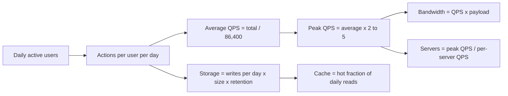

Back-of-envelope estimation is how you decide whether a design needs one Postgres box or a sharded cluster before you draw a single arrow. The goal is not precision. It is getting within a factor of 2 to 10 so you can tell which resource will break first: CPU, memory, disk, network or the database. In an interview, five minutes of clean arithmetic justifies every later choice.

## How it works

Every estimate follows the same chain. Start from users, derive requests per second, multiply by payload size to get bandwidth and storage, then divide by what one machine can handle to get a server count.



Round aggressively. A day has 86,400 seconds; call it 100,000 (10^5). That shortcut alone makes most QPS math a mental operation: 10 million requests per day is about 100 QPS.

## Latency numbers to remember

These are order-of-magnitude figures for modern hardware. Memorize the ratios, not the digits.

| Operation | Approximate time |
|-----------|------------------|
| L1 cache reference | 1 ns |
| Main memory reference | 100 ns |
| Read 1 MB sequentially from memory | 3 to 10 µs |
| Round trip within a datacenter | 0.5 ms |
| Random read from NVMe SSD | 20 to 100 µs |
| Read 1 MB sequentially from SSD | 0.2 to 1 ms |
| Redis GET over the network | 0.2 to 1 ms |
| Indexed Postgres point query | 1 to 5 ms |
| Round trip US East to Europe | 70 to 90 ms |
| Round trip US to Asia | 150 to 200 ms |

The lessons: memory is about 1,000 times faster than an SSD random read, a network hop inside a region costs about as much as an SSD read, and cross-continent round trips dominate everything else. If a request makes three sequential cross-region calls, it cannot finish under 250 ms no matter how fast your code is.

## Powers of two and unit shortcuts

| Power | Exact | Approx | Name |
|-------|-------|--------|------|
| 2^10 | 1,024 | 10^3 | KB |
| 2^20 | 1,048,576 | 10^6 | MB |
| 2^30 | about 1.07 billion | 10^9 | GB |
| 2^40 | | 10^12 | TB |
| 2^50 | | 10^15 | PB |

Useful sizes: a UUID is 16 bytes binary or 36 as text, a 64-bit integer is 8 bytes, a timestamp is 8 bytes, a typical tweet-sized JSON row is 300 to 500 bytes, a compressed thumbnail is 20 to 50 KB, a phone photo is 2 to 4 MB, one minute of 1080p video is roughly 100 MB at 15 Mbps.

## Traffic: average and peak

Average QPS is total daily requests divided by 86,400. Real traffic is not flat. Consumer apps peak in the evening at 2 to 3 times average; flash sales, live events and push notifications can spike 10 times or more for minutes. Size for peak, not average, and state the multiplier you chose.

Also split reads from writes. Most systems are read-heavy at ratios of 10:1 to 100:1. The ratio determines whether you scale with read replicas and caches or need write sharding.

## Storage and bandwidth

Storage per day = writes per day x bytes per record. Multiply by retention and then by a replication factor (3 for most distributed stores) and add 20 to 30 percent for indexes and overhead.

Bandwidth = QPS x response size. Convert to bits for network links: 1 GB/s is 8 Gbps. A single modern server NIC is usually 10 to 25 Gbps, so a service pushing 5 GB/s of images needs a CDN, not more app servers.

## Cache sizing

The 80/20 rule is a reasonable starting point: 20 percent of items serve 80 percent of reads. Cache size = daily distinct items read x 20 percent x item size. A single Redis node comfortably serves 50,000 to 100,000 simple operations per second, and more with pipelining.

## Server count

Divide peak QPS by realistic per-server throughput, then add headroom so you can lose a node or an availability zone.

| Component | Rough throughput per instance |
|-----------|-------------------------------|
| Stateless API server, light JSON work | 1,000 to 5,000 req/s |
| Postgres, simple indexed reads | 5,000 to 20,000 queries/s |
| Postgres, writes with fsync | 1,000 to 10,000 tx/s |
| Kafka broker | hundreds of MB/s |

Target 50 to 60 percent CPU at peak, and keep N+1 or N+2 capacity per zone.

## Worked example: a photo-sharing service

Assumptions, stated up front:

```text
DAU                        = 50 million
Uploads per user per day   = 0.2   -> 10 M uploads/day
Feed views per user/day    = 20    -> 1 B feed requests/day
Photos per feed request    = 10 thumbnails
Original photo size        = 2 MB, thumbnail = 30 KB
Metadata row               = 500 bytes
Retention                  = 5 years
Peak multiplier            = 3x
```

Traffic:

```text
Upload QPS   = 10 M / 10^5          = 100 avg, 300 peak
Feed QPS     = 1 B / 10^5           = 10,000 avg, 30,000 peak
Thumbnail QPS = 30,000 x 10         = 300,000 peak (CDN)
```

Storage:

```text
Photos/day   = 10 M x 2 MB          = 20 TB/day
Thumbs/day   = 10 M x 30 KB         = 300 GB/day
Per year     = about 7.4 PB originals
5 years      = about 37 PB, before replication
Metadata     = 10 M x 500 B x 365 x 5 = about 9 TB
```

Bandwidth:

```text
Upload ingress   = 300/s x 2 MB         = 600 MB/s, about 5 Gbps
Thumbnail egress = 300,000/s x 30 KB    = 9 GB/s, about 72 Gbps
```

Servers and cache:

```text
Feed API: 30,000 peak / 2,000 per server = 15, plus headroom -> 20-25
Hot metadata cache: 20% of 1 B reads -> say 20 M posts x 1 KB = 20 GB
```

What the numbers tell you: originals belong in object storage with lifecycle tiering, thumbnails must come from a CDN because 72 Gbps of egress from origin is unreasonable, metadata at 9 TB over five years fits a sharded relational store or a wide-column store, and the hot cache fits in memory on two or three Redis nodes with replicas. The write path at 300 uploads per second is modest; the read path is the real problem.

## Trade-offs and pitfalls

- **False precision**: writing 115.74 QPS signals you missed the point. Say "about 100".
- **Forgetting peak**: average-based sizing falls over at the first evening spike.
- **Ignoring replication and indexes**: raw data times 3 replicas plus index overhead can be 4 times the naive figure.
- **Mixing bits and bytes**: network specs are in bits, storage in bytes. A factor of 8 error is common.

## Interview angle

- Ask for or state DAU, read/write ratio and payload sizes before computing.
- Use 10^5 seconds per day and powers of ten; narrate the arithmetic out loud.
- Compute peak QPS, storage over retention, and egress bandwidth at minimum.
- End each number with a design consequence: "so we need a CDN", "so a single primary handles writes".

## Key takeaways

- Users to QPS to bandwidth and storage to servers is a repeatable chain.
- One day is about 10^5 seconds; 1 million requests per day is about 12 QPS.
- Size for peak at 2 to 5 times average and leave N+1 headroom.
- Memory beats SSD by about 1,000 times; cross-continent round trips cost 70 to 200 ms.
- The value of an estimate is the decision it drives, not the digits.
