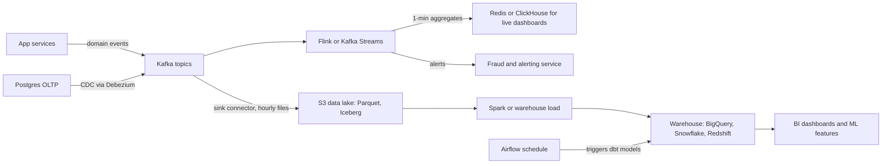

Your OLTP database answers "what is the state of order 123" in a millisecond. It is the wrong place to answer "revenue per country per hour last quarter" or "flag accounts with more than 20 failed logins in 5 minutes". Those need a separate path that copies events out of the application and computes over them, periodically over bounded data (batch) or continuously over unbounded data (stream). Most products end up with both; the choices are about latency, correctness when data arrives late, and how many systems you will operate.

## Batch vs stream at a glance

| | Batch | Stream |
| --- | --- | --- |
| Input | Bounded: yesterday's files, a table snapshot | Unbounded: a Kafka topic that never ends |
| Latency | Minutes to hours | Milliseconds to seconds |
| Typical tools | Spark, dbt on a warehouse, Airflow | Kafka Streams, Flink, Spark Structured Streaming |
| Correctness | Easy: rerun the job over the full input | Harder: late data, state, failures mid-stream |
| Cost model | Burst compute, then idle | Always-on workers holding state |
| Good for | Reporting, billing, ML training sets, backfills | Fraud, alerting, live dashboards, feature updates |

A useful rule: if a human looks at the result tomorrow morning, use batch. If a machine acts on it within seconds, use a stream.

## A typical analytics pipeline for an app

Application services write to Postgres or MongoDB and publish domain events to Kafka. Change data capture (Debezium reading the Postgres WAL) streams row changes into Kafka too, so you do not need dual writes. From there, one consumer lands raw events into object storage as Parquet (the lake), stream jobs compute real-time aggregates, and scheduled batch jobs build modelled tables in the warehouse.



Keep raw, immutable events in the lake for your full retention period. Everything downstream is derived and can be rebuilt, which makes bug fixes and new metrics cheap.

## Batch processing

### The MapReduce idea

MapReduce splits a job into three phases: **map** each record to key/value pairs, **shuffle** so all values for one key land on one worker, and **reduce** each key's values to a result. The shuffle moves data across the network and dominates cost, so batch tuning is mostly about shuffling less: filter early, pre-aggregate, broadcast small join tables.

Hadoop wrote intermediate results to disk between stages. **Spark** keeps them in memory where possible and plans a whole DAG, making multi-step jobs many times faster. You write SQL or DataFrame code and the optimiser picks the physical plan.

```python
events = spark.read.parquet("s3://lake/events/dt=2026-11-02/")
(events.filter("type = 'purchase'")
       .groupBy("country")
       .agg(F.sum("amount_cents").alias("revenue"))
       .write.mode("overwrite").parquet("s3://lake/marts/revenue_by_country/dt=2026-11-02/"))
```

### ETL vs ELT, Airflow and dbt

**ETL** transforms before loading into the warehouse; **ELT** loads raw data and transforms inside it with SQL. Elastic warehouse compute made ELT the default: **dbt** builds models (`stg_orders`, `fct_orders`) as versioned SQL with tests (`unique`, `not_null`) and lineage.

**Airflow** (or Dagster) runs tasks on a schedule in dependency order with retries and alerting: wait for yesterday's lake partition, run dbt, refresh dashboards.

Two rules prevent most incidents: make jobs **idempotent per partition** (overwrite `dt=2026-11-02`, never append), and process by the **data's date, not the run date**, so a backfill is a parameter change.

## Stream processing

Stream processors consume events continuously, keep state (counts, joins, sessions) in local storage such as RocksDB, checkpoint that state durably, and emit results.

- **Kafka Streams** is a Java library, not a cluster: your service embeds it and state is backed by compacted changelog topics. Good when input and output are Kafka.
- **Apache Flink** is a cluster engine with rich event-time support, large state and savepoints for upgrades. Good for complex, high-volume pipelines.
- **Spark Structured Streaming** runs micro-batches and suits teams already on Spark.

### Windowing

Aggregations over an infinite stream need boundaries.

| Window | Definition | Example |
| --- | --- | --- |
| Tumbling | Fixed size, no overlap | Orders per 1-minute bucket |
| Sliding (hopping) | Fixed size, advances by a smaller step | 5-minute count updated every 1 minute |
| Session | Closes after a gap of inactivity | User session ends after 30 minutes idle |

A 5-minute window with a 1-minute hop puts each event in five windows, five times the state of tumbling. Session windows can merge when a late event bridges two sessions.

### Event time, processing time and watermarks

**Event time** is when something happened on the device; **processing time** is when your job sees it. A phone offline in a tunnel may deliver a 09:01 click at 09:14. Bucketing by processing time miscounts both windows and gives different answers on replay, so bucket by event time.

The problem is knowing when a window is complete. A **watermark** is the processor's assertion that "no more events with timestamp earlier than T are expected". A common strategy is bounded out-of-orderness: watermark = max event time seen minus 10 seconds. When the watermark passes a window's end, the window fires.

```java
WatermarkStrategy.<Click>forBoundedOutOfOrderness(Duration.ofSeconds(10))
    .withTimestampAssigner((c, ts) -> c.eventTimeMillis());

clicks.keyBy(Click::pageId)
      .window(TumblingEventTimeWindows.of(Time.minutes(1)))
      .allowedLateness(Time.minutes(5))
      .sideOutputLateData(lateTag)
      .sum("count");
```

The watermark delay trades latency for completeness. **Allowed lateness** keeps window state so late events emit an updated result; anything later goes to a side output for batch reconciliation. Sinks must therefore accept upserts keyed by window.

### Exactly-once in streams

Failures cause replays, so naive pipelines double count. "Exactly-once" in practice means **the effect on state and output is as if each event was processed once**, even though some events are physically processed twice.

Flink achieves it with distributed snapshots: barriers flow through the stream, each operator checkpoints its state and the source offsets together, and on failure everything rewinds to the last checkpoint. For output, sinks use **two-phase commit**: Kafka transactions are committed only when the checkpoint completes, so consumers with `isolation.level=read_committed` never see uncommitted results. Kafka Streams gets the same with `processing.guarantee=exactly_once_v2`, which commits consumed offsets, state changelog writes and output records in one Kafka transaction.

The guarantee stops at the system boundary. Writing to Postgres or an HTTP API needs an **idempotent sink**: upsert by a deterministic key such as `(page_id, window_start)`, or store the offset in the same transaction as the result. Transactional output also adds up to one checkpoint interval (often 30 to 60 seconds) of latency.

## Lambda vs kappa architecture

**Lambda** runs a batch layer that recomputes accurate results and a speed layer that gives approximate real-time ones, merged at serving time. It was a workaround for untrustworthy stream processors, and costs two codebases per metric that inevitably drift.

**Kappa** uses only the stream path. The log (Kafka with long retention or tiered storage) is the source of truth; to fix a bug you deploy a new job version, replay into a new output table, and switch readers. Modern event-time, exactly-once engines make this viable for most cases.

Many teams run a hybrid: streaming for live aggregates and alerts, dbt in the warehouse as the system of record for finance.

## Data lake, warehouse and lakehouse

A **data lake** is object storage holding Parquet files at around $23 per TB per month on S3 Standard, with no transactions or schema enforcement of its own. A **warehouse** (BigQuery, Snowflake, Redshift) is a managed columnar SQL engine priced on storage plus compute or bytes scanned. A **lakehouse** adds table formats like Iceberg or Delta Lake to lake files, giving ACID commits, schema evolution and time travel so Spark, Trino and warehouses share one copy.

Partition by date, aim for files of 128 MB to 1 GB, and compact the small files streaming sinks produce.

## Trade-offs and pitfalls

- **Processing-time windows** give numbers that change on replay and are wrong for late mobile data; use event time.
- **Watermarks too tight** drop real data; too loose delays every result. Measure your actual lateness distribution first.
- **Exactly-once claims end at the sink**; non-transactional sinks still need idempotent upserts.
- **Appending in batch jobs** doubles data on retry; overwrite partitions.
- **Hot keys** (one celebrity page, one big tenant) overload a single stream partition; pre-aggregate with a salted key, then merge.
- **Schema changes upstream** break pipelines silently; use a schema registry with compatibility rules and dbt tests.

## Interview angle

- Ask how fresh the result must be; that decides batch vs stream.
- Draw the pipeline: OLTP and events into Kafka, then lake, stream jobs and warehouse.
- Explain event time vs processing time with a concrete late-arriving mobile event, then introduce watermarks.
- Say what exactly-once actually guarantees and how the sink stays idempotent.
- Compare lambda and kappa and say which you would pick and why.

## Key takeaways

- Batch handles bounded data with simple correctness; streams handle unbounded data with low latency and more complexity.
- Keep immutable raw events in the lake so every derived table can be rebuilt.
- Tumbling, sliding and session windows bound aggregations; window by event time.
- Watermarks trade latency for completeness; allowed lateness and side outputs catch stragglers.
- Exactly-once means consistent state and transactional or idempotent output, not single physical processing.
- Kappa with a replayable log is the modern default; lambda survives where batch is the system of record.
