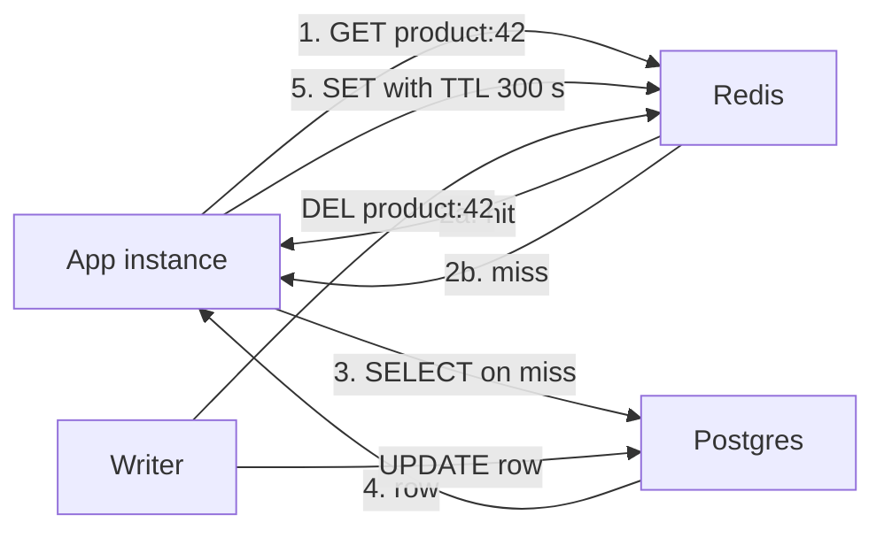

Caching is the cheapest way to make a read-heavy system fast and to protect the database behind it. A Redis lookup takes about 0.5 ms inside a region, a Postgres query with a join might take 5 to 50 ms, and a CDN hit avoids your servers entirely. But every cache is a copy of data that can go stale, and the classic failures (stampedes when a hot key expires, stale reads after updates, memory full of things nobody reads) come from treating caching as a one-line optimization. This guide covers where to cache, how to keep caches correct enough, and how to size them.

## Cache layers

| Layer | Example | Latency | Best for |
| --- | --- | --- | --- |
| Browser and app | HTTP `Cache-Control`, service worker, mobile disk cache | 0 ms | Static assets, per-user data that tolerates staleness |
| CDN | CloudFront, Cloudflare, Fastly | 5 to 30 ms from user | Static files, public API responses, images |
| Gateway or reverse proxy | Nginx `proxy_cache`, Varnish | about 1 ms | Shared responses close to origin |
| In-process | LRU map in app memory | under 0.01 ms | Config, feature flags, tiny hot reference data |
| Distributed | Redis, Memcached | 0.2 to 1 ms | Sessions, computed objects, query results shared by all instances |
| Database buffer | Postgres `shared_buffers`, OS page cache | inside the query | Hot pages and indexes, automatic |

Cache as close to the user as correctness allows. Data that is the same for everyone and changes rarely belongs at the CDN; per-user data belongs in Redis keyed by user; anything that must be exact belongs in the database.

## Patterns



**Cache-aside (lazy loading).** The application checks the cache, on a miss reads the database and populates the cache. It is the most common pattern because the cache only holds what is actually read and a cache outage degrades to slower reads instead of failures.

```js
async function getProduct(id) {
  const key = `product:${id}`;
  const hit = await redis.get(key);
  if (hit) return JSON.parse(hit);
  const row = await db.product.findUnique({ where: { id } });
  await redis.set(key, JSON.stringify(row ?? null), 'EX', row ? 300 : 30);
  return row;
}
```

**Read-through.** Same flow, but the cache library or service loads from the database itself, so application code only talks to the cache.

**Write-through.** Writes go to the cache and database synchronously, so the cache is always populated with fresh values. Write latency rises, and you cache data that may never be read.

**Write-behind (write-back).** Writes go to the cache and are flushed to the database asynchronously in batches. Very fast writes and good for absorbing bursts such as counters, but a cache node failure before flush loses data. Use it only for data you can afford to lose or that you also log durably.

**Refresh-ahead.** Entries that are read near expiry are refreshed in the background before they expire, so popular keys never miss. Good for expensive, predictable hot keys like a homepage feed.

## Invalidation and TTL choice

There are three ways to keep a cache fresh, and real systems combine them:

1. **TTL expiry**: every entry gets a lifetime. The TTL is your maximum staleness. Product descriptions can take 10 minutes, stock levels 5 to 30 seconds, exchange rates whatever your business accepts.
2. **Explicit invalidation**: on write, delete the cache key. Delete rather than update, because two concurrent writers updating the cache can leave the older value in place.
3. **Versioned keys**: include a version in the key (`product:42:v17`, or `assets/app.3f9a1c.js`). New data gets a new key, old entries age out. This is the standard for static assets: hash in the filename, `Cache-Control: max-age=31536000, immutable`.

Always set a TTL, even with explicit invalidation; it bounds the damage from a missed invalidation. Add jitter (for example 300 s plus or minus 10 percent) so keys written together do not expire together.

For CDN-cached API responses, use `Cache-Control: public, max-age=60, stale-while-revalidate=30` to serve a slightly stale copy while refreshing in the background, and purge by surrogate key or tag when content changes.

## Consistency between cache and database

Cache-aside with delete-on-write still has a race: reader A misses, reads old row; writer B updates the row and deletes the key; reader A then writes the old row into the cache, where it stays until TTL. Mitigations, from simple to thorough:

- Keep TTLs short enough that the race window is tolerable.
- **Delayed double delete**: delete on write, then delete again after roughly one replication-lag interval, such as 500 ms.
- Write to the cache only if the version you read is newer than what is cached, using a version column and a Lua script or `SET ... NX` patterns.
- Drive invalidation from the database change stream (Postgres logical replication via Debezium, MongoDB change streams) so every committed write evicts its keys, even writes from scripts and other services.

Also beware reading from a lagging replica on a miss: you can repopulate the cache with stale data right after invalidating it. Read from the primary on cache misses for data that was just written.

## Cache stampede

When a hot key expires, thousands of concurrent requests miss at once and all hit the database with the same query. Fixes:

- **Locking**: the first request takes a short lock (`SET lock:product:42 1 NX PX 5000`) and rebuilds; others wait briefly and retry the cache, or serve the stale value.
- **Request coalescing**: within one process, concurrent misses for the same key share a single in-flight promise. CDNs and Nginx (`proxy_cache_lock on`) do this at the edge.
- **Probabilistic early expiry**: each reader recomputes early with a probability that rises as expiry approaches (the "XFetch" approach), so one request refreshes before the key ever expires.
- **Serve stale while revalidating**: keep a soft TTL for freshness and a hard TTL for deletion.

## Hot keys

One key read 100,000 times per second (a celebrity profile, a flash-sale product) overloads the single Redis shard that owns it, no matter how big the cluster is. Mitigations: an in-process cache in front of Redis with a 1 to 5 second TTL, which turns 100,000 reads per second into a few per instance; replicating the key under several names (`product:42:#0` to `#9`) and reading a random copy; and Redis read replicas for that shard. Detect hot keys with `redis-cli --hotkeys` (with an LFU policy) or client-side sampling.

## Cache penetration

Requests for keys that do not exist, whether from bugs or attackers scanning IDs, miss the cache every time and hit the database. Fixes: **negative caching** (store a "not found" marker with a short TTL, as the code above does with `null` for 30 s) and a **Bloom filter** of all valid IDs checked before the cache. A Bloom filter answers "definitely not present" or "possibly present"; 10 million IDs at a 1 percent false-positive rate need only about 12 MB.

## Sizing with hit-ratio math

The value of a cache is how much load it removes. If the database can handle 2,000 queries per second and peak reads are 20,000, you need at least a 90 percent hit ratio; plan for 95 percent to leave headroom. Average latency is roughly:

```text
avg = hit_ratio x cache_latency + (1 - hit_ratio) x (cache_latency + db_latency)
95% hits, 0.5 ms cache, 20 ms DB  -> 0.5 + 0.05 x 20 = 1.5 ms
80% hits                           -> 0.5 + 0.20 x 20 = 4.5 ms
```

Size memory for the working set, not the whole dataset. Access is usually skewed: often 20 percent of items get 80 percent or more of reads. With 50 million products at 2 KB each (100 GB total), caching the hottest 10 million needs about 20 GB plus 20 to 30 percent overhead for Redis metadata and fragmentation, so a 32 GB node or a small cluster. Measure the actual hit ratio from `INFO stats` (`keyspace_hits`, `keyspace_misses`) and grow until extra memory stops improving it.

## Eviction policies

When memory is full, the cache must drop something. **LRU** evicts least recently used and suits most workloads. **LFU** evicts least frequently used and resists one-off scans pushing out genuinely hot keys. **TTL-based** (`volatile-ttl`) evicts soonest-to-expire first. In Redis, set `maxmemory` explicitly and choose `allkeys-lru` or `allkeys-lfu` for pure caches; the default `noeviction` makes writes fail when memory is full. Never share one Redis instance between a cache (evictable) and a queue or session store (must not evict).

## What not to cache

- Data that must be exact at read time: balances, inventory for the final decision, permissions just revoked.
- Highly personalized data with low reuse, which fills memory with a near-zero hit ratio.
- Responses with secrets or per-user data at a shared CDN without the right `Cache-Control: private` and `Vary` headers.
- Anything before you have measured that the underlying query is actually the bottleneck.

## Trade-offs and pitfalls

- **No TTL** means a single missed invalidation lives forever.
- **Updating instead of deleting** on write invites ordering races.
- **Synchronized expiry** causes periodic stampedes; add jitter.
- **Cache as source of truth** without persistence loses data on restart.
- **Large values** (multi-megabyte JSON) block Redis's single thread and saturate network; keep values small or split them.
- **Cold start**: after a cache flush or deploy, the database sees full load; warm critical keys or ramp traffic.

## Interview angle

- Name the layer for each kind of data: CDN for public, Redis for shared, in-process for tiny and hot.
- Default to cache-aside with delete-on-write and a TTL, and explain the race it leaves.
- Raise stampedes, hot keys and penetration before the interviewer does, with one fix each.
- Size the cache from hit-ratio math and working set, not total data.

## Key takeaways

- Every cache is a replica with bounded staleness; pick the TTL as a product decision.
- Cache-aside plus invalidation plus TTL with jitter covers most needs.
- Protect the database from stampedes, hot keys and lookups of missing keys.
- Size for the working set and measure the hit ratio.
- Do not cache what must be exact or what nobody reads twice.
