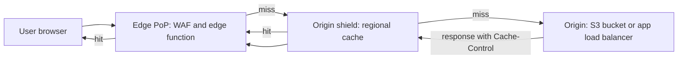

A content delivery network is a fleet of caching reverse proxies in hundreds of points of presence (PoPs), usually within 10 to 30 ms of most users. A request from Mumbai to an origin in us-east-1 pays roughly 200 ms of round trip per exchange; served from a Mumbai PoP it pays 10 ms. A CDN also absorbs traffic spikes and attacks, terminates TLS close to the user, and increasingly runs your code. The hard parts are not turning it on but deciding what is cacheable, what the cache key is, and how stale content gets replaced.

## How a request flows



The edge checks its cache using the cache key. On a miss it asks a regional shield cache rather than the origin directly, so 300 PoPs missing at once become one origin request. The origin's `Cache-Control` header decides how long each layer keeps the object.

## Pull vs push

A **pull CDN** fetches from your origin on the first miss and caches according to headers; it is the default everywhere (CloudFront, Cloudflare, Fastly, Akamai). A **push CDN** has you upload content ahead of time, which suits large release-day files such as game patches. Most teams use pull with object storage as the origin, which behaves like push without a separate upload step.

## Cache keys and Vary

The cache key decides which requests share a cached object. The default is usually host plus path plus query string. Two mistakes dominate:

- **Too broad a key** fragments the cache. Including every query parameter means `?utm_source=twitter` and `?utm_source=email` are cached separately. Whitelist the parameters that actually change the response.
- **Too narrow a key** leaks content. If the response differs by cookie, language or device but the key ignores that, one user's personalised page is served to another. This is the classic CDN data leak.

`Vary` tells caches which request headers change the response. `Vary: Accept-Encoding` is fine because CDNs normalise it to a few values (gzip, br). `Vary: User-Agent` or `Vary: Cookie` effectively disables caching, since nearly every request has a different value. Instead, normalise at the edge: derive a small header like `x-device: mobile|desktop` and put that in the key.

## Cache-Control that works

The origin controls caching through headers. A practical set:

| Content | Header |
| --- | --- |
| Hashed static assets (`app.3f9a1c.js`) | `public, max-age=31536000, immutable` |
| HTML pages | `public, max-age=0, s-maxage=60, stale-while-revalidate=300` |
| Public API list endpoint | `public, s-maxage=30, stale-while-revalidate=60, stale-if-error=86400` |
| Logged-in user data | `private, no-store` |

`max-age` applies to browsers and shared caches; `s-maxage` overrides it for shared caches only, so the CDN can hold HTML for 60 seconds while browsers always revalidate. `stale-while-revalidate` lets the cache serve the old copy immediately while fetching a fresh one in the background, which hides origin latency. `stale-if-error` keeps serving during an origin outage, often the cheapest availability win you will ever ship. `no-cache` does not mean "do not cache"; it means "revalidate before use". Use `no-store` for anything sensitive.

Send `ETag` or `Last-Modified` so revalidation returns a 304 without a body.

## Invalidation and versioned URLs

Purging works but is slow and blunt: CloudFront invalidations typically take one to a few minutes, the first 1,000 paths per month are free and then cost per path, and a purge of `/*` sends a burst of misses to the origin. Fastly and Cloudflare purge in seconds and support **surrogate keys** (cache tags), where you tag responses with `Surrogate-Key: product-123 category-9` and purge everything for product 123 with one call.

The better default is never needing to purge. Put a content hash in static asset filenames (every bundler does this), cache them for a year with `immutable`, and keep the HTML that references them on a short TTL. A deploy changes the HTML, which points to new filenames, and old assets age out naturally. Keep previous assets in the bucket for a day or two so users with an old HTML page still load.

## Origin shield and request collapsing

Without a shield, each PoP misses independently. An **origin shield** is a designated regional cache in front of the origin. Pair it with **request collapsing**: when 1,000 users ask for the same uncached object at once, the cache sends one request upstream and holds the rest. Together they routinely cut origin load by 90 percent or more for read-heavy sites. Pick the shield region closest to your origin.

## Dynamic content acceleration

Even uncacheable API calls benefit. TCP and TLS handshakes terminate at a nearby PoP, saving two or three long round trips, and the CDN carries the request over its backbone on warm, persistent connections to your origin. Expect 20 to 50 percent lower latency for far-away users on `no-store` routes.

## Edge compute

CDNs run code at the PoP. The options differ a lot:

| Platform | Runtime | Limits (typical) | Good for |
| --- | --- | --- | --- |
| CloudFront Functions | Lightweight JS | Under 1 ms CPU, no network | Header rewrites, redirects, cache key normalisation |
| Lambda@Edge | Node.js or Python | Seconds, network access, runs in regional caches | Auth checks, origin selection, image resizing |
| Cloudflare Workers | V8 isolates | Tens of ms CPU by default, cold start near zero | Full APIs, A/B routing, KV/D1/Durable Objects |
| Fastly Compute | WebAssembly | Fast start, any Wasm language | Low-latency request logic |

Good edge use: verify a JWT, route by geography or experiment, rewrite URLs, add security headers. Bad edge use: logic that needs your primary database, since every call then crosses the world anyway.

```js
// CloudFront Function: normalise device into the cache key
function handler(event) {
  var req = event.request;
  var ua = (req.headers['user-agent'] || {}).value || '';
  req.headers['x-device'] = { value: /Mobile/i.test(ua) ? 'mobile' : 'desktop' };
  return req;
}
```

## Signed URLs and private content

For paid or private files, keep the bucket private and let only the CDN read it (CloudFront Origin Access Control). Your app issues a **signed URL** or **signed cookie** with an expiry, say 15 minutes, and the edge validates the signature without calling you. Use signed cookies when one page loads many files, such as HLS video segments. Short expiry limits link sharing; it does not prevent a determined user from re-downloading during the window.

## Video and large files

Video is chunked into 2 to 6 second HLS or DASH segments at several bitrates, so each segment is a small cacheable object. Live streams use 1 to 2 second TTLs on the playlist and long TTLs on segments. For large downloads, make sure the CDN caches range requests rather than passing each range to the origin.

## DDoS and WAF at the edge

The edge is where attacks should die. CDNs absorb volumetric layer 3 and 4 floods across their whole network capacity, far beyond anything one origin can handle. At layer 7, put a WAF with managed rule sets (SQL injection, known bad bots) and rate limits per IP or per token at the edge. Then lock the origin so it only accepts CDN traffic, via security groups on the CDN's IP ranges, a secret header, or mTLS. Otherwise attackers simply bypass the CDN.

## Measuring hit ratio

Track **request hit ratio** (share of requests served from cache) and **byte hit ratio** (share of bytes); 70 percent request hits can mean 95 percent byte hits when misses are small HTML. Also watch origin request rate and egress, which is what costs money. Healthy targets: above 95 percent for static assets, 60 to 90 percent for HTML with short TTLs. When hit ratio drops, look first at cache key fragmentation (query strings, cookies) and at `Set-Cookie` on responses, which many CDNs treat as uncacheable.

## Multi-CDN

Large sites run two or more CDNs, steered by DNS using real-user latency data, to survive a provider outage and negotiate price. The cost is keeping configuration, purges, signed URLs and WAF rules consistent across providers. Without petabytes of monthly traffic or a strict availability contract, one CDN with `stale-if-error` is enough.

## Trade-offs and pitfalls

- **Caching personalised responses** under a shared key leaks user data. Mark them `private` or key on a normalised identity.
- **`Vary: Cookie` or `Vary: User-Agent`** silently destroys hit ratio.
- **Relying on purges** for deploys makes releases slow and origin-spiky; use versioned URLs.
- **Unlocked origins** let attackers skip the WAF.
- **Edge functions calling a distant database** add latency instead of removing it.
- **Long TTLs on HTML** strand users on old asset references after a deploy.

## Interview angle

- Put a CDN in front of static assets and media; add origin shield for read-heavy systems.
- Explain how cache keys decide both hit ratio and correctness.
- Contrast purging with content-hashed URLs, and use signed URLs for private media.

## Key takeaways

- A CDN cuts latency, origin load and attack surface; use pull mode with object storage by default.
- Keep cache keys minimal but correct, and normalise headers instead of using broad `Vary`.
- Use `s-maxage`, `stale-while-revalidate` and `stale-if-error`; reserve `no-store` for private data.
- Version static asset URLs and cache them for a year; purge only for exceptions.
- Run light logic at the edge, lock the origin to the CDN, and measure both request and byte hit ratio.
