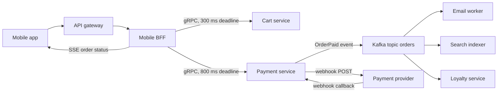

Every arrow on an architecture diagram is a decision about how two components communicate, and that decision fixes a lot: how failures propagate, how latency adds up, who has to be online, and how hard it will be to change either side later. A checkout that calls six services synchronously is only as available as the product of their availabilities; the same checkout that emits an event and lets those services react asynchronously keeps working when one is down. This guide covers the main styles, when each fits, and the cross-cutting rules that keep any of them reliable.

## Synchronous vs asynchronous

**Synchronous** means the caller waits for the answer: an HTTP or gRPC request. It is simple to reason about and gives immediate feedback, but it couples availability and latency. If service A calls B and C in sequence and each is 99.9 percent available, A's path is at best 99.7 percent, and its latency is the sum.

**Asynchronous** means the caller hands off work and moves on, usually via a queue or log. The receiver can be down, slow or scaled independently; the producer only needs the broker. The cost is eventual consistency, harder debugging, and the need to handle duplicates and ordering.

A useful rule: use synchronous calls when the user is waiting for the result and cannot proceed without it (load the cart, authorize the payment), and asynchronous for everything that can happen after the response (send the receipt email, update search, award loyalty points).



## Interaction styles

- **Request/response**: caller sends, waits for one reply. HTTP, gRPC unary.
- **Fire-and-forget**: caller sends a command to a queue and does not wait for the outcome. One consumer processes each message.
- **Publish/subscribe**: a producer emits an event ("OrderPaid") without knowing who listens; each subscriber group gets its own copy. Adding a new consumer requires no producer change.
- **Streaming**: an ongoing flow of messages in one or both directions, such as gRPC streams, WebSockets, or a Kafka consumer reading a log.

Commands ("SendEmail") have one intended handler and expect it to happen. Events ("OrderPaid") state a fact and let anyone react. Prefer events between bounded contexts; they keep the producer ignorant of downstream features.

## The options

**REST over HTTP/JSON** is the default for public and browser-facing APIs: universal tooling, cacheable GETs, human-readable payloads. Weaknesses are loose contracts (fix with OpenAPI) and chattiness for complex screens.

**gRPC** uses Protocol Buffers over HTTP/2. Payloads are typically 3 to 10 times smaller than JSON, contracts are generated into typed clients, and it supports streaming and native deadlines. It is excellent for internal service-to-service traffic. Browsers need gRPC-Web or a proxy, and payloads are not human-readable.

**GraphQL** lets clients ask for exactly the fields they need in one request, which suits rich UIs aggregating many resources. Costs: HTTP caching is harder because everything is a POST to one endpoint, a naive resolver triggers N+1 queries (use DataLoader), and you must limit query depth and cost to stop expensive queries.

**WebSocket** is a full-duplex connection upgraded from HTTP. Use it when both sides send frequently: chat, multiplayer, collaborative editing. You own reconnection, heartbeats, fan-out across servers (usually via Redis pub/sub or a broker) and stateful scaling.

**Server-Sent Events (SSE)** is a one-way stream from server to client over plain HTTP with automatic reconnection and `Last-Event-ID` resume. It covers most "push updates to the browser" needs (notifications, progress, live scores, token streaming from an LLM) with far less complexity than WebSockets.

**Webhooks** are HTTP callbacks from one system to another when something happens, the standard for integrating with third parties like Stripe or GitHub. Receivers must verify signatures, respond 2xx fast and process asynchronously, and dedupe by event ID because senders retry.

**Message queues and logs** (SQS, RabbitMQ, Kafka) decouple producers from consumers in time. Queues delete messages once acknowledged and suit task distribution; logs like Kafka retain messages and let many consumer groups replay at their own pace.

| Need | Choose | Avoid |
| --- | --- | --- |
| Public API for third parties | REST + OpenAPI | gRPC (client friction) |
| Internal service calls, low latency | gRPC | GraphQL |
| Web or mobile screen aggregating many resources | GraphQL or a BFF | Many REST round trips from the device |
| Server pushes updates to browser | SSE | Polling every second |
| Two-way realtime (chat, games, editing) | WebSocket | SSE plus POST if traffic is heavy both ways |
| Notify an external system of events | Webhooks | Asking them to poll |
| Background work after a response | Queue (SQS, RabbitMQ) | Sync call in the request path |
| Many consumers of the same events, replay | Log (Kafka, Kinesis) | Point-to-point queues per consumer |

## API gateway and BFF

An **API gateway** is the single entry point for external traffic. It handles cross-cutting concerns once: TLS, authentication, rate limiting, request size limits, routing to services, and metrics. Examples are AWS API Gateway, Kong, Apigee, or Envoy-based gateways. Keep business logic out of it.

A **backend for frontend (BFF)** is a thin service per client type (web, iOS, partner API) that aggregates internal calls and shapes responses for that client. The mobile BFF can return one compact payload for the home screen instead of the app making eight calls over a 150 ms cellular link. The BFF is owned by the frontend team, which lets them evolve it with the UI.

## Timeouts and deadline propagation

Every synchronous call needs a timeout. Better, the whole request carries a **deadline**: if the gateway allows 2 seconds and the BFF has spent 400 ms, it passes 1.6 seconds minus a safety margin downstream. gRPC propagates deadlines automatically through the `grpc-timeout` header; for HTTP, pass a header such as `x-request-deadline` with an absolute timestamp and have each service compute what is left. A service that sees its deadline has passed should stop work, since nobody will use the answer.

```js
const remaining = deadline - Date.now() - 50; // 50 ms margin
if (remaining <= 0) throw new Error('deadline exceeded');
const res = await fetch(url, { signal: AbortSignal.timeout(remaining) });
```

## Idempotency

Networks deliver at least once in practice: clients retry on timeouts, queues redeliver unacknowledged messages, webhook senders retry for days. Every handler that changes state must be safe to run twice. Techniques: natural idempotency (PUT sets a value, DELETE removes it), an `Idempotency-Key` header stored with the result under a unique constraint for POSTs, and for consumers, a processed-message table keyed by message ID written in the same transaction as the side effect.

## Versioning and backward compatibility

Clients upgrade on their own schedule, and mobile apps from two years ago still call you. Rules that keep you out of trouble:

- Only make additive changes to a live version: new optional fields, new endpoints, new enum values that clients ignore.
- Never rename or remove a field, change its type, or make an optional field required without a new version.
- Clients must ignore unknown fields (the default in Protobuf; enforce it in JSON parsers).
- In Protobuf, never reuse a field number; mark removed ones `reserved`.
- Version REST by URL (`/v2/orders`) or header; version events by schema with a registry that checks compatibility (Confluent Schema Registry, for example).
- Deploy in expand-and-contract order: add the new field, migrate consumers, then remove the old one.

## Service discovery basics

Callers need to find healthy instances of a service whose IPs change with every deploy. Options:

- **DNS-based**: Kubernetes gives each Service a stable name (`orders.default.svc.cluster.local`) backed by a virtual IP that kube-proxy balances across ready pods.
- **Registry-based**: instances register with Consul, Eureka or etcd and clients query it, often through a client-side balancer.
- **Load balancer or mesh**: callers hit a stable LB address or a local sidecar (Envoy in Istio or Linkerd) that knows the endpoints.

Discovery must reflect health: only instances passing readiness checks should receive traffic, and clients should refresh endpoints quickly when instances leave.

## Trade-offs and pitfalls

- **Deep synchronous chains** multiply latency and failure; flatten them or move work async.
- **Distributed monolith**: services that must all deploy together because of tight sync coupling and shared schemas.
- **Async without idempotency** produces duplicate emails and double charges.
- **WebSockets where SSE would do** adds stateful infrastructure for no benefit.
- **GraphQL without cost limits** lets a single query take down the database.
- **Breaking changes in events** silently break consumers you did not know existed.

## Interview angle

- For each arrow, say sync or async and why, based on whether the user waits for it.
- Use the decision table: REST public, gRPC internal, SSE for push, WebSocket for two-way, queues for background, Kafka for fan-out.
- Mention deadlines, idempotency keys and additive versioning without being asked.
- Place an API gateway at the edge and a BFF per client when screens aggregate data.

## Key takeaways

- Synchronous calls couple availability and latency; async decouples them at the cost of eventual consistency.
- Pick the protocol by direction, audience and coupling, not fashion.
- Propagate deadlines, not just per-hop timeouts.
- Assume at-least-once delivery everywhere and make handlers idempotent.
- Evolve contracts additively and let clients ignore unknown fields.
