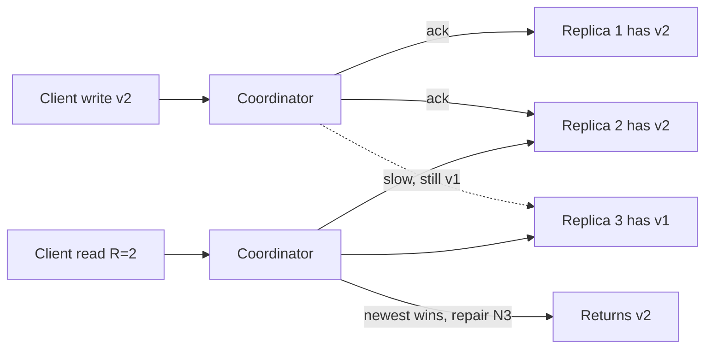

As soon as you keep more than one copy of data, on a replica, in a cache or in another region, the copies can disagree. A consistency model is the contract that tells a client what it might observe while they disagree: can it read a value older than one it just wrote, can two users see events in different orders, can a read go backwards in time? Picking one costs latency and availability, and the right answer usually differs per feature. This guide gives you the vocabulary, the theory you actually need, and how it maps onto databases you will use.

## The models, strongest to weakest

| Model | Guarantee | Typical cost |
| --- | --- | --- |
| Linearizable | Every operation appears to take effect at one instant between its call and return; all clients agree on one real-time order | Coordination on every write and most reads; cross-region adds 60 to 200 ms |
| Sequential | All clients see the same order of operations, consistent with each client's own program order, but not necessarily real time | Still needs a global order |
| Causal | If operation A could have influenced B (B read A's result, or the same client did A then B), everyone sees A before B; unrelated writes may appear in different orders | Track dependencies; no global coordination |
| Read-your-writes | A client always sees its own earlier writes | Session routing or version tokens |
| Monotonic reads | A client never sees older data after seeing newer data | Stick to one replica or track a version floor |
| Eventual | If writes stop, all replicas converge; no promise about what you read meanwhile | Cheapest, lowest latency |

Read-your-writes, monotonic reads, monotonic writes and writes-follow-reads are called **session guarantees**. They cover most of what users notice and are much cheaper than linearizability because they constrain only one client's view.

Rule of thumb: you need linearizability when two different clients must agree on a winner right now (a username, the last seat, a lock), session guarantees when one user would notice their own stale data, and eventual when nobody can tell.

## CAP, stated properly

CAP says that during a **network partition**, a replicated system must choose between **consistency** (here meaning linearizability) and **availability** (every non-failed node answers every request). It is not "pick two of three": partitions are not optional in a real network, so the choice only exists when one happens. A CP system refuses or blocks some requests on the minority side; an AP system keeps answering on both sides and reconciles afterwards.

Two common misreadings to avoid. First, CAP availability is a strict formal property; a CP database with automatic failover can still be 99.99 percent available in practice. Second, most systems are neither pure CP nor AP; they make different choices per operation.

**PACELC** extends CAP with the case you live in 99.9 percent of the time: if there is a Partition, choose Availability or Consistency; Else, choose Latency or Consistency. Even with a healthy network, synchronous replication to a second region costs a round trip on every write. DynamoDB and Cassandra defaults are PA/EL; Spanner and CockroachDB are PC/EC; a single Postgres primary with async replicas behaves as PC/EC when you read from the primary and trades toward EL when you read from replicas.

## Quorums: N, R and W

Leaderless stores like Cassandra and the original Dynamo design replicate each key to **N** nodes. A write succeeds after **W** acknowledge it; a read queries **R** nodes and returns the newest version. If **R + W > N**, every read set overlaps every write set in at least one node, so a read sees the latest acknowledged write.



| N | W | R | Behaviour |
| --- | --- | --- | --- |
| 3 | 2 | 2 | Standard choice; tolerates one node down for reads and writes |
| 3 | 3 | 1 | Fast reads, but any one node down blocks writes |
| 3 | 1 | 3 | Fast writes, reads block if one node is down |
| 3 | 1 | 1 | Lowest latency, eventual only; reads may be stale |

Overlapping quorums are necessary but not sufficient for linearizability. Sloppy quorums with hinted handoff, concurrent writes, and a failed write that reached only some replicas can all produce anomalies. Use them as "very likely fresh", and use a consensus-based operation (Cassandra lightweight transactions use Paxos) when you truly need compare-and-set.

## How real databases map

**PostgreSQL with streaming replicas.** The primary is linearizable for single-row operations. Async replicas typically lag by milliseconds but can fall seconds or minutes behind under load or long-running queries. `synchronous_commit = remote_apply` with a synchronous standby makes the commit wait until the replica has applied it, so reads there see it, at the cost of write latency. To get read-your-writes cheaply, route a user's reads to the primary for a few seconds after they write, or capture `pg_current_wal_lsn()` after the write and only read from a replica whose `pg_last_wal_replay_lsn()` has passed it.

**MongoDB.** Write concern `w: "majority"` means the write survives a primary failover; `w: 1` can be rolled back. Read concern `"majority"` returns only majority-committed data; `"linearizable"` on the primary gives true linearizable reads at extra cost. Causally consistent sessions give read-your-writes and monotonic reads even when reading from secondaries:

```js
const session = client.startSession({ causalConsistency: true });
await orders.insertOne(doc, { session, writeConcern: { w: 'majority' } });
await orders.findOne({ _id: doc._id }, {
  session, readPreference: 'secondary', readConcern: { level: 'majority' },
});
```

**DynamoDB.** Reads are eventually consistent by default, typically consistent within a second. `ConsistentRead: true` gives strongly consistent reads within a region at twice the read capacity cost; it is not available on global secondary indexes. Global tables replicate across regions asynchronously with last-writer-wins, usually within a second, so concurrent writes to the same item in two regions lose one.

**Cassandra.** Consistency is tunable per query: `ONE`, `QUORUM`, `LOCAL_QUORUM`, `ALL`. `LOCAL_QUORUM` for both reads and writes is the common choice: strong within a data centre, asynchronous across data centres, no cross-region latency on the request path.

## Choosing consistency per feature

The mistake is picking one model for the whole application. Go feature by feature and ask what goes wrong if a reader sees stale data or two writers conflict.

| Feature | Model | Why |
| --- | --- | --- |
| Account balance, payments | Linearizable, single leader, transactions | Double spend is unacceptable |
| Inventory for last items | Linearizable conditional write | Two buyers must not both win |
| Username or email uniqueness | Linearizable, unique index | Must have one owner |
| User's own profile edit | Read-your-writes | They will refresh and check |
| Comments thread | Causal | A reply must not appear before its parent |
| Like and view counts | Eventual | Off by a few is invisible |
| Search index, recommendations | Eventual, seconds to minutes | Rebuilt from source of truth |

A balance is a transaction against a single primary; a like is an increment into a counter that can lag. Both can live in the same system with different read paths.

## Conflict resolution

When you accept writes on more than one replica (multi-leader, leaderless, offline clients), concurrent updates to the same item will conflict and something must decide the result.

**Last-writer-wins (LWW).** Attach a timestamp and keep the highest. Simple and used by Cassandra and DynamoDB global tables, but it silently discards one concurrent write, and clock skew of even 50 ms can make an earlier write win. Acceptable for values where one overwrite is fine, such as "last seen" or a profile photo.

**Version vectors and vector clocks.** Each replica keeps a counter per node; comparing two vectors tells you whether one version descends from the other or they are concurrent. On concurrency, keep both "siblings" and let the application merge, as Riak did and the original Dynamo did for shopping carts. Correct, but it pushes merging to the client.

**CRDTs.** Conflict-free replicated data types are structures whose merge is commutative, associative and idempotent, so replicas converge regardless of order. A G-Counter keeps one count per node and sums them; a PN-Counter adds a second for decrements; an OR-Set handles add and remove; sequence CRDTs power collaborative editors such as those built on Yjs and Automerge. Redis Enterprise active-active and Riak ship CRDTs. They are ideal for counters, sets and collaborative documents, but they cannot enforce invariants like "balance never below zero".

**Avoid the conflict.** Often best: route all writes for a given key to one home region or leader, so conflicts cannot happen, and replicate elsewhere for reads.

## Trade-offs and pitfalls

- **Reading from replicas by default** breaks read-your-writes in ways that only appear under load when lag grows. Measure replication lag and alert on it.
- **Caches are replicas too.** A Redis cache in front of Postgres is an eventually consistent replica with its own staleness.
- **LWW with wall clocks** loses data under skew; prefer hybrid logical clocks or a single writer.
- **Quorum math is not linearizability**; do not build locks on `QUORUM` reads and writes.
- **Strong consistency across regions** costs at least one inter-region round trip per write, 70 ms US east to west and around 150 ms transatlantic plus processing.

## Interview angle

- Define linearizability precisely and contrast it with eventual and causal.
- State CAP as a choice during partitions, then bring up PACELC to discuss normal-case latency.
- Show R + W > N with N=3, R=2, W=2 and explain why it is still not a lock.
- Pick consistency per feature: balance strong, likes eventual, own-profile read-your-writes.
- Name a conflict strategy: LWW, version vectors, CRDT, or single-writer per key.

## Key takeaways

- Consistency models trade latency and availability for how stale or reordered a read can be.
- Session guarantees cover most user-visible issues at a fraction of linearizability's cost.
- CAP only bites during partitions; PACELC captures the everyday latency cost.
- Postgres, MongoDB, DynamoDB and Cassandra all let you choose per query; know the knobs.
- Decide per feature, and prefer avoiding conflicts with a single writer over resolving them.
