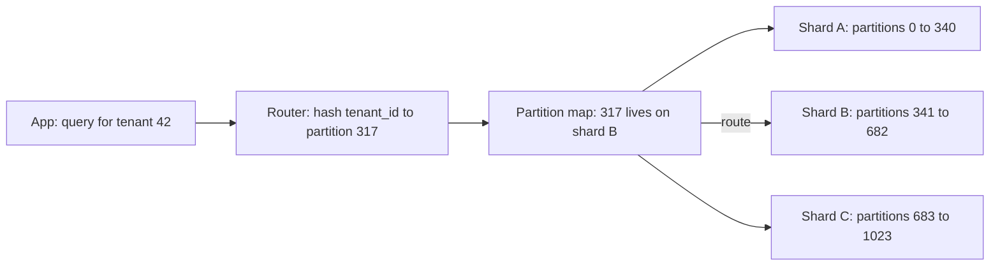

Sharding splits one logical dataset across several database nodes so that each holds and serves only part of it. It is how you scale writes and storage beyond a single machine. It is also one of the most expensive architectural changes you can make: joins, transactions, unique constraints and schema migrations all get harder, and a bad shard key is very hard to undo. The right approach is to delay it with cheaper options, then choose the key from your access patterns so the vast majority of queries touch exactly one shard.

## Do you actually need it?

A single modern database node goes a long way. A 64-vCPU, 512 GB RAM Postgres or MySQL instance with NVMe storage handles tens of thousands of writes per second and 5 to 10 TB of data. Before sharding, try these in roughly this order:

1. **Fix queries and indexes.** Slow query logs usually reveal a handful of queries responsible for most load.
2. **Cache hot reads** in Redis or at the CDN.
3. **Read replicas** for read-heavy load.
4. **Scale up** the instance; it is cheaper than engineering time.
5. **Archive or partition cold data**, using table partitioning by month and dropping or moving old partitions.
6. **Split by service** (vertical partitioning): move the analytics events or audit log tables to their own database.

Shard when the write rate, the working set, or the total size clearly exceeds what one primary can serve with headroom, or when you need data in specific regions for compliance.

## Vertical vs horizontal partitioning

**Vertical partitioning** splits by columns or tables: put user profiles in one database, orders in another, or move a large `bio` column into a separate table. **Horizontal partitioning** splits rows: users 1 to 10 million on shard A, the rest on shard B. Within one server, horizontal partitioning is just table partitioning (Postgres `PARTITION BY RANGE`), which helps pruning and retention. Across servers it is sharding.

## Partitioning schemes

| Scheme | How it maps a key | Strengths | Weaknesses |
| --- | --- | --- | --- |
| Range | Key ranges, for example A to F on shard 1 | Efficient range scans, easy to split | Sequential keys (timestamps, auto IDs) hit the last shard |
| Hash | `hash(key) mod N` | Even distribution | Range scans hit every shard; changing N moves almost all keys |
| Consistent hashing | Keys and nodes on a hash ring | Adding a node moves only about 1/N of keys | Uneven without virtual nodes |
| Directory or lookup | A table maps key or tenant to shard | Total flexibility, move one tenant at a time | Lookup service is a dependency and must be cached |

Plain `mod N` is the trap: going from 4 to 5 shards remaps about 80 percent of keys. Production systems avoid it with consistent hashing or, more commonly, with a **fixed large number of logical partitions** (for example 1,024) mapped onto fewer physical nodes. Resharding then moves whole logical partitions between nodes rather than rehashing keys. Cassandra uses virtual nodes on a token ring, Vitess uses keyspace ID ranges, and Citus uses hash-distributed shard tables (32 by default) placed on worker nodes.

## Choosing a shard key

The shard key should be the value most of your queries already filter on, with high cardinality and evenly spread load. Write down the top queries by rate and check which key keeps each on one shard.

- **Multi-tenant SaaS**: `tenant_id`. Almost every query is scoped to a tenant, and joins within a tenant stay local.
- **Social or consumer app**: `user_id` for a user's own data (posts, settings, inbox).
- **Messaging**: `conversation_id`, so a conversation's messages are together.
- **E-commerce orders**: `customer_id` for "my orders"; order lookups by ID either embed the shard in the ID or use a global index.

Avoid low-cardinality keys (country, status), monotonically increasing keys with range sharding (`created_at`, auto-increment IDs), and keys that change. A trick that removes lookups: embed the shard or partition number in generated IDs, as Instagram did with 13 bits of logical shard inside each 64-bit ID, so any service can route an ID without a directory.

## Hot partitions and key salting

Even distribution of keys does not mean even distribution of load. A celebrity account, a viral product, or one huge tenant can push a single shard to its limit while others idle. DynamoDB caps each partition at about 3,000 read units and 1,000 write units per second, so one hot key throttles regardless of table capacity.

Fixes:

- **Key salting**: for a hot write key, append a suffix such as `product123#0` to `product123#9`, spreading writes over 10 partitions; reads fan out to all 10 and combine. Good for counters and event streams.
- **Dedicated shards** for whale tenants, which a directory scheme makes easy.
- **Splitting hot ranges**, which range-sharded systems (MongoDB, CockroachDB, Bigtable) do automatically based on load.

## Cross-shard queries and joins

Queries that do not include the shard key become **scatter-gather**: the router sends them to all shards and merges results. With 64 shards, latency is set by the slowest shard and load multiplies 64 times. Keep these off hot paths.

Strategies:

- **Co-locate related data** by sharding related tables on the same key (orders and order_items both by `customer_id`), so joins stay local. Citus calls these co-located distributed tables.
- **Replicate small reference tables** (countries, plans) to every shard.
- **Denormalise** so a query needs only one shard.
- **Push analytics to a warehouse** instead of running them across shards.
- **Avoid cross-shard transactions**; when unavoidable, use a saga or a database with distributed transactions (Vitess supports two-phase commit with caveats, Spanner and CockroachDB do it natively).

## Global secondary indexes

To look up rows by a non-shard attribute, such as finding a user by email when sharded by `user_id`, you need a global index: a separate table partitioned by the indexed attribute mapping `email` to `user_id`. DynamoDB GSIs maintain this automatically but asynchronously, so they are eventually consistent. Building your own means writing both the row and the index entry, ideally via an outbox or CDC so they cannot drift. Local secondary indexes, by contrast, are per shard and only help queries that already include the shard key. Global uniqueness (unique email) needs either the global index with a conditional insert or a dedicated uniqueness table.

## Resharding and rebalancing

Eventually shards fill up or get hot, and you must move data while serving traffic. The common online procedure:

1. Provision the new shard and copy a snapshot of the partitions to move.
2. Tail the change log (binlog, WAL, or CDC) to keep the copy current.
3. Optionally **double-write** from the application to old and new locations.
4. Verify by comparing row counts and checksums.
5. Briefly pause writes for the moving partitions (seconds), wait for the copy to catch up, and flip the routing map.
6. Keep the old copy read-only for a while, then delete it.

Vitess automates this with VReplication `Reshard` workflows, MongoDB's balancer migrates chunks in the background, and Citus rebalances shards online.

## Tenant-based sharding

For B2B SaaS, sharding by tenant with a directory is often ideal. Small tenants share shards; large ones get their own; any tenant can be moved by copying its rows and updating one directory entry. It also helps data residency (EU tenants on EU shards) and noisy-neighbour isolation. The directory must be highly available and cached in each app instance with a short TTL.

## Real systems

- **Vitess** (MySQL): a proxy layer (VTGate) routes queries by a vindex on the shard key; used by YouTube, Slack and GitHub.
- **Citus** (Postgres extension): distributed tables by a column, co-location, reference tables, parallel distributed queries.
- **MongoDB**: shard key per collection, ranged or hashed, `mongos` routers, chunk balancing, and since 5.0 live resharding.
- **DynamoDB**: partition key hashing with automatic splits; design keys to spread load, use GSIs for alternate lookups.

## Trade-offs and pitfalls

- **Sharding too early** adds permanent complexity for capacity you could buy with a larger instance.
- **A shard key that misses the top queries** turns them into scatter-gather.
- **`hash mod N`** makes adding shards a near-total data move.
- **Monotonic keys with range sharding** create a single hot shard.
- **Global indexes kept in sync by hand** drift; use CDC or the database's built-in GSIs.
- **Cross-shard transactions** are slow and fragile; design them out.

## Interview angle

- Show you tried indexes, caching, replicas and scale-up first, with numbers.
- Pick a shard key from the main access pattern and say which queries stay single-shard.
- Use logical partitions for cheap resharding, salting for hot keys, global indexes for alternate lookups.

## Key takeaways

- Shard only when one primary cannot handle the writes or size; try cheaper options first.
- Range, hash, consistent hashing and directory schemes trade scan efficiency, balance and flexibility.
- Choose the shard key from your highest-rate queries so most of them hit one shard.
- Use many logical partitions over fewer nodes so rebalancing moves partitions, not keys.
- Plan for hot partitions, global indexes and online resharding from the start.
