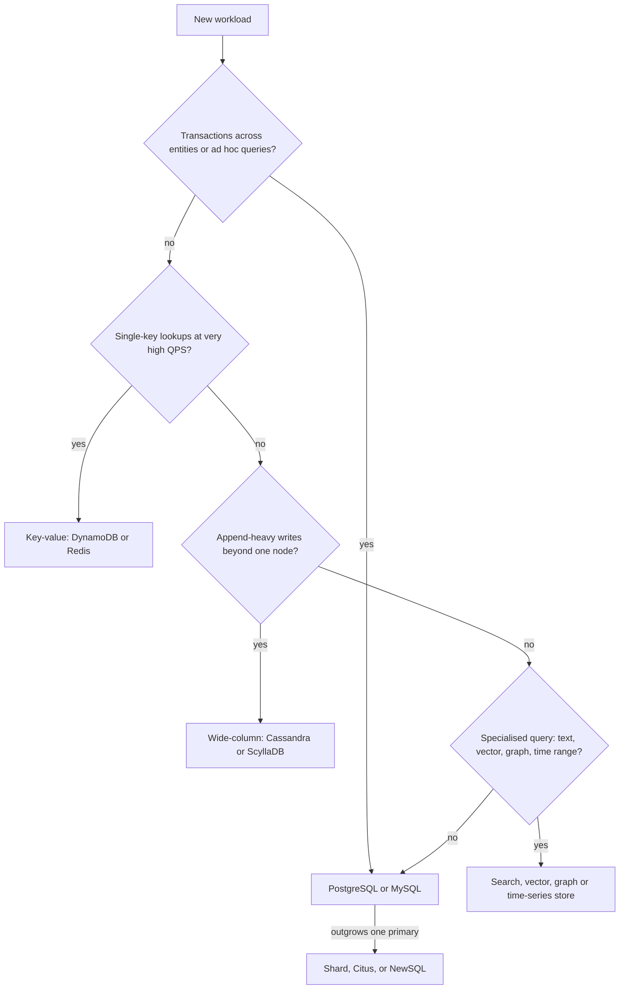

Database choice is one of the few decisions that gets more expensive every month you live with it. Migrating terabytes of live data between engines takes quarters, not sprints. Yet most teams choose based on what is fashionable or what someone used last job. A better approach starts from how the data will be read and written, what consistency the business needs, and how big it will realistically get, and it usually lands on a boring answer: a relational database, with specialised stores added only when a specific workload proves it needs one.

## A decision path

## The families

**Relational** (PostgreSQL, MySQL, SQL Server). Tables, joins, foreign keys, ACID transactions, a query planner. You can ask questions you did not anticipate at design time, which is worth more than most people credit. A single well-tuned Postgres node on modern hardware handles tens of thousands of transactional queries per second and several terabytes comfortably.

**Document** (MongoDB, Firestore, Couchbase). JSON-like documents with nested arrays, flexible schema, indexes on any field. Strong when an aggregate is read and written as a unit, such as a product with variants or a CMS page. Weak when you need many-to-many relationships or reports across collections. MongoDB has had multi-document transactions since 4.0, but heavy use of them suggests the model is fighting the engine.

**Key-value** (Redis, DynamoDB, etcd). Get and put by key, single-digit millisecond or sub-millisecond latency. DynamoDB scales to millions of requests per second with no servers to manage, but you design tables around exact queries; a query you did not plan for becomes a scan or a new index.

**Wide-column** (Cassandra, ScyllaDB, Bigtable, HBase). Rows partitioned by key and sorted by clustering columns, leaderless or tablet-based replication, excellent write throughput across many nodes and regions. Suits messaging inboxes, IoT readings, activity logs. No joins, limited secondary indexes, one table per query.

**Graph** (Neo4j, Amazon Neptune). Nodes and edges with traversal queries. Worth it when queries are many hops deep and variable, such as fraud rings or permission graphs. For one or two hops, a relational table of edges with recursive CTEs is usually enough.

**Time-series** (TimescaleDB, InfluxDB, Prometheus, ClickHouse). Append-mostly data keyed by time, with compression, downsampling and retention policies. TimescaleDB is a Postgres extension, so you can start there without a new operational system.

**Search** (Elasticsearch, OpenSearch, Typesense, Meilisearch). Inverted indexes for full-text relevance, fuzzy matching, facets. Treat it as a derived index fed from your primary store, never the source of truth.

**Vector** (pgvector, Pinecone, Weaviate, Qdrant, Milvus). Approximate nearest-neighbour search over embeddings for semantic search and retrieval for LLMs. pgvector with HNSW indexes handles several million vectors on one node; dedicated engines make sense at hundreds of millions or with heavy filtered search.

**NewSQL** (Google Spanner, CockroachDB, YugabyteDB, TiDB). SQL and serialisable or snapshot transactions on a horizontally scaled, consensus-replicated store. You pay higher write latency (a Raft or Paxos round per commit, more across regions) and operational or licence cost, in exchange for not hand-sharding.

## Decision table

| Need | Good fit | Avoid |
| --- | --- | --- |
| Transactions across several entities | Postgres, MySQL, NewSQL | Cassandra, most KV stores |
| Ad hoc queries and reporting | Postgres, then a warehouse | DynamoDB, Cassandra |
| Known key lookups at 100k+ QPS | DynamoDB, Redis, Cassandra | Single Postgres primary |
| Write-heavy, multi-region, always-on | Cassandra, DynamoDB global tables | Single-leader relational |
| Strong consistency, global scale | Spanner, CockroachDB | Async-replicated anything |
| Full-text relevance | Elasticsearch, OpenSearch, Postgres FTS for small cases | `LIKE '%term%'` |
| Similarity search on embeddings | pgvector, Qdrant, Pinecone | Brute-force in app code |
| Metrics and events by time | TimescaleDB, ClickHouse, Prometheus | Row-store without partitioning |
| Deep variable-length traversals | Neo4j, Neptune | Many self-joins |

## Start with Postgres by default

For a new product, Postgres is the right first choice in the large majority of cases. It gives you transactions, constraints that keep bad data out, JSONB for flexible attributes, full-text search, pgvector, PostGIS, partitioning, logical replication, and every managed cloud offers it (RDS, Aurora, Cloud SQL, Neon, Supabase). One database means one backup strategy, one failover runbook, one set of access controls, and joins instead of distributed consistency problems.

When not to start with Postgres:

- You already know the scale: billions of writes per day from day one (telemetry, ad events), where Cassandra, ClickHouse or Kafka plus object storage fit better.
- The workload is pure key lookups and the team wants zero database operations: DynamoDB is a strong choice if you can enumerate queries.
- You need active-active writes across regions with low latency: consider DynamoDB global tables, Cassandra, or Spanner/CockroachDB.
- The data is natively a large graph queried many hops deep.

## Model from access patterns

Before picking an engine, list the queries with expected rates. For an e-commerce order system:

| Access pattern | Rate | Notes |
| --- | --- | --- |
| Get order by ID | 2,000/s | Point lookup |
| List a customer's orders, newest first | 500/s | Range by customer, sorted by time |
| Create order with line items atomically | 100/s | Multi-row transaction |
| Daily revenue by category | Hourly batch | Aggregation across all orders |
| Search products by text | 1,000/s | Relevance ranking |

This immediately points to Postgres for orders (transactions, an index on `(customer_id, created_at DESC)`), a search index for products, and a warehouse for revenue reports. In DynamoDB the same list would drive a partition key of `customer_id` and a sort key of `created_at`, plus a global secondary index for order ID. The query list, not the data, determines the schema in non-relational stores.

## Polyglot persistence and its costs

Using several stores, each for what it does best, is often right at scale. Each one adds a cost: another system to run, patch, monitor, back up and secure; data copied between stores that can drift; a pipeline (usually change data capture via Debezium or the outbox pattern) to keep derived stores in sync; and engineers who must know each engine's failure modes. A useful rule: add a new store only when you can name the query that the current store cannot serve within your latency or cost budget, and you have measured it.

## OLTP vs OLAP

Transactional (OLTP) databases are row-oriented and optimised for many small reads and writes by key. Analytical (OLAP) queries scan millions of rows to compute aggregates, which column-oriented stores do 10 to 100 times faster because they read only the needed columns and compress them well.

Running heavy analytics on your production primary steals I/O and locks from user traffic. The progression is usually: run reports on a read replica; when queries take minutes or analysts need to join data from several services, add a warehouse. Stream changes with CDC or batch ELT (Fivetran, Airbyte, dbt) into it.

| Warehouse | Strength |
| --- | --- |
| BigQuery | Serverless, pay per bytes scanned, zero tuning |
| Snowflake | Separate storage and compute, multi-cloud, strong governance |
| ClickHouse | Very fast real-time aggregations, self-hosted or cloud, cheap at scale |
| Redshift | Close AWS integration |

## Trade-offs and pitfalls

- **Choosing NoSQL "for scale"** you will not hit for years, then rebuilding joins and transactions in application code.
- **Using search or cache as the source of truth**; both should be rebuildable from the primary store.
- **Ignoring query flexibility**; schemaless stores move the schema into every reader.
- **Adding stores without CDC discipline**, so copies drift and nobody knows which is right.
- **Analytics on the primary** degrades user-facing latency.
- **Benchmarks from vendor marketing** rather than your own access patterns.

## Interview angle

- Start by listing access patterns and their rates, then justify the store.
- Defend a relational default and say what would make you change it.
- Name the consistency need for each data type (money vs likes vs analytics).
- Show derived stores (search, cache, warehouse) fed from one source of truth.

## Key takeaways

- Choose from access patterns, consistency needs and realistic scale, not fashion.
- Postgres is the default first database; it covers JSON, search, vectors and time-series well at moderate scale.
- Key-value and wide-column stores trade query flexibility for predictable scale.
- Every added datastore costs operations, sync pipelines and drift risk.
- Separate OLTP from OLAP once reports hurt production; feed a warehouse with CDC or ELT.
