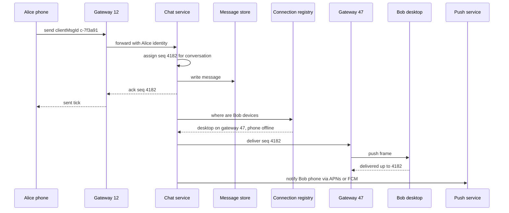

A chat system looks like "store a message, show it to the other person", but the hard parts are state outside the database: hundreds of millions of open connections, which server each user is on, whether a phone is asleep, which of four devices has seen which message. Users notice immediately when messages arrive out of order, twice, or not at all. This guide designs a WhatsApp or Slack-like system for 1:1 and group chat.

## Requirements

Functional:

- 1:1 and group conversations (groups up to 1,000 members; Slack-style channels larger).
- Send text and media; messages appear in real time when the recipient is online.
- Offline users receive messages when they reconnect, plus a push notification.
- Sent, delivered and read receipts; online and last-seen presence; typing indicators.
- Multiple devices per user (phone, desktop, web) stay in sync, with full history.

Non-functional:

- End-to-end delivery under 300 ms p99 when both parties are online in the same region.
- No message lost once the server acknowledges it; messages in a conversation appear in the same order for every participant.
- 99.99 percent availability for sending; presence can be eventually consistent.
- Durable history retained indefinitely (or per user settings).

## Estimates

- 500 million daily active users, 40 messages sent per user per day: 20 billion messages a day, about 230,000 per second on average and roughly 700,000 per second at peak.
- About 300 bytes per stored message with metadata: 6 TB a day, 18 TB with three replicas, 6.5 PB a year. Storage, not CPU, drives the database budget.
- About 200 million peak concurrent connections. A tuned gateway holds 100,000 to 500,000 idle WebSockets; at a conservative 100,000 per box that is 2,000 gateways.
- Group messages fan out: a 200-member group turns one send into 199 deliveries, so delivery volume can be several times send volume.

## API

Clients keep one persistent WebSocket to a gateway. Frames are small JSON or Protobuf messages:

```json
{ "type": "send", "clientMsgId": "c-7f3a91", "conversationId": "conv_8812",
  "body": "running 5 min late", "sentAt": 1793712000000 }

{ "type": "ack", "clientMsgId": "c-7f3a91", "messageId": "1859203847261", "seq": 4182 }

{ "type": "receipt", "conversationId": "conv_8812", "upToSeq": 4182, "state": "read" }
```

REST handles everything that is not real time: `GET /conversations/{id}/messages?beforeSeq=4100&limit=50` for history, `POST /media/uploads` for a presigned upload URL, and conversation and membership management.

## Data model

A wide-column store such as Cassandra or ScyllaDB fits append-heavy writes read in order by partition; Discord stores trillions of messages this way.

```sql
CREATE TABLE messages (
  conversation_id text,
  bucket          int,       -- e.g. 10-day time bucket, bounds partition size
  seq             bigint,    -- per-conversation sequence number
  message_id      bigint,    -- Snowflake: time-ordered, globally unique
  sender_id       text,
  body            blob,      -- ciphertext if E2E encrypted
  media_ref       text,
  created_at      timestamp,
  PRIMARY KEY ((conversation_id, bucket), seq)
) WITH CLUSTERING ORDER BY (seq DESC);
```

The time bucket keeps busy groups from creating unbounded partitions (aim for under about 100 MB each). Recent history is one sorted partition read.

Other tables: `conversations` and `members` (who belongs where, each member's role), `user_inbox` (per user, conversations sorted by last activity, for the chat list), and `receipts` storing each member's `last_delivered_seq` and `last_read_seq` per conversation rather than a row per message per reader.

## High-level design



- **Gateways** terminate WebSockets, authenticate once on connect, and are otherwise stateless pipes; a client can reconnect to any of them.
- **Connection registry**: a Redis cluster mapping `user_id -> [(device_id, gateway_id)]`, written on connect, removed on disconnect, with a TTL refreshed by heartbeats so crashed gateways do not leave ghosts.
- **Chat service** validates membership, assigns ordering, persists, and routes. Gateways and chat service talk over gRPC or via a per-gateway queue.
- **Push service** sends APNs and FCM notifications to devices with no live connection.

## Deep dive 1: ordering and exactly-once display

Wall clocks on phones are wrong, and two servers receiving messages for the same group at the same millisecond cannot agree on order by timestamp. The fix is a **per-conversation sequence number** assigned by a single authority:

- Route all writes for a conversation to one owner, for example by hashing `conversation_id` to a chat service shard or Kafka partition. That owner increments a counter (in memory, persisted with the message, or via Redis `INCR`) and stamps `seq`.
- Clients render strictly by `seq`. A gap (have 4180, receive 4182) means a message is in flight or lost; the client fetches the missing range from history.

A global **Snowflake ID** serves references; nobody needs order across conversations.

**Duplicates** come from retries after a lost ack. The server keeps `(sender_device, clientMsgId) -> seq` for a day and returns the existing ack instead of creating a second message. Sends are idempotent; delivery is at least once, deduplicated by `seq` on clients.

## Deep dive 2: delivery, receipts, offline and multi-device

Treat delivery as **sync, not push**. Every device tracks the highest `seq` it has per conversation. Real-time frames are an optimisation; the source of truth is "give me everything after my cursor".

- **Online**: the chat service looks up the recipient's devices in the registry and sends to each gateway. The device acks with its new cursor.
- **Offline**: increment the unread counter and call the push service. Payloads carry a preview at most (for E2E, just "wake up and sync"); APNs and FCM are best-effort.
- **Reconnect**: the device sends its cursors (or a single per-user inbox cursor), and the server streams everything newer, conversation by conversation.

**Receipts** are cursors too. "Delivered" means some device of the user has stored up to `seq`; "read" means the user viewed up to `seq`. Storing one `last_read_seq` per member per conversation turns "who read message 4182" into a comparison, instead of 199 rows per group message. In large groups, show read counts lazily and do not fan out every receipt to every member; batch them every few seconds.

**Multi-device**: each device is a separate endpoint with its own cursor. The sender's other devices receive their own outgoing message like any recipient, which is how your laptop shows what you typed on your phone. A new device bootstraps by paging history from the store (or, with E2E, from another of the user's devices).

## Deep dive 3: group fan-out and presence

For small and medium groups (up to a few hundred), **fan-out on write** at delivery time is simple: store the message once in the conversation partition, then route to each online member's gateway, batched per gateway so a 500-member group hitting 40 gateways becomes 40 calls. Storage stays single-copy; only delivery fans out.

For very large channels (50,000 members), push only a lightweight "latest seq 9123" event to online members and let clients pull when the channel is open.

**Presence** is the noisiest feature. With 200 million online users and friends lists of a few hundred, broadcasting every status change is enormous. Practical rules:

- Heartbeat every 30 seconds over the existing WebSocket; mark offline after about 60 seconds without one, to ride out brief network blips.
- Store presence in Redis with a TTL. Fan out changes only to users who currently have a conversation with that person open (subscribe on view), not to every contact.
- Typing indicators are ephemeral: route them through gateways and never persist them.

## Media and end-to-end encryption

Media never travels through the chat path. The client requests a presigned URL, uploads directly to object storage (S3) possibly in chunks, and sends a normal message with a `media_ref`, thumbnail and dimensions. Recipients fetch through a CDN. With E2E, the client encrypts the file with a random AES key and sends that key inside the encrypted message, so storage and CDN hold only ciphertext.

**End-to-end encryption** (the Signal protocol, used by WhatsApp) means the server routes ciphertext it cannot read. Each device publishes identity and prekeys to a key server; senders establish a session with X3DH and then encrypt each message with the Double Ratchet, which gives forward secrecy. Groups use sender keys: each member distributes a sender key to the others, so a group message is encrypted once rather than once per member. Consequences for the design: server-side search, moderation and history sync for new devices become client-side problems, and multi-device means encrypting to each recipient device.

## Scaling and bottlenecks

- **Gateways** scale horizontally; raise file descriptor limits, use epoll-based servers (Go, Erlang, Netty), keep per-connection memory around 10 KB, and drain gradually during deploys.
- **Reconnect storms** after a gateway or region failure can exceed normal load many times over; clients must reconnect with jittered exponential backoff, and gateways should shed with a `Retry-After`.
- **Registry** is read on every delivery; shard Redis by user ID and keep entries small.
- **Storage** grows by petabytes per year; use time buckets, compaction strategies suited to time series, and tier old data to cheaper storage.
- **Multi-region**: home each conversation in one region for ordering, and route cross-region deliveries over a replicated bus.

## Failure modes

- **Gateway crash**: clients reconnect elsewhere and sync from their cursors; registry entries expire via TTL. Nothing is lost because the store, not the gateway, is the source of truth.
- **Chat service shard failure**: a standby takes ownership of its conversations, recovering the last `seq` from the store before accepting writes, so sequence numbers never repeat.
- **Lost ack**: client retries with the same `clientMsgId`; deduplication prevents a double message.

## Trade-offs and pitfalls

- **Ordering by timestamp** produces reordered messages; use per-conversation sequence numbers.
- **Treating real-time delivery as the source of truth** loses messages on every disconnect; deliver by cursor-based sync.
- **Per-message, per-reader receipt rows** explode in groups; store read cursors per member.
- **Broadcasting presence to all contacts** dominates traffic; subscribe only while a chat is open.
- **Media through WebSockets** blocks small messages behind large ones; use presigned uploads and a CDN.
- **E2E encryption** removes server-side search and moderation; decide early, because retrofitting it changes every feature.

## Interview angle

- Start with connection management: WebSocket gateways and a registry, and explain why HTTP polling does not scale.
- Show the message flow including the ack to the sender before delivery.
- Explain ordering with per-conversation sequence numbers and idempotent sends.
- Handle offline users with push plus sync on reconnect.

## Key takeaways

- Stateless gateways hold connections; a TTL-backed registry maps users to gateways.
- Per-conversation sequence numbers give consistent ordering; client message IDs make sends idempotent.
- Delivery is cursor-based sync; real-time frames and push are accelerators.
- Partition messages by conversation and time bucket in a wide-column store.
- Receipts and presence are cursors and ephemeral state, scoped to keep fan-out bounded.
- Media goes to object storage; E2E encryption shifts search and sync to clients.
