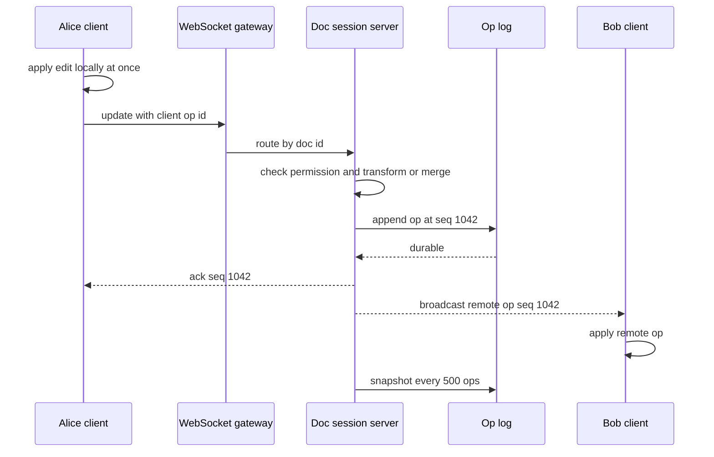

A collaborative editor lets several people change the same document at once and see each other's edits within a fraction of a second, without anyone's work being overwritten. Google Docs, Figma, Notion and Linear all solve this. The hard part is not the WebSocket plumbing; it is making concurrent edits converge to the same result on every screen, keeping it fast when typing, surviving disconnects and offline sessions, and storing years of fine-grained edits without the document becoming slow to open.

## Requirements

Functional:

- Multiple users edit a rich-text document (or a canvas) concurrently; edits appear for others in real time.
- Presence: who is here, their cursors and selections.
- Offline editing that merges on reconnect.
- Sharing with owner, editor, commenter and viewer roles.
- Version history: browse and restore named or automatic versions.

Non-functional:

- Local keystrokes render instantly; remote edits visible within 200 ms at p95 in-region.
- All replicas converge to identical content.
- No acknowledged edit is lost.
- 50 million documents, 2 million concurrently open, up to 100 active editors and 1,000 viewers on a hot document.

## Estimates

```text
Open documents     = 2 M, avg 3 connections each -> 6 M WebSockets
Per gateway        = about 50 K connections      -> 120+ gateway nodes
Edit rate          = 1 op/s per active typist, batched to 5-10 updates/s per client
Ops/s total        = about 3 M/s at peak (small, about 50-200 bytes each)
Op log             = 3 M x 100 B = 300 MB/s raw, compacted heavily into snapshots
Snapshot size      = median 50 KB, large docs 5-50 MB
```

Bandwidth and op volume are modest per document. The constraints are connection count, fan-out to many viewers, and keeping per-document state in one place.

## API

```text
GET  /docs/{id}                    -> metadata, permissions, latest snapshot URL + version
WS   /docs/{id}/session            -> bidirectional sync
     client -> server: {type: "update", base: v, ops}        (OT)  or  {type: "update", data: <CRDT update bytes>}
     server -> client: {type: "ack", v} | {type: "remote", ops, v} | {type: "presence", user, cursor}
GET  /docs/{id}/versions           -> list of versions
POST /docs/{id}/versions/{vid}/restore
POST /docs/{id}/share              {email, role}
```

## Data model

```text
documents   (doc_id, owner_id, title, created_at, latest_snapshot_ver, shard)
acl         (doc_id, principal_id, role)
ops         (doc_id, seq, actor_id, client_op_id, payload bytes, created_at)  -- append-only
snapshots   (doc_id, seq, blob_url, created_at)                              -- full state at seq
versions    (doc_id, version_id, seq, name, author_id, created_at)
```

Ops live in an append-only log keyed by `(doc_id, seq)` (Postgres partitioned by doc, DynamoDB, or Cassandra), snapshots in object storage. Opening a document loads the latest snapshot and replays the ops after it.

## High-level design

Each open document is owned by exactly one document session server, chosen by consistent hashing on `doc_id` or by a directory lookup. Clients connect through stateless WebSocket gateways that route messages to the owner. The owner orders and validates edits, appends them to the op log, broadcasts them to every connected client, and periodically writes snapshots.



## Deep dive 1: OT vs CRDTs

Both let each client apply its edit immediately and reconcile later. They differ in where the intelligence lives.

Concrete example. The document is `abc`. Alice inserts `X` at position 2 (`abXc`). At the same moment, Bob deletes position 0 (`bc`). Alice applies Bob's `delete(0)` to `abXc` and gets `bXc`, which is right. Bob applies Alice's `insert(2, "X")` to `bc` and gets `bcX`, which is wrong: the positions shifted under him, and the two screens now disagree.

**Operational transformation (OT)** fixes this with a transform function. The server holds the canonical order. Alice's insert was based on a version before Bob's delete, so it is transformed against `delete(0)` into `insert(1, "X")`, giving `bXc` on both sides. Google Docs uses OT with a central server: clients send ops tagged with the server version they saw, the server transforms them against everything committed since, assigns the next sequence number and broadcasts. Central ordering keeps the transform logic tractable; peer-to-peer OT is notoriously hard to get right.

**CRDTs** avoid positions altogether. Each character gets a unique, ordered ID such as `(lamport_clock, client_id)`, and inserts reference neighbouring IDs: "insert `X` after the ID of `b`". Deleting `a` marks its ID as a tombstone. Because ops refer to stable IDs, they commute: apply them in any order and every replica ends with `bXc`. Yjs (YATA algorithm) and Automerge are the mature libraries; both have compact binary encodings and handle rich text, maps and lists.

| | OT | CRDT (Yjs, Automerge) |
|-|----|----------------------|
| Server role | Required for ordering | Optional relay; can be peer-to-peer |
| Offline edits | Long rebases can be painful | Merge naturally |
| Metadata | Small | IDs and tombstones, though Yjs compresses runs well |
| Intent on complex edits | Fine-tuned per op type | Generic merges can occasionally surprise (interleaving) |
| Used by | Google Docs, older editors | Many new editors, local-first apps; Figma uses a CRDT-inspired, server-ordered model per property |

For a new product in 2026, Yjs with a server that relays and persists updates is the pragmatic default. Keep the server authoritative anyway: it checks permissions, validates update size, and is the source of durable truth.

## Deep dive 2: document sessions and sharding

All edits for a document must flow through one place to get ordering, batching and cheap fan-out. Shard by `doc_id`: a directory service (or consistent hash ring) maps each open document to a session server. The first client to open a document causes the server to load the snapshot and ops into memory. Subsequent clients for the same doc are routed to that server through any gateway.

Failover: session servers hold soft state only. Every op is appended to the durable log before it is acknowledged, so if a server dies, the directory reassigns the document, the new owner reloads snapshot plus tail, and clients reconnect and resend unacknowledged ops identified by `client_op_id`, which the server deduplicates. Use a lease or fencing token on document ownership so a partitioned old owner cannot keep accepting writes.

Batching matters. Clients coalesce keystrokes for 50 to 100 ms before sending, and the server batches log appends, turning thousands of tiny writes into tens of larger ones.

## Deep dive 3: persistence, history and offline

Every op is durable before the ack. Every 500 ops or 60 seconds of activity, the session server writes a snapshot (a full Yjs state encoding, or the materialised OT document) to object storage and records its sequence number. Opening a doc fetches the snapshot from a CDN-backed URL and the ops since, typically under 100 ms of replay.

Version history is built from the same pieces. Automatic versions are snapshots grouped by editing session (for example, a gap of 10 minutes ends a version); named versions are pinned snapshots. Restore creates new ops that transform the current state into the old one, rather than rewinding the log, so collaborators keep converging. Old fine-grained ops can be compacted after 30 days, keeping only snapshots at version boundaries.

Offline editing: the client persists its local state and pending updates in IndexedDB (Yjs provides `y-indexeddb`). On reconnect it exchanges state vectors with the server: "here is what I have", "here is what you are missing", and each side sends only the difference. With CRDTs this merge is automatic. With OT, the client must rebase its pending ops over everything committed meanwhile, which works but gets slow for hours of divergence. Either way, warn users when offline edits conflict with large structural changes, and keep the pre-merge version in history.

## Presence and cursors

Presence is ephemeral and high frequency: cursor moves at 10 to 20 per second per user. Keep it out of the op log. Send it over the same WebSocket, throttle to about 10 Hz, and have the session server relay it without persistence (Yjs's awareness protocol does exactly this). Represent cursors as CRDT-relative positions (anchored to character IDs) so a remote cursor stays on the right word as text shifts. Drop presence after 30 seconds without a heartbeat.

## Permissions

Check the ACL when the WebSocket opens and again on each update type: viewers may send presence but not content updates, commenters only comment ops. Cache the ACL in the session server and push revocations to it, so removing someone's access disconnects them within seconds rather than at next login. Never trust client-side read-only mode.

## Scaling and bottlenecks

- **Hot documents**: an all-hands doc with 1,000 viewers and 100 editors. One session server still orders edits (100 editors at 10 updates per second is only 1,000 messages per second), but fan-out is 1,000 x 1,000. Separate roles: the owner orders and persists, while viewer fan-out goes through a pub/sub tier (Redis Streams, NATS) to many gateway nodes, and viewers get batched updates every 200 ms.
- **Huge documents**: 50 MB states slow loading. Lazy-load by section or page (Figma loads pages on demand), and split very large docs into subdocuments.
- **Connection storms** after a gateway deploy: drain gradually and add jitter to client reconnect backoff.
- **Tombstone growth** in CRDTs: Yjs garbage-collects deleted content when no snapshot needs it; plan periodic compaction.

## Failure modes

| Failure | Effect | Mitigation |
|---------|--------|-----------|
| Session server crash | Doc briefly unavailable | Reassign owner, reload snapshot plus log, client resend |
| Split-brain ownership | Diverging orders | Ownership lease with fencing token checked on append |
| Client sends malformed update | Corrupt state for all | Validate and size-limit on server; reject and resync client |
| Op log write slow | Acks delayed, typing still instant | Local-first UI, backpressure, alert on ack latency |
| Long offline session | Large merge | State-vector diff, keep pre-merge version |

## Trade-offs and pitfalls

- **Last-write-wins on the whole document** loses work; merge at character or property level.
- **Persisting presence** floods storage for no value.
- **Peer-to-peer only** CRDT setups lack an authority for permissions and durability.
- **Never compacting** the op log makes cold opens slow; snapshot regularly.
- **Rewinding history on restore** breaks connected clients; restore with forward ops.

## Interview angle

- Start by stating the convergence requirement and why naive position-based edits fail, using a two-character example.
- Compare OT and CRDTs honestly, then pick one.
- Shard by document so one server orders each doc's edits; explain failover with a durable log and client resend.
- Separate presence from content.
- Address the hot document explicitly with a separate fan-out tier.

## Key takeaways

- Clients apply edits locally first; the system's job is to converge everyone afterwards.
- OT transforms positions against a central order; CRDTs use stable IDs so ops commute.
- One session server per open document gives ordering and cheap fan-out; the durable op log makes it replaceable.
- Snapshots plus op tails keep opens fast and power version history.
- Presence is ephemeral, throttled and never persisted; permissions are enforced on the server for every update.
