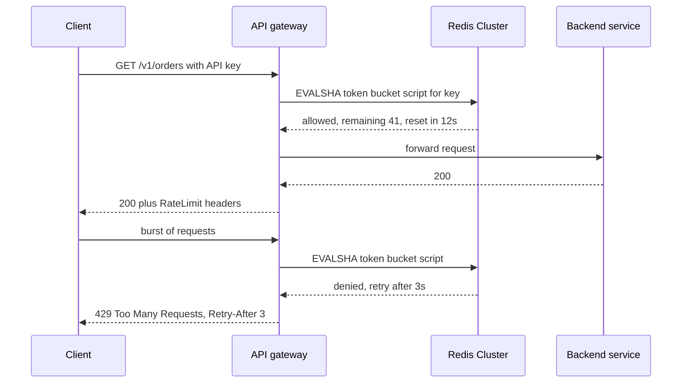

A rate limiter caps how many requests a client can make in a time period: 100 requests per minute per API key, 5 login attempts per minute per IP, 1,000 SMS per hour per account. On one server it is a counter in memory. Behind a load balancer with 40 instances, each instance sees only a fraction of a client's traffic, so the limit must live in shared state that every instance can update atomically in under a millisecond.

## Requirements

- Limit by a key: user ID, API key, IP, or a combination such as `apiKey:endpoint`.
- Support multiple rules per key (per second and per day).
- Add less than 1 to 2 ms to request latency at p99.
- Stay available: a limiter outage must not take down the API.
- Tell clients their limit, remaining quota and when to retry.

## Algorithms

| Algorithm | State per key | Burst behaviour | Accuracy |
|-----------|---------------|-----------------|----------|
| Fixed window counter | 1 integer | Up to 2x at window edges | Low |
| Sliding window log | All timestamps | None | Exact, memory heavy |
| Sliding window counter | 2 integers | Smoothed | Approximate, good |
| Token bucket | Tokens + timestamp | Allows bursts up to capacity | Exact for its model |
| Leaky bucket | Queue or level + timestamp | Smooths to constant rate | Exact for its model |

**Fixed window**: `INCR rl:{key}:{minute}` with an expiry. Cheap, but a client can send 100 requests at 12:00:59 and 100 more at 12:01:00, doubling the rate briefly.

**Sliding window log**: store each request timestamp in a sorted set, remove entries older than the window, count the rest. Precise, but a limit of 10,000 per hour means storing up to 10,000 entries per key.

**Sliding window counter**: keep counts for the current and previous fixed windows and weight the previous one by how much of it still overlaps the sliding window.

```text
estimate = prev_count x (1 - elapsed_in_current / window) + curr_count
```

Cloudflare reported this approximation within a fraction of a percent of exact on real traffic. It is a strong default.

**Token bucket**: a bucket holds up to `capacity` tokens and refills at `rate` per second. Each request takes one token; an empty bucket means reject. It allows short bursts while enforcing an average, which matches how most APIs want to behave.

**Leaky bucket**: requests enter a queue drained at a fixed rate; overflow is rejected. It produces a smooth output rate, useful in front of a fragile downstream, but adds queueing delay.

## How it works



## Atomicity with Redis and Lua

A read-then-write from the application (`GET` tokens, compute, `SET` tokens) races when two instances handle the same key concurrently: both read 1 token and both allow. Redis runs a Lua script atomically, so put the whole decision in one script.

```lua
-- KEYS[1] = bucket key; ARGV: capacity, refill_per_sec, now_ms, cost
local cap   = tonumber(ARGV[1])
local rate  = tonumber(ARGV[2])
local now   = tonumber(ARGV[3])
local cost  = tonumber(ARGV[4])

local b = redis.call("HMGET", KEYS[1], "tokens", "ts")
local tokens = tonumber(b[1]) or cap
local ts     = tonumber(b[2]) or now

tokens = math.min(cap, tokens + (now - ts) / 1000 * rate)
local allowed = 0
if tokens >= cost then
  tokens = tokens - cost
  allowed = 1
end
redis.call("HSET", KEYS[1], "tokens", tokens, "ts", now)
redis.call("PEXPIRE", KEYS[1], math.ceil(cap / rate * 1000) + 1000)
return { allowed, math.floor(tokens) }
```

Notes that matter in production:

- Pass `now` from the caller or call `redis.call("TIME")` inside the script. Using Redis time avoids clock skew between app servers.
- Load once with `SCRIPT LOAD` and call `EVALSHA` to avoid resending the script.
- In Redis Cluster all keys a script touches must be in the same hash slot. Use hash tags like `rl:{apiKey123}:min` and `rl:{apiKey123}:day` for multi-rule checks.
- The expiry ensures idle keys disappear, keeping memory proportional to active clients.

## Where to place it

- **Edge or API gateway** (Envoy, Kong, Nginx, AWS API Gateway): rejects abusive traffic before it consumes backend resources. Best for per-key and per-IP limits.
- **Middleware in the service**: has business context such as plan tier, tenant or endpoint cost. Good for "export endpoint costs 10 tokens".
- **In front of a dependency**: a client-side limiter protecting a third-party API with its own quota, or a database.

Many systems layer them: coarse IP limits at the edge, per-tenant limits in the gateway, cost-based limits in the service.

## Failure modes and performance

Decide failure behaviour explicitly. **Fail open** (allow when Redis is unreachable) protects availability and is the usual choice for general API limits. **Fail closed** suits security limits such as login attempts. Set a tight timeout (for example 5 to 10 ms) on the Redis call so a slow limiter cannot stall requests.

To cut Redis load for very hot keys, keep a small local token bucket per instance that pre-fetches quota in batches (take 50 tokens at a time from Redis). This trades a little accuracy for far fewer round trips.

## Multi-region

A single global Redis adds a cross-region round trip of 70 to 200 ms, which is unacceptable on every request. Options:

1. **Per-region limits**: split the global quota across regions (for example 60/40 by traffic share). Simple and fast; a client concentrated in one region gets less than its full quota.
2. **Local enforcement with async sync**: each region counts locally and periodically gossips counts to the others, accepting brief overshoot.
3. **Sticky routing**: route each API key to a home region so its limit is always local.

Most teams choose per-region limits or local counting with asynchronous reconciliation and accept small overshoot. Exact global limits are rarely worth the latency.

## Response headers

Return `429 Too Many Requests` with a `Retry-After` header in seconds. Also expose quota so well-behaved clients can pace themselves. The IETF draft standardizes `RateLimit-Policy` and `RateLimit` headers; many APIs still use the older `X-RateLimit-*` form.

```http
HTTP/1.1 429 Too Many Requests
Retry-After: 3
RateLimit-Policy: "default";q=100;w=60
RateLimit: "default";r=0;t=3
X-RateLimit-Limit: 100
X-RateLimit-Remaining: 0
X-RateLimit-Reset: 1730620863
Content-Type: application/json

{"error":"rate_limited","message":"Limit of 100 requests per 60s exceeded"}
```

Clients should back off with jitter rather than retrying exactly at `Retry-After`, or they will synchronize into a new spike.

## Trade-offs and pitfalls

- **Non-atomic check-and-set** lets concurrent requests exceed the limit; use Lua or `INCR` semantics.
- **Fixed windows** allow double bursts at boundaries.
- **Limiting by IP only** punishes users behind corporate NAT or mobile carrier NAT and is easily evaded with many IPs.
- **No timeout on the limiter** turns a Redis hiccup into an API outage.

## Interview angle

- Compare at least token bucket and sliding window counter and pick one with a reason.
- Explain the race condition and how a Lua script fixes it.
- Discuss placement, fail open vs fail closed, and the latency budget.
- Handle multi-region by relaxing exactness, and say so explicitly.

## Key takeaways

- Token bucket allows controlled bursts; sliding window counter is a cheap, accurate window.
- Shared state in Redis plus an atomic Lua script makes limits correct across instances.
- Place coarse limits at the edge and context-aware limits in services.
- Choose fail open or fail closed per rule and enforce a tight timeout.
- Multi-region limits trade exactness for latency; per-region quotas are the pragmatic default.
