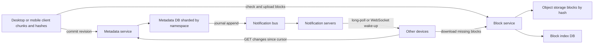

A file sync service keeps a folder identical across a user's laptop, phone and the web, and lets them share parts of it with other people. The bytes are the easy part: object storage already stores exabytes cheaply. The hard parts are splitting files so only changed pieces move over the network, keeping a metadata service that can answer "what changed since I last looked" for hundreds of millions of devices, and deciding what to do when two offline devices edit the same file. This guide separates the system into a block plane and a metadata plane and designs each.

## Requirements

Functional:

- Upload, download, rename, move and delete files and folders from desktop, mobile and web.
- Changes on one device appear on the user's other devices automatically.
- Version history and restore for 30 days; trash for deleted files.
- Share files and folders with other users as viewer or editor, and by link.
- Work offline and sync when back online.

Non-functional:

- Durability of 11 nines for file content; no acknowledged write is ever lost.
- A small edit on one device reaches other online devices in under 5 seconds.
- Uploads of multi-gigabyte files survive network drops without restarting.
- Bandwidth efficient: editing 1 MB inside a 2 GB file uploads about 1 MB, not 2 GB.

## Estimates

Assume 500 million users, 100 million daily active, 2 devices each.

```text
Stored data      = 500 M users x 10 GB avg used  = 5 EB logical
After dedup      = about 30 to 40 percent saved   = about 3 EB physical, before replication
Files            = 500 M x 2,000 files            = 1 trillion file entries
Metadata row     = about 500 bytes                -> 500 TB of metadata, plus version history
Changes          = 100 M DAU x 50 file changes/day = 5 B/day = about 60,000/s avg, 200,000/s peak
Open connections = 200 M devices, 50 M online at peak for notifications
```

Metadata, not bytes, is the scaling problem. Hundreds of terabytes of small rows with heavy read traffic and strict ordering per user need a sharded database designed with care. The bytes go to object storage, which you rent rather than build.

## API

```text
POST /v1/blocks/check        {hashes: [...]}              -> {missing: [...]}
PUT  /v1/blocks/{sha256}     <bytes, max 4 MB>             -> 201
POST /v1/files/commit        {path or parent_id, name, block_list, base_rev, size}
                              -> {file_id, rev} | 409 conflict
GET  /v1/changes?cursor=c    -> {entries: [...], cursor, has_more}
GET  /v1/changes/wait?cursor=c   long-poll, returns {changes: true} or times out after 60 s
GET  /v1/blocks/{sha256}     -> bytes (or a signed object storage URL)
POST /v1/shares              {item_id, grantee, role}
```

Upload is two phases. The client chunks and hashes locally, asks which blocks the server lacks, uploads only those, then commits a new file revision that references the block list. A commit that names blocks the server does not have is rejected, so metadata never points at missing data.

## Data model

```sql
CREATE TABLE namespaces (            -- a user's root, or a shared folder
  ns_id        BIGINT PRIMARY KEY,
  owner_id     BIGINT NOT NULL,
  journal_seq  BIGINT NOT NULL DEFAULT 0
);

CREATE TABLE items (
  ns_id        BIGINT NOT NULL,
  item_id      BIGINT NOT NULL,
  parent_id    BIGINT,
  name         TEXT NOT NULL,
  is_dir       BOOLEAN NOT NULL,
  current_rev  BIGINT,
  deleted      BOOLEAN NOT NULL DEFAULT false,
  PRIMARY KEY (ns_id, item_id),
  UNIQUE (ns_id, parent_id, name)
);

CREATE TABLE revisions (
  ns_id        BIGINT NOT NULL,
  item_id      BIGINT NOT NULL,
  rev          BIGINT NOT NULL,
  size         BIGINT NOT NULL,
  block_list   BYTEA NOT NULL,       -- ordered list of 32-byte SHA-256 hashes
  author_dev   BIGINT NOT NULL,
  created_at   TIMESTAMPTZ NOT NULL,
  PRIMARY KEY (ns_id, item_id, rev)
);

CREATE TABLE journal (               -- append-only change log per namespace
  ns_id        BIGINT NOT NULL,
  seq          BIGINT NOT NULL,
  item_id      BIGINT NOT NULL,
  op           TEXT NOT NULL,        -- CREATE, UPDATE, MOVE, DELETE
  rev          BIGINT,
  PRIMARY KEY (ns_id, seq)
);

CREATE TABLE blocks (
  hash         BYTEA PRIMARY KEY,    -- SHA-256
  size         INT NOT NULL,
  refcount     BIGINT NOT NULL
);
```

Shard everything by `ns_id`. A namespace is the unit of consistency: one user's home folder, or one shared folder that many users mount. Because a commit only ever touches one namespace, it is a single-shard transaction. Moving a file between namespaces is a copy plus delete at the application level.

## High-level design



The block service is a thin, stateless layer over object storage that verifies each upload hashes to its claimed name and records it in the block index. The metadata service owns the namespace tree, revisions and the journal. Notification servers hold idle connections and only say "something changed"; clients then pull the actual changes. Keeping the bytes and the metadata on separate paths lets each scale on its own terms.

## Deep dive: chunking, hashing and dedup

Fixed-size chunking (split every 4 MB) is simple and fast, and for most file types it works well: appending to a log or rewriting a region in place only changes the affected chunks. Its weakness is insertion. Insert one byte at the start of a file and every chunk boundary shifts, so every chunk hash changes and the whole file uploads again.

Content-defined chunking (CDC) fixes this. Slide a rolling hash (Rabin fingerprint, or the faster Gear hash used by FastCDC) over the bytes and cut a boundary wherever the hash matches a pattern, for example the low 20 bits are zero for about 1 MB average chunks. Boundaries follow content, so an insertion only changes the chunk it lands in. Set a minimum and maximum (say 256 KB and 4 MB) so pathological data does not produce tiny or huge chunks.

| Approach | Insert near start | CPU cost | Typical use |
|---|---|---|---|
| Fixed 4 MB | Re-uploads whole file | Lowest | Simple clients, append-heavy files |
| CDC, 1 MB avg | Re-uploads about one chunk | Moderate | Large documents, VM images, archives |

Name each chunk by its SHA-256 hash. That gives dedup for free: if two users upload the same installer, the second `check` call finds every hash present and nothing is uploaded. Dedup across users saves a lot of space but leaks information: a client that sees "already present" for a file it never uploaded learns that someone has it. Mitigate by always making the client upload a small proof, or limit cross-user dedup to within an organisation, and never return per-user existence hints for content hashes alone. Encrypt blocks at rest with keys managed by the service; true end-to-end encryption defeats cross-user dedup and server-side previews, which is a product decision.

Blocks are immutable, so garbage collection is reference counting. When a revision ages out of the 30 day history, decrement refcounts for its blocks; blocks at zero for longer than a grace period (to cover in-flight commits that reference them) are deleted from object storage.

## Deep dive: the sync protocol

Each namespace has a monotonically increasing `journal_seq`. A commit runs one transaction:

```sql
BEGIN;
SELECT current_rev FROM items WHERE ns_id = $ns AND item_id = $id FOR UPDATE;
-- if current_rev <> base_rev: abort with 409 conflict
INSERT INTO revisions (...) VALUES (...);
UPDATE items SET current_rev = $new_rev WHERE ns_id = $ns AND item_id = $id;
UPDATE namespaces SET journal_seq = journal_seq + 1 WHERE ns_id = $ns RETURNING journal_seq;
INSERT INTO journal (ns_id, seq, item_id, op, rev) VALUES ($ns, $seq, $id, 'UPDATE', $new_rev);
COMMIT;
```

The client's cursor is an opaque encoding of `{ns_id: last_seq}` for every namespace it mounts. `GET /changes?cursor=` returns journal entries after those sequence numbers, collapsed so that ten edits to one file show only the latest revision, and a new cursor. Because the journal is ordered per namespace, a client that applies entries in order converges to the server state, and a client that crashes mid-sync just retries from its last saved cursor.

Notification servers hold one connection per online device. On commit, the metadata service publishes `ns_id` to the bus; notification servers wake every device subscribed to that namespace. A long-poll that returns after 60 seconds with no change costs almost nothing and works through corporate proxies that break WebSockets. At 50 million online devices and about 1 million connections per well-tuned server, you need on the order of 50 to 100 notification servers.

A brand new device, or one offline for months, would replay a huge journal. Instead it takes a snapshot listing of the namespace tree at a known sequence number, then switches to incremental changes from there. Journals older than the snapshot window can be compacted.

## Deep dive: conflicts and offline clients

Offline clients keep a local database of the last synced state of each file (`item_id`, `rev`, block list, local mtime). When they reconnect, they first pull remote changes, then upload local ones with `base_rev` set to the revision they edited.

If `base_rev` no longer matches, the server returns 409. The client does not merge binary files. It keeps the server version under the original name and saves its own as `report (Laptop's conflicted copy 2026-11-03).docx`, then commits that as a new file. No data is lost and the user decides. Real-time co-editing (Google Docs) is a different product built on operational transforms or CRDTs over a document model, not on file sync.

Directory operations need care. A rename is a metadata change on one item, not a delete plus create, so it does not reupload anything. A remote delete of a folder that contains local unsynced edits should restore those files rather than delete them silently.

## Sharing and permissions

A shared folder is its own namespace. Sharing inserts an ACL row `(ns_id, principal, role)` and mounts the namespace into each member's tree at a path they choose. Permission checks happen in the metadata service on every commit and every block download URL it signs. Block downloads use short-lived signed URLs (5 to 15 minutes) scoped to one hash, so the block service never needs to understand ACLs; a user can only get a URL for a block that belongs to a revision they can read. Link sharing creates a token mapped to `(ns_id, item_id, role, expiry)`.

## Resumable uploads

Chunking already makes uploads resumable: a dropped connection loses at most one in-flight block, and on retry the `check` call reports which blocks still need to go. For web uploads without local hashing, use an upload session (`POST /uploads` returns an id; `PUT` byte ranges; finalize). Object storage multipart upload maps directly onto this, with parts of 5 MB to 100 MB and up to 10,000 parts.

## Scaling and bottlenecks

- **Metadata shards**: shard by `ns_id` with a directory service mapping namespaces to shards, so a very large team folder can move to its own shard.
- **Huge shared namespaces** concentrate writes on one journal; a 100,000-member company folder is a hot shard. Split by subfolder namespaces or rate limit bulk operations.
- **Block traffic** goes direct to object storage via signed URLs and a CDN for popular downloads, keeping app servers out of the data path.
- **Hash index**: a trillion blocks at about 50 bytes each is 50 TB; shard by hash prefix.

## Failure modes

- **Block uploaded, commit never sent**: orphan blocks with refcount zero are collected after the grace period.
- **Notification lost**: clients also poll `/changes` every few minutes, so a missed wake-up delays sync but never loses it.
- **Client clock skew**: never use client mtime for ordering; the server journal sequence is the only order.
- **Corrupted local cache**: client verifies block hashes on download and rehashes local files on startup if the cache is suspect.

## Trade-offs and pitfalls

- **Storing files as single objects** forces full reuploads and blocks dedup.
- **Pushing full changes over the notification channel** couples it to the metadata store; push a hint, pull the data.
- **Using paths as identity** breaks renames and moves; use stable `item_id`s.
- **Last-writer-wins on conflicts** silently destroys work; conflicted copies are ugly but safe.
- **Cross-user dedup** saves space but can leak whether content exists.

## Interview angle

- Split block plane from metadata plane early and say why.
- Explain fixed versus content-defined chunking with the one-byte insert example.
- Describe the journal and cursor; this is the heart of sync.
- Walk through a conflict with two offline devices.
- Mention signed URLs for downloads and refcount GC for blocks.

## Key takeaways

- Files are ordered lists of content-addressed blocks; metadata is a tree of items with revisions.
- Content-defined chunking keeps small edits small even after insertions.
- A per-namespace journal with a client cursor makes sync incremental, ordered and resumable.
- Notifications only wake clients; clients pull changes, so lost notifications are harmless.
- Conflicts produce conflicted copies, never silent overwrites.
