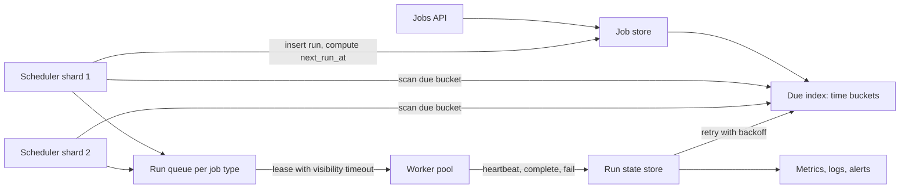

Every product eventually needs work that runs later or on a schedule: send invoices on the 1st, expire trials at midnight in the user's time zone, retry a failed webhook in 5 minutes, rebuild a search index nightly after the export finishes. A single server with crontab works until that server reboots during the billing run or you need a million per-user schedules. A distributed scheduler makes "run this at time T" reliable: it fires each job on time, exactly once from the user's point of view, survives node failures, and tells you when something did not run.

## Requirements

Functional:

- Create one-off jobs (`run_at`) and recurring jobs (cron expression plus time zone).
- Deliver each run to a worker pool by job type; workers execute arbitrary code.
- Retries with backoff, timeouts, cancellation, pause and resume.
- Dependencies: run job C after A and B succeed (a DAG).
- History per job: runs, durations, outcomes, logs.

Non-functional:

- 10 million active schedules, peak 50,000 runs fired per second (top-of-hour spikes).
- Fire within 1 second of the scheduled time at p99.
- No lost runs: every due run is executed at least once.
- Scheduler tier survives node loss with failover under 10 seconds.

## Estimates

```text
Active schedules     = 10 M
Avg runs per day     = 10 M x 4         = 40 M runs/day = about 460/s average
Top-of-hour spike    = 30 percent of hourly jobs land at :00 -> 50 K/s for a few seconds
Run record           = about 500 bytes  -> 20 GB/day history, keep 30 days = 600 GB
Due-index lookups    = one range scan per bucket per shard per second
```

Average load is small; the design is driven by spikes at round times, where humans love to schedule things. Add jitter for jobs that do not care about the exact second.

## API

```text
POST   /jobs        {type, payload, schedule: {cron, tz} | {run_at}, retry, timeout, idempotency_key}
GET    /jobs/{id}                        -> definition and next_run_at
POST   /jobs/{id}/pause | /resume | /trigger
DELETE /jobs/{id}
GET    /jobs/{id}/runs?limit=50          -> run history
Worker: POST /lease {types, max}         -> runs with lease_until
        POST /runs/{id}/heartbeat | /complete | /fail
```

`idempotency_key` on create stops a client retry from registering two schedules.

## Data model

```sql
CREATE TABLE jobs (
  id            uuid PRIMARY KEY,
  tenant_id     bigint NOT NULL,
  type          text NOT NULL,
  payload       jsonb,
  cron          text,             -- '0 9 * * MON-FRI'
  tz            text,             -- 'America/New_York'
  next_run_at   timestamptz,
  misfire       text DEFAULT 'run_once',  -- skip | run_once | run_all
  max_attempts  int DEFAULT 5,
  timeout_s     int DEFAULT 300,
  paused        bool DEFAULT false
);

CREATE TABLE runs (
  id            uuid PRIMARY KEY,
  job_id        uuid NOT NULL,
  scheduled_for timestamptz NOT NULL,
  state         text NOT NULL,   -- pending, leased, succeeded, failed, dead
  attempt       int DEFAULT 0,
  lease_until   timestamptz,
  worker_id     text,
  UNIQUE (job_id, scheduled_for)
);
CREATE INDEX ON runs (state, lease_until);
```

The unique constraint on `(job_id, scheduled_for)` is the key correctness tool: if two schedulers both try to fire the 09:00 run, only one insert wins.

## High-level design

The job store holds definitions. A due-job index orders jobs by next fire time. Scheduler shards poll their slice of the index, create run records, and push them onto a queue per job type. Workers pull, hold a lease while executing, and report back.



## Deep dive 1: finding due jobs at 50,000 per second

Polling `SELECT * FROM jobs WHERE next_run_at <= now()` across 10 million rows every second does not scale and makes every scheduler fight over the same rows.

Bucket time instead. Keep an index keyed by `(shard, minute_bucket)` holding job IDs due in that minute. In Redis this is one sorted set per shard with score = `next_run_at` epoch milliseconds; a scheduler calls `ZRANGEBYSCORE due:{shard} 0 now LIMIT 0 1000` and removes what it claims atomically with a Lua script. In Postgres, a partial index on `next_run_at` plus `SELECT ... FOR UPDATE SKIP LOCKED LIMIT 500` lets several schedulers claim disjoint batches without blocking each other. Cassandra-based designs (Netflix, Uber) use a partition per time bucket so a scan reads one partition.

Pre-load: a scheduler reads the next 60 seconds of due jobs into an in-memory timer wheel, so firing at the exact second is a local operation and the store sees one scan per bucket. For the top-of-hour spike, the queue absorbs the burst and workers drain it; firing latency is the time to enqueue, not to execute.

Sharding: hash `job_id` into, say, 1,024 logical shards and assign shards to scheduler nodes with a lease in etcd, ZooKeeper or a database table. When a node dies, its lease expires (10 seconds) and another node takes its shards. A single leader-elected scheduler is fine up to a few thousand fires per second and is how many systems start; shard when one node cannot keep up.

After firing, the scheduler computes the next occurrence from the cron expression and writes `next_run_at` in the same transaction as the run insert, so a crash cannot fire without rescheduling or reschedule without firing.

## Deep dive 2: workers, leases and at-least-once execution

Workers pull rather than receive pushes, so a slow worker never gets more than it asked for. On lease, the run goes to `leased` with `lease_until = now + 30 s`. Long jobs heartbeat every 10 seconds to extend the lease. If the worker crashes, the lease expires and a reaper (or the queue's visibility timeout in SQS) makes the run available again.

That means a job can execute twice: the worker might finish the work and die before reporting success. Exactly-once execution is impossible in general, so the contract is at-least-once delivery plus idempotent handlers:

```js
async function sendInvoice(run) {
  const key = `invoice:${run.jobId}:${run.scheduledFor}`;
  const inserted = await db.query(
    "INSERT INTO processed (key) VALUES ($1) ON CONFLICT DO NOTHING RETURNING key", [key]);
  if (inserted.rowCount === 0) return;           // already done
  await payments.charge({ ...run.payload, idempotencyKey: key });
}
```

Pass the same key to downstream APIs that support idempotency keys (Stripe and most payment providers do). Fencing tokens help when a stale worker might still be running: each lease carries an increasing number, and writes from older tokens are rejected.

Retries use exponential backoff with jitter, for example `min(2^attempt x 10 s, 1 h) x random(0.5, 1.5)`, up to `max_attempts`, then the run moves to `dead` and alerts the owner. Separate retryable failures (timeouts, 503) from permanent ones (validation error) so you do not retry a bug five times.

## Deep dive 3: cron, time zones, missed runs and DAGs

Store schedules as cron plus an IANA time zone, never as a UTC offset. "9:00 every weekday in New York" is 14:00 UTC in winter and 13:00 UTC in summer. Compute the next run in local time with a tested library (cron-parser in Node, croniter in Python) and convert to UTC. DST creates two edge cases: on spring-forward, 02:30 does not exist (run at 03:00 or skip, and document which); on fall-back, 01:30 happens twice (run once, on the first). Jobs that must run at fixed intervals regardless of wall clock should use UTC.

Missed runs happen when the system was down or a job was paused. The `misfire` policy decides:

| Policy | After 3 hours down, hourly job | Good for |
|--------|-------------------------------|---------|
| skip | Nothing; next run on schedule | Status checks, cache warming |
| run_once | One catch-up run now | Syncs, reports for latest state |
| run_all | Three runs, one per missed slot | Billing, per-period aggregation |

Cap `run_all` so a month-long pause does not unleash 700 runs at once.

Dependencies form a DAG: each run of C has edges to runs of A and B for the same logical date. When a run completes, the scheduler decrements a pending-dependency counter on its children and enqueues any that reach zero. Reject cycles at definition time with a topological sort. Once DAGs, conditional branches and long human waits appear, you are building a workflow engine; adopt one rather than growing your own.

## Build or adopt

| Option | Best for | Notes |
|--------|----------|-------|
| Kubernetes CronJob | Batch containers on a cluster | `concurrencyPolicy`, `startingDeadlineSeconds`, `timeZone` field; one pod per run, not for millions of schedules |
| EventBridge Scheduler + SQS/Lambda | AWS, many one-off and recurring schedules | Millions of schedules, time zones, flexible windows, at-least-once |
| BullMQ repeatable jobs (Redis) | Node.js apps | Cron and delays in Redis, retries, rate limits; Redis durability matters |
| Temporal | Durable multi-step workflows, long waits | Schedules, retries, timers and state as code; strong history |
| Apache Airflow | Data pipelines with DAGs | Rich DAG UI, backfill; not for per-user schedules or low latency |

For a SaaS product, the common path is BullMQ or EventBridge for per-entity timers, Temporal for business workflows, and Airflow or Dagster for data.

## Scaling and bottlenecks

- **Thundering herd at :00**: spread non-critical jobs with deterministic jitter (hash of job ID modulo 300 seconds).
- **Hot tenants**: one tenant scheduling 1 million jobs at midnight starves others. Use per-tenant concurrency limits and fair queues.
- **Run history growth**: partition `runs` by day and drop old partitions instead of deleting rows.
- **Queue backlog**: autoscale workers on queue depth and oldest-message age, not CPU.

## Failure modes

| Failure | Effect | Mitigation |
|---------|--------|-----------|
| Scheduler node dies | Its shards stop firing | Shard leases expire, others take over in seconds |
| Two schedulers think they own a shard | Double fire | Unique `(job_id, scheduled_for)` plus fencing tokens |
| Worker crashes mid-run | Run stuck in leased | Lease expiry re-queues; idempotent handler |
| Poison job | Retries forever, blocks capacity | Max attempts, dead-letter state, alert |
| Clock skew between nodes | Early or late firing | Synchronised clocks; claim by store time, not local time |
| Job store down | Nothing fires | Replicated store; catch-up policy on recovery |

## Observability per job

Owners need to know when their job did not run, which is harder to notice than a failure. Track per job: last success time, next expected run, duration p50/p95, attempts, and outcome. Alert on "no success within expected interval plus grace" (a dead man's switch), on dead-lettered runs, and on scheduling lag, the gap between `scheduled_for` and actual start. Platform-wide, chart due-index depth, fire lag p99, queue age and lease expiries. Attach a trace ID to each run so logs from the worker link back to the schedule.

## Trade-offs and pitfalls

- **Promising exactly-once** sets a trap; promise at-least-once and make handlers idempotent.
- **Storing UTC offsets** instead of time zones breaks twice a year.
- **Pushing to workers** overloads slow ones; pull with leases.
- **Leases shorter than job duration** without heartbeats cause duplicate runs.
- **Building a workflow engine by accident**: once you add DAGs, signals and compensation, use Temporal or similar.

## Interview angle

- Separate the definition (job) from the occurrence (run); it clarifies everything else.
- Explain how you find due work cheaply: time buckets, sorted sets, or `SKIP LOCKED`.
- Show how sharding plus a unique constraint prevents double firing.
- State at-least-once plus idempotency explicitly, with lease and heartbeat details.
- Mention DST and misfire policy; few candidates do.

## Key takeaways

- Index jobs by next fire time in buckets so schedulers scan only what is due.
- Shard schedulers with leases; a unique key on (job, scheduled time) stops double fires.
- Workers pull with leases and heartbeats; execution is at-least-once, so handlers must be idempotent.
- Store cron with an IANA time zone and decide DST and missed-run behaviour explicitly.
- Alert on runs that did not happen, not only on runs that failed.
