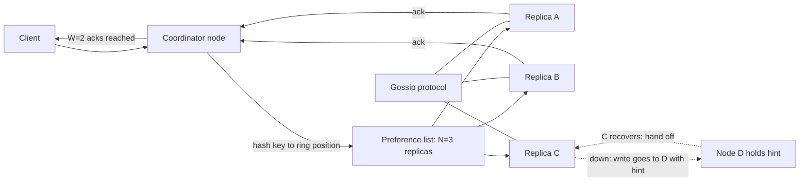

A distributed key-value store is the building block under shopping carts, session stores, feature flags and user profiles at companies that cannot afford a single database primary. Amazon's 2007 Dynamo paper defined the shape that Cassandra, Riak and ScyllaDB still follow. The design problem is to spread data across hundreds of machines, keep several copies, stay writable when nodes and links fail, and reconcile the copies afterwards. Every choice is a trade between consistency, availability and latency, and the system lets each application tune that trade per request.

## Requirements

Functional:

- `put(key, value)`, `get(key)`, `delete(key)` with values up to 1 MB (typical 1 KB).
- Optional conditional writes (compare-and-set on a version).
- Tunable consistency per request.

Non-functional:

- p99 latency under 10 ms for reads and writes within a region.
- 99.99 percent availability for writes, including during node failures and network partitions.
- Horizontal scale: add nodes without downtime and with minimal data movement.
- Durability: no acknowledged write lost if one node dies.

## Estimates

```text
Keys            = 10 B, avg value 1 KB      -> 10 TB raw
Replication     = 3                          -> 30 TB stored
Per node        = 2 TB usable NVMe           -> about 15-20 nodes, run 30 for headroom
Traffic         = 500 K reads/s, 100 K writes/s peak
Per node        = about 17 K reads/s, 10 K replica writes/s (each write hits 3 nodes)
```

A single modern node with an LSM engine handles 50,000 or more small writes per second, so the cluster is sized by storage and failure headroom rather than throughput. Keep each node under about 60 percent disk to leave room for compaction, which temporarily needs extra space.

## API

```text
GET    /kv/{key}?consistency=quorum        -> 200 {value, context}
PUT    /kv/{key}  body {value, context}     -> 204
DELETE /kv/{key}  body {context}            -> 204
```

`context` is an opaque version token (a vector clock or timestamp). Clients send back the context they read so the store can tell whether a write supersedes what they saw or races with something else.

## Data model

To the store, a key is a byte string and a value is an opaque blob plus metadata:

```text
key        bytes  (hashed to place it on the ring)
value      bytes
version    vector clock or (timestamp, node_id)
tombstone  bool   (deletes are writes of a marker)
ttl        optional expiry
```

Deletes cannot simply remove data: a replica that missed the delete would resurrect the key during repair. A tombstone records the delete and is purged only after a grace period (Cassandra's default `gc_grace_seconds` is 10 days) longer than the longest expected outage.

## High-level design

There is no master. Every node runs the same code, owns a slice of the keyspace, and can coordinate any request. A client (or a smart client library) sends a request to any node, which becomes the coordinator, hashes the key, finds the N replicas responsible, and fans out.



## Partitioning with consistent hashing

Hash each key (MD5 in Dynamo, Murmur3 in Cassandra) onto a ring of 2^64 positions. Each node owns the arc between its token and its predecessor's. Adding a node only moves keys from its neighbours, roughly 1/N of the data, instead of reshuffling everything as `hash(key) mod N` would.

With one token per node, arcs are uneven and a new node only relieves one neighbour. Virtual nodes fix this: each physical node takes many tokens scattered around the ring. Cassandra historically used 256, and since 4.0 defaults to 16 with a smarter token allocator. With vnodes, a joining node streams small ranges from many peers in parallel, and a dead node's load spreads across the whole cluster instead of doubling on one neighbour.

## Replication and preference lists

For a key, walk clockwise from its hash and take the first N distinct physical nodes. That ordered list is the preference list. Skip vnodes that belong to a node already chosen, and with rack or availability-zone awareness, skip nodes in an already-used zone so that N=3 means three zones. Any node can compute the preference list because ring membership is shared through gossip.

## Deep dive 1: quorums, sloppy quorums and hinted handoff

The coordinator writes to all N replicas and acknowledges after W respond; a read queries replicas and returns after R respond. If R + W > N, the read set and write set overlap in at least one replica, so a read sees the latest acknowledged write (barring concurrent writes and sloppy quorum, below).

| Setting (N=3) | Behaviour | Use for |
|---------------|-----------|---------|
| W=1, R=1 | Fastest, may read stale data | Caches, metrics, carts with merge |
| W=2, R=2 | Overlapping quorums, survives one node down | Default for most data |
| W=3, R=1 | Fast reads, writes fail if any replica down | Read-heavy, rarely written config |
| W=1, R=3 | Fast writes, slow reads | Rare; write-heavy logs |

Latency follows the slowest of the fastest W or R replicas, so quorum p99 is better than waiting for all three.

Strict quorums lose availability when two of the three preferred replicas are unreachable. Dynamo uses a sloppy quorum: the coordinator writes to the first N healthy nodes it finds walking the ring, even if they are not the key's home replicas. A node standing in stores the write with a hint naming the intended owner and replays it when gossip reports the owner back. This keeps writes available during partitions, at the price that R + W > N no longer guarantees overlap, because the W acks may have landed on substitutes. Hints are kept for a bounded window (Cassandra defaults to 3 hours); longer outages need full repair.

## Deep dive 2: conflicts with vector clocks or last-write-wins

Concurrent writes to different replicas are normal under sloppy quorums. The store must detect them and decide.

Last-write-wins (LWW) attaches a timestamp and keeps the highest. It is simple and what Cassandra does per column, but it silently drops one of two concurrent writes and depends on clocks; a node with a fast clock wins every race. Run NTP or better (chrony, cloud time sync with bounded error) and accept that LWW is lossy.

Vector clocks attach a list of (node, counter) pairs. Each coordinator increments its own counter on write. Version A descends from B if every counter in A is at least B's; otherwise they are concurrent siblings.

```text
Write via node X:          [X:1]
Update via X:              [X:2]
Concurrent update via Y
  from a client that read [X:1]:  [X:1, Y:1]
[X:2] vs [X:1, Y:1] -> neither descends -> return both siblings
Client merges, writes back with context [X:2, Y:1] -> resolved
```

Siblings push resolution to the application, which suits data with a natural merge (union of cart items, max of counters). Clocks grow with the number of coordinators, so implementations truncate old entries. Most teams choose LWW for simplicity unless they have a real merge function.

## Deep dive 3: storage engine (LSM tree)

Each node needs fast writes on SSD. A log-structured merge tree delivers them:

1. Append the write to a write-ahead log (WAL) and fsync (or group-commit every few milliseconds).
2. Insert into the memtable, an in-memory sorted structure (skip list).
3. When the memtable reaches about 64 to 256 MB, flush it as an immutable sorted file, an SSTable, and truncate the WAL.
4. Reads check the memtable, then SSTables newest to oldest. A bloom filter per SSTable (about 10 bits per key for a 1 percent false-positive rate) skips files that cannot hold the key, and a sparse index jumps to the right block.
5. Compaction merges SSTables in the background, discarding overwritten values and expired tombstones.

| Compaction | Write amplification | Read amplification | Space overhead | Fit |
|------------|--------------------|--------------------|----------------|-----|
| Size-tiered | Low | Higher (many overlapping files) | Up to 2x during compaction | Write-heavy |
| Leveled | Higher (10x or more) | Low (one file per level) | About 10 percent | Read-heavy, updates |
| Time-window | Low | Low for time queries | Low | TTL time series |

RocksDB is the usual engine choice if you are building rather than adopting; it implements all of the above.

## Membership, failure detection and anti-entropy

Nodes gossip every second with a few random peers, exchanging membership lists with heartbeat counters. State converges across thousands of nodes in O(log n) rounds. Failure detection uses a phi accrual detector, which outputs a suspicion level based on heartbeat inter-arrival history instead of a fixed timeout; Cassandra marks a node down at phi 8 by default. Down is a local, temporary view used for routing. Permanent removal is an explicit operator action, so flapping never triggers a mass reshuffle.

Hinted handoff and read repair fix recent divergence. Read repair: when a quorum read sees replicas disagree, the coordinator returns the newest value and writes it back to stale replicas. For everything else there is anti-entropy. Each replica builds a Merkle tree per token range, a hash tree where leaves hash key buckets and parents hash children. Two replicas compare roots; if equal, the range matches. If not, they descend only into differing subtrees, so syncing 2 TB with a handful of differences transfers kilobytes of hashes plus the actual differences. Run full repair on every range more often than the tombstone grace period, or deleted data can come back.

## Scaling and bottlenecks

- **Hot keys**: one celebrity key overloads its three replicas regardless of cluster size. Cache it in front, or split it (`key#0`..`key#9`) and fan in on read.
- **Adding capacity**: bootstrap streams data at a throttled rate; adding a node to a 30-node cluster moves about 3 percent of data.
- **Compaction debt**: if writes outpace compaction, SSTable counts and read latency climb. Monitor pending compactions and throttle clients before the disk fills.
- **Cross-region**: run a ring per region with async replication between them, and use `LOCAL_QUORUM` to keep latency regional.

## Failure modes

| Failure | Effect | Mitigation |
|---------|--------|-----------|
| One node down | Quorum still met with N=3, W=2 | Hints, then repair |
| Zone outage | One replica per key lost | Zone-aware placement |
| Network partition | Both sides accept writes (sloppy) | Vector clocks or LWW reconcile |
| Disk corruption | Bad SSTable | Checksums per block, rebuild from replicas |
| Clock skew | LWW picks wrong winner | Tight time sync, vector clocks for critical data |
| Missed repair beyond grace | Deleted data resurrects | Schedule repair, alert on staleness |

## Trade-offs and pitfalls

- **R + W > N is not linearizability.** Concurrent writes, sloppy quorums and failed partial writes still create anomalies. If you need compare-and-set correctness, use a consensus protocol per key range (Cassandra's Paxos-based lightweight transactions, or Raft groups as in TiKV and CockroachDB) and pay the extra round trips.
- **LWW loses writes** silently under concurrency.
- **Tombstone build-up** makes reads scan thousands of markers; avoid queue-like delete patterns.
- **Leaderless is not free**: Raft-based stores (etcd, TiKV) give stronger semantics with a leader per range and fail over in seconds. Pick leaderless when write availability during partitions matters more than strict consistency.

## Interview angle

- Start from the CAP choice: an AP store that tunes toward C with quorums.
- Draw the ring with vnodes and the preference list before discussing replication.
- Explain why R + W > N gives overlap and where sloppy quorum breaks it.
- Compare vector clocks and LWW with a concrete example.
- Walk the LSM write and read paths; mention bloom filters and compaction trade-offs.
- Close with repair: hints, read repair, Merkle trees, and tombstone grace.

## Key takeaways

- Consistent hashing with vnodes spreads data evenly and makes scaling move only about 1/N of keys.
- N replicas, with per-request R and W, let each use case pick its latency and consistency point.
- Sloppy quorum and hinted handoff keep writes available at the cost of guaranteed overlap.
- Conflicts are resolved by LWW (simple, lossy) or vector clocks (correct, pushes merge to clients).
- An LSM tree turns random writes into sequential I/O; compaction strategy is the main tuning knob.
- Gossip, read repair and Merkle-tree anti-entropy keep replicas converging without a coordinator.
